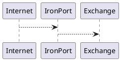

# Coubiac

Sources du blog [coubiac.github.io](https://coubiac.github.io).

Le site est généré automatiquement par GitHub Pages à partir de la branche `main`.

## Ajouter un article

Les articles sont des fichiers Markdown placés dans `_posts` et nommés selon le format `AAAA-MM-JJ-titre.md`.

Chaque article commence par un en-tête YAML. Utiliser **un seul type principal** et plusieurs tags si le sujet est transversal :

```yaml
---
layout: post
title: "Titre de l'article"
description: "Résumé affiché sur la page d'accueil."
article_type: tutoriel
tags:
  - Exchange
  - PowerShell
  - DAG
---
```

Types admis pour `article_type` :

- `comprendre` : expliquer un mécanisme ou une architecture ;
- `tutoriel` : procédure reproductible pas à pas ;
- `script` : outil ou automatisation commenté.

Tags technologiques à privilégier : `Exchange` (pas `Exchange Server`), `PowerShell`, `HPE`, `Cisco IronPort`, `SMTP`, `Sécurité`, `API`. Des tags spécialisés (`DAG`, `Redfish`, `Active Directory`, etc.) peuvent être ajoutés. Un article peut porter plusieurs tags : les filtres de l'accueil s'additionnent.

Ajouter `featured: true` dans l'en-tête d'un article pour le mettre à la une (éviter de marquer plusieurs articles à la fois). L'accueil affiche ensuite les six articles récents hors article vedette. Les autres restent accessibles via `Voir tous les articles` et la recherche. Les articles avec `published: false` ne sont pas indexés ni affichés.

## Ajouter un schéma PlantUML

Les sources PlantUML sont placées dans `assets/diagrams` avec l'extension `.puml`.

Exemple :



À chaque modification d'un fichier `.puml` sur la branche `main`, le workflow `.github/workflows/plantuml.yml` génère automatiquement le fichier SVG correspondant dans le même répertoire.

Ainsi :

```text
assets/diagrams/mail-flow.puml
        |
        +--> assets/diagrams/mail-flow.svg
```

Le SVG peut ensuite être inséré dans un article Markdown :

```markdown

```

Le fichier `.puml` reste la source à modifier. Le SVG généré ne doit normalement pas être édité à la main.
