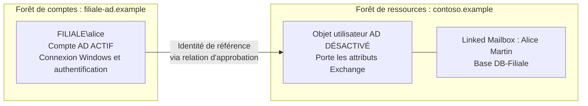
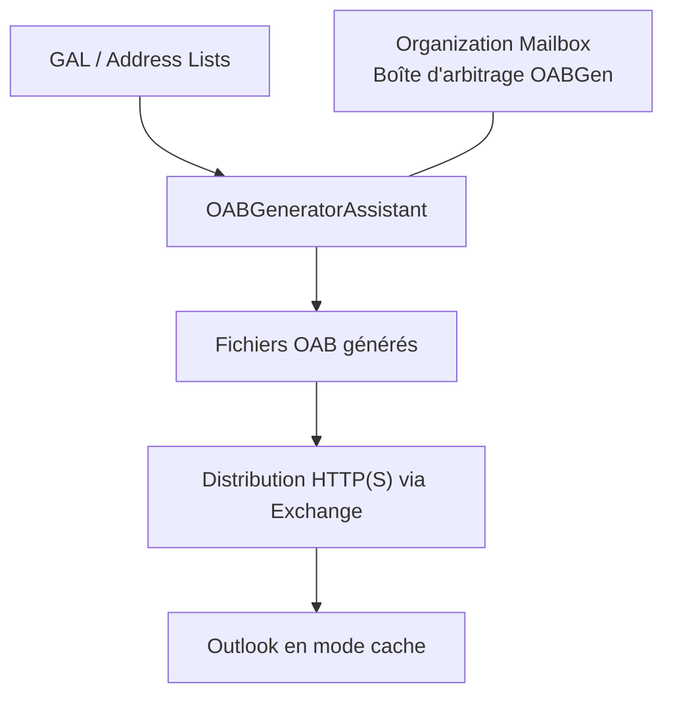
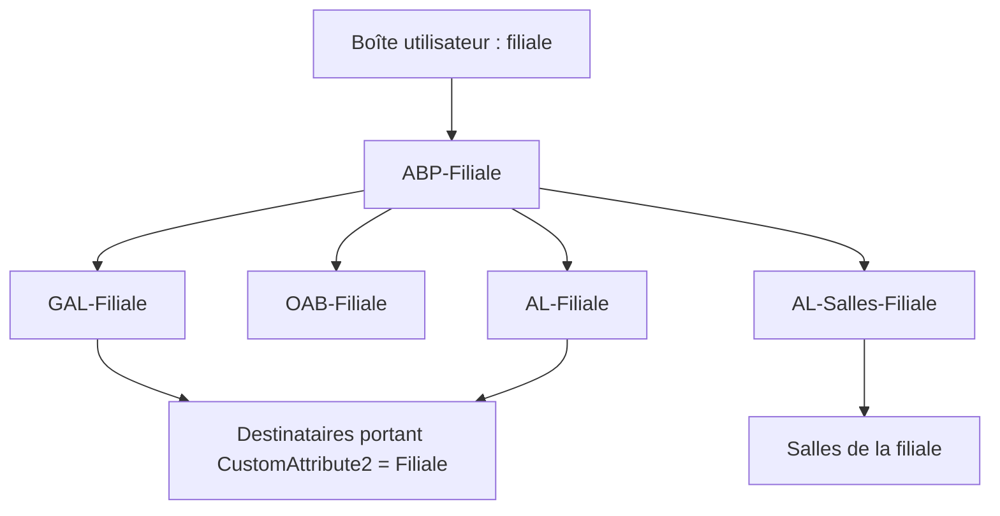
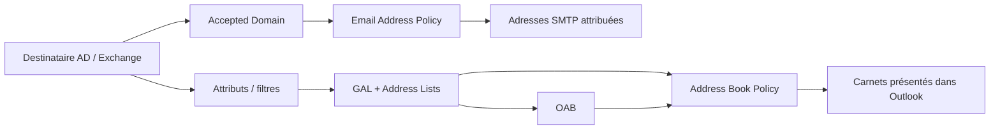

Une organisation Exchange ne se résume pas à des boîtes aux lettres et à un flux SMTP. Elle gère aussi les groupes de distribution, les ressources de calendrier, les dossiers publics, l'attribution des adresses électroniques et la présentation des carnets d'adresses aux utilisateurs.

Ces fonctions sont liées, mais répondent à des besoins différents. Une stratégie d'adresses SMTP détermine **à quelles adresses un destinataire reçoit ses messages** ; une politique de carnet d'adresses détermine **quels destinataires un utilisateur voit dans son annuaire**. Une boîte partagée ne fonctionne pas comme un groupe de distribution, et une liste de salles n'est pas nécessairement un groupe de salles utilisé par Room Finder.

Prenons un cas classique : une organisation Exchange accueille une nouvelle filiale, qui conserve son propre domaine SMTP et doit disposer de ses utilisateurs, de ses groupes, de ses ressources et d'un carnet d'adresses distinct. Les exemples utilisent des noms fictifs : `contoso.example` pour le domaine AD et `filiale.example` pour le domaine SMTP. Ils concernent **Exchange Server on-premises** (Exchange 2016/2019 et Subscription Edition), et non Exchange Online, dont certaines cmdlets et certains mécanismes diffèrent.

## 1. Ne pas confondre objet Active Directory et destinataire Exchange

Les destinataires Exchange reposent sur des objets Active Directory, mais tous les objets AD ne sont pas automatiquement des destinataires de messagerie.

| Objet | Particularité | Usage |
|---|---|---|
| Utilisateur AD | Compte permettant l'authentification | Identité et accès |
| User mailbox | Utilisateur AD associé à une boîte Exchange | Messagerie personnelle |
| Shared mailbox | Boîte accessible à plusieurs utilisateurs autorisés | Adresse fonctionnelle |
| Room mailbox | Boîte de ressource disposant d'un calendrier | Réservation de salle |
| Equipment mailbox | Boîte de ressource pour du matériel | Réservation d'équipement |
| Distribution group | Liste de membres recevant le même message | Diffusion |
| Dynamic distribution group | Ensemble de destinataires déterminé par un filtre | Diffusion fondée sur des attributs |
| Mail contact | Contact AD à adresse externe, sans compte de connexion | Correspondant externe visible dans la GAL |
| Mail user | Utilisateur AD ayant une adresse de destination externe, sans boîte locale | Consultant ou utilisateur hébergé ailleurs |
| Linked mailbox | Boîte dans une forêt Exchange liée à un compte actif d’une autre forêt approuvée | Forêt de ressources / forêts de comptes |
| Remote mailbox | Objet utilisateur local représentant une boîte dans Exchange Online | Organisation Exchange hybride |

La propriété `RecipientTypeDetails` est souvent la plus utile pour identifier précisément la nature d'un destinataire :

```powershell
Get-Recipient -ResultSize Unlimited |
    Group-Object RecipientTypeDetails |
    Sort-Object Count -Descending |
    Select-Object Name, Count
```

Pour inspecter un objet particulier :

```powershell
Get-Recipient "alice@contoso.example" |
    Format-List Name,RecipientType,RecipientTypeDetails,PrimarySmtpAddress
```

### Mail Contact, Mail User et Remote Mailbox : trois objets à ne pas confondre

Deux correspondants peuvent apparaître de la même manière dans Outlook tout en correspondant à des objets Exchange très différents.

- Un **Mail Contact** est un contact dans l'AD, **sans compte d'ouverture de session**. Exemple : un prestataire extérieur que l'on veut retrouver dans la GAL. Le courrier envoyé au contact est acheminé à sa véritable adresse externe.
- Un **Mail User** est un **compte utilisateur AD**, avec SID et possibilité de se connecter aux ressources autorisées, mais **sans boîte Exchange locale**. Ses messages sont acheminés à une adresse externe. Exemple : un consultant qui se connecte à une application interne, mais lit ses e-mails chez son employeur.
- Une **Remote Mailbox** est un cas particulier des environnements **hybrides** : l'identité Exchange est gérée côté AD local, tandis que la boîte se trouve dans **Exchange Online**. Ce n'est pas une boîte liée entre deux forêts AD.

```powershell
# Correspondant externe sans compte d'authentification
New-MailContact -Name "Prestataire Dupont" `
    -ExternalEmailAddress "dupont@partenaire.example"

# Le compte AD consultantAD existe déjà : on lui associe une adresse externe
Enable-MailUser -Identity "consultantAD" `
    -ExternalEmailAddress "consultant@partenaire.example"

Get-MailContact "Prestataire Dupont" |
    Format-List Name,ExternalEmailAddress

Get-MailUser "consultantAD" |
    Format-List Name,ExternalEmailAddress,PrimarySmtpAddress
```

Pour les Mail Contacts et Mail Users, la propriété Exchange `ExternalEmailAddress` décrit l'adresse vers laquelle remettre les messages ; dans l'AD, cette destination est notamment représentée par `targetAddress`. Cette adresse de routage ne doit pas être confondue avec l'adresse SMTP présentée dans la GAL.

### Linked Mailbox : une boîte Exchange, deux forêts Active Directory

Le terme *Linked Mailbox* peut prêter à confusion : **il ne désigne ni une boîte partagée, ni une copie de boîte, ni une synchronisation de messages**. Il s'agit d'une **boîte aux lettres normale hébergée par Exchange, mais utilisée par un compte d'authentification situé dans une autre forêt AD**.

#### Exemple : une entreprise et sa filiale

Imaginons deux forêts Active Directory **distinctes** :

1. **`filiale-ad.example`**, la **forêt de comptes** : Alice possède le compte `FILIALE\alice`. Elle ouvre sa session Windows dans cette forêt et y utilise son mot de passe.
2. **`contoso.example`**, la **forêt de ressources** : c'est ici que se trouvent l'organisation Exchange, les serveurs et les bases de boîtes aux lettres.

L'entreprise veut centraliser ses boîtes Exchange dans `contoso.example` **sans obliger Alice à abandonner son compte AD de filiale**.



**Pourquoi créer un compte désactivé dans la forêt Exchange ?** Parce qu'une boîte Exchange on-premises est associée à un objet utilisateur AD dans la forêt où Exchange est installé. Cet objet porte notamment les attributs de messagerie et représente la boîte dans l'annuaire Exchange. Mais Alice **ne doit pas se connecter avec ce deuxième compte** : on le laisse donc désactivé. Le compte `FILIALE\alice`, lui, reste actif.

Le lien entre les identités repose notamment sur l'attribut AD **`msExchMasterAccountSid`** du compte associé à la boîte dans la forêt Exchange : il permet à Exchange d'identifier le compte principal d'une forêt approuvée. Ce n'est donc pas une seconde authentification avec un compte AD désactivé.

| Élément | Forêt de comptes | Forêt Exchange (ressources) |
|---|---|---|
| Compte d'Alice | **Actif** | **Désactivé** |
| Mot de passe et ouverture de session | Gérés ici | Pas de connexion avec le compte désactivé |
| Serveur Exchange et données de boîte | Pas nécessaires | **Hébergés ici** |
| Identité d'accès à la boîte | `FILIALE\alice` | Liée à ce compte via `LinkedMasterAccount` |

**Le sens de l'approbation est capital** : au minimum, **la forêt Exchange (ressources) approuve la forêt de comptes**. En termes AD, il s'agit d'une approbation **sortante à sens unique depuis la forêt Exchange**. Ce n'est pas forcément une confiance bidirectionnelle. Il faut aussi que le compte d'Alice existe *avant* la création de sa Linked Mailbox.

#### Création en Exchange Management Shell

La commande suivante s'exécute dans l'EMS de la **forêt de ressources**. On suppose la relation d'approbation opérationnelle, le compte `FILIALE\alice` existant et la base `DB-Filiale` disponible.

```powershell
# Identifiants permettant d'interroger la forêt de comptes
$cred = Get-Credential "FILIALE\administrateur"

New-Mailbox -Name "Alice Martin" `
    -Alias "alice.martin" `
    -Database "DB-Filiale" `
    -LinkedMasterAccount "FILIALE\alice" `
    -LinkedDomainController "dc1.filiale-ad.example" `
    -LinkedCredential $cred
```

Comprenons chaque paramètre :

- `Name` et `Alias` identifient le nouvel objet et sa boîte dans **la forêt Exchange**.
- `Database` indique où seront **stockés les messages**.
- `LinkedMasterAccount` désigne le **compte AD actif de la forêt de comptes** qui doit pouvoir ouvrir cette boîte.
- `LinkedDomainController` désigne un contrôleur de domaine **de la forêt de comptes**, utilisé pour résoudre ce compte.
- `LinkedCredential` fournit, si nécessaire, les identifiants permettant d'interroger cette forêt lors de l'opération d'administration. **Ce ne sont pas les identifiants qu'Alice saisira dans Outlook**.

Avec une approbation **à sens unique**, les identifiants d'un administrateur de la forêt de comptes sont normalement nécessaires pour cette opération. Une relation bidirectionnelle peut rendre leur fourniture inutile dans certains contextes de délégation. Cette étape concerne la **création** de la boîte, pas la connexion quotidienne de l'utilisateur.

On vérifie ensuite :

```powershell
Get-Mailbox "Alice Martin" |
    Format-List Name,RecipientTypeDetails,IsLinked,LinkedMasterAccount,Database

# Inventaire de toutes les boîtes liées de l'organisation
Get-Mailbox -ResultSize Unlimited `
    -Filter "RecipientTypeDetails -eq 'LinkedMailbox'" |
    Format-Table Name,LinkedMasterAccount,Database
```

Le type attendu est `LinkedMailbox` et `LinkedMasterAccount` doit correspondre à `FILIALE\alice`.

#### Et lorsqu'Alice ouvre Outlook ?

1. Alice ouvre sa session avec **`FILIALE\alice`**, son compte habituel.
2. Grâce aux relations d'approbation et à la configuration de l'accès client Exchange, son identité est reconnue.
3. Exchange rattache cette identité à la **Linked Mailbox** dans `contoso.example`.
4. Les messages et le calendrier sont consultés **dans la base Exchange de la forêt de ressources**. Il n'existe pas une deuxième boîte qui se synchronise depuis la filiale.

La relation d'approbation n'assure pas, à elle seule, toute la configuration d'Outlook, des URL, des certificats et de la connectivité. Ces points doivent également être prévus.

#### Les confusions les plus fréquentes

| Situation | Linked Mailbox ? | Pourquoi ? |
|---|---|---|
| Alice a son compte AD **et sa boîte** dans la même forêt | **Non** | `UserMailbox` classique |
| Plusieurs utilisateurs ouvrent `commercial@filiale.example` | **Non** | `SharedMailbox` et délégations |
| Alice conserve son compte dans une forêt A et sa boîte est centralisée dans une forêt Exchange B approuvant A | **Oui** | C'est le cas d'usage d'une `LinkedMailbox` |
| Alice possède un objet local, mais sa boîte est sur Microsoft 365 | **Non** | `RemoteMailbox` d'un déploiement hybride |
| On fusionne deux entreprises et on déplace leurs messages | **Pas à lui seul** | Une Linked Mailbox **ne déplace pas** les données : la migration est un autre processus |

Une **Linked Mailbox ne nécessite pas deux organisations Exchange**. C'est souvent au contraire une manière de **centraliser** la messagerie dans une seule organisation tout en conservant plusieurs forêts d'identités.

**À retenir :** *compte actif dans la forêt de comptes ; objet désactivé et boîte dans la forêt Exchange ; relation d'approbation ; lien d'identité ; une seule boîte à lettres*.

Pour comparer cette architecture aux autres options après un rachat d'entreprise (coexistence de deux Exchange, domaine SMTP partagé, déplacement inter-forêts et fusion complète), voir [Exchange Server : intégrer la messagerie après le rachat d'une entreprise](/articles/exchange-fusion-acquisition-coexistence-migration-linked-mailboxes/).

### Activer une boîte pour un compte existant

La cmdlet `Enable-Mailbox` associe une boîte Exchange à un utilisateur AD existant. Elle ne crée pas le compte utilisateur :

```powershell
Enable-Mailbox -Identity "alice" -Database "DB-Filiale"
```

Pour une création simultanée du compte et de la boîte, on utilise plutôt `New-Mailbox`.

Une base de boîtes aux lettres peut être créée puis montée :

```powershell
New-MailboxDatabase -Name "DB-Filiale" -Server "EX01"
Mount-Database -Identity "DB-Filiale"
```

La création d'une base implique également des choix de volumes, de chemins pour le fichier `.edb` et les journaux, de sauvegarde et de haute disponibilité. Dans un environnement DAG, on prépare les copies de base et leur placement indépendamment de l'organisation logique des filiales.

Certaines procédures de création de base demandent un redémarrage du service Information Store pour prendre en compte la nouvelle configuration. **`Restart-Service MSExchangeIS` n'est pas une opération anodine en production** : elle interrompt les bases actives hébergées par le serveur. Elle ne doit pas être copiée aveuglément dans un script d'approvisionnement.

Pour vérifier :

```powershell
Get-MailboxDatabase -Status |
    Format-Table Name,Server,Mounted

Get-Mailbox -Database "DB-Filiale" -ResultSize Unlimited |
    Format-Table Name,RecipientTypeDetails
```

La base Exchange héberge les données. L'OU AD facilite l'administration des objets. Les adresses SMTP et les carnets d'adresses sont encore deux couches distinctes. **Une base par filiale n'est pas une obligation technique pour segmenter les utilisateurs.**

### Désactiver une boîte n'est pas supprimer son utilisateur

Deux opérations sont souvent confondues. Pour une boîte utilisateur locale classique :

| Cmdlet | Effet sur la boîte | Effet sur le compte AD |
|---|---|---|
| `Disable-Mailbox` | La déconnecte du compte ; elle reste récupérable selon la rétention applicable | **Compte conservé** |
| `Remove-Mailbox` | La supprime / déconnecte dans le cadre du cycle de suppression | **Compte utilisateur associé supprimé**, dans le cas usuel |

```powershell
# Vérifier l'objet avant toute action
Get-Mailbox "alice" | Format-List Name,Database,RecipientTypeDetails

# Exemple : déconnecter une boîte utilisateur SANS supprimer son compte AD
Disable-Mailbox -Identity "alice"
```

Les cas spéciaux (boîtes partagées, d'arbitrage, de ressources, migrations, boîtes déconnectées) demandent des vérifications supplémentaires. Ne pas utiliser `Remove-Mailbox` comme synonyme de suppression d'une simple adresse SMTP.

## 2. Boîte partagée : distinguer accès et identité d'envoi

Une boîte partagée répond au besoin d'une adresse fonctionnelle, par exemple `commercial@filiale.example`. Plusieurs personnes consultent les mêmes messages et peuvent, si elles en ont le droit, répondre avec cette identité.

```powershell
New-Mailbox -Shared `
    -Name "Commercial Filiale" `
    -Alias "CommercialFiliale" `
    -Database "DB-Filiale"
```

Trois permissions sont à distinguer :

| Permission | Effet |
|---|---|
| `FullAccess` | Ouvrir la boîte et manipuler son contenu |
| `Send As` | Envoyer comme si le message provenait de la boîte partagée |
| `Send on Behalf` | Envoyer explicitement « de la part de » cette boîte |

`FullAccess` **ne donne pas** automatiquement `Send As`.

Exemple d'attribution des droits à un utilisateur :

```powershell
Add-MailboxPermission `
    -Identity "Commercial Filiale" `
    -User "alice" `
    -AccessRights FullAccess `
    -InheritanceType All

Add-ADPermission `
    -Identity "Commercial Filiale" `
    -User "alice" `
    -ExtendedRights "Send As"
```

Sur Exchange on-premises, `Add-ADPermission` reste notamment employée pour `Send As`. En revanche, les droits d'administration Exchange relèvent du modèle RBAC, qu'il ne faut pas confondre avec les ACL accordées sur un destinataire.

Le mappage automatique dans Outlook est également distinct des droits : il fonctionne avec certaines délégations directes à des utilisateurs, mais pas avec une simple attribution de `FullAccess` à un groupe.

### Délégation d'envoi : également sur une boîte utilisateur

Le droit **Send on Behalf** s'accorde notamment sur une boîte utilisateur ; la configuration est stockée dans sa propriété `GrantSendOnBehalfTo`.

```powershell
# Ajouter Alice comme déléguée à la boîte "direction",
# en préservant les éventuels délégués existants
Set-Mailbox "direction" -GrantSendOnBehalfTo @{Add="alice"}

Get-Mailbox "direction" | Format-List GrantSendOnBehalfTo
```

Si un utilisateur possède à la fois `Send As` et `Send on Behalf` pour la même identité, **Send As** prend le dessus. Ces droits ne sont pas des permissions de lecture.

### Partage du calendrier : droits de dossier, pas droits de boîte entière

Le manuel distingue aussi les **permissions sur le dossier Calendrier**. On peut autoriser Bob à consulter le calendrier d'Alice **sans lui accorder `FullAccess` sur toute sa boîte**.

| Rôle | Ce que Bob peut faire |
|---|---|
| `AvailabilityOnly` | Voir seulement libre / occupé |
| `LimitedDetails` | Voir libre / occupé, objet et emplacement |
| `Reviewer` | Lire les éléments du dossier |
| `Editor` | Lire et modifier les éléments |
| `Owner` | Administrer le dossier et ses droits |

```powershell
# Le nom du dossier dépend de la langue de la boîte : Calendar ou Calendrier
Get-MailboxFolderPermission -Identity "alice:\Calendar"

# Autoriser Bob à voir les éléments du calendrier
Add-MailboxFolderPermission `
    -Identity "alice:\Calendar" `
    -User "bob" `
    -AccessRights Reviewer

# Modifier une autorisation déjà existante
Set-MailboxFolderPermission `
    -Identity "alice:\Calendar" `
    -User "bob" `
    -AccessRights LimitedDetails
```

**`Add-MailboxFolderPermission` ajoute** une entrée qui n'existe pas encore ; **`Set-MailboxFolderPermission` modifie** une entrée existante. Une délégation de traitement des invitations de réunion ne se réduit pas à donner `Reviewer` ou `Editor` : elle implique des réglages supplémentaires. Ne pas confondre non plus ces droits avec la politique de réservation d'une **Room Mailbox**.

## 3. Groupes de distribution : membres fixes ou calculés

### Groupe de distribution classique

Un groupe classique possède une liste explicite de membres. C'est adapté à une équipe dont les membres sont gérés administrativement :

```powershell
New-DistributionGroup `
    -Name "DG-Filiale-Managers" `
    -Alias "DGFilialeManagers" `
    -Type Distribution

Add-DistributionGroupMember `
    -Identity "DG-Filiale-Managers" `
    -Member "alice"

Get-DistributionGroupMember "DG-Filiale-Managers"
```

La commande `Enable-DistributionGroup` permet aussi d'activer pour la messagerie certains groupes universels AD existants. Il faut distinguer les groupes de distribution et les groupes de sécurité à extension messagerie : seuls les seconds peuvent également servir à attribuer des permissions.

Un groupe peut imposer des règles d'adhésion :

- `Open` : adhésion libre ;
- `Closed` : l'adhésion est gérée par les propriétaires ;
- `ApprovalRequired` : le propriétaire approuve ou refuse la demande.

Les possibilités de quitter un groupe se configurent séparément. Elles ne sont pas des règles d'autorisation d'envoi : les restrictions sur les expéditeurs constituent un autre ensemble de paramètres.

Il ne faut pas non plus confondre **approbation d'une demande d'adhésion** et **modération des messages**. Dans le premier cas, un propriétaire décide qui peut rejoindre le groupe. Dans le second, un modérateur approuve ou refuse un e-mail *avant sa distribution*. Exchange utilise alors une boîte d'arbitrage pour conserver le message en attente, comme nous le verrons avec les boîtes système.

```powershell
Get-DistributionGroup "DG-Filiale-Managers" |
    Format-List MemberJoinRestriction,MemberDepartRestriction,ManagedBy
```

### Qui a le droit d'écrire au groupe ? Et qui approuve les messages ?

Les **règles d'adhésion** (rejoindre ou quitter un groupe) ne contrôlent **pas** les expéditeurs. Il existe trois décisions indépendantes :

| Mécanisme | Question |
|---|---|
| `MemberJoinRestriction` | Qui peut **rejoindre** le groupe ? |
| Restrictions de remise | Qui peut **envoyer** au groupe ? |
| Modération | Faut-il **approuver chaque message** avant sa distribution ? |

```powershell
# Refuser les messages envoyés par des expéditeurs non authentifiés
Set-DistributionGroup "DG-Filiale-Managers" `
    -RequireSenderAuthenticationEnabled $true

# Réserver l'envoi à Alice (remplace la liste autorisée existante)
Set-DistributionGroup "DG-Filiale-Managers" `
    -AcceptMessagesOnlyFromSendersOrMembers "alice"

# Faire approuver les messages par Bob
Set-DistributionGroup "DG-Filiale-Managers" `
    -ModerationEnabled $true `
    -ModeratedBy "bob"

Get-DistributionGroup "DG-Filiale-Managers" |
    Format-List RequireSenderAuthenticationEnabled,AcceptMessagesOnlyFromSendersOrMembers,ModerationEnabled,ModeratedBy
```

La modération s'appuie sur une **boîte d'arbitrage** pour conserver les messages en attente de décision. Elle n'a aucun rapport avec l'approbation d'une **demande d'adhésion**. Attention : les commandes qui affectent directement une liste multivaluée peuvent **remplacer** sa valeur précédente.

Enfin, Exchange permet de confier la gestion d'un groupe à un propriétaire (`ManagedBy`), et, sous réserve des rôles RBAC attribués, d'autoriser certains utilisateurs à gérer ou créer eux-mêmes des groupes (`MyDistributionGroups`). Ces possibilités relèvent de la **délégation administrative**, pas de la remise SMTP.

### Groupe de distribution dynamique

Un groupe dynamique n'a pas une liste de membres maintenue manuellement. Sur Exchange Server on-premises, **les destinataires sont déterminés par son filtre lors de l'expansion du groupe à l'envoi**.

Un exemple fréquent consiste à marquer les destinataires d'un projet au moyen d'un attribut personnalisé :

```powershell
Import-Csv ".\equipe-projet.csv" | ForEach-Object {
    Set-Mailbox -Identity $_.Identity -CustomAttribute1 "ProjetFusion"
}
```

Le CSV peut simplement posséder une colonne `Identity` contenant un alias ou un autre identifiant Exchange unique.

On crée ensuite le groupe dynamique :

```powershell
New-DynamicDistributionGroup `
    -Name "DG-Projet-Fusion" `
    -Alias "DGProjetFusion" `
    -RecipientContainer "contoso.example" `
    -IncludedRecipients MailboxUsers `
    -ConditionalCustomAttribute1 "ProjetFusion"
```

Le filtre porte sur l'ensemble du conteneur AD indiqué, pas seulement sur l'OU dans laquelle l'objet groupe est créé. Cela permet d'inclure des utilisateurs de plusieurs départements.

**Comment vérifier ses membres ?** `Get-DistributionGroupMember` n'est pas adapté à un groupe dynamique. Il faut prévisualiser son filtre :

```powershell
$ddg = Get-DynamicDistributionGroup "DG-Projet-Fusion"

Get-Recipient `
    -RecipientPreviewFilter $ddg.RecipientFilter `
    -OrganizationalUnit $ddg.RecipientContainer `
    -ResultSize Unlimited |
    Format-Table Name,PrimarySmtpAddress,CustomAttribute1
```

Ce résultat est un **aperçu au moment de la requête**, et non une liste statique enregistrée dans le groupe. Il est nécessaire de vérifier les attributs avec soin : une valeur attribuée par erreur peut inclure un destinataire dans des messages sensibles.

## 4. Réservation des salles : quatre paramètres déterminants

Une salle est une boîte Exchange spécialisée, dont le calendrier est géré par les assistants de traitement des réunions.

```powershell
New-Mailbox `
    -Room `
    -Name "Salle Filiale 1" `
    -Alias "SalleFiliale1" `
    -Database "DB-Filiale"
```

Le point essentiel est de distinguer **réservation automatique** et **demande soumise à un délégué**.

| Paramètre | Fonction |
|---|---|
| `AutomateProcessing` | Active ou non le traitement automatique, notamment `AutoAccept` |
| `AllBookInPolicy` | Autorise tous les utilisateurs à réserver automatiquement si la demande respecte les règles |
| `BookInPolicy` | Désigne les utilisateurs ou groupes autorisés à réserver automatiquement |
| `AllRequestInPolicy` | Autorise tous les utilisateurs à présenter une demande conforme soumise à approbation |
| `ResourceDelegates` | Désigne les personnes qui approuvent ou refusent les demandes |

Pour permettre aux membres de `DG-Filiale-Employes` de réserver automatiquement une salle, et soumettre les demandes des autres utilisateurs à un délégué :

```powershell
Set-CalendarProcessing `
    -Identity "Salle Filiale 1" `
    -AutomateProcessing AutoAccept `
    -AllBookInPolicy $false `
    -BookInPolicy "DG-Filiale-Employes" `
    -AllRequestInPolicy $true `
    -ResourceDelegates "alice" `
    -ForwardRequestsToDelegates $true
```

Le groupe `DG-Filiale-Employes` est supposé exister. Les demandes restent soumises aux règles habituelles de disponibilité et de durée des réunions.

Le piège classique est de renseigner uniquement `BookInPolicy` : **si `AllBookInPolicy` est encore à `$true`, tous les utilisateurs peuvent rester autorisés à réserver automatiquement**. On obtient alors un résultat différent de celui recherché.

Autre subtilité : `BookInPolicy` ne prend pas en charge les groupes de distribution dynamiques comme groupes d'autorisés.

Pour diagnostiquer une réservation :

```powershell
Get-CalendarProcessing "Salle Filiale 1" |
    Format-List AutomateProcessing,AllBookInPolicy,BookInPolicy,AllRequestInPolicy,RequestInPolicy,AllRequestOutOfPolicy,RequestOutOfPolicy,ResourceDelegates,ForwardRequestsToDelegates
```

Ces paramètres décrivent *qui peut réserver et comment*. Ils ne doivent pas être confondus avec les permissions permettant d'ouvrir directement le calendrier de la salle.

### Au-delà de l'autorisation de réserver : les règles de calendrier

Les paramètres `BookInPolicy` et `AllBookInPolicy` répondent à la question **qui peut réserver ?**. D'autres paramètres répondent à **dans quelles conditions la réservation est-elle recevable ?**

```powershell
Get-CalendarProcessing "Salle Filiale 1" |
    Format-List AllowConflicts,AllowRecurringMeetings,BookingWindowInDays,MaximumDurationInMinutes,ScheduleOnlyDuringWorkHours,ConflictPercentageAllowed,MaximumConflictInstances,RequestInPolicy,RequestOutOfPolicy
```

- `AllowConflicts` : accepter ou non une réservation sur une plage déjà occupée.
- `AllowRecurringMeetings` : permettre ou interdire les réunions récurrentes.
- `BookingWindowInDays` et `MaximumDurationInMinutes` : horizon maximal et durée maximale d'une réservation.
- `ScheduleOnlyDuringWorkHours` : limiter les réservations aux heures de travail configurées pour la ressource.
- `RequestInPolicy` / `RequestOutOfPolicy` : autoriser certains utilisateurs à **demander** une réservation nécessitant une décision humaine, selon qu'elle respecte ou dépasse les règles standard. Contrairement à `BookInPolicy`, ces demandes ne signifient pas « réserver automatiquement ».

### Une Room List pour trouver les salles dans Outlook

Il existe deux objets différents au nom proche :

- La **Room List d'une ABP** est une **Address List Exchange** utilisée dans la politique de carnet d'adresses.
- La **Room List utilisée par Room Finder** est un **groupe de distribution spécial**, contenant des boîtes de salle, généralement par bâtiment ou site.

```powershell
New-DistributionGroup -Name "Salles Nantes" -RoomList

Add-DistributionGroupMember `
    -Identity "Salles Nantes" `
    -Member "Salle Filiale 1"
```

La création de ce groupe ne remplace ni les règles de réservation de la salle ni les Address Lists d'une ABP.

## 5. Dossiers publics : une infrastructure distincte des boîtes partagées

Les dossiers publics servent à partager une arborescence commune de messages, calendriers, contacts ou autres contenus. Ils ne sont pas équivalents à une boîte partagée : leur modèle repose sur des dossiers et des permissions propres à chacun d'eux.

Depuis Exchange 2013, les dossiers publics modernes utilisent des **public folder mailboxes**, stockées dans les bases Exchange. Les anciennes bases de dossiers publics ont disparu de cette architecture.

La première boîte de dossiers publics héberge la **copie principale modifiable de la hiérarchie**. D'autres boîtes peuvent héberger des copies de hiérarchie en lecture seule et du contenu. La réplication de hiérarchie ne signifie pas que chaque élément de contenu est répliqué dans toutes les boîtes de dossiers publics.

Exemple :

```powershell
New-Mailbox -PublicFolder -Name "PF-Hierarchie-01" -Database "DB-Filiale"

New-PublicFolder -Name "Filiale" -Path "\"
New-PublicFolder -Name "Infrastructure" -Path "\Filiale"
```

Arborescence obtenue :

```text
Public Folders
└── Filiale
    └── Infrastructure
```

Quelques rôles de permissions à retenir :

| Rôle | Capacités principales |
|---|---|
| `Owner` | Contrôle étendu du dossier, y compris gestion de son contenu et de ses permissions |
| `PublishingEditor` | Créer des éléments et des sous-dossiers, modifier les éléments |
| `Author` | Lire les éléments et créer/modifier/supprimer ses propres éléments |
| `Reviewer` | Lire les éléments |
| `None` | Aucun droit sur le dossier |

```powershell
Add-PublicFolderClientPermission `
    -Identity "\Filiale" `
    -User "alice" `
    -AccessRights Owner

Get-PublicFolderClientPermission -Identity "\Filiale"
```

Pour déléguer des droits à une population, utiliser des groupes de sécurité compatibles avec la gestion des permissions plutôt qu'une simple liste de diffusion sans portée de sécurité.

**Point d'attention :** accorder `Owner` à un groupe et `Author` à un autre ne garantit pas que tous les autres utilisateurs sont exclus. Les entrées `Default` et `Anonymous`, les permissions sur les parents et les droits des sous-dossiers doivent être inspectés. Une application récursive des permissions est une opération à contrôler explicitement.

On peut enfin activer la messagerie pour un dossier public si l'on souhaite qu'il reçoive des messages directement :

```powershell
Enable-MailPublicFolder -Identity "\Filiale\Infrastructure"
```

### Exploitation : quotas, rétention et diagnostic des dossiers publics

Les dossiers publics possèdent aussi des paramètres de **quota** et de **rétention**, configurables au niveau de l'organisation ou de certains dossiers. Leur fonctionnement ne se limite pas aux droits `Owner` et `Author`.

```powershell
Get-PublicFolderStatistics |
    Select-Object Name,ItemCount,TotalItemSize

Get-PublicFolderItemStatistics -Identity "\Filiale\Infrastructure"

Get-PublicFolderClientPermission -Identity "\Filiale"
```

Pour diagnostiquer des problèmes de hiérarchie, on peut également utiliser `Get-PublicFolderMailboxDiagnostics` et `Update-PublicFolderMailbox`, avec précaution. Dans le cas de boîtes de dossiers publics stockées dans un **DAG**, la disponibilité provient des copies de la **base Exchange**, pas d'une réplication indépendante du contenu entre toutes les boîtes de dossiers publics.

## 6. Domaine accepté : ce qu'Exchange accepte réellement en SMTP

Lorsqu'une filiale dispose d'un domaine distinct, la première étape consiste à l'ajouter comme domaine accepté dans l'organisation Exchange :

```powershell
New-AcceptedDomain `
    -Name "Domaine Filiale" `
    -DomainName "filiale.example" `
    -DomainType Authoritative
```

Trois types sont à connaître :

| Type | Comportement |
|---|---|
| `Authoritative` | Exchange est responsable des destinataires du domaine et des échecs de remise pour les adresses inconnues |
| `InternalRelay` | Certains destinataires peuvent être ailleurs ; Exchange doit pouvoir relayer les messages non résolus |
| `ExternalRelay` | Les destinataires sont hors de l'organisation ; Exchange relaie vers un système externe |

Un domaine accepté indique que l'organisation Exchange prend en charge cet espace d'adressage. **Il ne suffit pas à rendre un domaine joignable depuis Internet** : les enregistrements DNS MX, le chemin de transport entrant et les éventuelles passerelles SMTP doivent également être configurés.

```powershell
Get-AcceptedDomain |
    Format-Table Name,DomainName,DomainType,Default
```

## 7. Email Address Policy : attribuer des adresses SMTP

Une *Email Address Policy* (EAP) automatise la création des adresses de messagerie des destinataires. Elle est caractérisée par :

1. un filtre de destinataires ;
2. un ou plusieurs modèles d'adresse ;
3. une priorité par rapport aux autres politiques.

Exemple : une personne nommée `Alice Martin` doit recevoir les messages adressés à `alice.martin@filiale.example`, tout en conservant éventuellement une adresse secondaire dans le domaine historique.

```powershell
New-EmailAddressPolicy `
    -Name "EAP-Filiale" `
    -IncludedRecipients MailboxUsers `
    -RecipientContainer "contoso.example/Filiale" `
    -EnabledEmailAddressTemplates `
        "SMTP:%g.%s@filiale.example", `
        "smtp:%g.%s@contoso.example"

Update-EmailAddressPolicy -Identity "EAP-Filiale"
```

Dans les modèles :

- `%g` correspond au prénom (*given name*) ;
- `%s` au nom (*surname*) ;
- `%m` à l'alias Exchange ;
- `%1g%s` au premier caractère du prénom suivi du nom.

Dans l'attribut `EmailAddresses`, la casse du **préfixe** est significative :

```text
SMTP:alice.martin@filiale.example   -> adresse principale
smtp:alice.martin@contoso.example  -> adresse secondaire
```

La casse des lettres de l'adresse elle-même n'est pas le mécanisme qui définit l'adresse principale.

La propriété `PrimarySmtpAddress` correspond à l'adresse principale utilisée par défaut comme identité d'expédition. Ce n'est pas la même chose que l'en-tête SMTP `Reply-To`, qui peut être explicitement défini par un client ou une application.

Vérification :

```powershell
Get-Mailbox "alice" |
    Format-List PrimarySmtpAddress,EmailAddresses,EmailAddressPolicyEnabled
```

Une EAP ne reconfigure pas le routage SMTP. Elle attribue des adresses aux destinataires. Le domaine doit être accepté par Exchange et les politiques sont évaluées par priorité : **un destinataire n'est géré que par une politique d'adresses à la fois**.

Si `EmailAddressPolicyEnabled` vaut `$false` pour une boîte, celle-ci ne suit plus automatiquement les modèles de la politique : c'est notamment à vérifier en cas d'adresse gérée manuellement.

Pour contrôler l'ordre des politiques, **le plus petit numéro de priorité est le plus prioritaire**. La politique par défaut est évaluée en dernier.

```powershell
Get-EmailAddressPolicy |
    Sort-Object Priority |
    Format-Table Name,Priority
```

Une politique prioritaire dont le filtre englobe trop de destinataires peut empêcher une politique plus spécifique de s'appliquer, même si son modèle d'adresse semble correct.

### Comprendre l'attribut AD `proxyAddresses`

Lorsqu'on consulte les propriétés d'un utilisateur dans **Active Directory Users and Computers** (avec l'affichage des fonctionnalités avancées et l'éditeur d'attributs), on retrouve les adresses Exchange dans l'attribut **`proxyAddresses`**.

Il s'agit d'un attribut **multivalué** : il contient plusieurs adresses pour un même destinataire. Par exemple :

```text
SMTP:alice.martin@filiale.example
smtp:alice.martin@contoso.example
smtp:a.martin@filiale.example
X500:/o=Contoso/ou=Exchange Administrative Group/cn=Recipients/cn=AliceMartin
```

La distinction essentielle porte sur **la casse du préfixe** :

| Valeur | Signification |
|---|---|
| `SMTP:` | Adresse SMTP principale, unique pour le destinataire |
| `smtp:` | Adresse SMTP secondaire (alias de réception), plusieurs possibles |
| `X500:` | Adresse héritée liée à l'identité Exchange, notamment utile après une migration |

Les messages envoyés aux différentes adresses SMTP sont remis à la **même boîte aux lettres**. L'adresse principale est celle qu'Exchange utilise normalement comme adresse d'expéditeur par défaut. Ce n'est pas un en-tête `Reply-To:` forcé : un client ou une application peut définir ce dernier séparément.

Ce n'est donc pas la casse de `alice.martin` ou du nom de domaine qui indique l'adresse principale, mais bien **`SMTP:` (majuscules) ou `smtp:` (minuscules)**.

#### Vérifier l'attribut depuis Active Directory et Exchange

Pour comparer la représentation dans Active Directory et les propriétés exposées par Exchange :

```powershell
# Lecture directe dans Active Directory
Get-ADUser "alice" -Properties proxyAddresses,mail,mailNickname,userPrincipalName |
    Format-List Name,proxyAddresses,mail,mailNickname,userPrincipalName

# Lecture via Exchange Management Shell
Get-Mailbox "alice" |
    Format-List PrimarySmtpAddress,EmailAddresses,EmailAddressPolicyEnabled
```

On trouve également plusieurs attributs AD qu'il ne faut pas confondre :

| Attribut AD | Rôle |
|---|---|
| `proxyAddresses` | Ensemble des adresses de messagerie (SMTP, X500, etc.) |
| `mail` | Adresse électronique renseignée dans l'annuaire, généralement l'adresse principale, mais ce n'est pas le mécanisme qui détermine le préfixe `SMTP:` |
| `mailNickname` | Alias Exchange |
| `userPrincipalName` | Identifiant de connexion AD, qui peut être différent de l'adresse e-mail |
| `targetAddress` | Adresse de destination/routage externe pour certains destinataires comme les Mail Users ou Remote Mailboxes |

#### Ajouter un alias ou changer l'adresse principale

Pour **ajouter une adresse secondaire** sans effacer les entrées existantes :

```powershell
Set-Mailbox "alice" -EmailAddresses @{
    Add = "smtp:alice.martin@ancien-domaine.example"
}
```

Le point important est la syntaxe `@{Add=...}`, qui ajoute une valeur à une propriété multivaluée. En revanche, affecter directement une nouvelle liste avec `-EmailAddresses "SMTP:...","smtp:..."` **remplace l'ensemble des entrées existantes** : celles qui ne sont pas reprises risquent de disparaître.

Pour changer ponctuellement l'adresse principale d'une boîte **gérée manuellement**, il faut d'abord tenir compte de la politique d'adresses :

```powershell
Set-Mailbox "alice" -EmailAddressPolicyEnabled $false

Set-Mailbox "alice" -PrimarySmtpAddress "alice.martin@nouveau-domaine.example"
```

Désactiver `EmailAddressPolicyEnabled` constitue un choix d'administration : la boîte ne recevra plus les mises à jour automatiques des modèles d'adresse. Si le changement concerne toute une population, mieux vaut modifier et appliquer l'**Email Address Policy** appropriée.

#### Pourquoi ne pas modifier `proxyAddresses` directement dans AD ?

Techniquement, on peut modifier cet attribut dans les outils AD, mais **les cmdlets Exchange restent la méthode normale d'administration**. Elles effectuent les validations Exchange et permettent de gérer les politiques d'adresses. Une modification directe dans AD peut laisser des propriétés incohérentes ou entrer en conflit avec une mise à jour de politique.

Un cas piégeux concerne `targetAddress` : Microsoft documente qu'un `targetAddress` commençant par **`SMTP:` en majuscules** peut remplacer l'adresse SMTP principale dans `proxyAddresses` lors de l'application d'une politique d'adresses. La casse du préfixe mérite donc une attention particulière, aussi sur cet attribut.

Enfin, **ne supprime pas les adresses `X500:` par simple nettoyage**. Elles peuvent préserver la résolution des anciens destinataires, notamment lors de réponses à des messages historiques ou d'une migration de boîte. Leur disparition peut entraîner des erreurs de remise liées à d'anciens identifiants Exchange.


## 8. GAL, Address List et OAB : trois notions différentes

On utilise fréquemment le terme « carnet d'adresses » pour désigner des objets Exchange distincts.

| Objet | Rôle |
|---|---|
| Global Address List (GAL) | Ensemble de destinataires pouvant être trouvés dans un carnet global |
| Address List | Sous-ensemble logique de destinataires, filtré par des critères |
| Offline Address Book (OAB) | Fichiers de carnet téléchargeables par Outlook, notamment en mode cache |
| Address Book Policy (ABP) | Politique attribuée à une boîte et définissant les carnets qu'elle voit |

Une liste d'adresses n'est pas un groupe AD : on ne lui ajoute pas directement des membres. Elle définit un filtre.

### La segmentation par attributs personnalisés

Les attributs `CustomAttribute1` à `CustomAttribute15` permettent de construire des périmètres indépendants de l'arborescence d'OU. Côté Active Directory, ils correspondent aux attributs `extensionAttribute1` à `extensionAttribute15`.

Pour marquer les destinataires de la filiale :

```powershell
Get-Mailbox -OrganizationalUnit "contoso.example/Filiale" -ResultSize Unlimited |
    Set-Mailbox -CustomAttribute2 "Filiale"

Get-DistributionGroup -OrganizationalUnit "contoso.example/Filiale" -ResultSize Unlimited |
    Set-DistributionGroup -CustomAttribute2 "Filiale"
```

Cette opération ne couvre pas nécessairement tous les types de destinataires : contacts, mail users et groupes de distribution dynamiques peuvent nécessiter leur propre traitement. Le périmètre réel doit donc être inventorié avant la création des listes.

Créons une GAL et une liste d'adresses reposant sur le même attribut :

```powershell
New-GlobalAddressList `
    -Name "GAL-Filiale" `
    -IncludedRecipients AllRecipients `
    -ConditionalCustomAttribute2 "Filiale"

New-AddressList `
    -Name "AL-Filiale" `
    -IncludedRecipients AllRecipients `
    -ConditionalCustomAttribute2 "Filiale"

Update-GlobalAddressList "GAL-Filiale"
Update-AddressList "AL-Filiale"
```

Ces mises à jour appliquent les filtres aux destinataires existants. La définition d'une liste et l'actualisation de son appartenance sont deux étapes qu'il faut savoir distinguer.

La prévisualisation est possible :

```powershell
$gal = Get-GlobalAddressList "GAL-Filiale"

Get-Recipient -RecipientPreviewFilter $gal.RecipientFilter -ResultSize Unlimited |
    Format-Table Name,RecipientTypeDetails,CustomAttribute2
```

Ce test vérifie le *filtre*. L'affichage côté client dépend aussi des mises à jour, de la visibilité des destinataires et, pour Outlook en cache, de l'OAB téléchargé.

### Créer l'OAB

```powershell
New-OfflineAddressBook `
    -Name "OAB-Filiale" `
    -AddressLists "GAL-Filiale"

Set-OfflineAddressBook `
    -Identity "OAB-Filiale" `
    -VirtualDirectories $null `
    -GlobalWebDistributionEnabled $true

Update-OfflineAddressBook -Identity "OAB-Filiale"
```

Pour Exchange Server moderne, Microsoft recommande la **distribution Web globale** plutôt que l'énumération manuelle des répertoires virtuels OAB de chaque serveur. Outlook récupère l'OAB via les mécanismes Exchange et Autodiscover ; une génération ou un téléchargement retardé peut expliquer un décalage entre Outlook en ligne et Outlook en cache.


### Qui génère l'OAB ? Les boîtes aux lettres d'arbitrage

Une **boîte aux lettres d'arbitrage** (*arbitration mailbox*) est une boîte aux lettres système d'Exchange. Elle possède un objet Active Directory et réside dans une base de boîtes aux lettres Exchange, au même titre qu'une boîte utilisateur, mais elle n'est pas destinée à être ouverte dans Outlook.

Ces boîtes servent à stocker des informations nécessaires au fonctionnement interne d'Exchange. Plusieurs fonctionnalités les utilisent :

| Fonction | Utilisation d'une boîte d'arbitrage |
|---|---|
| **Génération des OAB** | Hébergement des données et fichiers utilisés pour construire les carnets hors connexion |
| **Modération des messages** | Stockage temporaire des messages attendant l'approbation d'un modérateur |
| **Migrations par lots** | Stockage d'informations exploitées par le service de migration Exchange |
| **Fédération** | Données utiles à la communication et à certains échanges entre organisations |
| **eDiscovery** | Stockage de données système liées aux fonctions de découverte et de conformité |

**Toutes les boîtes d'arbitrage n'ont pas toutes ces fonctions.** Certaines sont spécialisées, et leurs capacités sont enregistrées dans les propriétés `PersistedCapabilities`. Les rôles disponibles dépendent aussi de la version d'Exchange.

Pour l'OAB, Exchange s'appuie sur une boîte d'arbitrage particulière appelée **Organization Mailbox**, dotée de la capacité `OrganizationCapabilityOABGen`. L'Organization Mailbox créée par défaut s'appelle généralement :

`SystemMailbox{bb558c35-97f1-4cb9-8ff7-d53741dc928c}`

Le service **Microsoft Exchange Mailbox Assistants** héberge l'assistant `OABGeneratorAssistant`, qui exécute la génération. La boîte d'arbitrage n'est donc pas un processus autonome : elle fournit l'emplacement et le contexte de stockage nécessaires à cet assistant.



Pour inventorier les boîtes système :

```powershell
Get-Mailbox -Arbitration |
    Format-Table Name,Database,ServerName
```

Pour identifier celles autorisées à générer les carnets hors connexion :

```powershell
Get-Mailbox -Arbitration |
    Where-Object {
        $_.PersistedCapabilities -contains "OrganizationCapabilityOABGen"
    } |
    Format-Table Name,Database,ServerName
```

Et pour vérifier à quelle Organization Mailbox un OAB est associé :

```powershell
Get-OfflineAddressBook |
    Format-List Name,AddressLists,GeneratingMailbox,IsDefault
```

La **modération** illustre un autre usage concret : quand un message est adressé à un groupe modéré, Exchange conserve temporairement le message original dans une boîte d'arbitrage et transmet une demande d'approbation au modérateur. Si celui-ci accepte, la distribution reprend ; s'il refuse, le message n'est pas remis aux destinataires prévus. Il ne faut pas confondre ce mécanisme avec les délégués de réservation d'une salle, ni avec les restrictions d'adhésion à un groupe.

Enfin, ces boîtes comptent aussi dans l'exploitation des **DAG**. Une Organization Mailbox est stockée dans une base Exchange ; si cette base dispose de copies dans un DAG, elle peut profiter de la disponibilité de ces copies. La génération de l'OAB est alors prise en charge sur le serveur hébergeant la copie active de sa base. L'accès HTTP aux fichiers OAB est relayé par les services Exchange vers l'emplacement approprié.

En pratique, avant de supprimer une base ou de décommissionner un serveur, il faut inventorier **les boîtes système aussi bien que les boîtes utilisateur**. Une boîte d'arbitrage manquante, déplacée dans une base indisponible ou mal configurée peut notamment perturber la génération des OAB, les migrations ou la modération.

La gestion des OAB se réalise dans **Exchange Management Shell**, et non dans l'EAC : `Get-OfflineAddressBook`, `New-OfflineAddressBook`, `Set-OfflineAddressBook` et `Update-OfflineAddressBook` sont les commandes à retenir.

### Dépannage : Send As et Send on Behalf avec un OAB obsolète

Une délégation peut sembler incorrecte dans Outlook **alors que les autorisations sont bien présentes côté Exchange**. C'est notamment possible avec les droits **Send As** (envoyer en tant que) et **Send on Behalf** (envoyer de la part de), lorsqu'Outlook classique en mode Exchange mis en cache travaille avec un carnet d'adresses hors connexion ou une entrée d'autocomplétion obsolète.

Prenons une boîte `direction@contoso.example` sur laquelle Alice dispose du droit `Send As`. Exchange contrôle ce droit côté serveur : **l'OAB ne contient pas les permissions de délégation**. En revanche, Outlook utilise des données d'annuaire pour résoudre l'expéditeur choisi dans le champ **De**. Si celles-ci renvoient à une identité ancienne ou incorrecte, l'envoi peut échouer avec un message laissant penser à une absence de permission.

Microsoft documente explicitement ce scénario pour **Send As dans Exchange Online** : l'envoi échoue dans Outlook mais réussit dans Outlook sur le Web, à cause d'informations locales périmées. Le mécanisme de résolution par OAB existe également dans Exchange Server on-premises, même si ce symptôme ne se produit pas systématiquement. Pour **Send on Behalf**, une résolution obsolète peut aussi être une piste, mais il ne faut pas conclure automatiquement que l'OAB est responsable.

#### Distinguer un défaut de permission d'un problème de résolution

Sur Exchange Server on-premises, on commence par examiner les droits de la boîte représentée :

```powershell
# Send As : droit étendu dans Active Directory
Get-ADPermission -Identity "direction" -User "alice" |
    Where-Object { $_.ExtendedRights -like "*Send-As*" } |
    Format-Table User,Deny,ExtendedRights

# Send on Behalf : propriété de la boîte représentée
Get-Mailbox "direction" |
    Format-List GrantSendOnBehalfTo

# Vérifier la visibilité de la boîte dans les carnets
Get-Mailbox "direction" |
    Format-List HiddenFromAddressListsEnabled
```

L'absence d'un droit dans cette vérification ne suffit pas toujours à conclure : il faut aussi considérer une **délégation accordée via un groupe**, les refus explicites et la propagation des changements.

Si les permissions semblent correctes, effectuer le même test dans **Outlook sur le Web** peut aider à isoler un problème propre au client Outlook classique.

#### Autre panne possible : boîte masquée dans les listes d'adresses

Ce n'est **pas toujours un OAB ancien** : Microsoft documente aussi qu'une boîte masquée des listes d'adresses peut empêcher un délégué d'**ouvrir la boîte avec `FullAccess`** ou d'**envoyer en `Send As` / `Send on Behalf`**, malgré des permissions accordées côté serveur.

```powershell
Get-Mailbox "direction" |
    Format-List HiddenFromAddressListsEnabled
```

En dépannage, distinguer donc trois questions : **la permission existe-t-elle ?** ; **la boîte est-elle visible et résoluble ?** ; **Outlook possède-t-il une ancienne entrée locale ?** Éviter de résoudre une difficulté de délégation en accordant davantage de permissions sans diagnostic.

#### Rafraîchir la résolution dans Outlook

1. Dans le message, supprimer l'ancienne entrée du champ **De**.
2. Choisir **De > Autre adresse de courrier > De**, puis sélectionner à nouveau le destinataire depuis la GAL, plutôt que de réutiliser une suggestion mémorisée.
3. Dans Outlook classique : **Envoyer/Recevoir > Groupes d'envoi/réception > Télécharger le carnet d'adresses**. Décocher **Télécharger les modifications depuis le dernier envoi/réception** pour forcer un téléchargement complet.
4. Si les modifications ne sont pas encore présentes dans l'OAB côté Exchange, déclencher sa génération puis retester après le téléchargement client :

```powershell
Update-OfflineAddressBook -Identity "OAB-Filiale"
```

**À retenir :** actualiser l'OAB *sur le serveur* et le *télécharger dans Outlook* sont deux opérations différentes. Un OAB ancien peut perturber l'utilisation d'une délégation, mais **il ne supprime pas le droit** et **n'empêche pas systématiquement Send As ou Send on Behalf de fonctionner**.

## 9. Address Book Policy : segmenter la visibilité des carnets

Une ABP rassemble obligatoirement : **une GAL, un OAB, une liste de salles et une ou plusieurs Address Lists**.



La *Room List* d'une ABP est une **Address List filtrant les salles**. Il ne faut pas la confondre avec un groupe de distribution créé avec `-RoomList`, qui intervient dans d'autres fonctionnalités de recherche de salles.

Un exemple de filtre adapté :

```powershell
New-AddressList `
    -Name "AL-Salles-Filiale" `
    -RecipientFilter "(RecipientDisplayType -eq 'ConferenceRoomMailbox') -and (CustomAttribute2 -eq 'Filiale')"

Update-AddressList "AL-Salles-Filiale"
```

On regroupe ensuite les éléments :

```powershell
New-AddressBookPolicy `
    -Name "ABP-Filiale" `
    -GlobalAddressList "GAL-Filiale" `
    -OfflineAddressBook "OAB-Filiale" `
    -RoomList "AL-Salles-Filiale" `
    -AddressLists "AL-Filiale"
```

Il reste à attribuer la politique aux utilisateurs concernés :

```powershell
Get-Mailbox -OrganizationalUnit "contoso.example/Filiale" -ResultSize Unlimited |
    Set-Mailbox -AddressBookPolicy "ABP-Filiale"
```

Pour vérifier :

```powershell
Get-AddressBookPolicy "ABP-Filiale" |
    Format-List GlobalAddressList,OfflineAddressBook,RoomList,AddressLists

Get-Mailbox "alice" |
    Format-List Name,AddressBookPolicy
```

### Attribution de l'ABP : l'OU ne suffit pas

C'est un piège classique du provisioning Exchange : **créer une boîte dans la bonne unité d'organisation Active Directory n'attribue pas automatiquement la politique de carnet d'adresses correspondante**.

Il faut distinguer trois éléments :

- L'**OU Active Directory** classe les objets et peut servir à les sélectionner dans une commande ou dans certains filtres.
- La **GAL** et les Address Lists définissent quels destinataires correspondent à leurs filtres, par exemple `CustomAttribute2 = Filiale`.
- L'**ABP** est une propriété **de chaque boîte aux lettres utilisatrice**, attribuée séparément via `AddressBookPolicy`.

Un compte situé dans `contoso.example/Filiale` et présent dans `GAL-Filiale` peut donc parfaitement afficher :

```text
Name              : alice
CustomAttribute2  : Filiale
AddressBookPolicy :
```

Dans ce cas, **Alice ne reçoit pas automatiquement `ABP-Filiale`**. En l'absence d'ABP, elle peut continuer à voir le carnet global de l'organisation dans Outlook. C'est une conséquence opérationnelle importante dans un environnement où plusieurs filiales partagent la même organisation Exchange.

#### Prévoir l'ABP au moment du provisioning

Pour un compte AD déjà existant, `Enable-Mailbox` accepte directement `-AddressBookPolicy` :

```powershell
Enable-Mailbox -Identity "alice" `
    -Database "DB-Filiale" `
    -AddressBookPolicy "ABP-Filiale"
```

La cmdlet `New-Mailbox` accepte également le paramètre `-AddressBookPolicy` lors de la création simultanée du compte et de sa boîte.

Pour mettre en conformité les boîtes déjà existantes d'une OU :

```powershell
Get-Mailbox -OrganizationalUnit "contoso.example/Filiale" -ResultSize Unlimited |
    Set-Mailbox -AddressBookPolicy "ABP-Filiale"
```

Cette commande affecte la politique à **toutes les boîtes retournées**, y compris celles qui avaient déjà une autre ABP. Il faut vérifier le périmètre avant de l'exécuter, particulièrement dans une arborescence contenant des boîtes de ressources ou des boîtes partagées.

#### Détecter les utilisateurs oubliés

Pour identifier les **boîtes utilisateur** de la filiale qui n'ont aucune ABP :

```powershell
Get-Mailbox -OrganizationalUnit "contoso.example/Filiale" -ResultSize Unlimited |
    Where-Object {
        $_.RecipientTypeDetails -eq "UserMailbox" -and
        $null -eq $_.AddressBookPolicy
    } |
    Format-Table Name,PrimarySmtpAddress,AddressBookPolicy
```

Attention : ce contrôle ne signale pas une boîte ayant **une mauvaise ABP**, seulement celles qui n'en ont aucune. Pour auditer l'ensemble des affectations :

```powershell
Get-Mailbox -OrganizationalUnit "contoso.example/Filiale" -ResultSize Unlimited |
    Where-Object { $_.RecipientTypeDetails -eq "UserMailbox" } |
    Format-Table Name,CustomAttribute2,AddressBookPolicy
```

L'attribution peut être intégrée à un script de création de boîte ou vérifiée par un traitement périodique. **Exchange ne surveille pas automatiquement une OU pour lui appliquer une ABP** : l'administrateur doit prévoir ce mécanisme de provisioning.

### Les limites d'une ABP

La segmentation par ABP est **une séparation de présentation des destinataires**, pas une frontière de sécurité. Une ABP n'empêche pas en soi d'envoyer un message à une adresse connue, et ne fournit pas un cloisonnement juridique ou administratif de deux entités.

Par ailleurs, si seuls les employés de la filiale possèdent une ABP, les utilisateurs du siège continuent potentiellement à utiliser les carnets généraux. Une segmentation réciproque exige une politique adaptée pour chaque population.

Pour limiter aussi la résolution des noms et l'accès aux fiches de contacts entre populations utilisant des ABP différentes, Exchange Server fournit l'**Address Book Policy Routing Agent**, à étudier selon le besoin de confidentialité.

Autre impératif : les objets exposés par les Address Lists associées doivent être cohérents avec la GAL de l'ABP. Il est déconseillé de sélectionner les salles par OU et les utilisateurs par `CustomAttribute` si les deux mécanismes peuvent aboutir à des périmètres divergents.

## 10. La chaîne complète, du destinataire jusqu'à Outlook

On peut résumer l'ensemble en deux chaînes indépendantes :



La première chaîne concerne **l'identité SMTP et la réception du courrier**. La seconde concerne **la sélection et la visibilité des destinataires**. Le fait qu'elles puissent utiliser les mêmes OU ou attributs ne les rend pas interchangeables.

En cas de comportement inattendu, quelques vérifications permettent de remonter rapidement à la cause :

| Symptôme | Vérifications prioritaires |
|---|---|
| Une adresse SMTP attendue manque | Domaine accepté, filtre/priorité EAP, `EmailAddressPolicyEnabled`, application de la politique |
| Un utilisateur manque dans une GAL | `CustomAttribute`, `RecipientFilter`, `HiddenFromAddressListsEnabled`, actualisation de la GAL |
| Un groupe dynamique ne reçoit pas les bons membres | Filtre du DDG, conteneur de destinataires, prévisualisation `Get-Recipient` |
| Impossible d’ouvrir une Linked Mailbox | Relation d’approbation, compte lié actif, LinkedMasterAccount, connectivité et résolution d’identité |
| Mail User visible mais courrier non reçu | ExternalEmailAddress, targetAddress et routage vers le système distant |
| Une délégation échoue alors que le droit existe | HiddenFromAddressListsEnabled, résolution de la boîte, OAB et cache Outlook |
| Une salle accepte les demandes de tout le monde | `AllBookInPolicy`, `BookInPolicy`, délégués et mode de traitement |
| Outlook affiche d'anciennes informations | OAB généré et téléchargé, mode cache, reconnexion du client |
| Un utilisateur voit le mauvais carnet | `AddressBookPolicy` de sa boîte et cohérence GAL/Address Lists/OAB |
| Un dossier public reste accessible | Droits des dossiers, entrées `Default`/`Anonymous`, droits des sous-dossiers |

## Conclusion

La difficulté dans Exchange Server n'est pas tant de créer un objet que de comprendre **à quel niveau il intervient**.

- Les **boîtes** stockent les messages et les calendriers ; une **Linked Mailbox** permet d’utiliser une boîte Exchange avec l’identité d’une autre forêt AD approuvée.
- Les **groupes de distribution** contrôlent la diffusion à plusieurs destinataires, avec membres fixes ou filtrés.
- Les **politiques de réservation** décident comment une salle traite les demandes.
- Les **dossiers publics** proposent une arborescence partagée avec des permissions spécifiques.
- Les **domaines acceptés et les Email Address Policies** gèrent l'espace d'adressage SMTP et l'attribution des adresses.
- Les **GAL, Address Lists, OAB et ABP** organisent la manière dont les destinataires sont retrouvés dans les carnets d'adresses.

Ces composants peuvent être assemblés dans une seule organisation Exchange pour accompagner une filiale, une séparation métier ou une évolution de l'annuaire. Mais la cohérence des filtres et des attributs est déterminante, et une segmentation visuelle ne doit jamais être confondue avec une véritable isolation de sécurité.

## Références Microsoft

- [Linked mailboxes dans Exchange Server : principe, création et vérification](https://learn.microsoft.com/fr-fr/exchange/recipients/linked-mailboxes)
- [New-Mailbox : LinkedMasterAccount, LinkedDomainController et LinkedCredential](https://learn.microsoft.com/fr-fr/powershell/module/exchangepowershell/new-mailbox)
- [Préparer une migration de boîtes entre forêts : attribut msExchMasterAccountSid](https://learn.microsoft.com/en-us/exchange/architecture/mailbox-servers/prep-mailboxes-for-cross-forest-moves)
- [Enable-MailUser : adresse de destination externe](https://learn.microsoft.com/fr-fr/powershell/module/exchangepowershell/enable-mailuser)
- [Gestion des autorisations des destinataires et limites des boîtes masquées](https://learn.microsoft.com/fr-fr/exchange/recipients/mailbox-permissions)
- [Add-MailboxFolderPermission : droits sur les calendriers](https://learn.microsoft.com/en-us/powershell/module/exchangepowershell/add-mailboxfolderpermission)
- [New-DistributionGroup : groupes de salles RoomList](https://learn.microsoft.com/fr-fr/powershell/module/exchangepowershell/new-distributiongroup)
- [Set-DistributionGroup : restrictions d’envoi et modération](https://learn.microsoft.com/fr-fr/powershell/module/exchangepowershell/set-distributiongroup)

- [Recipients in Exchange Server](https://learn.microsoft.com/en-us/exchange/recipients/recipients)
- [Manage permissions for recipients](https://learn.microsoft.com/en-us/exchange/recipients/mailbox-permissions)
- [Set-CalendarProcessing](https://learn.microsoft.com/en-us/powershell/module/exchangepowershell/set-calendarprocessing)
- [Public folders in Exchange Server](https://learn.microsoft.com/en-us/exchange/collaboration/public-folders/public-folders)
- [Accepted domains in Exchange Server](https://learn.microsoft.com/en-us/exchange/mail-flow/accepted-domains/accepted-domains)
- [Email address policies in Exchange Server](https://learn.microsoft.com/en-us/exchange/email-addresses-and-address-books/email-address-policies/email-address-policies)
- [Add or remove email addresses for a mailbox](https://learn.microsoft.com/en-us/exchange/recipients/user-mailboxes/email-addresses)
- [Set-Mailbox : propriétés EmailAddresses et PrimarySmtpAddress](https://learn.microsoft.com/en-us/powershell/module/exchangepowershell/set-mailbox)
- [Primary SMTP address overwritten by targetAddress](https://learn.microsoft.com/en-us/troubleshoot/exchange/administration/primary-smtp-address-is-overwritten-by-targetaddress)
- [Address book policies in Exchange Server](https://learn.microsoft.com/en-us/exchange/email-addresses-and-address-books/address-book-policies/address-book-policies)
- [Attribuer une Address Book Policy dans Exchange Server](https://learn.microsoft.com/fr-fr/exchange/email-addresses-and-address-books/address-book-policies/abp-procedures)
- [Enable-Mailbox : paramètre AddressBookPolicy](https://learn.microsoft.com/fr-fr/powershell/module/exchangepowershell/enable-mailbox)
- [Set-OfflineAddressBook](https://learn.microsoft.com/en-us/powershell/module/exchangepowershell/set-offlineaddressbook)
- [Offline address books in Exchange Server](https://learn.microsoft.com/en-us/exchange/email-addresses-and-address-books/offline-address-books/offline-address-books)
- [OAB procedures and organization mailboxes](https://learn.microsoft.com/en-us/exchange/email-addresses-and-address-books/offline-address-books/oab-procedures)
- [Re-create missing arbitration mailboxes](https://learn.microsoft.com/en-us/exchange/architecture/mailbox-servers/recreate-arbitration-mailboxes)
- [Message tracking: moderation events](https://learn.microsoft.com/en-us/exchange/mail-flow/transport-logs/message-tracking)
- [Send As : échec dans Outlook dû à des informations locales obsolètes (cas Exchange Online)](https://support.microsoft.com/en-us/outlook/a-user-who-has-send-as-permission-can-t-send-email-messages-as-another-user-account-in-outlook-in-of)
- [Outlook : résolution des noms et fichiers OAB locaux](https://learn.microsoft.com/en-us/troubleshoot/outlook/performance/outlook-may-be-slower-to-resolve-names)
- [Administration du carnet d'adresses hors connexion dans Outlook](https://support.microsoft.com/fr-fr/outlook/administering-the-offline-address-book-in-outlook)