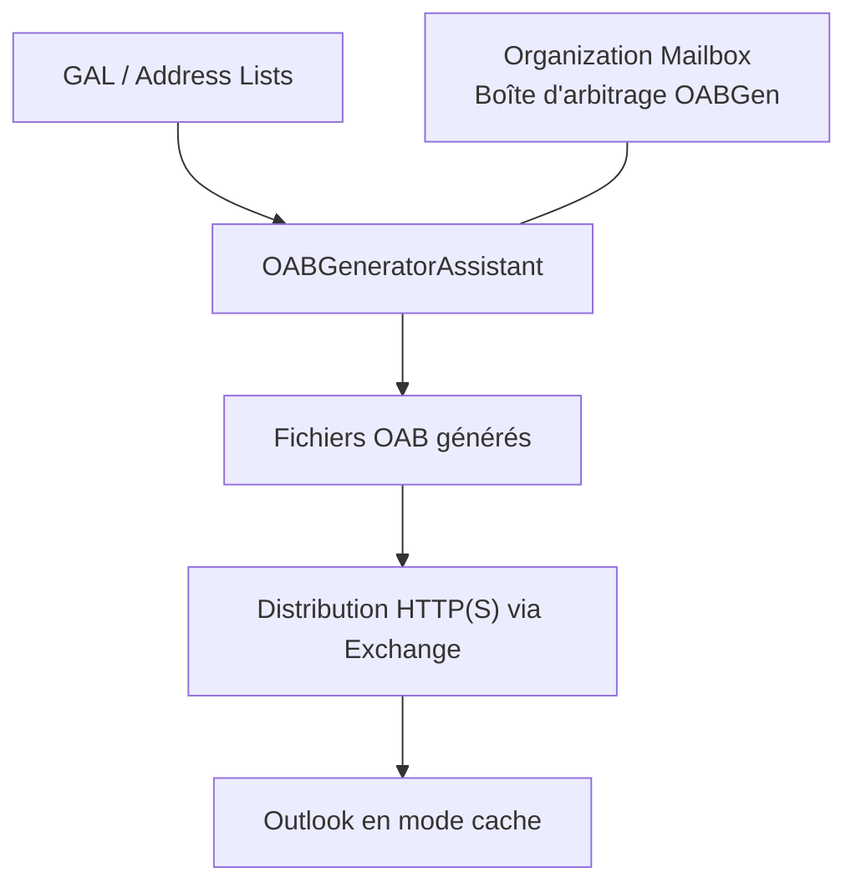
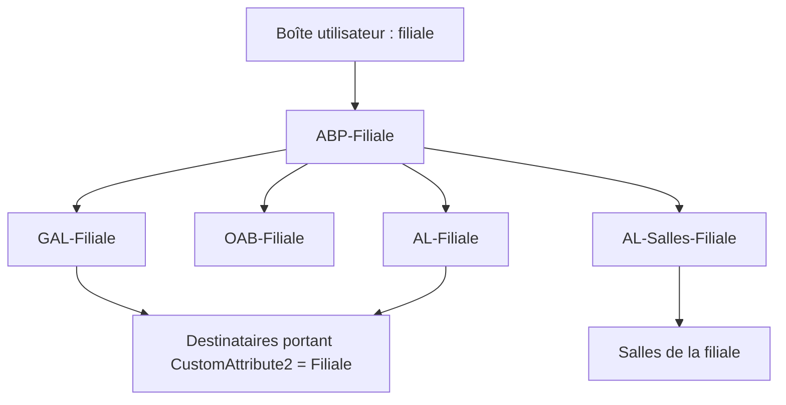

Une organisation Exchange ne se résume pas à des boîtes aux lettres et à un flux SMTP. Elle gère aussi les groupes de distribution, les ressources de calendrier, les dossiers publics, l'attribution des adresses électroniques et la présentation des carnets d'adresses aux utilisateurs.

Ces fonctions sont liées, mais répondent à des besoins différents. Une stratégie d'adresses SMTP détermine **à quelles adresses un destinataire reçoit ses messages** ; une politique de carnet d'adresses détermine **quels destinataires un utilisateur voit dans son annuaire**. Une boîte partagée ne fonctionne pas comme un groupe de distribution, et une liste de salles n'est pas nécessairement un groupe de salles utilisé par Room Finder.

Prenons un cas classique : une organisation Exchange accueille une nouvelle filiale, qui conserve son propre domaine SMTP et doit disposer de ses utilisateurs, de ses groupes, de ses ressources et d'un carnet d'adresses distinct. Les exemples utilisent des noms fictifs : `contoso.example` pour le domaine AD et `filiale.example` pour le domaine SMTP. Ils concernent **Exchange Server on-premises** (Exchange 2016/2019 et Subscription Edition), et non Exchange Online, dont certaines cmdlets et certains mécanismes diffèrent.

## 1. Ne pas confondre objet Active Directory et destinataire Exchange

Les destinataires Exchange reposent sur des objets Active Directory, mais tous les objets AD ne sont pas automatiquement des destinataires de messagerie.

| Objet | Particularité | Usage |
|---|---|---|
| Utilisateur AD | Compte permettant l'authentification | Identité et accès |
| User mailbox | Utilisateur AD associé à une boîte Exchange | Messagerie personnelle |
| Shared mailbox | Boîte accessible à plusieurs utilisateurs autorisés | Adresse fonctionnelle |
| Room mailbox | Boîte de ressource disposant d'un calendrier | Réservation de salle |
| Equipment mailbox | Boîte de ressource pour du matériel | Réservation d'équipement |
| Distribution group | Liste de membres recevant le même message | Diffusion |
| Dynamic distribution group | Ensemble de destinataires déterminé par un filtre | Diffusion fondée sur des attributs |
| Mail contact / Mail user | Destinataire représentant une adresse externe | Correspondants ou comptes externes |

La propriété `RecipientTypeDetails` est souvent la plus utile pour identifier précisément la nature d'un destinataire :

```powershell
Get-Recipient -ResultSize Unlimited |
    Group-Object RecipientTypeDetails |
    Sort-Object Count -Descending |
    Select-Object Name, Count
```

Pour inspecter un objet particulier :

```powershell
Get-Recipient "alice@contoso.example" |
    Format-List Name,RecipientType,RecipientTypeDetails,PrimarySmtpAddress
```

### Activer une boîte pour un compte existant

La cmdlet `Enable-Mailbox` associe une boîte Exchange à un utilisateur AD existant. Elle ne crée pas le compte utilisateur :

```powershell
Enable-Mailbox -Identity "alice" -Database "DB-Filiale"
```

Pour une création simultanée du compte et de la boîte, on utilise plutôt `New-Mailbox`.

Une base de boîtes aux lettres peut être créée puis montée :

```powershell
New-MailboxDatabase -Name "DB-Filiale" -Server "EX01"
Mount-Database -Identity "DB-Filiale"
```

La création d'une base implique également des choix de volumes, de chemins pour le fichier `.edb` et les journaux, de sauvegarde et de haute disponibilité. Dans un environnement DAG, on prépare les copies de base et leur placement indépendamment de l'organisation logique des filiales.

Certaines procédures de création de base demandent un redémarrage du service Information Store pour prendre en compte la nouvelle configuration. **`Restart-Service MSExchangeIS` n'est pas une opération anodine en production** : elle interrompt les bases actives hébergées par le serveur. Elle ne doit pas être copiée aveuglément dans un script d'approvisionnement.

Pour vérifier :

```powershell
Get-MailboxDatabase -Status |
    Format-Table Name,Server,Mounted

Get-Mailbox -Database "DB-Filiale" -ResultSize Unlimited |
    Format-Table Name,RecipientTypeDetails
```

La base Exchange héberge les données. L'OU AD facilite l'administration des objets. Les adresses SMTP et les carnets d'adresses sont encore deux couches distinctes. **Une base par filiale n'est pas une obligation technique pour segmenter les utilisateurs.**

## 2. Boîte partagée : distinguer accès et identité d'envoi

Une boîte partagée répond au besoin d'une adresse fonctionnelle, par exemple `commercial@filiale.example`. Plusieurs personnes consultent les mêmes messages et peuvent, si elles en ont le droit, répondre avec cette identité.

```powershell
New-Mailbox -Shared `
    -Name "Commercial Filiale" `
    -Alias "CommercialFiliale" `
    -Database "DB-Filiale"
```

Trois permissions sont à distinguer :

| Permission | Effet |
|---|---|
| `FullAccess` | Ouvrir la boîte et manipuler son contenu |
| `Send As` | Envoyer comme si le message provenait de la boîte partagée |
| `Send on Behalf` | Envoyer explicitement « de la part de » cette boîte |

`FullAccess` **ne donne pas** automatiquement `Send As`.

Exemple d'attribution des droits à un utilisateur :

```powershell
Add-MailboxPermission `
    -Identity "Commercial Filiale" `
    -User "alice" `
    -AccessRights FullAccess `
    -InheritanceType All

Add-ADPermission `
    -Identity "Commercial Filiale" `
    -User "alice" `
    -ExtendedRights "Send As"
```

Sur Exchange on-premises, `Add-ADPermission` reste notamment employée pour `Send As`. En revanche, les droits d'administration Exchange relèvent du modèle RBAC, qu'il ne faut pas confondre avec les ACL accordées sur un destinataire.

Le mappage automatique dans Outlook est également distinct des droits : il fonctionne avec certaines délégations directes à des utilisateurs, mais pas avec une simple attribution de `FullAccess` à un groupe.

## 3. Groupes de distribution : membres fixes ou calculés

### Groupe de distribution classique

Un groupe classique possède une liste explicite de membres. C'est adapté à une équipe dont les membres sont gérés administrativement :

```powershell
New-DistributionGroup `
    -Name "DG-Filiale-Managers" `
    -Alias "DGFilialeManagers" `
    -Type Distribution

Add-DistributionGroupMember `
    -Identity "DG-Filiale-Managers" `
    -Member "alice"

Get-DistributionGroupMember "DG-Filiale-Managers"
```

La commande `Enable-DistributionGroup` permet aussi d'activer pour la messagerie certains groupes universels AD existants. Il faut distinguer les groupes de distribution et les groupes de sécurité à extension messagerie : seuls les seconds peuvent également servir à attribuer des permissions.

Un groupe peut imposer des règles d'adhésion :

- `Open` : adhésion libre ;
- `Closed` : l'adhésion est gérée par les propriétaires ;
- `ApprovalRequired` : le propriétaire approuve ou refuse la demande.

Les possibilités de quitter un groupe se configurent séparément. Elles ne sont pas des règles d'autorisation d'envoi : les restrictions sur les expéditeurs constituent un autre ensemble de paramètres.

Il ne faut pas non plus confondre **approbation d'une demande d'adhésion** et **modération des messages**. Dans le premier cas, un propriétaire décide qui peut rejoindre le groupe. Dans le second, un modérateur approuve ou refuse un e-mail *avant sa distribution*. Exchange utilise alors une boîte d'arbitrage pour conserver le message en attente, comme nous le verrons avec les boîtes système.

```powershell
Get-DistributionGroup "DG-Filiale-Managers" |
    Format-List MemberJoinRestriction,MemberDepartRestriction,ManagedBy
```

### Groupe de distribution dynamique

Un groupe dynamique n'a pas une liste de membres maintenue manuellement. Sur Exchange Server on-premises, **les destinataires sont déterminés par son filtre lors de l'expansion du groupe à l'envoi**.

Un exemple fréquent consiste à marquer les destinataires d'un projet au moyen d'un attribut personnalisé :

```powershell
Import-Csv ".\equipe-projet.csv" | ForEach-Object {
    Set-Mailbox -Identity $_.Identity -CustomAttribute1 "ProjetFusion"
}
```

Le CSV peut simplement posséder une colonne `Identity` contenant un alias ou un autre identifiant Exchange unique.

On crée ensuite le groupe dynamique :

```powershell
New-DynamicDistributionGroup `
    -Name "DG-Projet-Fusion" `
    -Alias "DGProjetFusion" `
    -RecipientContainer "contoso.example" `
    -IncludedRecipients MailboxUsers `
    -ConditionalCustomAttribute1 "ProjetFusion"
```

Le filtre porte sur l'ensemble du conteneur AD indiqué, pas seulement sur l'OU dans laquelle l'objet groupe est créé. Cela permet d'inclure des utilisateurs de plusieurs départements.

**Comment vérifier ses membres ?** `Get-DistributionGroupMember` n'est pas adapté à un groupe dynamique. Il faut prévisualiser son filtre :

```powershell
$ddg = Get-DynamicDistributionGroup "DG-Projet-Fusion"

Get-Recipient `
    -RecipientPreviewFilter $ddg.RecipientFilter `
    -OrganizationalUnit $ddg.RecipientContainer `
    -ResultSize Unlimited |
    Format-Table Name,PrimarySmtpAddress,CustomAttribute1
```

Ce résultat est un **aperçu au moment de la requête**, et non une liste statique enregistrée dans le groupe. Il est nécessaire de vérifier les attributs avec soin : une valeur attribuée par erreur peut inclure un destinataire dans des messages sensibles.

## 4. Réservation des salles : quatre paramètres déterminants

Une salle est une boîte Exchange spécialisée, dont le calendrier est géré par les assistants de traitement des réunions.

```powershell
New-Mailbox `
    -Room `
    -Name "Salle Filiale 1" `
    -Alias "SalleFiliale1" `
    -Database "DB-Filiale"
```

Le point essentiel est de distinguer **réservation automatique** et **demande soumise à un délégué**.

| Paramètre | Fonction |
|---|---|
| `AutomateProcessing` | Active ou non le traitement automatique, notamment `AutoAccept` |
| `AllBookInPolicy` | Autorise tous les utilisateurs à réserver automatiquement si la demande respecte les règles |
| `BookInPolicy` | Désigne les utilisateurs ou groupes autorisés à réserver automatiquement |
| `AllRequestInPolicy` | Autorise tous les utilisateurs à présenter une demande conforme soumise à approbation |
| `ResourceDelegates` | Désigne les personnes qui approuvent ou refusent les demandes |

Pour permettre aux membres de `DG-Filiale-Employes` de réserver automatiquement une salle, et soumettre les demandes des autres utilisateurs à un délégué :

```powershell
Set-CalendarProcessing `
    -Identity "Salle Filiale 1" `
    -AutomateProcessing AutoAccept `
    -AllBookInPolicy $false `
    -BookInPolicy "DG-Filiale-Employes" `
    -AllRequestInPolicy $true `
    -ResourceDelegates "alice" `
    -ForwardRequestsToDelegates $true
```

Le groupe `DG-Filiale-Employes` est supposé exister. Les demandes restent soumises aux règles habituelles de disponibilité et de durée des réunions.

Le piège classique est de renseigner uniquement `BookInPolicy` : **si `AllBookInPolicy` est encore à `$true`, tous les utilisateurs peuvent rester autorisés à réserver automatiquement**. On obtient alors un résultat différent de celui recherché.

Autre subtilité : `BookInPolicy` ne prend pas en charge les groupes de distribution dynamiques comme groupes d'autorisés.

Pour diagnostiquer une réservation :

```powershell
Get-CalendarProcessing "Salle Filiale 1" |
    Format-List AutomateProcessing,AllBookInPolicy,BookInPolicy,AllRequestInPolicy,RequestInPolicy,AllRequestOutOfPolicy,RequestOutOfPolicy,ResourceDelegates,ForwardRequestsToDelegates
```

Ces paramètres décrivent *qui peut réserver et comment*. Ils ne doivent pas être confondus avec les permissions permettant d'ouvrir directement le calendrier de la salle.

## 5. Dossiers publics : une infrastructure distincte des boîtes partagées

Les dossiers publics servent à partager une arborescence commune de messages, calendriers, contacts ou autres contenus. Ils ne sont pas équivalents à une boîte partagée : leur modèle repose sur des dossiers et des permissions propres à chacun d'eux.

Depuis Exchange 2013, les dossiers publics modernes utilisent des **public folder mailboxes**, stockées dans les bases Exchange. Les anciennes bases de dossiers publics ont disparu de cette architecture.

La première boîte de dossiers publics héberge la **copie principale modifiable de la hiérarchie**. D'autres boîtes peuvent héberger des copies de hiérarchie en lecture seule et du contenu. La réplication de hiérarchie ne signifie pas que chaque élément de contenu est répliqué dans toutes les boîtes de dossiers publics.

Exemple :

```powershell
New-Mailbox -PublicFolder -Name "PF-Hierarchie-01" -Database "DB-Filiale"

New-PublicFolder -Name "Filiale" -Path "\"
New-PublicFolder -Name "Infrastructure" -Path "\Filiale"
```

Arborescence obtenue :

```text
Public Folders
└── Filiale
    └── Infrastructure
```

Quelques rôles de permissions à retenir :

| Rôle | Capacités principales |
|---|---|
| `Owner` | Contrôle étendu du dossier, y compris gestion de son contenu et de ses permissions |
| `PublishingEditor` | Créer des éléments et des sous-dossiers, modifier les éléments |
| `Author` | Lire les éléments et créer/modifier/supprimer ses propres éléments |
| `Reviewer` | Lire les éléments |
| `None` | Aucun droit sur le dossier |

```powershell
Add-PublicFolderClientPermission `
    -Identity "\Filiale" `
    -User "alice" `
    -AccessRights Owner

Get-PublicFolderClientPermission -Identity "\Filiale"
```

Pour déléguer des droits à une population, utiliser des groupes de sécurité compatibles avec la gestion des permissions plutôt qu'une simple liste de diffusion sans portée de sécurité.

**Point d'attention :** accorder `Owner` à un groupe et `Author` à un autre ne garantit pas que tous les autres utilisateurs sont exclus. Les entrées `Default` et `Anonymous`, les permissions sur les parents et les droits des sous-dossiers doivent être inspectés. Une application récursive des permissions est une opération à contrôler explicitement.

On peut enfin activer la messagerie pour un dossier public si l'on souhaite qu'il reçoive des messages directement :

```powershell
Enable-MailPublicFolder -Identity "\Filiale\Infrastructure"
```

## 6. Domaine accepté : ce qu'Exchange accepte réellement en SMTP

Lorsqu'une filiale dispose d'un domaine distinct, la première étape consiste à l'ajouter comme domaine accepté dans l'organisation Exchange :

```powershell
New-AcceptedDomain `
    -Name "Domaine Filiale" `
    -DomainName "filiale.example" `
    -DomainType Authoritative
```

Trois types sont à connaître :

| Type | Comportement |
|---|---|
| `Authoritative` | Exchange est responsable des destinataires du domaine et des échecs de remise pour les adresses inconnues |
| `InternalRelay` | Certains destinataires peuvent être ailleurs ; Exchange doit pouvoir relayer les messages non résolus |
| `ExternalRelay` | Les destinataires sont hors de l'organisation ; Exchange relaie vers un système externe |

Un domaine accepté indique que l'organisation Exchange prend en charge cet espace d'adressage. **Il ne suffit pas à rendre un domaine joignable depuis Internet** : les enregistrements DNS MX, le chemin de transport entrant et les éventuelles passerelles SMTP doivent également être configurés.

```powershell
Get-AcceptedDomain |
    Format-Table Name,DomainName,DomainType,Default
```

## 7. Email Address Policy : attribuer des adresses SMTP

Une *Email Address Policy* (EAP) automatise la création des adresses de messagerie des destinataires. Elle est caractérisée par :

1. un filtre de destinataires ;
2. un ou plusieurs modèles d'adresse ;
3. une priorité par rapport aux autres politiques.

Exemple : une personne nommée `Alice Martin` doit recevoir les messages adressés à `alice.martin@filiale.example`, tout en conservant éventuellement une adresse secondaire dans le domaine historique.

```powershell
New-EmailAddressPolicy `
    -Name "EAP-Filiale" `
    -IncludedRecipients MailboxUsers `
    -RecipientContainer "contoso.example/Filiale" `
    -EnabledEmailAddressTemplates `
        "SMTP:%g.%s@filiale.example", `
        "smtp:%g.%s@contoso.example"

Update-EmailAddressPolicy -Identity "EAP-Filiale"
```

Dans les modèles :

- `%g` correspond au prénom (*given name*) ;
- `%s` au nom (*surname*) ;
- `%m` à l'alias Exchange ;
- `%1g%s` au premier caractère du prénom suivi du nom.

Dans l'attribut `EmailAddresses`, la casse du **préfixe** est significative :

```text
SMTP:alice.martin@filiale.example   -> adresse principale
smtp:alice.martin@contoso.example  -> adresse secondaire
```

La casse des lettres de l'adresse elle-même n'est pas le mécanisme qui définit l'adresse principale.

La propriété `PrimarySmtpAddress` correspond à l'adresse principale utilisée par défaut comme identité d'expédition. Ce n'est pas la même chose que l'en-tête SMTP `Reply-To`, qui peut être explicitement défini par un client ou une application.

Vérification :

```powershell
Get-Mailbox "alice" |
    Format-List PrimarySmtpAddress,EmailAddresses,EmailAddressPolicyEnabled
```

Une EAP ne reconfigure pas le routage SMTP. Elle attribue des adresses aux destinataires. Le domaine doit être accepté par Exchange et les politiques sont évaluées par priorité : **un destinataire n'est géré que par une politique d'adresses à la fois**.

Si `EmailAddressPolicyEnabled` vaut `$false` pour une boîte, celle-ci ne suit plus automatiquement les modèles de la politique : c'est notamment à vérifier en cas d'adresse gérée manuellement.

## 8. GAL, Address List et OAB : trois notions différentes

On utilise fréquemment le terme « carnet d'adresses » pour désigner des objets Exchange distincts.

| Objet | Rôle |
|---|---|
| Global Address List (GAL) | Ensemble de destinataires pouvant être trouvés dans un carnet global |
| Address List | Sous-ensemble logique de destinataires, filtré par des critères |
| Offline Address Book (OAB) | Fichiers de carnet téléchargeables par Outlook, notamment en mode cache |
| Address Book Policy (ABP) | Politique attribuée à une boîte et définissant les carnets qu'elle voit |

Une liste d'adresses n'est pas un groupe AD : on ne lui ajoute pas directement des membres. Elle définit un filtre.

### La segmentation par attributs personnalisés

Les attributs `CustomAttribute1` à `CustomAttribute15` permettent de construire des périmètres indépendants de l'arborescence d'OU. Côté Active Directory, ils correspondent aux attributs `extensionAttribute1` à `extensionAttribute15`.

Pour marquer les destinataires de la filiale :

```powershell
Get-Mailbox -OrganizationalUnit "contoso.example/Filiale" -ResultSize Unlimited |
    Set-Mailbox -CustomAttribute2 "Filiale"

Get-DistributionGroup -OrganizationalUnit "contoso.example/Filiale" -ResultSize Unlimited |
    Set-DistributionGroup -CustomAttribute2 "Filiale"
```

Cette opération ne couvre pas nécessairement tous les types de destinataires : contacts, mail users et groupes de distribution dynamiques peuvent nécessiter leur propre traitement. Le périmètre réel doit donc être inventorié avant la création des listes.

Créons une GAL et une liste d'adresses reposant sur le même attribut :

```powershell
New-GlobalAddressList `
    -Name "GAL-Filiale" `
    -IncludedRecipients AllRecipients `
    -ConditionalCustomAttribute2 "Filiale"

New-AddressList `
    -Name "AL-Filiale" `
    -IncludedRecipients AllRecipients `
    -ConditionalCustomAttribute2 "Filiale"

Update-GlobalAddressList "GAL-Filiale"
Update-AddressList "AL-Filiale"
```

Ces mises à jour appliquent les filtres aux destinataires existants. La définition d'une liste et l'actualisation de son appartenance sont deux étapes qu'il faut savoir distinguer.

La prévisualisation est possible :

```powershell
$gal = Get-GlobalAddressList "GAL-Filiale"

Get-Recipient -RecipientPreviewFilter $gal.RecipientFilter -ResultSize Unlimited |
    Format-Table Name,RecipientTypeDetails,CustomAttribute2
```

Ce test vérifie le *filtre*. L'affichage côté client dépend aussi des mises à jour, de la visibilité des destinataires et, pour Outlook en cache, de l'OAB téléchargé.

### Créer l'OAB

```powershell
New-OfflineAddressBook `
    -Name "OAB-Filiale" `
    -AddressLists "GAL-Filiale"

Set-OfflineAddressBook `
    -Identity "OAB-Filiale" `
    -VirtualDirectories $null `
    -GlobalWebDistributionEnabled $true

Update-OfflineAddressBook -Identity "OAB-Filiale"
```

Pour Exchange Server moderne, Microsoft recommande la **distribution Web globale** plutôt que l'énumération manuelle des répertoires virtuels OAB de chaque serveur. Outlook récupère l'OAB via les mécanismes Exchange et Autodiscover ; une génération ou un téléchargement retardé peut expliquer un décalage entre Outlook en ligne et Outlook en cache.


### Qui génère l'OAB ? Les boîtes aux lettres d'arbitrage

Une **boîte aux lettres d'arbitrage** (*arbitration mailbox*) est une boîte aux lettres système d'Exchange. Elle possède un objet Active Directory et réside dans une base de boîtes aux lettres Exchange, au même titre qu'une boîte utilisateur, mais elle n'est pas destinée à être ouverte dans Outlook.

Ces boîtes servent à stocker des informations nécessaires au fonctionnement interne d'Exchange. Plusieurs fonctionnalités les utilisent :

| Fonction | Utilisation d'une boîte d'arbitrage |
|---|---|
| **Génération des OAB** | Hébergement des données et fichiers utilisés pour construire les carnets hors connexion |
| **Modération des messages** | Stockage temporaire des messages attendant l'approbation d'un modérateur |
| **Migrations par lots** | Stockage d'informations exploitées par le service de migration Exchange |
| **Fédération** | Données utiles à la communication et à certains échanges entre organisations |
| **eDiscovery** | Stockage de données système liées aux fonctions de découverte et de conformité |

**Toutes les boîtes d'arbitrage n'ont pas toutes ces fonctions.** Certaines sont spécialisées, et leurs capacités sont enregistrées dans les propriétés `PersistedCapabilities`. Les rôles disponibles dépendent aussi de la version d'Exchange.

Pour l'OAB, Exchange s'appuie sur une boîte d'arbitrage particulière appelée **Organization Mailbox**, dotée de la capacité `OrganizationCapabilityOABGen`. L'Organization Mailbox créée par défaut s'appelle généralement :

`SystemMailbox{bb558c35-97f1-4cb9-8ff7-d53741dc928c}`

Le service **Microsoft Exchange Mailbox Assistants** héberge l'assistant `OABGeneratorAssistant`, qui exécute la génération. La boîte d'arbitrage n'est donc pas un processus autonome : elle fournit l'emplacement et le contexte de stockage nécessaires à cet assistant.



Pour inventorier les boîtes système :

```powershell
Get-Mailbox -Arbitration |
    Format-Table Name,Database,ServerName
```

Pour identifier celles autorisées à générer les carnets hors connexion :

```powershell
Get-Mailbox -Arbitration |
    Where-Object {
        $_.PersistedCapabilities -contains "OrganizationCapabilityOABGen"
    } |
    Format-Table Name,Database,ServerName
```

Et pour vérifier à quelle Organization Mailbox un OAB est associé :

```powershell
Get-OfflineAddressBook |
    Format-List Name,AddressLists,GeneratingMailbox,IsDefault
```

La **modération** illustre un autre usage concret : quand un message est adressé à un groupe modéré, Exchange conserve temporairement le message original dans une boîte d'arbitrage et transmet une demande d'approbation au modérateur. Si celui-ci accepte, la distribution reprend ; s'il refuse, le message n'est pas remis aux destinataires prévus. Il ne faut pas confondre ce mécanisme avec les délégués de réservation d'une salle, ni avec les restrictions d'adhésion à un groupe.

Enfin, ces boîtes comptent aussi dans l'exploitation des **DAG**. Une Organization Mailbox est stockée dans une base Exchange ; si cette base dispose de copies dans un DAG, elle peut profiter de la disponibilité de ces copies. La génération de l'OAB est alors prise en charge sur le serveur hébergeant la copie active de sa base. L'accès HTTP aux fichiers OAB est relayé par les services Exchange vers l'emplacement approprié.

En pratique, avant de supprimer une base ou de décommissionner un serveur, il faut inventorier **les boîtes système aussi bien que les boîtes utilisateur**. Une boîte d'arbitrage manquante, déplacée dans une base indisponible ou mal configurée peut notamment perturber la génération des OAB, les migrations ou la modération.

La gestion des OAB se réalise dans **Exchange Management Shell**, et non dans l'EAC : `Get-OfflineAddressBook`, `New-OfflineAddressBook`, `Set-OfflineAddressBook` et `Update-OfflineAddressBook` sont les commandes à retenir.

## 9. Address Book Policy : segmenter la visibilité des carnets

Une ABP rassemble obligatoirement : **une GAL, un OAB, une liste de salles et une ou plusieurs Address Lists**.



La *Room List* d'une ABP est une **Address List filtrant les salles**. Il ne faut pas la confondre avec un groupe de distribution créé avec `-RoomList`, qui intervient dans d'autres fonctionnalités de recherche de salles.

Un exemple de filtre adapté :

```powershell
New-AddressList `
    -Name "AL-Salles-Filiale" `
    -RecipientFilter "(RecipientDisplayType -eq 'ConferenceRoomMailbox') -and (CustomAttribute2 -eq 'Filiale')"

Update-AddressList "AL-Salles-Filiale"
```

On regroupe ensuite les éléments :

```powershell
New-AddressBookPolicy `
    -Name "ABP-Filiale" `
    -GlobalAddressList "GAL-Filiale" `
    -OfflineAddressBook "OAB-Filiale" `
    -RoomList "AL-Salles-Filiale" `
    -AddressLists "AL-Filiale"
```

Il reste à attribuer la politique aux utilisateurs concernés :

```powershell
Get-Mailbox -OrganizationalUnit "contoso.example/Filiale" -ResultSize Unlimited |
    Set-Mailbox -AddressBookPolicy "ABP-Filiale"
```

Pour vérifier :

```powershell
Get-AddressBookPolicy "ABP-Filiale" |
    Format-List GlobalAddressList,OfflineAddressBook,RoomList,AddressLists

Get-Mailbox "alice" |
    Format-List Name,AddressBookPolicy
```

### Les limites d'une ABP

La segmentation par ABP est **une séparation de présentation des destinataires**, pas une frontière de sécurité. Une ABP n'empêche pas en soi d'envoyer un message à une adresse connue, et ne fournit pas un cloisonnement juridique ou administratif de deux entités.

Par ailleurs, si seuls les employés de la filiale possèdent une ABP, les utilisateurs du siège continuent potentiellement à utiliser les carnets généraux. Une segmentation réciproque exige une politique adaptée pour chaque population.

Pour limiter aussi la résolution des noms et l'accès aux fiches de contacts entre populations utilisant des ABP différentes, Exchange Server fournit l'**Address Book Policy Routing Agent**, à étudier selon le besoin de confidentialité.

Autre impératif : les objets exposés par les Address Lists associées doivent être cohérents avec la GAL de l'ABP. Il est déconseillé de sélectionner les salles par OU et les utilisateurs par `CustomAttribute` si les deux mécanismes peuvent aboutir à des périmètres divergents.

## 10. La chaîne complète, du destinataire jusqu'à Outlook

On peut résumer l'ensemble en deux chaînes indépendantes :


La première chaîne concerne **l'identité SMTP et la réception du courrier**. La seconde concerne **la sélection et la visibilité des destinataires**. Le fait qu'elles puissent utiliser les mêmes OU ou attributs ne les rend pas interchangeables.

En cas de comportement inattendu, quelques vérifications permettent de remonter rapidement à la cause :

| Symptôme | Vérifications prioritaires |
|---|---|
| Une adresse SMTP attendue manque | Domaine accepté, filtre/priorité EAP, `EmailAddressPolicyEnabled`, application de la politique |
| Un utilisateur manque dans une GAL | `CustomAttribute`, `RecipientFilter`, `HiddenFromAddressListsEnabled`, actualisation de la GAL |
| Un groupe dynamique ne reçoit pas les bons membres | Filtre du DDG, conteneur de destinataires, prévisualisation `Get-Recipient` |
| Une salle accepte les demandes de tout le monde | `AllBookInPolicy`, `BookInPolicy`, délégués et mode de traitement |
| Outlook affiche d'anciennes informations | OAB généré et téléchargé, mode cache, reconnexion du client |
| Un utilisateur voit le mauvais carnet | `AddressBookPolicy` de sa boîte et cohérence GAL/Address Lists/OAB |
| Un dossier public reste accessible | Droits des dossiers, entrées `Default`/`Anonymous`, droits des sous-dossiers |

## Conclusion

La difficulté dans Exchange Server n'est pas tant de créer un objet que de comprendre **à quel niveau il intervient**.

- Les **boîtes** stockent les messages et les calendriers.
- Les **groupes de distribution** contrôlent la diffusion à plusieurs destinataires, avec membres fixes ou filtrés.
- Les **politiques de réservation** décident comment une salle traite les demandes.
- Les **dossiers publics** proposent une arborescence partagée avec des permissions spécifiques.
- Les **domaines acceptés et les Email Address Policies** gèrent l'espace d'adressage SMTP et l'attribution des adresses.
- Les **GAL, Address Lists, OAB et ABP** organisent la manière dont les destinataires sont retrouvés dans les carnets d'adresses.

Ces composants peuvent être assemblés dans une seule organisation Exchange pour accompagner une filiale, une séparation métier ou une évolution de l'annuaire. Mais la cohérence des filtres et des attributs est déterminante, et une segmentation visuelle ne doit jamais être confondue avec une véritable isolation de sécurité.

## Références Microsoft

- [Recipients in Exchange Server](https://learn.microsoft.com/en-us/exchange/recipients/recipients)
- [Manage permissions for recipients](https://learn.microsoft.com/en-us/exchange/recipients/mailbox-permissions)
- [Set-CalendarProcessing](https://learn.microsoft.com/en-us/powershell/module/exchangepowershell/set-calendarprocessing)
- [Public folders in Exchange Server](https://learn.microsoft.com/en-us/exchange/collaboration/public-folders/public-folders)
- [Accepted domains in Exchange Server](https://learn.microsoft.com/en-us/exchange/mail-flow/accepted-domains/accepted-domains)
- [Email address policies in Exchange Server](https://learn.microsoft.com/en-us/exchange/email-addresses-and-address-books/email-address-policies/email-address-policies)
- [Address book policies in Exchange Server](https://learn.microsoft.com/en-us/exchange/email-addresses-and-address-books/address-book-policies/address-book-policies)
- [Set-OfflineAddressBook](https://learn.microsoft.com/en-us/powershell/module/exchangepowershell/set-offlineaddressbook)
- [Offline address books in Exchange Server](https://learn.microsoft.com/en-us/exchange/email-addresses-and-address-books/offline-address-books/offline-address-books)
- [OAB procedures and organization mailboxes](https://learn.microsoft.com/en-us/exchange/email-addresses-and-address-books/offline-address-books/oab-procedures)
- [Re-create missing arbitration mailboxes](https://learn.microsoft.com/en-us/exchange/architecture/mailbox-servers/recreate-arbitration-mailboxes)
- [Message tracking: moderation events](https://learn.microsoft.com/en-us/exchange/mail-flow/transport-logs/message-tracking)