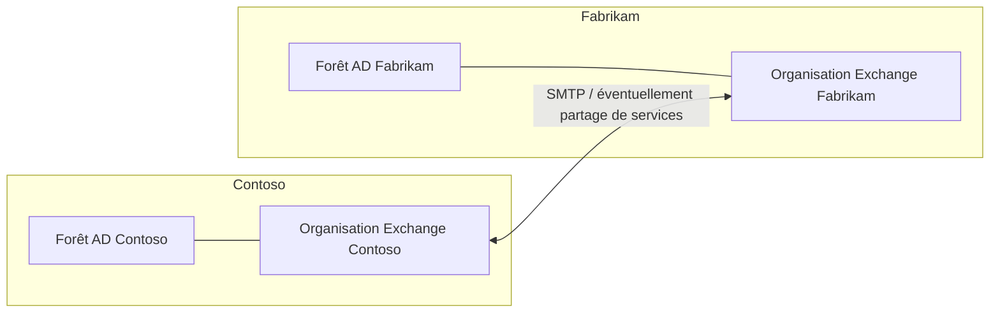
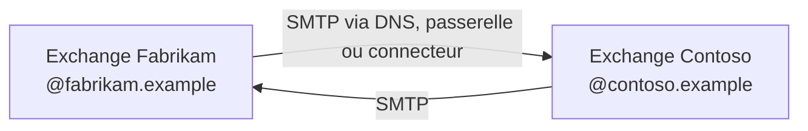
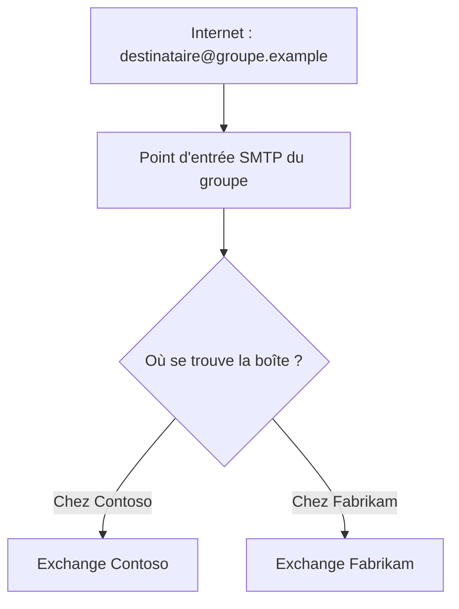
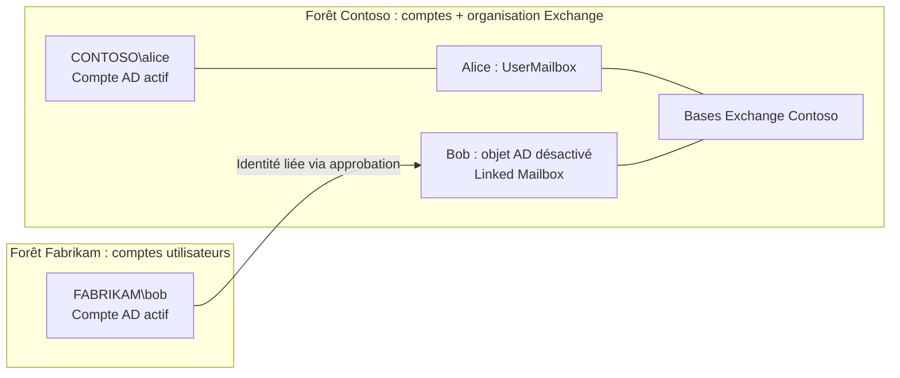
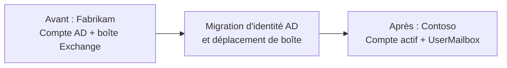
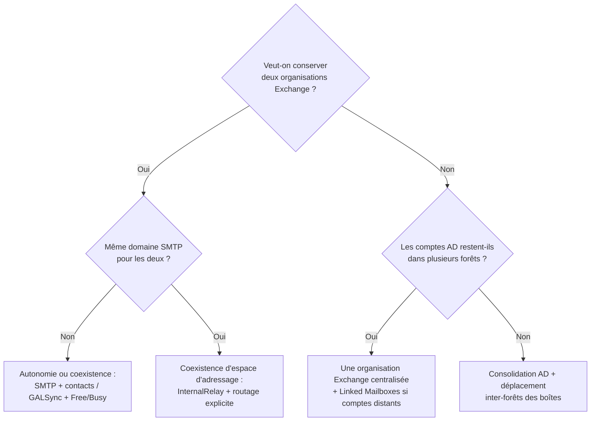

Une entreprise rachète une autre entreprise. Sur le papier, les deux sociétés appartiennent désormais au même groupe. Techniquement, rien ne change automatiquement : elles peuvent toujours avoir **deux forêts Active Directory, deux organisations Exchange, deux domaines SMTP, deux annuaires et deux infrastructures de sécurité**.

C'est là qu'une question apparemment simple — « comment intégrer les messageries ? » — devient un **choix d'architecture**. On peut vouloir permettre aux collaborateurs de se joindre dès le premier jour, partager un carnet d'adresses, centraliser les boîtes, conserver les identités AD ou, au contraire, tout fusionner progressivement.

La **Linked Mailbox** est une réponse à l'un de ces besoins. **Ce n'est ni la solution universelle à une acquisition, ni une méthode de migration des messages.**

Cet article privilégie **Exchange Server on-premises** (2016, 2019 et Subscription Edition). Les scénarios Microsoft 365 sont évoqués séparément, car les mécanismes et contraintes diffèrent. Les noms d'entreprises et de domaines sont fictifs.

## 1. Le scénario de départ : Contoso rachète Fabrikam

Imaginons deux sociétés qui administraient jusqu'ici leur informatique séparément.

| Élément | Contoso (acquéreur) | Fabrikam (société acquise) |
|---|---|---|
| Forêt Active Directory | `corp.contoso.example` | `ad.fabrikam.example` |
| Domaine SMTP | `contoso.example` | `fabrikam.example` |
| Organisation Exchange | Exchange-Contoso | Exchange-Fabrikam |
| Comptes utilisateurs | `CONTOSO\alice` | `FABRIKAM\bob` |
| Boîtes aux lettres | Bases Exchange Contoso | Bases Exchange Fabrikam |
| Administration | Équipe Contoso | Équipe Fabrikam |



**Une organisation Exchange on-premises est liée à sa forêt AD.** Même avec une relation d'approbation entre les deux forêts, les deux organisations Exchange ne fusionnent pas. Une approbation AD n'importe pas les boîtes de Fabrikam dans les bases de Contoso, et ne crée pas une GAL unique.

Il faut commencer par distinguer **ce qu'on veut unifier**, sans nécessairement tout regrouper :

- **Les adresses et le transport** : envoyer et recevoir des messages, conserver les anciens domaines et éventuellement présenter une marque commune.
- **Les carnets d'adresses et calendriers** : retrouver un collègue de l'autre société et consulter son libre/occupé.
- **Les identités** : avec quel compte Windows et quelles informations d'authentification les salariés ouvrent-ils leur session ?
- **Les données** : où résident physiquement les boîtes aux lettres, archives, dossiers publics et calendriers ?
- **L'administration et la sécurité** : qui est habilité à gérer quoi, dans quelle forêt et avec quel périmètre ?

Selon les réponses, plusieurs architectures sont possibles.

## 2. Six scénarios possibles après une acquisition

| Scénario | Identités AD | Emplacement des boîtes | Objectif |
|---|---|---|---|
| A. Autonomie conservée | Deux forêts | Deux organisations Exchange | Faire communiquer les sociétés sans fusion |
| B. Coexistence approfondie | Deux forêts | Deux organisations Exchange | Carnets, disponibilité et routage coordonnés |
| C. Domaine SMTP partagé | Une ou deux forêts | Deux systèmes de messagerie | Utiliser une adresse de marque commune pendant la transition |
| D. Forêt Exchange de ressources | Comptes actifs conservés dans plusieurs forêts | Une organisation Exchange centralisée | Utiliser des **Linked Mailboxes** |
| E. Consolidation complète | Comptes regroupés dans une forêt cible | Boîtes regroupées dans Exchange cible | Supprimer à terme l'ancienne infrastructure |
| F. Consolidation Microsoft 365 | Identités et locataires selon le projet | Exchange Online | Fusionner ou faire coexister des locataires cloud |

Ces scénarios **ne sont pas mutuellement exclusifs dans le temps**. Une acquisition peut passer par A, puis B et C, avant d'aboutir à D ou E. Le scénario D n'est pas un passage obligatoire vers E.

## 3. Scénario A : garder les deux Exchange et simplement échanger des mails

Contoso et Fabrikam conservent chacun leur forêt AD, leur Exchange et leur domaine SMTP.

Bob, chez Fabrikam, écrit à `alice@contoso.example`. Le message est acheminé par SMTP comme vers n'importe quelle autre société. Le fait que Contoso détienne Fabrikam ne change rien à la remise.



**Ce qu'on obtient :** le courrier circule, mais **les annuaires restent séparés**. Dans Outlook, Alice ne voit pas nécessairement Bob dans la GAL. Elle peut connaître son adresse en la saisissant manuellement.

**Ce qu'il n'est pas nécessaire de faire :** créer une relation d'approbation AD ou une Linked Mailbox. **SMTP fonctionne sans approbation entre les forêts.**

Ce scénario est adapté à une acquisition récente, à une filiale qui conserve son autonomie ou à une intégration volontairement limitée pour des raisons de sécurité ou de réglementation.

On peut compléter les flux par des connecteurs de transport, un routage via les passerelles de sécurité et une politique de filtrage commune. Cela reste **une intégration du transport**, pas des identités.

## 4. Scénario B : deux Exchange, mais des carnets et calendriers communs

Les deux organisations Exchange restent en place. En revanche, les collaborateurs veulent :

- retrouver les salariés de l'autre société dans Outlook ;
- utiliser leurs adresses sans les connaître ;
- connaître la disponibilité de leurs collègues pour organiser des réunions.

Ces besoins nécessitent **des mécanismes distincts**.

### 4.1. Synchroniser les destinataires : Mail Contacts, Mail Users et GALSync

On peut créer dans la forêt Contoso un **Mail Contact** représentant Bob. Ce contact apparaît dans les listes d'adresses de Contoso, mais les messages sont remis à la boîte de Bob chez Fabrikam.

```powershell
# Exemple : objet de carnet côté Contoso
New-MailContact -Name "Bob Fabrikam" `
    -ExternalEmailAddress "bob@fabrikam.example"

Get-MailContact "Bob Fabrikam" |
    Format-List Name,ExternalEmailAddress
```

Le contact **ne possède pas de boîte chez Contoso** et ne crée pas de deuxième compte d'authentification pour Bob.

Pour quelques personnes, une gestion manuelle peut suffire. Pour plusieurs milliers de salariés, il faut envisager une **synchronisation des GAL** (*GALSync*) afin de créer et maintenir les représentations des destinataires entre forêts. Des **Mail Users** peuvent également jouer ce rôle lorsqu'une identité AD est nécessaire.

**Attention : une relation d'approbation entre forêts ne réalise pas la GALSync**. Microsoft documente notamment les topologies utilisant Microsoft Identity Manager. Et **Microsoft Entra Connect ne réalise pas une GALSync on-premises entre deux organisations Exchange**.

### 4.2. Partager le libre/occupé ne se résume pas à créer des contacts

Voir Bob dans la GAL permet de lui envoyer un message ; cela ne garantit pas qu'Alice puisse consulter son calendrier.

Le service **Availability** d'Exchange prend en charge des scénarios **inter-forêts**, avec ou sans relation d'approbation selon le mode configuré. L'intégration implique des paramètres d'accès, des points de terminaison, de la résolution d'annuaire et des autorisations.

```powershell
# Commandes utiles pour examiner une configuration existante
Get-AvailabilityAddressSpace
Get-OrganizationRelationship |
    Format-Table Name,Enabled,FreeBusyAccessEnabled,FreeBusyAccessLevel
```

Une `OrganizationRelationship` n'est pas une approbation AD : c'est une **relation entre organisations de messagerie** utilisée notamment pour le partage de disponibilité, selon les fonctionnalités et la configuration de fédération disponibles.

**À retenir : la présence dans la GAL, le transport SMTP et le partage Free/Busy sont trois problèmes séparés.** Les résoudre dans cet ordre aide à diagnostiquer les échecs.

## 5. Scénario C : deux messageries, mais un même domaine SMTP

Imaginons que la direction impose une adresse commune en `@groupe.example`, alors que certaines boîtes sont encore chez Fabrikam et d'autres déjà chez Contoso.

C'est un cas de **coexistence d'espace d'adressage SMTP** (*shared SMTP namespace*).



Dans une organisation Exchange, le type de domaine accepté est déterminant :

| Domaine accepté | Ce que fait Exchange |
|---|---|
| `Authoritative` | Exchange est responsable de l'ensemble des destinataires de ce domaine ; une adresse inconnue peut produire un NDR |
| `InternalRelay` | Certains destinataires du domaine peuvent se trouver ailleurs ; les messages non résolus peuvent être relayés |
| `ExternalRelay` | Le domaine est relayé vers un système externe, sans héberger localement ses destinataires |

Sur l'organisation assurant l'entrée des messages, un domaine partagé peut être configuré en `InternalRelay` :

```powershell
# Exemple de principe, non suffisant à lui seul pour rendre la coexistence opérationnelle
Set-AcceptedDomain "groupe.example" -DomainType InternalRelay

Get-AcceptedDomain "groupe.example" |
    Format-List DomainName,DomainType
```

**Le changement de type de domaine ne crée pas le routage.** Il faut aussi des connecteurs et des objets destinataires cohérents.

Par exemple, chez Contoso, Bob peut être représenté par un `MailUser` avec :

- une adresse présentée aux correspondants, `bob@groupe.example` ;
- une **adresse de routage distincte**, par exemple `bob@routage.fabrikam.example`, qui pointe vers la boîte réellement hébergée chez Fabrikam.

Ce domaine de routage doit être maîtrisé et acheminé vers le bon système ; il ne s'agit pas nécessairement d'un domaine public utilisé par les salariés.

**Le principal piège est la boucle SMTP** : Contoso renvoie à Fabrikam un destinataire inconnu, qui le renvoie à Contoso, et ainsi de suite. Il faut concevoir explicitement le point d'entrée, la résolution des destinataires, les connecteurs, les cas d'adresse inconnue et la terminaison du routage.

En pratique, un domaine SMTP partagé peut être utile pour une **période de migration**, mais il ajoute de la complexité et du risque. Si chaque société conserve durablement son domaine distinct, ce mécanisme n'est pas forcément nécessaire.

## 6. Scénario D : centraliser Exchange, mais garder les comptes AD de chaque société

**C'est le véritable cas d'usage des Linked Mailboxes.**

L'objectif est différent des scénarios précédents. On ne veut plus exploiter deux organisations Exchange à long terme. On souhaite que **toutes les boîtes résident chez Contoso**, mais que Bob conserve son compte `FABRIKAM\bob` dans sa forêt d'origine.



Dans un exemple simplifié où **la forêt de Contoso héberge à la fois ses propres comptes et Exchange**, les utilisateurs Contoso peuvent conserver des **User Mailboxes ordinaires** et les utilisateurs de la forêt Fabrikam utiliser des **Linked Mailboxes**. Il n'est pas nécessaire que tous les utilisateurs soient en Linked Mailbox.

Pour Bob, il existe deux objets AD ayant des rôles différents :

| | Forêt Fabrikam | Forêt Exchange Contoso |
|---|---|---|
| Objet | `FABRIKAM\bob` | Objet utilisateur AD associé à la Linked Mailbox |
| État | **Actif** | **Désactivé** |
| Usage | Authentification quotidienne | Porte les attributs de boîte Exchange |
| Messages | Pas de boîte locale dans l'architecture cible | Boîte stockée dans une base Exchange Contoso |

Le lien d'identité passe notamment par `msExchMasterAccountSid`. La forêt Exchange doit **approuver** la forêt de comptes Fabrikam, au minimum via une approbation sortante à sens unique depuis la forêt Exchange.

### 6.1. Créer une Linked Mailbox pour un nouvel utilisateur

Si Bob n'a **pas encore de boîte à migrer** et possède déjà son compte dans la forêt Fabrikam :

```powershell
# Depuis l'Exchange Management Shell de la forêt de ressources
$cred = Get-Credential "FABRIKAM\administrateur"

New-Mailbox -Name "Bob Fabrikam" `
    -Alias "bob" `
    -Database "DB-Groupe" `
    -LinkedMasterAccount "FABRIKAM\bob" `
    -LinkedDomainController "dc1.ad.fabrikam.example" `
    -LinkedCredential $cred

Get-Mailbox "Bob Fabrikam" |
    Format-List RecipientTypeDetails,LinkedMasterAccount,Database
```

On attend `RecipientTypeDetails : LinkedMailbox`. Bob utilise **son mot de passe Fabrikam**, pas celui du compte désactivé créé côté Exchange.

### 6.2. Et si Bob possédait déjà une boîte chez Fabrikam ?

**Créer une nouvelle Linked Mailbox ne transfère aucun ancien message.** On ne peut pas non plus remplacer un projet de migration par une simple attribution de `LinkedMasterAccount`.

Pour ramener la boîte existante dans Exchange Contoso, il faut envisager un **déplacement inter-forêts de boîte aux lettres** (*cross-forest move*) :

1. Préparer le compte cible et ses attributs Exchange, notamment avec le script Microsoft `Prepare-MoveRequest.ps1` selon la topologie.
2. Préparer le déplacement et sa connectivité, notamment **MRS / MRS Proxy**.
3. Exécuter la migration avec les mécanismes de déplacement Exchange, puis finaliser la bascule.
4. Vérifier l'identité liée, les adresses, les délégations, le profil Outlook et la disparition maîtrisée de l'ancienne boîte.

Dans un déplacement vers une **forêt de ressources**, la boîte cible peut être une **Linked Mailbox**, parce que le compte principal actif reste dans la forêt de comptes.

C'est une distinction fondamentale :

> **Linked Mailbox = modèle d'identité et d'accès à une boîte.**  
> **Cross-forest mailbox move = processus de déplacement des données d'une boîte.**

Les deux peuvent intervenir dans le même projet, mais **ne font pas la même chose**.

### 6.3. Pourquoi adopter cette architecture ?

Elle a du sens lorsque les filiales doivent conserver des **domaines AD réellement indépendants**, par exemple pour la délégation de l'administration des comptes, tout en mutualisant l'exploitation Exchange.

Elle a aussi un coût :

- dépendances à la disponibilité des contrôleurs de domaine et aux approbations inter-forêts ;
- complexité supplémentaire sur les identités, les permissions et le dépannage ;
- gestion des objets utilisateurs désactivés dans la forêt de ressources ;
- adaptation de l'automatisation de provisioning et du départ des collaborateurs.

**Si le but final est de supprimer la forêt Fabrikam et d'unifier les comptes AD, cette architecture peut être inutilement complexe à long terme.**

## 7. Scénario E : fusionner aussi les comptes AD et migrer les boîtes

Autre décision possible : Contoso veut qu'Alice et Bob finissent tous deux avec un **compte actif dans la forêt AD Contoso** et une boîte dans son organisation Exchange.



Ici, **on ne conserve pas le principe de Linked Mailbox** à l'arrivée. Bob devient un utilisateur normal de la forêt cible, avec une **User Mailbox**.

Ce chantier combine deux migrations distinctes :

**Migration d'identité Active Directory.** Il faut décider du compte cible, des UPN, de la reprise des appartenances aux groupes, des droits sur les ressources, des profils Windows et des applications liées à l'ancien domaine. Le sujet ne se limite pas à la messagerie.

**Migration de boîte Exchange.** Il faut déplacer les données, conserver les bonnes adresses SMTP, préserver les anciennes adresses `X500` et valider les autorisations. Microsoft documente les déplacements **inter-forêts** via `New-MoveRequest` ou `New-MigrationBatch`, avec une préparation adéquate des destinataires cibles.

Le choix entre une forêt de ressources (D) et une consolidation complète (E) dépend donc principalement de la stratégie **Active Directory et sécurité**, pas d'une préférence pour une cmdlet Exchange.

## 8. Scénario F : si les sociétés sont sur Microsoft 365

Le raisonnement doit aussi couvrir le cas où l'une ou les deux sociétés utilisent **Exchange Online**.

Deux situations différentes :

- **Exchange on-premises et Exchange Online** : on peut envisager une architecture hybride avec des **Remote Mailboxes**, une synchronisation d'identités et des déplacements de boîtes adaptés. Une Remote Mailbox ne fonctionne pas comme une Linked Mailbox.
- **Deux locataires Microsoft 365 indépendants** : une acquisition peut conduire à une **migration inter-locataires** (*cross-tenant migration*). Les utilisateurs cibles peuvent être préparés comme `MailUser` avec des attributs dédiés ; les données sont ensuite déplacées avec les mécanismes pris en charge par Exchange Online, sous réserve des licences et des contraintes du service.

**Attention aux mots trompeurs :** une migration « inter-forêts Exchange » et une migration « inter-locataires Microsoft 365 » ne sont pas interchangeables. Il faut les étudier comme deux parcours techniques différents.

Microsoft publie désormais un guide dédié à la planification des **migrations Microsoft 365 entre locataires** dans les situations de fusion, acquisition ou séparation. Ce parcours mérite à lui seul un autre article.

## 9. Comment choisir ? Partir de la cible, pas de la technologie

Voici un arbre de décision simplifié.



Quelques conclusions pratiques :

- **Besoin urgent : les employés doivent s'écrire** → un routage SMTP correct peut suffire, sans relation d'approbation AD.
- **Besoin : les employés doivent se rechercher et prendre rendez-vous** → ajouter la représentation des destinataires dans les carnets et le partage de disponibilité.
- **Besoin : une adresse de groupe commune avant migration complète** → préparer un espace SMTP partagé et ses règles anti-boucle.
- **Besoin : une seule infrastructure Exchange, mais des identités réparties dans plusieurs forêts** → examiner le scénario de **Linked Mailboxes**.
- **Besoin : une seule forêt AD et une seule organisation Exchange à terme** → planifier une consolidation d'identité et de données, sans imposer des Linked Mailboxes comme état final.

Ce tableau n'élimine pas la nécessité d'un dossier d'architecture : le choix dépend aussi des exigences de sécurité, de continuité d'activité et des dates de bascule.

## 10. Ce qui casse souvent pendant une fusion

La migration des messages est souvent la partie la plus visible. Elle n'est pas forcément la plus délicate.

| Risque | Exemple concret | Vérification |
|---|---|---|
| Collision d'identités | Deux comptes `jdupont` ou deux UPN identiques dans les populations | Stratégie de correspondance et de renommage |
| Perte de résolution d'anciens destinataires | Réponse à un ancien message générant un NDR | Préservation de `legacyExchangeDN` via alias `X500` |
| Mauvais routage SMTP | Message renvoyé indéfiniment entre les deux Exchange | Connecteurs, domaines acceptés et tests de remise |
| Perte de délégation | Un assistant ne peut plus utiliser `Send As` | ACL, `GrantSendOnBehalfTo`, mapping de comptes |
| GAL incomplète | Utilisateur absent du carnet ou de l'OAB | GALSync, filtres, attributs, mises à jour |
| Disponibilités indisponibles | Un calendrier externe affiche « aucune information » | Service Availability et configuration inter-organisations |
| Rupture client | Outlook demande un nouveau profil ou l'Autodiscover ne trouve plus la bonne boîte | DNS, certificats, URL et séquencement des bascules |
| Objets non migrés | Salles, groupes, boîtes partagées, archives, dossiers publics | Inventaire des types de destinataires et des objets système |
| Contraintes réglementaires | Certaines boîtes sont sous conservation ou ne doivent pas être réunies | Politique de rétention, conformité, autorisations |
| Relations d'approbation risquées | Une forêt acquise donne accès à des ressources internes inattendues | Audit de sécurité, filtrage, périmètre de confiance et moindre privilège |

Un point particulièrement important : **ne pas créer une relation d'approbation AD simplement pour rendre la messagerie interopérable**. L'approbation élargit la surface de confiance entre environnements. Si l'objectif est seulement d'échanger des messages, SMTP suffit.

### Une démarche de déploiement raisonnable

**Étape 1 — Inventorier.** Recenser forêts, domaines, versions Exchange, bases, connecteurs, domaines acceptés, MX, passerelles, certificats, groupes, boîtes systèmes, boîtes partagées, archives, délégations, rétention et clients. Ne pas oublier les applications SMTP et les périphériques qui émettent des messages.

**Étape 2 — Définir la cible.** Décider si l'on veut une autonomie durable, une messagerie centralisée avec plusieurs forêts de comptes, ou une consolidation complète des identités.

**Étape 3 — Prévoir la coexistence.** Définir le routage pendant la transition, les destinations des messages, la représentation des utilisateurs, les carnets et le partage Free/Busy. Tester les adresses inconnues et les boucles.

**Étape 4 — Migrer par lots.** Vérifier les contraintes de version, la préparation des objets, MRS Proxy, les droits, les archives et la finalisation. Préparer une procédure de retour arrière réaliste : une migration de boîte finalisée n'est pas simplement annulée en restaurant un ancien DNS.

**Étape 5 — Décommissionner proprement.** Vérifier le retrait ou déplacement des dernières boîtes, y compris les boîtes d'arbitrage, puis les dépendances transport, DNS, certificats, applications et services de coexistence.

## 11. Commandes de départ pour auditer une organisation Exchange

Avant même de choisir l'architecture, on peut obtenir quelques informations non destructives depuis l'Exchange Management Shell :

```powershell
# Organisation / serveurs
Get-ExchangeServer |
    Format-Table Name,AdminDisplayVersion,Site

# Domaines SMTP acceptés et transport
Get-AcceptedDomain |
    Format-Table Name,DomainName,DomainType

Get-SendConnector |
    Format-Table Name,AddressSpaces,SmartHosts,DNSRoutingEnabled

# Population des destinataires
Get-Recipient -ResultSize Unlimited |
    Group-Object RecipientTypeDetails |
    Sort-Object Count -Descending |
    Select-Object Name,Count

# Boîtes liées déjà présentes
Get-Mailbox -ResultSize Unlimited `
    -Filter "RecipientTypeDetails -eq 'LinkedMailbox'" |
    Format-Table Name,LinkedMasterAccount,Database

# Demandes de déplacement en cours ou historiques encore présentes
Get-MoveRequest |
    Get-MoveRequestStatistics |
    Select-Object DisplayName,Status,PercentComplete

# Relations de disponibilité
Get-OrganizationRelationship |
    Format-Table Name,Enabled,FreeBusyAccessEnabled
```

Ces commandes donnent un premier état des lieux, **pas un audit exhaustif**. La sécurité d'une acquisition impose également un inventaire AD, PKI, identité, réseau, sauvegarde et conformité.

## Conclusion

Un rachat d'entreprise ne conduit pas automatiquement à la fusion des forêts AD, des organisations Exchange et des domaines SMTP.

La démarche consiste à distinguer **communication**, **visibilité dans l'annuaire**, **identité d'authentification** et **lieu de stockage des boîtes**.

On peut parfaitement faire communiquer deux sociétés sans fusionner leurs infrastructures. On peut également centraliser Exchange tout en conservant les forêts de comptes : **c'est alors que les Linked Mailboxes deviennent pertinentes**. Enfin, si l'objectif est une seule forêt AD, une seule organisation Exchange et une administration unifiée, il faut préparer une **migration d'identité et de messagerie**, dont les Linked Mailboxes ne sont pas forcément la destination finale.

Pour approfondir la construction et l'administration de ces objets, voir aussi : [Exchange Server : comprendre les destinataires, les groupes et les politiques d'adressage](/articles/exchange-server-destinataires-groupes-politiques-adressage/).

## Références Microsoft

- [Manage linked mailboxes in Exchange Server](https://learn.microsoft.com/en-us/exchange/recipients/linked-mailboxes)
- [Recipients in Exchange Server](https://learn.microsoft.com/en-us/exchange/recipients/recipients)
- [Mailbox moves in Exchange Server](https://learn.microsoft.com/en-us/exchange/recipients/mailbox-moves)
- [Prepare mailboxes for cross-forest move requests](https://learn.microsoft.com/en-us/exchange/architecture/mailbox-servers/prep-mailboxes-for-cross-forest-moves)
- [Prepare mailboxes for cross-forest moves using PowerShell](https://learn.microsoft.com/en-us/exchange/architecture/mailbox-servers/prep-mailboxes-for-cross-forest-moves-in-powershell)
- [Accepted domains in Exchange Server](https://learn.microsoft.com/en-us/exchange/mail-flow/accepted-domains/accepted-domains)
- [Configure accepted domains in Exchange Server](https://learn.microsoft.com/en-us/exchange/mail-flow/accepted-domains/accepted-domain-procedures)
- [Configure Availability service for cross-forest topologies](https://learn.microsoft.com/en-us/exchange/architecture/client-access/availability-service-for-cross-forest-topologies)
- [Microsoft Entra Connect: supported topologies](https://learn.microsoft.com/en-us/entra/identity/hybrid/connect/plan-connect-topologies)
- [Hybrid deployments with multiple forests](https://learn.microsoft.com/en-us/exchange/hybrid-deployment/hybrid-with-multiple-forests)
- [Plan a Microsoft 365 tenant-to-tenant migration](https://learn.microsoft.com/en-us/microsoft-365/migration/microsoft-365-tenant-to-tenant-migrations?view=o365-worldwide)
- [Cross-tenant mailbox migration](https://learn.microsoft.com/en-us/microsoft-365/migration/cross-tenant-mailbox-migration?view=o365-worldwide)
