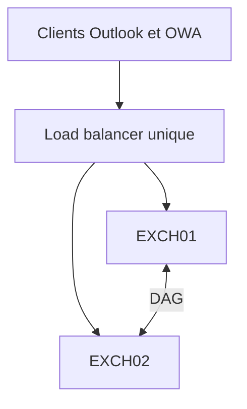
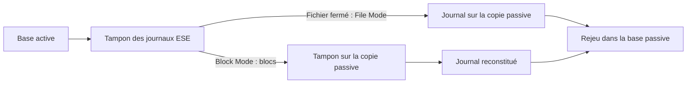
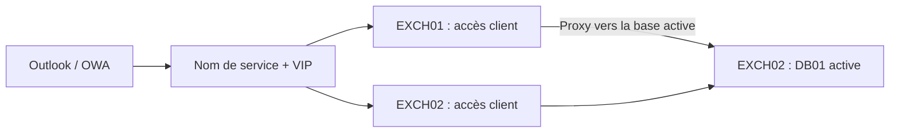
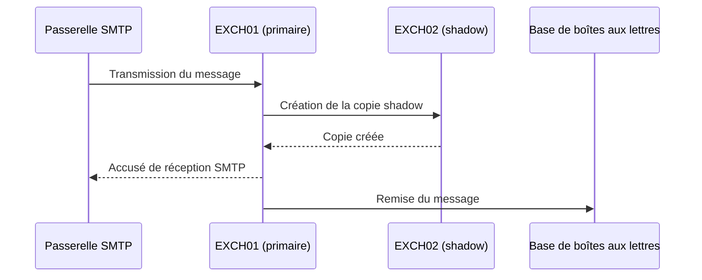
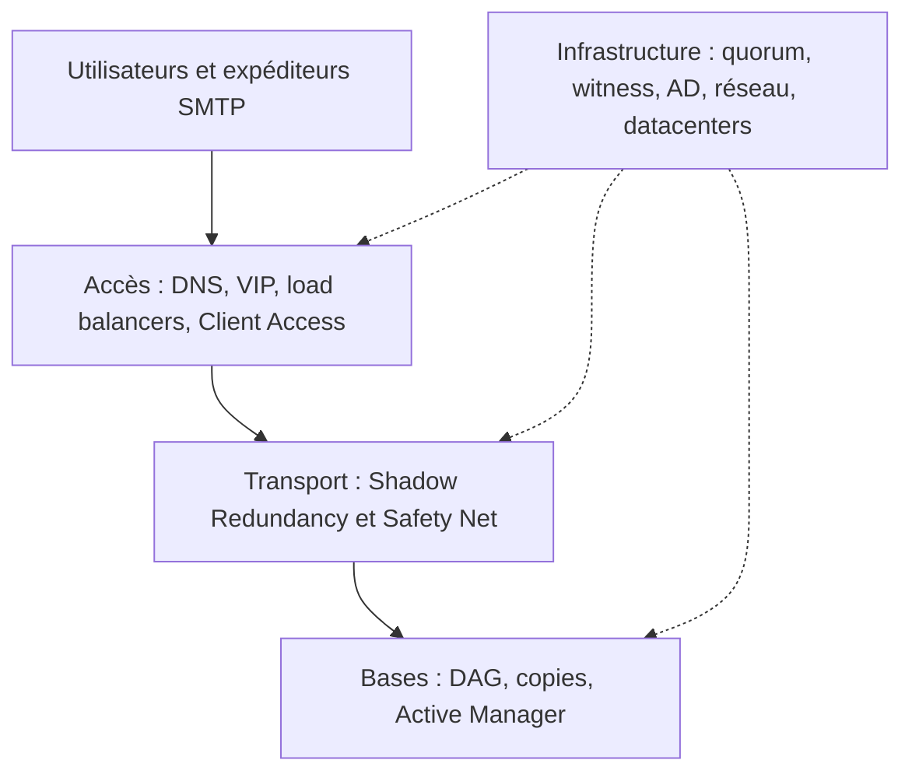

Quand on parle de haute disponibilité dans Exchange Server, on pense immédiatement aux **DAG** (*Database Availability Groups*). C'est logique : ils permettent de conserver plusieurs copies des bases de données et de basculer sur une copie saine en cas de défaillance.

Mais une base parfaitement répliquée ne suffit pas à rendre une messagerie disponible. Si les clients ne peuvent plus se connecter, si un équipement réseau constitue un point de défaillance unique ou si les messages se perdent avant leur remise, l'utilisateur subit malgré tout une interruption.

La haute disponibilité Exchange repose donc sur plusieurs mécanismes complémentaires : **disponibilité des bases**, **accès client**, **transport des messages** et **résilience des sites**.

Cet article prolonge [Comprendre le fonctionnement d'un DAG](/articles/comprendre-fonctionnement-dag-exchange-server/), sans reprendre tous les détails de son fonctionnement. La configuration des URL, des certificats et d'Autodiscover est abordée séparément dans [Comprendre les accès clients, Autodiscover, MAPI/HTTP, OWA et ActiveSync](/articles/exchange-server-comprendre-acces-clients-autodiscover-certificats-mapi-owa-activesync/).

> **Versions :** les exemples de formation utilisent Exchange Server 2019. En octobre 2026, Exchange Server 2016 et 2019 ont dépassé leur date de fin de support (14 octobre 2025). Pour une infrastructure on-premises maintenue, Exchange Server Subscription Edition (SE) est désormais la version de référence. Les principes décrits restent applicables à SE, sous réserve des évolutions documentées par Microsoft.

## Commencer par traquer les points de défaillance uniques

Imaginons deux serveurs Exchange dont toutes les bases sont répliquées. Les clients les joignent à travers un répartiteur de charge.



La perte d'un serveur Exchange peut être absorbée. Mais si le seul load balancer tombe, les clients perdent leur point d'entrée. On a rendu la couche Exchange redondante tout en conservant un **SPOF** (*Single Point of Failure*) devant elle.

La même question se pose pour les commutateurs, les pare-feu, le DNS, Active Directory, les liens WAN, les passerelles SMTP et l'alimentation électrique.

Il ne s'agit pas de tout doubler sans discernement. Il faut d'abord définir le niveau de service attendu, les scénarios de panne à couvrir, le **RTO** (temps maximal de reprise acceptable) et le **RPO** (perte de données maximale acceptable). Le coût de la protection doit être comparé au coût d'une indisponibilité.

## Première couche : le DAG protège les bases, pas toute la messagerie

Une base de données Exchange peut être présente sur plusieurs membres d'un DAG, mais **une seule copie est montée et active à un instant donné**. Les autres sont passives.

Le composant **Active Manager**, intégré au service Microsoft Exchange Replication, pilote l'activation des bases. Le **PAM** (*Primary Active Manager*) prend les décisions de basculement au niveau du DAG ; les **SAM** (*Standby Active Managers*) suivent notamment l'état local des copies.

Cela reste distinct de Windows Failover Clustering : le cluster fournit notamment les informations de membership et le quorum, tandis qu'Exchange décide quelle copie de base activer.

Pour approfondir ces rôles, le quorum et la sélection des copies, voir [l'article consacré au DAG](/articles/comprendre-fonctionnement-dag-exchange-server/).

### Deux modes de réplication : File Mode et Block Mode

La réplication continue repose sur les journaux de transactions, mais elle peut fonctionner de deux façons.

En **File Mode**, Exchange transfère les fichiers de journaux une fois fermés. Ce mode permet notamment à une copie de rattraper son retard après une interruption de la réplication ou une maintenance.

En **Block Mode**, lorsque les copies ont rattrapé leur retard, les données du tampon de journal ESE sont transmises aux tampons des copies passives avant même la fermeture du fichier de journal. Les serveurs passifs assemblent ensuite leurs propres journaux.



Le Block Mode réduit le décalage entre les copies et le risque de perdre les derniers journaux lors d'une panne. **Ce n'est toutefois pas une réplication synchrone au sens d'un accusé de réception de chaque écriture par toutes les copies** : le RPO réel dépend de l'état des copies et des conditions de basculement.

### Comment Exchange choisit-il une copie ?

Lorsqu'une base active devient indisponible, Exchange recherche une copie éligible, récupère si possible les derniers journaux et applique ses critères de santé. `ActivationPreference` exprime un ordre souhaité, mais ne garantit pas que la copie correspondante sera systématiquement retenue.

Autre paramètre déterminant : `AutoDatabaseMountDial`. Avec `BestAvailability`, Exchange peut accepter, sous certaines conditions, de monter une copie malgré un maximum de douze journaux manquants. `GoodAvailability` réduit ce seuil à six ; `Lossless` privilégie l'absence de perte de journaux. Ces paramètres matérialisent un arbitrage entre **reprise de service** et **risque de perte de données**.

## Deuxième couche : rendre les services d'accès client disponibles

Depuis Exchange Server 2016, les services d'accès client sont intégrés au rôle Mailbox. Ils sont conçus pour fonctionner de manière **stateless** : le client peut entrer par un serveur Exchange différent de celui qui héberge la copie active de sa base.



Le répartiteur de charge distribue les connexions et doit éviter les serveurs dont le service concerné est défaillant. **La persistance de session n'est pas nécessaire** pour les services HTTP modernes d'Exchange 2016/2019.

### Load balancing de niveau 4 ou de niveau 7 ?

Un répartiteur **L4** travaille principalement sur les informations réseau et transport. Il est plus simple, mais peut être limité lorsqu'il s'agit de distinguer une panne d'OWA d'une panne d'EWS ou de MAPI/HTTP, particulièrement si tous les services partagent le même nom et la même VIP.

Un répartiteur **L7** peut distinguer les requêtes HTTP par chemin et gérer des contrôles de santé par protocole, au prix d'une configuration et d'un traitement plus complexes. Avec un L4, il reste possible d'utiliser plusieurs noms/VIP pour différencier les services.

Dans les deux cas, la disponibilité du **répartiteur lui-même** est à traiter : un équipement isolé devant deux serveurs redondants reste un SPOF.

Un **load balancer L4 peut tout à fait réaliser une sonde HTTP** pour vérifier l'état d'un backend, même s'il ne déchiffre ni n'inspecte les requêtes qu'il distribue. La limite tient surtout à son incapacité à **router différemment les requêtes `/owa`, `/mapi` et `/ecp` sur une même VIP**, pas à une interdiction technique de faire une sonde applicative.

### Managed Availability : un contrôle plus utile qu'un simple port 443 ouvert

Exchange intègre **Managed Availability**, organisé autour de *probes*, *monitors* et *responders* : les contrôles détectent un problème, les moniteurs en évaluent l'état, et les répondeurs peuvent engager une action de réparation.

Pour les services HTTP, les endpoints de santé tels que `/owa/healthcheck.htm` ou `/mapi/healthcheck.htm` permettent au load balancer de s'appuyer sur la santé de la charge applicative et non sur la seule ouverture du port TCP. Selon le service et son état, ces contrôles peuvent notamment retourner **200** pour un service disponible ou **403** lorsqu'il est déclaré indisponible.

L'idée est importante : **un serveur allumé n'est pas nécessairement un serveur capable de rendre le service attendu**.

## Troisième couche : protéger les messages pendant leur transport

Le DAG protège les bases de données. Mais entre l'arrivée d'un message SMTP et son écriture dans la boîte aux lettres, celui-ci passe par des files d'attente de transport. Exchange dispose de mécanismes de protection spécifiques pour cette période.

### Shadow Redundancy : une copie avant l'accusé de réception SMTP

Prenons une passerelle SMTP externe, deux serveurs Mailbox et un message entrant.



Par défaut, Exchange essaie de disposer d'une copie du message sur un second serveur **avant d'accuser réception** auprès de l'expéditeur. Cette copie est conservée dans une **shadow queue** tant que le serveur principal n'a pas confirmé le traitement du message.

La nuance est que le comportement en cas d'impossibilité de créer cette copie dépend de `RejectMessageOnShadowFailure` : avec sa valeur par défaut (`$false`), Exchange peut accepter le message malgré l'échec de la copie redondante. Il ne faut donc pas présenter Shadow Redundancy comme une garantie absolue en toutes circonstances.

Si le serveur principal disparaît avant d'avoir transmis le message à son destinataire, le serveur détenteur de la copie shadow peut reprendre sa remise.

### Safety Net : une protection *après* la remise

Une fois le message correctement traité, il sort des files de livraison mais reste temporairement conservé dans **Safety Net**, avec une copie redondante dans **Shadow Safety Net**.

Safety Net permet notamment de **resoumettre des messages déjà remis** lorsque le DAG active une copie de base qui ne contient pas encore certaines transactions. Sa durée de rétention par défaut est de **deux jours**.

Il faut donc distinguer :

| Mécanisme | Moment de la protection | Problème traité |
|---|---|---|
| Shadow Redundancy | Message encore en transit | Perte du serveur de transport avant la remise |
| Safety Net | Message déjà traité ou remis | Nouvelle soumission après perte de transactions / basculement |
| DAG | Données des boîtes aux lettres | Panne de base, disque ou serveur |

Ces mécanismes se complètent. **Une copie shadow n'est pas une copie de base de données**, et Safety Net n'est pas une sauvegarde historique de boîte aux lettres.

## Quatrième couche : résilience SMTP et DNS

Côté Internet, les serveurs expéditeurs découvrent le point d'entrée de la messagerie via les enregistrements **MX**. Un MX contient un nom de serveur et une **préférence** : **plus sa valeur est faible, plus le serveur est prioritaire**.

Il est possible de publier plusieurs MX de même préférence ou des MX principaux et secondaires. Mais ces enregistrements ne constituent pas, à eux seuls, une supervision de service ni un système de répartition rigoureusement équilibré : le comportement concret dépend des serveurs SMTP expéditeurs.

**Attention au MX secondaire qui contourne les protections.** Si le MX principal pointe vers une passerelle antispam tandis qu'un MX secondaire donne un accès SMTP direct à Exchange, les expéditeurs peuvent tenter d'utiliser ce second chemin. Une différence de priorité ne constitue pas une barrière de sécurité. Tous les chemins publics de remise doivent appliquer un niveau de protection cohérent.

Lors d'un changement de passerelle ou d'adresse IP, il est pertinent d'abaisser **en amont** les TTL des enregistrements concernés, en tenant compte de l'ancien TTL encore présent dans les caches DNS. La continuité dépend aussi de l'accessibilité des passerelles, des liens Internet et de la réputation des nouvelles IP d'émission.

## Résilience multisite : les copies ne suffisent pas

Répartir les membres d'un DAG sur plusieurs datacenters permet de conserver des copies des bases hors du site principal. Mais le service dépend également du **quorum**, de l'annuaire, du DNS, de l'accès client et des entrées/sorties SMTP.

### Le witness participe au quorum

Dans un DAG avec un nombre pair de membres, le serveur témoin (*witness*) peut fournir le vote supplémentaire permettant au cluster de départager les membres. Il n'héberge pas une copie des bases et ne choisit pas lui-même quelle base doit devenir active.

Le witness est généralement un **serveur Windows membre du domaine, extérieur au DAG**. Lorsqu'il ne s'agit pas d'un serveur Exchange, le groupe `Exchange Trusted Subsystem` doit disposer des droits administrateurs locaux nécessaires à la création du partage et des fichiers du témoin.

Pour une architecture répartie entre deux datacenters, Microsoft préconise de placer le witness dans un **troisième emplacement indépendant**, lorsqu'il existe, afin de favoriser la continuité après la perte de l'un des deux datacenters.

### Witness alternatif : ne pas confondre préconfiguration et basculement automatique

Exchange permet de préconfigurer `AlternateWitnessServer` et `AlternateWitnessDirectory` :

```powershell
Set-DatabaseAvailabilityGroup -Identity DAG01 `
    -AlternateWitnessServer FSW02 `
    -AlternateWitnessDirectory C:\DAGWitness\DAG01
```

Mais **ce témoin alternatif ne prend pas automatiquement le relais si le témoin principal tombe**. Les paramètres sont utilisés dans une procédure de *datacenter switchover* ; celle-ci peut notamment nécessiter `Restore-DatabaseAvailabilityGroup` et une reconstitution contrôlée du quorum.

De même, la perte du witness seul **ne provoque pas automatiquement l'arrêt des bases** tant que le cluster conserve son quorum. Le problème apparaît lorsque d'autres votes sont perdus.

### Et si l'on dispose de trois datacenters ?

Des membres et des copies peuvent être répartis sur plus de deux sites. Mais **Microsoft ne recommande pas d'étendre un même DAG au-delà de deux datacenters dans sa Preferred Architecture**.

Surtout, trois emplacements pour les copies ne signifient pas automatiquement une tolérance à la perte simultanée de deux sites. Il faut étudier **la répartition des votes, le quorum restant, le caractère simultané ou successif des pannes et la procédure de reprise**. Une copie intacte n'est pas forcément activable si le cluster ne peut plus fonctionner normalement.

Enfin, le **DAC mode** (*Datacenter Activation Coordination*) sert à éviter certains scénarios de *split-brain* lors de la remise en service d'un site après un basculement. Il ne remplace ni le quorum ni un plan de reprise.

## Et les réseaux de réplication ?

Un réseau IP dédié à la réplication est possible, mais n'est pas obligatoire. La Preferred Architecture de Microsoft privilégie une configuration simplifiée avec **une seule interface réseau par serveur**, lorsque la capacité du réseau est suffisante.

Si plusieurs réseaux sont configurés, Exchange peut utiliser le réseau MAPI pour la réplication en cas de panne du réseau dédié, même si la réplication a été désactivée sur le réseau MAPI dans la configuration du DAG. Ce comportement évite de perdre toute réplication alors qu'un chemin IP utilisable existe encore.

Le réseau dédié ne doit donc pas être présenté comme un prérequis général des DAG.

## Travaux pratiques du module 6 : ce que l'on a réellement configuré

Les exercices utilisent `LON-EX1`, `LON-EX2` et le domaine fictif `adatum.com`. Dans le support 20345-1B, **Lab A** met en place le DAG et les copies de bases (pages 6-21 à 6-23) ; **Lab B** configure le load balancer et teste un incident (pages 6-31 à 6-34). Ce sont des manipulations en laboratoire, pas une procédure de déploiement recommandée telle quelle en production.

### Lab A — Créer le DAG, ajouter une copie, puis la déplacer

#### 1. Préconfigurer l'objet ordinateur du cluster : le CNO

L'exercice commence dans **Utilisateurs et ordinateurs Active Directory**. Dans le conteneur `Computers` — qui n'est pas une OU — on crée un compte ordinateur `DAG1`, on le désactive et on lui attribue des permissions permettant au cluster de l'utiliser. Le manuel demande explicitement le contrôle total au groupe `Exchange Trusted Subsystem` et au compte `ADATUM\LON-EX1$`.


Ce compte est le **CNO**, *Cluster Name Object* : l'identité AD du cluster Windows sous-jacent au DAG **lorsqu'il dispose d'un point d'accès administratif**. Les deux délégations demandées par le TP ne sont pas une règle universelle : la documentation Microsoft prévoit le contrôle total au compte du premier serveur **ou** au groupe `Exchange Trusted Subsystem`.

**Nuance essentielle :** les DAG **sans point d'accès administratif de cluster** ne nécessitent pas de CNO. Ils n'utilisent ni ressource de nom de cluster, ni IP de cluster pour l'administration. Il serait donc incorrect de présenter ce compte comme un prérequis de tout DAG Exchange moderne. Voir [Préconfigurer un CNO](https://learn.microsoft.com/en-us/exchange/high-availability/manage-ha/pre-stage-dag-cnos) et [Groupes de disponibilité de bases de données](https://learn.microsoft.com/en-us/exchange/high-availability/database-availability-groups/database-availability-groups).

#### 2. Créer le DAG et choisir le serveur témoin

Dans EAC, le lab crée le DAG avec les paramètres suivants :

| Paramètre | Valeur du lab |
|---|---|
| Nom du DAG | `DAG1` |
| Witness | `LON-DC1` |
| Répertoire témoin | `C:\FSWDAG1` |
| Adresse IP du DAG | `172.16.0.33` |
| Membres | `LON-EX1`, puis `LON-EX2` |

L'équivalent PowerShell, pour comprendre les objets créés, est :

```powershell
New-DatabaseAvailabilityGroup -Name DAG1 `
    -WitnessServer LON-DC1 `
    -WitnessDirectory C:\FSWDAG1 `
    -DatabaseAvailabilityGroupIPAddresses 172.16.0.33

Add-DatabaseAvailabilityGroupServer -Identity DAG1 -MailboxServer LON-EX1
Add-DatabaseAvailabilityGroupServer -Identity DAG1 -MailboxServer LON-EX2
```


C'est **l'ajout du premier membre** qui provoque la mise en place du cluster Windows sous-jacent ; Exchange installe au besoin la fonctionnalité Failover Clustering. L'ajout du second membre fait évoluer le cluster et son modèle de quorum ; le témoin entre en jeu quand il est nécessaire pour obtenir la majorité.

Le **choix de `LON-DC1` comme witness n'est pas un modèle de sécurité à reproduire**. La séance fait remarquer que le lab a accordé à `Exchange Trusted Subsystem` des droits dans le groupe `Builtin\Administrators` du domaine, afin d'utiliser un contrôleur de domaine comme témoin. Cette délégation est particulièrement étendue et à éviter en production. Mieux vaut un serveur témoin membre du domaine et extérieur au DAG, avec les permissions locales requises.

Pour un DAG sans IP ni point d'accès administratif, la syntaxe est différente :

```powershell
# Exemple alternatif : ne pas exécuter en plus de la création du DAG1 du lab.
New-DatabaseAvailabilityGroup -Name DAG-SANS-IP `
    -WitnessServer FSW01 `
    -DatabaseAvailabilityGroupIPAddresses ([System.Net.IPAddress]::None)
```

La valeur `255.255.255.255`, évoquée oralement, est également utilisée dans EAC pour représenter cette configuration. Ce n'est **pas** une adresse virtuelle à attribuer à une interface réseau. Vérifier la compatibilité exacte avec la version Exchange/Windows avant de créer le DAG.

#### 3. Créer une copie passive de la base

La base `Mailbox Database 1`, initialement active sur `LON-EX1`, est copiée vers `LON-EX2` avec `ActivationPreference` à **2** :

```powershell
Add-MailboxDatabaseCopy -Identity 'Mailbox Database 1' `
    -MailboxServer LON-EX2 -ActivationPreference 2
```


Exchange effectue un **seeding initial**, puis la réplication maintient la copie passive à jour. Le support invite à regarder les deux réglages supplémentaires **Replay lag time** et **Postpone seeding**, sans les modifier. Ils ne sont pas équivalents :

- `ReplayLagTime` retarde **le rejeu des journaux** déjà reçus, ce qui permet de constituer une *lagged copy*.
- `-SeedingPostponed` empêche **l'amorçage automatique initial** après l'ajout de la copie. Il faudra ensuite lancer explicitement `Update-MailboxDatabaseCopy`.

Le formateur a d'abord confondu le second paramètre avec un mécanisme évitant les basculements répétés, puis s'est corrigé. **Le réglage anti-basculements en ping-pong n'est donc pas identifié par cette séquence du cours ; il ne faut pas attribuer ce rôle à `SeedingPostponed`.**

#### 4. Vérifier, suspendre, reprendre et basculer

Les opérations étudiées peuvent être reproduites en Exchange Management Shell :

```powershell
# Vue des copies : une Mounted, l'autre Healthy
Get-MailboxDatabaseCopyStatus 'Mailbox Database 1' |
    Format-Table Name,Status,CopyQueueLength,ReplayQueueLength -AutoSize

# Santé de la réplication du membre
Test-ReplicationHealth -Identity LON-EX2

# Suspension temporaire de la copie passive
Suspend-MailboxDatabaseCopy -Identity 'Mailbox Database 1\LON-EX2' -Confirm:$false

# Reprise de la réplication
Resume-MailboxDatabaseCopy -Identity 'Mailbox Database 1\LON-EX2'

# Basculement manuel (switchover) vers le second serveur
Move-ActiveMailboxDatabase -Identity 'Mailbox Database 1' -ActivateOnServer LON-EX2
```


Il faut constater **`Mounted` sur la copie active** et **`Healthy` sur la passive**, avec des files de copie et de rejeu qui convergent. Le cours précise que `Test-ReplicationHealth` peut afficher des avertissements sur la redondance globale lorsque **d'autres bases ne disposent d'aucune copie supplémentaire**. Ce n'est pas nécessairement une panne de la base que l'on vient de répliquer.

Le formateur observe aussi un `ContentIndexState` à `NotApplicable` : ce résultat ne suffit pas, à lui seul, pour diagnostiquer un index défectueux sur Exchange 2019, où l'architecture d'indexation a évolué. Les tests réels de recherche et l'état des composants complètent le diagnostic.

### Lab B — Rendre les accès clients disponibles via un répartiteur L4

Le second atelier ne réplique pas les bases : il crée **une entrée commune HTTPS** permettant d'atteindre les deux serveurs Exchange. Le lab utilise une ancienne version communautaire de **Zen Load Balancer**, avec une ferme TCP sur le port 443.

#### 1. Installer le certificat sur les deux serveurs Exchange

Le même certificat `webmail.adatum.com` est importé sur `LON-EX1` et `LON-EX2`, puis associé au service **IIS**. Ce choix est cohérent avec la configuration **L4 TCP passthrough** du TP : le load balancer ne termine pas TLS, la session chiffrée arrive jusqu'au serveur Exchange. Le certificat utilisé par le client doit donc être présenté par le serveur Exchange sélectionné.

Cela ne signifie pas qu'un répartiteur n'a jamais besoin de certificat : **avec une terminaison TLS au niveau du load balancer**, celui-ci doit aussi posséder un certificat correspondant au nom publié.

#### 2. Définir une VIP et une ferme de deux backends

La configuration prescrite par le lab est la suivante :

| Élément | Valeur |
|---|---|
| Interface de gestion du LB | `172.16.0.2:444` |
| VIP du service | `172.16.0.100` |
| Protocole et port | `TCP/443` |
| Ferme | `ExchangeOWA` |
| Backend 1 | `LON-EX1` — `172.16.0.14:443` |
| Backend 2 | `LON-EX2` — `172.16.0.15:443` |
| Persistance par IP client | Désactivée |


Bien que la ferme s'appelle `ExchangeOWA`, **elle relaie les connexions TCP/443 et ne filtre pas magiquement le chemin `/owa`** : un équipement L4 ne lit pas ce chemin HTTP. Une connexion vers `/ecp` pourra emprunter la même ferme si elle utilise la VIP et le port 443. Il faut distinguer le **nom administratif de la ferme** du protocole réellement traité.

Comme les services Client Access modernes sont sans état, **la persistance de session n'est pas requise** pour le scénario décrit. Il n'est pas nécessaire d'envoyer toujours un même utilisateur sur `LON-EX1`.

#### 3. Publier le même nom sur le DNS et sur Exchange

On crée un enregistrement DNS `webmail.adatum.com` pointant vers `172.16.0.100`, puis on modifie les URL internes et externes des répertoires virtuels OWA et ECP sur **les deux serveurs** :

```text
webmail.adatum.com -> 172.16.0.100 (VIP)
                              |
                  +-----------+-----------+
                  |                       |
           172.16.0.14:443        172.16.0.15:443
               LON-EX1                 LON-EX2

https://webmail.adatum.com/owa
https://webmail.adatum.com/ecp
```


Le TP demande un `iisreset` sur les deux serveurs afin d'appliquer les changements. **Ce n'est pas une consigne de redémarrer IIS sur tous les nœuds en même temps en production** : cela interromprait toute la couche d'accès client. En exploitation, appliquer et vérifier les changements serveur par serveur dans une fenêtre de maintenance appropriée.

#### 4. Observer ce que le load balancer considère comme disponible

Après la configuration, la supervision de la ferme présente initialement les deux backends en vert :


Le TP simule ensuite une indisponibilité en **arrêtant IIS sur `LON-EX2`**, et demande de vérifier que `https://webmail.adatum.com/owa` reste accessible via `LON-EX1`. À la fin de la séance, les captures montrent aussi une expérimentation avec **un troisième backend `172.16.0.16`**, non prévu par l'exercice écrit, ainsi que des indicateurs rouges :


Le formateur a eu du mal à faire évoluer immédiatement le statut dans l'interface de cette ancienne appliance. Il envisage que la détection soit liée au trafic client et à la manière dont Zen actualise ses statistiques. **Ce comportement observé n'établit pas que les répartiteurs L4 n'effectuent leurs contrôles qu'à la première requête d'un client.** Il faudrait connaître la configuration exacte des sondes et des temporisations pour conclure.

Ce que l'incident illustre clairement : **un indicateur vert dans l'interface du load balancer n'est pas une preuve que `/owa` fonctionne correctement**, surtout si la sonde vérifie seulement la disponibilité de TCP/443. Il faut confronter l'état de la ferme à un test de bout en bout depuis un client et, idéalement, aux endpoints de santé d'Exchange.

#### 5. Tester le basculement de la base et la reconnexion d'Outlook

L'exercice 2 du Lab B prévoit une autre panne : `Mailbox Database 1` étant active sur `LON-EX2`, on **déconnecte la carte réseau virtuelle de ce serveur** dans Hyper-V, puis on observe si la base est remontée sur `LON-EX1` et si Outlook retrouve la connexion. Cela vérifie à la fois la **mobilité de la copie active** et la **capacité des services Client Access à continuer à servir l'utilisateur**.

Le transcript décrit le démarrage de ces vérifications mais ne documente pas avec certitude chaque état final (en particulier la reconnexion Outlook). Il ne faut donc pas présenter un test de reprise intégralement réussi comme un résultat mesuré de ce lab.

Le support prescrit ensuite de remettre le réseau du serveur dans l'état requis pour les modules suivants. **L'interruption d'un serveur Exchange via l'hyperviseur n'est à reproduire que dans un lab**, jamais comme méthode ordinaire de maintenance.

### Ce que l'exercice valide… et ce qu'il ne valide pas

| Observation | Portée réelle |
|---|---|
| Deux copies `Mounted` / `Healthy` | Une base dispose de copies sur deux membres du DAG |
| `Move-ActiveMailboxDatabase` fonctionne | La copie active peut changer de membre volontairement |
| OWA répond après l'arrêt d'IIS d'un backend | La couche d'accès peut contourner ce backend dans la configuration testée |
| Outlook se reconnecte après la perte d'un membre | Vérifier ce résultat dans les traces et le client : l'enregistrement ne le prouve pas entièrement |
| Zen signale `Cluster: Not configured` | **La VIP repose encore sur un load balancer unique : SPOF** |
| Witness placé sur le contrôleur de domaine | Montage pratique du lab, non modèle de délégation sécurisé |

À la fin de l'atelier, le DAG et les deux serveurs Exchange sont redondés, **mais pas l'appliance de load balancing**. Cette dernière affiche elle-même un avertissement signalant qu'elle n'est pas configurée en cluster. On ne devrait donc pas qualifier cette maquette de haute disponibilité de bout en bout.

### Astuce EAC : récupérer les commandes PowerShell exécutées

Le formateur montre enfin **Show Command Logging** dans l'ancien EAC, via l'icône d'aide. Lorsque ce volet est ouvert **avant** une action, il affiche les cmdlets utilisées par la console. C'est très utile pour apprendre la syntaxe PowerShell à partir d'une manipulation graphique, puis pour automatiser des opérations répétitives.

Ce **n'est pas un journal d'audit historique permanent** : il n'enregistre pas rétroactivement toutes les opérations antérieures à son ouverture. Ne pas confondre ce volet pédagogique avec les journaux d'audit ou la transcription PowerShell.

## Une première boîte à outils pour l'exploitation

Quelques commandes fournissent une première vue de la disponibilité :

```powershell
# Membres, témoin, quorum et Primary Active Manager
Get-DatabaseAvailabilityGroup DAG01 -Status |
    Format-List Name,Servers,OperationalServers,PrimaryActiveManager,*Witness*,DatacenterActivationMode

# Santé de la réplication d'un membre
Test-ReplicationHealth -Identity EXCH01

# État et retard des copies
Get-MailboxDatabaseCopyStatus * |
    Format-Table Name,Status,CopyQueueLength,ReplayQueueLength -AutoSize

# Vérification des composants Exchange
Get-ServerComponentState EXCH01 |
    Format-Table Component,State -AutoSize

# Santé des charges applicatives
Get-ServerHealth EXCH01 |
    Where-Object {$_.AlertValue -ne 'Healthy'} |
    Format-Table HealthSetName,Name,AlertValue -AutoSize

# Files d'attente sur un serveur
Get-Queue -Server EXCH01

# Paramétrage global de Shadow Redundancy
Get-TransportConfig |
    Format-List ShadowRedundancyEnabled,RejectMessageOnShadowFailure,ShadowMessagePreferenceSetting
```

Ces commandes ne constituent pas une procédure de dépannage complète. Elles permettent de distinguer les problèmes de **copies de bases**, de **composants d'accès client** et de **transport** au lieu de considérer toute interruption comme une panne du DAG.

Un contrôle de disponibilité utile doit également vérifier les éléments situés autour d'Exchange : DNS, Active Directory, équilibre des VIP, chemins SMTP, disponibilité des datacenters et infrastructure réseau.

## Une lagged copy est-elle une sauvegarde ?

Une copie différée reçoit les journaux mais retarde leur rejeu. Elle peut faciliter la récupération après une corruption logique majeure. Le délai `ReplayLagTime` est configurable jusqu'à **14 jours**, mais la Preferred Architecture de Microsoft retient généralement **7 jours**.

Cette copie ne doit pas être assimilée à un backup garanti : Exchange peut rejouer automatiquement ses journaux dans certains scénarios, et elle demeure dans le domaine d'administration de l'infrastructure Exchange.

Ce point est développé dans [Circular Logging, sauvegardes et cyber-récupération](/articles/exchange-circular-logging-sauvegardes-cyber-recovery/).

## Le modèle à retenir

La disponibilité d'une messagerie dépend de plusieurs couches qu'il faut concevoir et tester ensemble :



**Le DAG maintient les données disponibles. Le load balancing maintient l'accès. Shadow Redundancy et Safety Net sécurisent le parcours du message. Le quorum et la résilience multisite déterminent si cet ensemble peut continuer à fonctionner malgré une panne majeure.**

À ce stade, on a posé les principes. Reste la partie la plus opérationnelle : tester une panne, observer le choix de la copie activée, placer correctement un serveur en maintenance et diagnostiquer une réplication qui ne reprend pas.

<!-- BROUILLON : séances du module 6 intégrées jusqu'au Lab B. Compléter après réception de la suite (module 7/reprise après sinistre, maintenance et troubleshooting si abordés). -->

## Sources et prolongements

- [Microsoft Learn — High availability and site resilience](https://learn.microsoft.com/en-us/exchange/high-availability/high-availability)
- [Microsoft Learn — Database availability groups](https://learn.microsoft.com/en-us/exchange/high-availability/database-availability-groups/database-availability-groups)
- [Microsoft Learn — Transport high availability](https://learn.microsoft.com/en-us/exchange/mail-flow/transport-high-availability/transport-high-availability)
- [Microsoft Learn — Shadow Redundancy](https://learn.microsoft.com/en-us/exchange/mail-flow/transport-high-availability/shadow-redundancy)
- [Microsoft Learn — Safety Net](https://learn.microsoft.com/en-us/exchange/mail-flow/transport-high-availability/safety-net)
- [Microsoft Learn — Preferred Architecture](https://learn.microsoft.com/en-us/exchange/plan-and-deploy/deployment-ref/preferred-architecture)
- [Microsoft Learn — Datacenter switchovers](https://learn.microsoft.com/en-us/exchange/high-availability/manage-ha/datacenter-switchovers)
- [Microsoft Learn — Manage database availability groups](https://learn.microsoft.com/en-us/exchange/high-availability/manage-ha/manage-dags)
- [Microsoft Learn — Pre-stage the DAG CNO](https://learn.microsoft.com/en-us/exchange/high-availability/manage-ha/pre-stage-dag-cnos)
- [Microsoft Learn — Add-MailboxDatabaseCopy, option SeedingPostponed](https://learn.microsoft.com/en-us/powershell/module/exchangepowershell/add-mailboxdatabasecopy)
- [Microsoft Learn — Manage mailbox database copies](https://learn.microsoft.com/en-us/exchange/high-availability/manage-ha/manage-database-copies)
- [Microsoft Learn — Load balancing in Exchange Server](https://learn.microsoft.com/en-us/exchange/architecture/client-access/load-balancing)
- [Microsoft Learn — Fin de support Exchange Server 2016/2019](https://learn.microsoft.com/fr-fr/troubleshoot/exchange/administration/exchange-2019-2016-end-of-support)

*Notes techniques élaborées à partir du module 6 du support 20345-1B (Exchange Server 2016/2019), des deux transcriptions du 28 octobre 2026 (cours et labs), des captures d'écran du laboratoire et de la documentation Microsoft. Le module 7, consacré à la récupération après sinistre, n'est pas encore traité ici.*