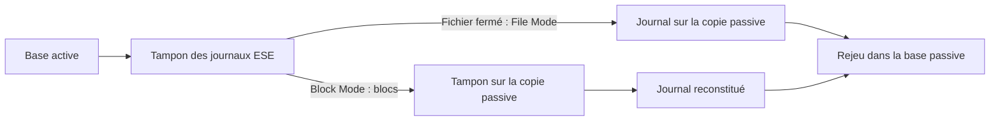
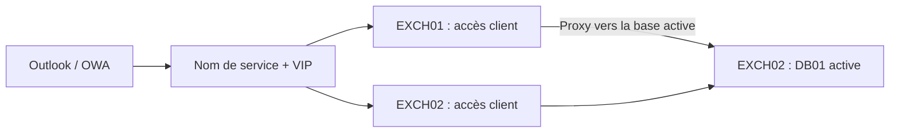
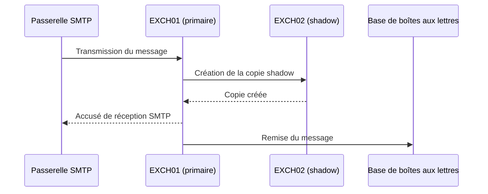
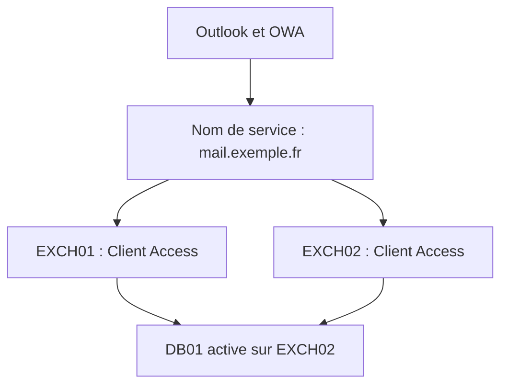
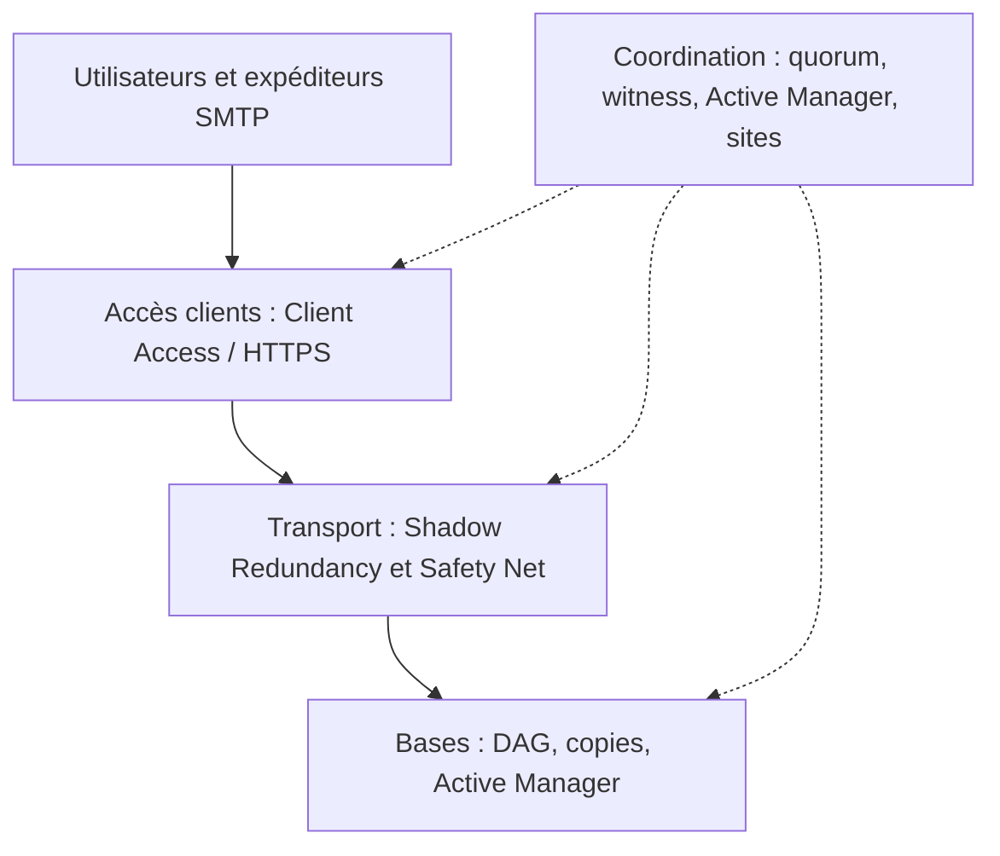

Quand on parle de haute disponibilité dans Exchange Server, on pense immédiatement aux **DAG** (*Database Availability Groups*). C'est logique : ils permettent de conserver plusieurs copies des bases de données et de basculer sur une copie saine en cas de défaillance.

Mais une base parfaitement répliquée ne suffit pas à garantir le service de messagerie. Un utilisateur peut ne plus accéder à OWA alors que sa base est disponible ; inversement, une connexion HTTPS opérationnelle ne garantit pas qu'une copie saine de sa base puisse être montée. Le transport SMTP possède lui aussi ses propres mécanismes de résilience.

La haute disponibilité Exchange repose donc sur plusieurs mécanismes complémentaires : **disponibilité des bases**, **accès client**, **transport des messages** et **résilience des sites**.

Cet article prolonge [Comprendre le fonctionnement d'un DAG](/articles/comprendre-fonctionnement-dag-exchange-server/), sans reprendre tous les détails de son fonctionnement. La configuration des URL, des certificats et d'Autodiscover est abordée séparément dans [Comprendre les accès clients, Autodiscover, MAPI/HTTP, OWA et ActiveSync](/articles/exchange-server-comprendre-acces-clients-autodiscover-certificats-mapi-owa-activesync/).

> **Versions :** les exemples de formation utilisent Exchange Server 2019. En octobre 2026, Exchange Server 2016 et 2019 ont dépassé leur date de fin de support (14 octobre 2025). Pour une infrastructure on-premises maintenue, Exchange Server Subscription Edition (SE) est désormais la version de référence. Les principes décrits restent applicables à SE, sous réserve des évolutions documentées par Microsoft.

## Première couche : le DAG protège les bases, pas toute la messagerie

Une base de données Exchange peut être présente sur plusieurs membres d'un DAG, mais **une seule copie est montée et active à un instant donné**. Les autres sont passives.

Le composant **Active Manager**, intégré au service Microsoft Exchange Replication, pilote l'activation des bases. Le **PAM** (*Primary Active Manager*) prend les décisions de basculement au niveau du DAG ; les **SAM** (*Standby Active Managers*) suivent notamment l'état local des copies.

Cela reste distinct de Windows Failover Clustering : le cluster fournit notamment les informations de membership et le quorum, tandis qu'Exchange décide quelle copie de base activer.

Pour approfondir ces rôles, le quorum et la sélection des copies, voir [l'article consacré au DAG](/articles/comprendre-fonctionnement-dag-exchange-server/).

### Deux modes de réplication : File Mode et Block Mode

La réplication continue repose sur les journaux de transactions, mais elle peut fonctionner de deux façons.

En **File Mode**, Exchange transfère les fichiers de journaux une fois fermés. Ce mode permet notamment à une copie de rattraper son retard après une interruption de la réplication ou une maintenance.

En **Block Mode**, lorsque les copies ont rattrapé leur retard, les données du tampon de journal ESE sont transmises aux tampons des copies passives avant même la fermeture du fichier de journal. Les serveurs passifs assemblent ensuite leurs propres journaux.



Le Block Mode réduit le décalage entre les copies et le risque de perdre les derniers journaux lors d'une panne. **Ce n'est toutefois pas une réplication synchrone au sens d'un accusé de réception de chaque écriture par toutes les copies** : le RPO réel dépend de l'état des copies et des conditions de basculement.


*Dans EAC, `Mailbox Database 1` a une copie active `Mounted` sur `LON-EX1`, tandis que sa copie passive sur `LON-EX2` est indiquée `Resynchronizing`. Disposer de deux copies ne signifie donc pas qu'elles sont toutes deux immédiatement prêtes à être activées.*

### Comment Exchange choisit-il une copie ?

Lorsqu'une base active devient indisponible, Exchange recherche une copie éligible, récupère si possible les derniers journaux et applique ses critères de santé. `ActivationPreference` exprime un ordre souhaité, mais ne garantit pas que la copie correspondante sera systématiquement retenue.

Autre paramètre déterminant : `AutoDatabaseMountDial`. Avec `BestAvailability`, Exchange peut accepter, sous certaines conditions, de monter une copie malgré un maximum de douze journaux manquants. `GoodAvailability` réduit ce seuil à six ; `Lossless` privilégie l'absence de perte de journaux. Ces paramètres matérialisent un arbitrage entre **reprise de service** et **risque de perte de données**.


*Après un déplacement volontaire de la base, EAC indique `LON-EX2` comme serveur actif de `Mailbox Database 1`, alors qu'il indiquait `LON-EX1` sur la capture précédente. Le nom de la base reste identique. Cet écran ne renseigne pas à lui seul sur l'état des copies passives.*

## Deuxième couche : rendre les services d'accès client disponibles

Depuis Exchange Server 2016, les services d'accès client sont intégrés au rôle Mailbox. Ils sont conçus pour fonctionner de manière **stateless** : le client peut entrer par un serveur Exchange différent de celui qui héberge la copie active de sa base.



La couche d'accès client doit orienter les connexions vers un serveur capable de traiter le protocole demandé. **La persistance de session n'est pas nécessaire** pour les services HTTP modernes d'Exchange 2016/2019.

### Un service qui répond sur TCP/443 peut-il quand même être en panne ?

Prenons un serveur Exchange dont le site OWA dysfonctionne alors que MAPI/HTTP continue de répondre. Un répartiteur qui vérifie uniquement que le port TCP/443 est ouvert risque de continuer à lui envoyer les utilisateurs du webmail, alors que le service dont ils ont besoin est défaillant.

Un contrôle plus pertinent doit distinguer **la disponibilité de la machine** de **la santé du service applicatif**. Selon la méthode utilisée, le répartiteur peut tester une connexion TCP, interroger un endpoint HTTP de santé ou tenir compte de l'état propre à chaque service. La distinction L4/L7 concerne principalement le traitement et l'orientation du trafic ; elle ne suffit pas, à elle seule, pour savoir quelles sondes un équipement sait effectuer.

L'important pour Exchange est de ne pas confondre **port TCP ouvert** et **service applicatif disponible**. La répartition des connexions n'est ici qu'un moyen de présenter les services Client Access des différents membres.

### Managed Availability : un contrôle plus utile qu'un simple port 443 ouvert

Exchange intègre **Managed Availability**, organisé autour de *probes*, *monitors* et *responders* : les contrôles détectent un problème, les moniteurs en évaluent l'état, et les répondeurs peuvent engager une action de réparation.

Pour les services HTTP, les endpoints de santé tels que `/owa/healthcheck.htm` ou `/mapi/healthcheck.htm` permettent au load balancer de s'appuyer sur la santé de la charge applicative et non sur la seule ouverture du port TCP. Selon le service et son état, ces contrôles peuvent notamment retourner **200** pour un service disponible ou **403** lorsqu'il est déclaré indisponible.

L'idée est importante : **un serveur allumé n'est pas nécessairement un serveur capable de rendre le service attendu**.

## Troisième couche : protéger les messages pendant leur transport

Le DAG protège les bases de données. Mais entre l'arrivée d'un message SMTP et son écriture dans la boîte aux lettres, celui-ci passe par des files d'attente de transport. Exchange dispose de mécanismes de protection spécifiques pour cette période.

### Shadow Redundancy : une copie avant l'accusé de réception SMTP

Prenons une passerelle SMTP externe, deux serveurs Mailbox et un message entrant.



Par défaut, Exchange essaie de disposer d'une copie du message sur un second serveur **avant d'accuser réception** auprès de l'expéditeur. Cette copie est conservée dans une **shadow queue** tant que le serveur principal n'a pas confirmé le traitement du message.

La nuance est que le comportement en cas d'impossibilité de créer cette copie dépend de `RejectMessageOnShadowFailure` : avec sa valeur par défaut (`$false`), Exchange peut accepter le message malgré l'échec de la copie redondante. Il ne faut donc pas présenter Shadow Redundancy comme une garantie absolue en toutes circonstances.

Si le serveur principal disparaît avant d'avoir transmis le message à son destinataire, le serveur détenteur de la copie shadow peut reprendre sa remise.

### Safety Net : une protection *après* la remise

Une fois le message correctement traité, il sort des files de livraison mais reste temporairement conservé dans **Safety Net**, avec une copie redondante dans **Shadow Safety Net**.

Safety Net permet notamment de **resoumettre des messages déjà remis** lorsque le DAG active une copie de base qui ne contient pas encore certaines transactions. Sa durée de rétention par défaut est de **deux jours**.

Il faut donc distinguer :

| Mécanisme | Moment de la protection | Problème traité |
|---|---|---|
| Shadow Redundancy | Message encore en transit | Perte du serveur de transport avant la remise |
| Safety Net | Message déjà traité ou remis | Nouvelle soumission après perte de transactions / basculement |
| DAG | Données des boîtes aux lettres | Panne de base, disque ou serveur |

Ces mécanismes se complètent. **Une copie shadow n'est pas une copie de base de données**, et Safety Net n'est pas une sauvegarde historique de boîte aux lettres.

## Quatrième couche : résilience SMTP et DNS

Côté Internet, les serveurs expéditeurs découvrent le point d'entrée de la messagerie via les enregistrements **MX**. Un MX contient un nom de serveur et une **préférence** : **plus sa valeur est faible, plus le serveur est prioritaire**.

Il est possible de publier plusieurs MX de même préférence ou des MX principaux et secondaires. Mais ces enregistrements ne constituent pas, à eux seuls, une supervision de service ni un système de répartition rigoureusement équilibré : le comportement concret dépend des serveurs SMTP expéditeurs.

**Attention au MX secondaire qui contourne les protections.** Si le MX principal pointe vers une passerelle antispam tandis qu'un MX secondaire donne un accès SMTP direct à Exchange, les expéditeurs peuvent tenter d'utiliser ce second chemin. Une différence de priorité ne constitue pas une barrière de sécurité. Tous les chemins publics de remise doivent appliquer un niveau de protection cohérent.

Lors d'un changement de passerelle ou d'adresse IP, il est pertinent d'abaisser **en amont** les TTL des enregistrements concernés, en tenant compte de l'ancien TTL encore présent dans les caches DNS. La continuité dépend aussi de l'accessibilité des passerelles, des liens Internet et de la réputation des nouvelles IP d'émission.

## Résilience multisite : les copies ne suffisent pas

Répartir les membres d'un DAG sur plusieurs datacenters permet de conserver des copies des bases hors du site principal. Mais le service dépend également du **quorum**, de l'annuaire, du DNS, de l'accès client et des entrées/sorties SMTP.

### Le witness participe au quorum

Dans un DAG avec un nombre pair de membres, le serveur témoin (*witness*) peut fournir le vote supplémentaire permettant au cluster de départager les membres. Il n'héberge pas une copie des bases et ne choisit pas lui-même quelle base doit devenir active.

Le witness est généralement un **serveur Windows membre du domaine, extérieur au DAG**. Lorsqu'il ne s'agit pas d'un serveur Exchange, le groupe `Exchange Trusted Subsystem` doit disposer des droits administrateurs locaux nécessaires à la création du partage et des fichiers du témoin.

Pour une architecture répartie entre deux datacenters, Microsoft préconise de placer le witness dans un **troisième emplacement indépendant**, lorsqu'il existe, afin de favoriser la continuité après la perte de l'un des deux datacenters.


*Dans l'ancien EAC, le DAG `DAG1` regroupe `LON-EX1` et `LON-EX2`, avec un witness distinct. Le contrôleur de domaine est utilisé comme témoin uniquement pour les besoins de cette maquette ; ce n'est pas le choix à reproduire systématiquement en production.*

### Le point d'accès administratif du cluster : une IP dont Exchange peut se passer

Un DAG Exchange s'appuie sur **Windows Server Failover Clustering**, mais cela ne signifie pas que les clients ou les administrateurs Exchange doivent se connecter à un nom de cluster.

Dans un cluster Windows traditionnel, le **point d'accès administratif** (*Cluster Administrative Access Point*, CAAP) est une identité réseau propre au cluster. Elle comprend un nom virtuel, une adresse IP et un compte ordinateur Active Directory appelé **CNO** (*Cluster Name Object*). Le CNO est l'identité de sécurité du cluster, notamment pour l'authentification Kerberos.

Imaginons deux serveurs, `EXCH01` et `EXCH02`, réunis dans le DAG `DAG01`. Avec le modèle historique, le cluster sous-jacent peut posséder un nom DNS `DAG01.adatum.com`, une adresse IP et le compte ordinateur `DAG01$` dans l'AD.

Ces éléments ne jouent **aucun rôle de point d'entrée pour Outlook ou OWA**. Il faut distinguer :

| Élément | Ce qu'il fait |
|---|---|
| **CAAP et CNO** | Identité réseau et de sécurité du cluster Windows, si ce modèle est utilisé |
| **Witness** | Participe au quorum lorsque les votes disponibles le nécessitent |
| **Nom DNS et VIP des clients** | Permettent aux utilisateurs d'atteindre les services Client Access |
| **DAG** | Regroupe les membres Exchange, leurs copies de bases et les mécanismes de basculement |

Pour un DAG moderne, le point d'accès administratif **n'est pas nécessaire**. On peut créer un **DAG sans point d'accès administratif** (*IP-less DAG*) : le cluster n'a pas de ressource de nom réseau, pas de ressource IP, pas d'enregistrement DNS associé à son nom, et **aucun CNO n'est créé**.

Cela ne supprime pas le cluster : les mécanismes de *heartbeat*, de quorum et de suivi des membres continuent de fonctionner. L'objet de configuration du DAG existe toujours dans Active Directory, mais ce n'est pas un compte ordinateur CNO.

Un tel cluster n'est pas administré en se connectant à un nom virtuel depuis le gestionnaire graphique Windows. On administre le DAG via Exchange Management Shell ; si des cmdlets de cluster Windows sont nécessaires, elles ciblent directement un membre.

Pourquoi certains exercices demandent-ils de créer un compte ordinateur `DAG01` désactivé et de donner au groupe `Exchange Trusted Subsystem` le contrôle de cet objet ? Il s'agit de **précréer le CNO** (*pre-stage*) pour un DAG avec point d'accès administratif, afin que le cluster puisse utiliser l'identité prévue sans devoir créer lui-même ce compte. **Ce n'est pas une étape obligatoire de création d'un DAG**.

Microsoft recommande de s'affranchir du CAAP lorsque rien ne l'exige. Certaines solutions de supervision ou de sauvegarde historiques peuvent toutefois avoir besoin de cet accès : il faut le vérifier avant de choisir le mode de déploiement.

Voir [les groupes de disponibilité de bases Microsoft](https://learn.microsoft.com/en-us/exchange/high-availability/database-availability-groups/database-availability-groups) et [la précréation du CNO](https://learn.microsoft.com/en-us/exchange/high-availability/manage-ha/pre-stage-dag-cnos).

### Witness alternatif : ne pas confondre préconfiguration et basculement automatique

Exchange permet de préconfigurer `AlternateWitnessServer` et `AlternateWitnessDirectory` :

```powershell
Set-DatabaseAvailabilityGroup -Identity DAG01 `
    -AlternateWitnessServer FSW02 `
    -AlternateWitnessDirectory C:\DAGWitness\DAG01
```

Mais **ce témoin alternatif ne prend pas automatiquement le relais si le témoin principal tombe**. Les paramètres sont utilisés dans une procédure de *datacenter switchover* ; celle-ci peut notamment nécessiter `Restore-DatabaseAvailabilityGroup` et une reconstitution contrôlée du quorum.

De même, la perte du witness seul **ne provoque pas automatiquement l'arrêt des bases** tant que le cluster conserve son quorum. Le problème apparaît lorsque d'autres votes sont perdus.

### Et si l'on dispose de trois datacenters ?

Des membres et des copies peuvent être répartis sur plus de deux sites. Mais **Microsoft ne recommande pas d'étendre un même DAG au-delà de deux datacenters dans sa Preferred Architecture**.

Surtout, trois emplacements pour les copies ne signifient pas automatiquement une tolérance à la perte simultanée de deux sites. Il faut étudier **la répartition des votes, le quorum restant, le caractère simultané ou successif des pannes et la procédure de reprise**. Une copie intacte n'est pas forcément activable si le cluster ne peut plus fonctionner normalement.

Enfin, le **DAC mode** (*Datacenter Activation Coordination*) sert à éviter certains scénarios de *split-brain* lors de la remise en service d'un site après un basculement. Il ne remplace ni le quorum ni un plan de reprise.

## Et les réseaux de réplication ?

Un réseau IP dédié à la réplication est possible, mais n'est pas obligatoire. La Preferred Architecture de Microsoft privilégie une configuration simplifiée avec **une seule interface réseau par serveur**, lorsque la capacité du réseau est suffisante.

Si plusieurs réseaux sont configurés, Exchange peut utiliser le réseau MAPI pour la réplication en cas de panne du réseau dédié, même si la réplication a été désactivée sur le réseau MAPI dans la configuration du DAG. Ce comportement évite de perdre toute réplication alors qu'un chemin IP utilisable existe encore.

Le réseau dédié ne doit donc pas être présenté comme un prérequis général des DAG.

## Que se passe-t-il lorsqu'un serveur Exchange devient indisponible ?

Prenons deux serveurs Exchange, chacun fournissant les services Client Access, et une base `DB01` active sur le second :



Deux défaillances très différentes peuvent se produire :

- **Le site OWA d'EXCH02 tombe, mais la base reste active sur EXCH02.** L'accès web peut continuer par EXCH01, qui transmet les requêtes au backend approprié. La base n'a pas besoin de basculer.
- **EXCH02 tombe entièrement.** Active Manager doit pouvoir monter une copie saine de DB01 sur EXCH01, et les connexions clientes doivent rejoindre un point d'entrée encore disponible. Le basculement de la base et la reprise de l'accès client sont deux opérations distinctes.

C'est précisément ce que les simulations de panne permettent de comprendre : **la disponibilité de la base n'implique pas automatiquement la disponibilité des services**, et inversement. Pour valider une architecture, il faut tester chaque couche et une panne combinée, pas simplement constater que deux serveurs sont allumés.


## Une première boîte à outils pour l'exploitation

Quelques commandes fournissent une première vue de la disponibilité :

```powershell
# Membres, témoin, quorum et Primary Active Manager
Get-DatabaseAvailabilityGroup DAG01 -Status |
    Format-List Name,Servers,OperationalServers,PrimaryActiveManager,*Witness*,DatacenterActivationMode

# Santé de la réplication d'un membre
Test-ReplicationHealth -Identity EXCH01

# État et retard des copies
Get-MailboxDatabaseCopyStatus * |
    Format-Table Name,Status,CopyQueueLength,ReplayQueueLength -AutoSize

# Vérification des composants Exchange
Get-ServerComponentState EXCH01 |
    Format-Table Component,State -AutoSize

# Santé des charges applicatives
Get-ServerHealth EXCH01 |
    Where-Object {$_.AlertValue -ne 'Healthy'} |
    Format-Table HealthSetName,Name,AlertValue -AutoSize

# Files d'attente sur un serveur
Get-Queue -Server EXCH01

# Paramétrage global de Shadow Redundancy
Get-TransportConfig |
    Format-List ShadowRedundancyEnabled,RejectMessageOnShadowFailure,ShadowMessagePreferenceSetting
```

Ces commandes ne constituent pas une procédure de dépannage complète. Elles permettent de distinguer les problèmes de **copies de bases**, de **composants d'accès client** et de **transport** au lieu de considérer toute interruption comme une panne du DAG.

Le diagnostic Exchange doit recouper l'état des bases, de la réplication, des services Client Access, des files de transport et du quorum, avant de conclure sur la cause d'une interruption.

## Une lagged copy est-elle une sauvegarde ?

Une copie différée reçoit les journaux mais retarde leur rejeu. Elle peut faciliter la récupération après une corruption logique majeure. Le délai `ReplayLagTime` est configurable jusqu'à **14 jours**, mais la Preferred Architecture de Microsoft retient généralement **7 jours**.

Cette copie ne doit pas être assimilée à un backup garanti : Exchange peut rejouer automatiquement ses journaux dans certains scénarios, et elle demeure dans le domaine d'administration de l'infrastructure Exchange.

Ce point est développé dans [Circular Logging, sauvegardes et cyber-récupération](/articles/exchange-circular-logging-sauvegardes-cyber-recovery/).

## Le modèle à retenir

La disponibilité d'une messagerie dépend de plusieurs couches qu'il faut concevoir et tester ensemble :



**Le DAG rend les copies de bases disponibles et Active Manager pilote leur activation. Les services Client Access permettent de rejoindre la copie active. Shadow Redundancy et Safety Net protègent le flux de messages, tandis que le quorum et la résilience multisite conditionnent la poursuite du service lors d'une panne importante.**

À ce stade, on a posé les principes. Reste la partie la plus opérationnelle : tester une panne, observer le choix de la copie activée, placer correctement un serveur en maintenance et diagnostiquer une réplication qui ne reprend pas.

<!-- BROUILLON : compléter avec les prochains apports techniques sur la maintenance et le dépannage Exchange. -->

## Sources et prolongements

- [Microsoft Learn — High availability and site resilience](https://learn.microsoft.com/en-us/exchange/high-availability/high-availability)
- [Microsoft Learn — Database availability groups](https://learn.microsoft.com/en-us/exchange/high-availability/database-availability-groups/database-availability-groups)
- [Microsoft Learn — Transport high availability](https://learn.microsoft.com/en-us/exchange/mail-flow/transport-high-availability/transport-high-availability)
- [Microsoft Learn — Shadow Redundancy](https://learn.microsoft.com/en-us/exchange/mail-flow/transport-high-availability/shadow-redundancy)
- [Microsoft Learn — Safety Net](https://learn.microsoft.com/en-us/exchange/mail-flow/transport-high-availability/safety-net)
- [Microsoft Learn — Preferred Architecture](https://learn.microsoft.com/en-us/exchange/plan-and-deploy/deployment-ref/preferred-architecture)
- [Microsoft Learn — Datacenter switchovers](https://learn.microsoft.com/en-us/exchange/high-availability/manage-ha/datacenter-switchovers)
- [Microsoft Learn — Manage database availability groups](https://learn.microsoft.com/en-us/exchange/high-availability/manage-ha/manage-dags)
- [Microsoft Learn — Pre-stage the DAG CNO](https://learn.microsoft.com/en-us/exchange/high-availability/manage-ha/pre-stage-dag-cnos)
- [Microsoft Learn — Add-MailboxDatabaseCopy, option SeedingPostponed](https://learn.microsoft.com/en-us/powershell/module/exchangepowershell/add-mailboxdatabasecopy)
- [Microsoft Learn — Manage mailbox database copies](https://learn.microsoft.com/en-us/exchange/high-availability/manage-ha/manage-database-copies)
- [Microsoft Learn — Load balancing in Exchange Server](https://learn.microsoft.com/en-us/exchange/architecture/client-access/load-balancing)
- [Microsoft Learn — Fin de support Exchange Server 2016/2019](https://learn.microsoft.com/fr-fr/troubleshoot/exchange/administration/exchange-2019-2016-end-of-support)

*Notes techniques élaborées à partir du module 6 du support 20345-1B (Exchange Server 2016/2019), des deux transcriptions du 28 octobre 2026 (cours et labs), des captures d'écran du laboratoire et de la documentation Microsoft. Le module 7, consacré à la récupération après sinistre, n'est pas encore traité ici.*