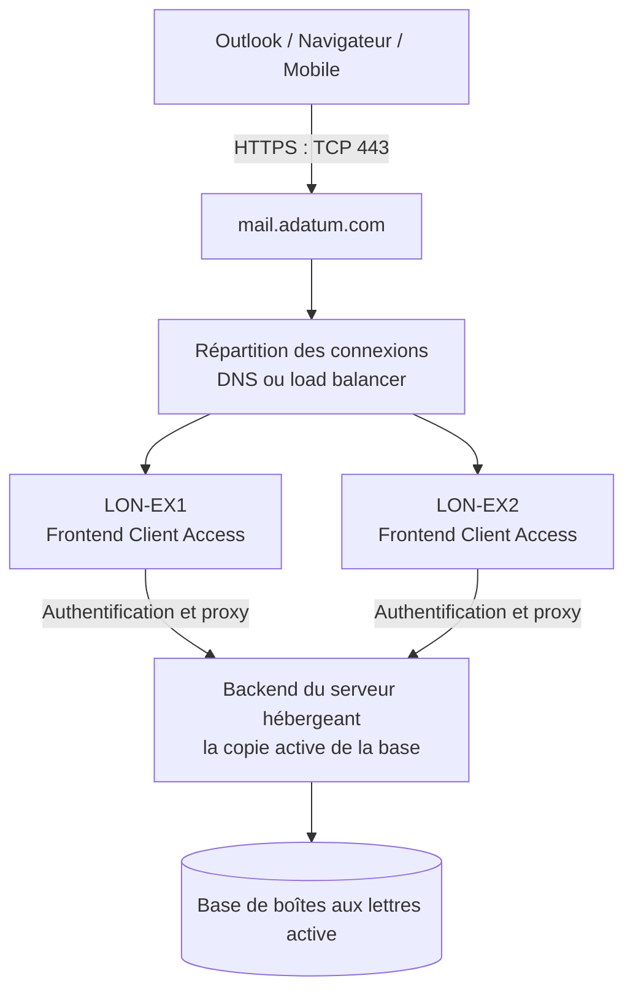
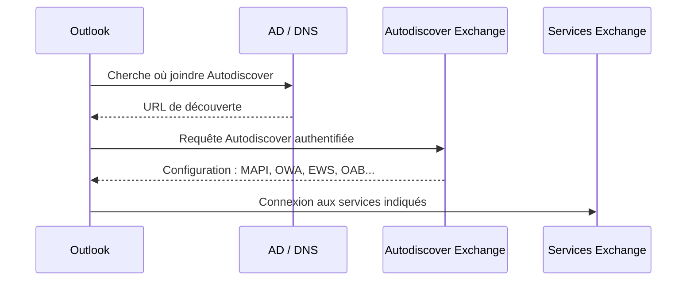
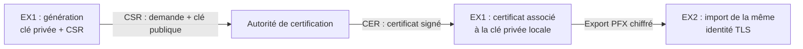

Lorsqu'un utilisateur ouvre Outlook, les messages ne viennent pas directement d'une base Exchange au moyen d'une connexion à un serveur connu à l'avance. Plusieurs composants entrent en jeu : le DNS, Autodiscover, les services Client Access, IIS, les répertoires virtuels, les certificats TLS et, enfin, les services backend qui accèdent aux boîtes aux lettres.

Ces composants fonctionnent ensemble, mais ne remplissent pas la même fonction. **Le DNS dit où trouver un service ; Autodiscover dit comment s'y connecter ; le certificat permet au client de vérifier le serveur et de protéger la connexion ; le frontend Exchange transmet ensuite les requêtes au backend approprié.**

Je propose de suivre ce chemin pour comprendre l'architecture et ses conséquences en administration et en dépannage. Les exemples utilisent l'organisation fictive `adatum.com`, deux serveurs `LON-EX1` et `LON-EX2`, et le namespace partagé `mail.adatum.com`. Les captures proviennent d'un environnement de formation Exchange Server 2019, mais les mécanismes décrits restent largement pertinents pour Exchange Server Subscription Edition (SE), sous réserve des évolutions propres à chaque version.

> **À propos des versions :** Exchange Server 2016 et 2019 ont atteint la fin de leur support standard/étendu le **14 octobre 2025**. En 2026, la version de référence pour une nouvelle infrastructure on-premises est Exchange Server Subscription Edition (SE). Les écrans de l'ancien EAC sont donc avant tout illustratifs : les fonctionnalités ou emplacements exacts peuvent varier selon la version et la mise à jour cumulative.

## 1. Architecture : comment un client accède réellement à sa boîte

Avec Exchange 2010, le rôle Client Access Server (CAS) pouvait être déployé séparément. Depuis Exchange 2016, **les services Client Access font partie du rôle Mailbox**. Chaque serveur de boîtes aux lettres peut accepter une connexion client et transmettre la demande au serveur qui héberge la copie active de la base correspondante.



Le client peut ainsi entrer par `LON-EX1` alors que sa boîte se trouve dans une base active sur `LON-EX2`. Le frontend ne travaille pas à partir d'une copie locale arbitraire : il sait où se trouve la boîte et fait suivre la requête. C'est le **proxying stateless**, qui évite de devoir maintenir une affinité de session stricte sur le load balancer pour ces accès HTTP.

Il faut distinguer deux formes de disponibilité :

- **Disponibilité des données** : assurée notamment par les copies de bases et le DAG.
- **Disponibilité de l'accès client** : assurée par des points d'entrée et des serveurs frontend fonctionnels, des URL cohérentes et un mécanisme de répartition/basculement.

Un DAG fonctionnel ne garantit pas à lui seul que les clients pourront joindre `mail.adatum.com`.

### Les services à connaître

| Composant | Rôle principal | Exemple |
|---|---|---|
| **Autodiscover** | Fournir les paramètres nécessaires au client | `/Autodiscover/Autodiscover.xml` |
| **MAPI over HTTP** | Connexion principale d'Outlook aux boîtes | `/mapi` |
| **Outlook Anywhere** | Ancien transport RPC over HTTP, utilisé pour la compatibilité | Namespace HTTPS |
| **OWA** | Messagerie depuis un navigateur | `/owa` |
| **ECP / EAC** | Administration Exchange et certains paramètres de boîte | `/ecp` |
| **EWS** | Services Web : disponibilités, intégrations et fonctions applicatives | `/EWS/Exchange.asmx` |
| **OAB** | Téléchargement du carnet d'adresses hors connexion | `/OAB` |
| **ActiveSync** | Synchronisation de terminaux et applications compatibles | `/Microsoft-Server-ActiveSync` |
| **MRS Proxy** | Prise en charge de certains déplacements distants de boîtes | EWS / `MRSProxyEnabled` |

Ces services sont principalement exposés par IIS sur HTTPS. POP3, IMAP4 et SMTP ne passent pas par les mêmes répertoires virtuels et utilisent leurs propres protocoles.

## 2. Le namespace : un nom logique au lieu du nom physique des serveurs

À l'installation, Exchange renseigne souvent des URL internes basées sur le FQDN de chaque machine : `lon-ex1.adatum.com`, `lon-ex2.adatum.com`, etc. Ce n'est pas ce que l'on veut présenter durablement aux clients.

Un **namespace** est un nom logique stable, commun à plusieurs serveurs. Dans notre exemple, les clients utilisent toujours :

```text
https://mail.adatum.com
```

Peu importe que l'infrastructure derrière ce nom comporte deux, quatre ou dix serveurs. Le namespace est indépendant du domaine Active Directory et n'est pas forcément identique au domaine utilisé pour les adresses SMTP.

La plupart des répertoires virtuels possèdent deux attributs essentiels :

- `InternalUrl` : URL communiquée pour les connexions internes ;
- `ExternalUrl` : URL communiquée pour les connexions externes, lorsque le service est publié.

Ces deux propriétés peuvent être identiques dans une architecture de **split DNS** : le nom reste `mail.adatum.com`, mais les résolveurs internes et publics ne le traduisent pas nécessairement vers la même IP.


*Les répertoires virtuels sont configurés par serveur. Les noms et les méthodes d'authentification doivent être cohérents entre les serveurs qui partagent le même point d'entrée.*


*OWA expose ici la même URL en interne et en externe : `https://mail.adatum.com/owa`. Le DNS et la publication réseau déterminent où aboutit réellement la connexion.*

### Contrôler les URL en PowerShell

```powershell
Get-OwaVirtualDirectory |
    Format-Table Server,Identity,InternalUrl,ExternalUrl -AutoSize

Get-EcpVirtualDirectory |
    Format-Table Server,InternalUrl,ExternalUrl -AutoSize

Get-WebServicesVirtualDirectory |
    Format-Table Server,InternalUrl,ExternalUrl -AutoSize

Get-ActiveSyncVirtualDirectory |
    Format-Table Server,InternalUrl,ExternalUrl -AutoSize

Get-OabVirtualDirectory |
    Format-Table Server,InternalUrl,ExternalUrl -AutoSize

Get-MapiVirtualDirectory |
    Format-Table Server,InternalUrl,ExternalUrl -AutoSize
```

Par exemple, une modification ciblée d'OWA :

```powershell
Set-OwaVirtualDirectory -Identity "LON-EX1\owa (Default Web Site)" `
    -InternalUrl "https://mail.adatum.com/owa" `
    -ExternalUrl "https://mail.adatum.com/owa"
```

Il faut répéter une configuration cohérente sur les serveurs concernés et contrôler ce qu'elle donne. Un script contrôlé est plus sûr qu'une longue succession de modifications manuelles dans l'EAC, surtout sur plusieurs dizaines de machines.

**Attention :** ne modifie pas ces répertoires directement avec IIS Manager. Exchange possède des cmdlets spécifiques et ses propres paramètres d'authentification ; une modification IIS qui contourne Exchange peut créer des incohérences.

## 3. DNS round-robin ou load balancer : deux solutions, mais pas les mêmes garanties

Imaginons que les deux serveurs disposent de leur propre IP. On pourrait créer :

```text
mail.adatum.com.    A    192.0.2.11   ; EX1 (adresse d'exemple)
mail.adatum.com.    A    192.0.2.12   ; EX2 (adresse d'exemple)
```

Le DNS peut renvoyer plusieurs adresses dans un ordre variable. Des clients HTTP modernes, notamment Outlook avec MAPI over HTTP, peuvent réessayer une autre adresse lorsque la première ne répond plus.

Cela **ne signifie pas** que le DNS est un répartiteur de charge doté de contrôles de santé :

| DNS round-robin | Load balancer avec health checks |
|---|---|
| Simple, peu de composants | Configuration et exploitation supplémentaires |
| Distribution par réponses DNS, pas par charge réelle | Peut répartir selon une stratégie choisie |
| Ne teste pas la santé des services | Peut retirer un serveur ou service défaillant |
| Le comportement de basculement dépend du client | Le point d'entrée dirige vers une cible saine |
| Effets des caches DNS et des TTL | Basculement généralement mieux maîtrisé |

Exemple : si IIS répond sur EX1 mais que **seul OWA** est en erreur, le DNS continuera à fournir EX1. Un client peut obtenir une page d'erreur sans que sa connexion réseau soit interrompue. Un répartiteur qui teste spécifiquement OWA pourra écarter EX1 pour ce service.

```powershell
Resolve-DnsName mail.adatum.com -Type A
Test-NetConnection mail.adatum.com -Port 443
```

Le TTL du DNS ne constitue pas un délai de reprise garanti : les caches et les stratégies de reconnexion des clients interviennent aussi. À l'inverse, supprimer et remettre des enregistrements DNS à chaque maintenance est une technique fragile.

**Autre piège :** un serveur Exchange membre d'un DAG ne peut pas simplement utiliser Windows NLB, en raison de l'incompatibilité entre les mécanismes de clustering concernés. Microsoft documente les approches fondées sur DNS et sur des répartiteurs dédiés.

## 4. Autodiscover : comment Outlook trouve-t-il les bons services ?

Autodiscover n'est pas le protocole de transport des courriels. Il s'agit d'un **service de configuration**. Outlook le consulte pour obtenir les URL et informations qui lui permettront d'accéder à la boîte, au carnet d'adresses, à la disponibilité des calendriers, etc.



### Client joint au domaine : le SCP

Un client Outlook joint au domaine et disposant d'un accès à Active Directory peut rechercher les objets **Service Connection Point (SCP)**. Chaque serveur Exchange publie un SCP qui contient une URL interne Autodiscover. Par défaut, celle-ci peut pointer vers le FQDN du serveur, ce qu'on veut généralement remplacer par le namespace partagé.

```powershell
Get-ClientAccessService |
    Format-List Name,AutoDiscoverServiceInternalUri,AutoDiscoverSiteScope
```

Pour configurer le point d'entrée commun :

```powershell
Get-ClientAccessService |
    Set-ClientAccessService `
        -AutoDiscoverServiceInternalUri `
        "https://mail.adatum.com/Autodiscover/Autodiscover.xml"
```

Cette commande agit sur **tous** les services retournés. Si on ne souhaite modifier qu'un serveur, il faut cibler son identité :

```powershell
Set-ClientAccessService -Identity "LON-EX1" `
    -AutoDiscoverServiceInternalUri `
    "https://mail.adatum.com/Autodiscover/Autodiscover.xml"
```

Dans une organisation multisite, `AutoDiscoverSiteScope` peut orienter la découverte vers les SCP du site Active Directory approprié.

**Point subtil :** pour changer l'URL du SCP, on utilise `Set-ClientAccessService` et non `Set-AutodiscoverVirtualDirectory`. Ce sont deux objets de configuration différents.

### Client externe ou non joint au domaine : le DNS

Sans accès à Active Directory, Outlook utilise des mécanismes de découverte basés sur le domaine de l'adresse de messagerie, notamment `https://autodiscover.adatum.com/autodiscover/autodiscover.xml`, ainsi que d'autres étapes selon la version d'Outlook et sa configuration. Un enregistrement SRV `_autodiscover._tcp` peut être prévu pour certains clients ; il n'est pas universellement pris en charge, notamment par des clients mobiles.

Une configuration courante consiste à publier `autodiscover.adatum.com` vers le service Exchange, avec un certificat couvrant ce nom. On peut aussi utiliser un schéma de découverte compatible via SRV lorsque les clients le permettent.

**Le nom de connexion au domaine AD, le domaine SMTP, le nom découvert par DNS et le FQDN de connexion MAPI sont donc quatre notions liées, mais distinctes.**

## 5. Les certificats TLS : pourquoi le même certificat sur EX1 et EX2 ?

Lorsque le client ouvre `https://mail.adatum.com/owa` ou se connecte en MAPI over HTTP, il doit pouvoir vérifier que le serveur qu'il contacte est autorisé à présenter ce nom.

Trois conditions principales interviennent : **le nom demandé est couvert par le certificat**, sa **chaîne de confiance** aboutit à une AC reconnue par le client, et le certificat est **valide** (dates, usages, révocation selon la configuration et le client).

### CN, SAN et noms nécessaires

Le champ **SAN (Subject Alternative Name)** contient les noms DNS pour lesquels le certificat est valable. Il peut notamment couvrir :

```text
DNS:mail.adatum.com
DNS:autodiscover.adatum.com
```

Inutile d'inclure systématiquement `lon-ex1.adatum.com` et `lon-ex2.adatum.com` si les clients utilisent toujours le namespace partagé et que ces noms ne sont pas nécessaires pour les usages envisagés.

Pour un certificat public, les noms demandés doivent être admissibles à l'émission par l'AC publique. Avec une AC interne, il faut que les clients concernés fassent confiance à la racine et disposent, si nécessaire, des intermédiaires.

### Comprendre la CSR, le CER et le PFX



- La **CSR** (`.req`) est une demande contenant notamment la clé publique et les noms demandés. **Elle ne contient pas la clé privée.**
- Le **CER** (`.cer`) est le certificat signé reçu de l'AC. Il ne suffit pas à lui seul pour établir une identité TLS : il doit être associé à la clé privée correspondante.
- Le **PFX / PKCS#12** (`.pfx`, parfois `.p12`) peut contenir le certificat, sa clé privée et éventuellement sa chaîne. **Ce fichier doit être protégé par un mot de passe fort et traité comme un secret.**

Pour deux serveurs derrière un même namespace, le déploiement d'un même certificat avec sa clé privée sur les deux nœuds simplifie la continuité des sessions et évite que le nom TLS change selon le serveur atteint.

### Vérifications et affectation

```powershell
Get-ExchangeCertificate |
    Format-List Thumbprint,Subject,CertificateDomains,Services,NotAfter
```

L'affectation d'un certificat à IIS s'effectue par exemple ainsi, après validation de son empreinte :

```powershell
Enable-ExchangeCertificate -Server "LON-EX1" `
    -Thumbprint "<EMPREINTE_A_REMPLACER>" -Services IIS
```

Le laboratoire affecte son nouveau certificat à **IIS et SMTP**. En production, attention à SMTP : le certificat qu'un connecteur présente ou sélectionne peut dépendre de sa configuration (`TlsCertificateName`, FQDN, certificat disponible, négociation TLS). Attribuer aveuglément un certificat à SMTP n'est pas une stratégie suffisante pour maîtriser tous les flux de transport.

```powershell
Get-ReceiveConnector |
    Format-Table Identity,Fqdn,TlsCertificateName

Get-SendConnector |
    Format-Table Identity,TlsCertificateName
```

Enfin, distinguer **certificat installé** et **certificat réellement présenté**. On vérifie avec le cadenas du navigateur, ou par une connexion TLS, et pas seulement en constatant que le certificat figure dans le magasin Windows.

> La gestion graphique des certificats a changé selon les CU d'Exchange Server. Sur certaines versions, l'Exchange Management Shell est nécessaire ou préférable. Les captures historiques de l'EAC ne doivent pas être prises pour une procédure universelle sur Exchange SE.

### Et le MRS Proxy dans EWS ?

`MRSProxyEnabled` permet notamment à des systèmes distants de dialoguer avec le Mailbox Replication Service lors de scénarios de migration (dont certaines migrations hybrides). Ce n'est pas une option nécessaire à une connexion Outlook normale. Il faut l'activer lorsqu'un scénario de déplacement pris en charge en a besoin, puis contrôler sa publication et sa sécurité.

```powershell
Get-WebServicesVirtualDirectory |
    Format-Table Identity,MRSProxyEnabled
```

## 6. MAPI over HTTP : le transport moderne d'Outlook

Les deux noms se ressemblent, mais il existe une différence importante :

- **Outlook Anywhere** encapsule RPC et ses appels MAPI dans HTTPS.
- **MAPI over HTTP** transporte les requêtes MAPI au-dessus de HTTP(S), sans l'enveloppe RPC over HTTP précédente.

MAPI over HTTP améliore la fiabilité et la reconnexion après une coupure réseau ou une sortie de veille. C'est le protocole privilégié pour les clients compatibles.

### Organisation, boîte, puis répertoire virtuel

Il faut distinguer trois niveaux :

1. **Organisation** : MAPI over HTTP est-il activé ?
2. **Boîte aux lettres** : existe-t-il une exception individuelle ?
3. **Répertoire virtuel** : quelles URL internes et externes le client doit-il utiliser ?

```powershell
Get-OrganizationConfig | Format-List MapiHttpEnabled
Get-CasMailbox "Adam" | Format-List MapiHttpEnabled
Get-MapiVirtualDirectory |
    Format-Table Server,InternalUrl,ExternalUrl
```

Quand `MapiHttpEnabled` vaut `$null` sur la boîte, elle hérite du réglage de l'organisation. Ce `$null` ne doit pas être interprété comme un refus.

Pour une configuration typique des URL du namespace :

```powershell
Get-MapiVirtualDirectory |
    Set-MapiVirtualDirectory `
        -InternalUrl "https://mail.adatum.com/mapi" `
        -ExternalUrl "https://mail.adatum.com/mapi"
```

Sur le laboratoire, ces modifications sont suivies d'un `iisreset` sur chaque serveur. **En production, un `iisreset` interrompt des connexions : il faut planifier l'intervention et suivre la procédure recommandée pour la version concernée.**

### La meilleure vérification : ce qu'Outlook a réellement reçu

Dans Outlook classique sous Windows, maintenir **Ctrl**, faire un clic droit sur l'icône Outlook dans la zone de notification et choisir **Test E-mail AutoConfiguration**.

Conserver la recherche Autodiscover, désactiver les mécanismes de recherche alternatifs si nécessaire, lancer le test, puis examiner les onglets **Results**, **Log** et **XML**.


*Le résultat indique explicitement "Protocol: Exchange MAPI HTTP" et des points d'accès `/mapi/emsmdb` et `/mapi/nspi` sur `mail.adatum.com`. C'est beaucoup plus probant que de supposer qu'Outlook utilise MAPI over HTTP parce que ce protocole est activé sur Exchange.*

Les URL `/mapi/emsmdb` et `/mapi/nspi` correspondent à des composants de la connexion MAPI. Le client obtient les points d'accès nécessaires depuis la configuration Exchange ; il n'est pas souhaitable de fabriquer ces URLs manuellement dans un profil.

En complément, l'outil **Connection Status** d'Outlook (Ctrl + clic droit sur l'icône, selon version) aide à observer les connexions actives et leur protocole.

## 7. OWA : deux dimensions distinctes, authentification et politique d'usage

OWA (Outlook on the web) est le client accessible à l'adresse `/owa`. Son paramétrage comporte au moins deux étages qu'il ne faut pas confondre :

1. **Le répertoire virtuel OWA** détermine notamment les URL et certains modes d'authentification.
2. **La politique OWA d'une boîte** définit quelles fonctionnalités sont offertes à cet utilisateur.

### Authentification : que saisit réellement l'utilisateur ?

Dans un environnement à domaine Active Directory unique, le format de connexion peut être simplifié : au lieu de saisir `ADATUM\nathan`, l'utilisateur saisit seulement `nathan` et le domaine est déterminé par la configuration.


*L'écran distingue les méthodes d'authentification et le format d'identifiant pour l'authentification par formulaire. "User name only" ne signifie pas authentification Windows intégrée.*

On peut consulter les paramètres du répertoire virtuel :

```powershell
Get-OwaVirtualDirectory |
    Format-List Identity,InternalUrl,ExternalUrl,FormsAuthentication,WindowsAuthentication,LogonFormat,DefaultDomain
```

**Attention :** choisir "User name only" ne met pas en place du SSO, et ne signifie pas non plus qu'un proxy Linux devant Exchange va automatiquement transmettre une authentification Kerberos. Avec un reverse proxy, il faut examiner le schéma de préauthentification, les en-têtes, les mécanismes Kerberos/NTLM ou les méthodes modernes disponibles selon l'architecture.

Autre détail : **ECP est lié à l'écosystème Web d'Exchange et à certaines fonctions utilisateur**, mais l'exposition d'ECP vers Internet pose aussi une question de sécurité administrative. Les accès à l'interface d'administration doivent être restreints selon le besoin et la version d'Exchange.

### Les politiques OWA : gérer ce qui apparaît dans l'interface

Une **OWA mailbox policy** peut autoriser ou masquer des fonctionnalités pour les utilisateurs concernés. Le lab illustre notamment la désactivation de fonctionnalités historiques de messagerie instantanée et SMS.


*L'EAC historique expose les fonctions par catégories. La politique modifie l'expérience OWA des boîtes auxquelles elle s'applique, pas le fonctionnement de toute l'organisation Exchange indistinctement.*

Deux commandes de contrôle :

```powershell
Get-OwaMailboxPolicy |
    Format-Table Name,IsDefault

Get-CasMailbox "Nathan" |
    Format-List OwaMailboxPolicy,OWAEnabled
```

On distingue également `OwaEnabled` (droit d'utiliser OWA pour la boîte) de `OwaMailboxPolicy` (ensemble de fonctions autorisées lorsque OWA est utilisé).


*Une politique définie n'agit que sur les boîtes qui l'utilisent. Une modification de la politique "Default" a potentiellement un impact très large ; en production, des politiques séparées sont souvent plus faciles à piloter.*

### Accès hors connexion : ce que signifie la désactivation

Dans les éditions historiques d'OWA, des fonctions d'accès hors ligne permettaient de conserver localement des données nécessaires à la lecture sans connexion. C'est un sujet sensible sur un poste partagé ou non maîtrisé.


*Les choix visibles sont "Always", "Private computer" et "Never". L'option "Never" interdit la fonctionnalité d'accès hors connexion gérée par OWA ; elle ne constitue pas à elle seule une garantie d'absence totale de données temporaires ou de copies locales dans le navigateur.*

Après modification, il faut vérifier le **comportement utilisateur réel** et ne pas s'arrêter au fait que la politique existe dans l'interface d'administration.

## 8. MailTips : informer l'expéditeur avant qu'il n'envoie

Les **MailTips**, ou infos-courrier, affichent un avertissement durant la rédaction d'un message. Exchange peut informer l'utilisateur qu'il écrit à un destinataire externe, à un grand groupe, à quelqu'un d'absent ou à une boîte particulière.

Un MailTip personnalisé est utile pour une boîte de service, une boîte non surveillée ou une adresse soumise à des consignes spécifiques.

```powershell
Set-Mailbox -Identity "Beth" `
    -MailTip "Cette boîte n'est pas surveillée. Contactez le support."
```

Il est possible de définir différentes langues :

```powershell
Set-Mailbox -Identity "Beth" `
    -MailTip "This mailbox is not monitored." `
    -MailTipTranslations "FR:Cette boîte n'est pas surveillée."

Get-Mailbox "Beth" |
    Format-List MailTip,MailTipTranslations
```

Le client affiche normalement la traduction correspondant à sa langue lorsqu'elle est définie, sinon le texte par défaut. La longueur affichée d'un MailTip personnalisé est limitée à **175 caractères**.

**Un MailTip avertit, mais ne bloque pas l'envoi.** Il ne se substitue ni à une règle de transport, ni à un contrôle de conformité ni à une politique DLP. Un avertissement peut de plus ne pas être visible dans tous les scénarios ou tous les clients.

## 9. Exchange ActiveSync : accès mobile, quarantaine et politique de sécurité

Exchange ActiveSync (EAS) fournit un protocole de synchronisation utilisé par certains clients mobiles et certaines applications. Les mécanismes disponibles dépendent du client utilisé : toute application de messagerie sur smartphone n'est pas nécessairement un client EAS natif.

Il faut distinguer trois niveaux :

- **L'accès au protocole pour une boîte** (`ActiveSyncEnabled`).
- **Le statut de l'appareil** : autorisé, bloqué ou en quarantaine, selon les règles et décisions applicables.
- **La politique de boîte d'appareil mobile** : exigence de mot de passe, longueur minimale, effacement après échecs, etc., dans la mesure où le client prend ces paramètres en charge.

### La quarantaine des nouveaux appareils

Lorsqu'un nouvel appareil essaie de se connecter, l'organisation peut choisir de l'autoriser automatiquement, de le bloquer ou de le placer en quarantaine avant décision.


*Le mode "Quarantine" met en attente les appareils concernés. Les administrateurs désignés reçoivent une notification et peuvent décider de leur accès. Il ne s'agit pas d'un dispositif MDM complet.*

```powershell
Get-ActiveSyncOrganizationSettings |
    Format-List DefaultAccessLevel,AdminMailRecipients

Get-MobileDevice -Mailbox "Nathan" |
    Format-Table FriendlyName,DeviceType,DeviceId

Get-MobileDeviceStatistics -Mailbox "Nathan" |
    Format-Table DeviceType,DeviceAccessState,LastSuccessSync
```

Le changement de `DefaultAccessLevel` peut affecter **des appareils déjà enregistrés**, sauf en présence de règles ou d'exceptions applicables. Il mérite donc une étude d'impact avant tout déploiement.

### Les politiques de sécurité mobiles

La politique de l'exercice impose un mot de passe, une longueur minimale de quatre caractères, huit tentatives avant effacement et quinze minutes d'inactivité avant nouvelle authentification. Elle interdit aussi la synchronisation des appareils qui ne peuvent pas appliquer intégralement la politique.


*Un réglage peut avoir une valeur visible sans être appliqué : sur cet écran, plusieurs valeurs sont affichées mais les cases correspondantes ne sont pas encore cochées. C'est un détail à contrôler avant d'interpréter une politique.*

```powershell
Get-MobileDeviceMailboxPolicy |
    Format-List Name,IsDefault,AllowNonProvisionableDevices,PasswordEnabled,MinPasswordLength,MaxPasswordFailedAttempts,MaxInactivityTimeLock

Get-CasMailbox "Nathan" |
    Format-List ActiveSyncEnabled,ActiveSyncMailboxPolicy
```

Les valeurs du laboratoire ne doivent pas être copiées aveuglément dans une organisation : **quatre caractères et les mots de passe simples sont faibles**, et l'effacement après échecs peut avoir des conséquences importantes sur un appareil personnel. EAS ne remplace ni une solution MDM ni une stratégie de sécurité des terminaux.

## 10. Dépanner : partir du symptôme utilisateur et remonter la chaîne

Face à Outlook qui demande un mot de passe en boucle, à un certificat signalé comme invalide ou à OWA qui fonctionne sur un serveur mais pas l'autre, il faut éviter de conclure immédiatement à un problème d'authentification.

### Étape 1 : le point d'entrée existe-t-il ?

```powershell
Resolve-DnsName mail.adatum.com
Test-NetConnection mail.adatum.com -Port 443
```

Vérifier la résolution interne et externe, les IP renvoyées, et le chemin réseau. Une réussite TCP 443 ne prouve pas qu'OWA, EWS ou MAPI fonctionne.

### Étape 2 : Autodiscover donne-t-il les bons paramètres ?

```powershell
Get-ClientAccessService |
    Format-Table Name,AutoDiscoverServiceInternalUri

Get-MapiVirtualDirectory |
    Format-Table Server,InternalUrl,ExternalUrl

Get-WebServicesVirtualDirectory |
    Format-Table Server,InternalUrl,ExternalUrl
```

Puis utiliser **Test E-mail AutoConfiguration** côté Outlook pour savoir ce qui a réellement été annoncé au client. Vérifier le protocole, les noms d'hôtes, les URL internes et externes, puis les journaux de découverte.

### Étape 3 : les deux serveurs sont-ils configurés de façon cohérente ?

Le certificat est-il présent sur les deux ? Les répertoires virtuels ont-ils les mêmes URL et des modes d'authentification compatibles ? Un nœud est-il accessible mais défaillant au niveau d'un service particulier ? Les règles du proxy ou du load balancer dirigent-elles les connexions vers le bon backend ?

C'est ici qu'un scénario de panne contrôlé vaut mieux qu'une supposition : un test de perte d'EX1, puis d'EX2, révèle des problèmes que le contrôle des seules propriétés Exchange ne suffit pas à démontrer.

### Étape 4 : distinguer échec TLS, échec d'authentification et échec applicatif

Un problème de certificat ne se traite pas en forçant le navigateur à continuer ; un échec d'authentification ne signifie pas nécessairement que le mot de passe est faux ; et une erreur applicative OWA peut survenir avec un serveur qui répond parfaitement au ping.

Pour Exchange, inspecter les journaux IIS, les journaux HTTP Proxy pertinents, les événements Windows et les informations côté client est généralement plus utile que de se limiter au statut des services Windows.

### Étape 5 : vérifier le fuseau horaire des traces

Les horodatages des logs ne sont pas toujours exprimés dans le fuseau local. Pour recouper une tentative Outlook, un événement de proxy et les journaux Exchange, il faut normaliser les heures, souvent en UTC. Sans cela, on peut chercher un incident à la mauvaise minute.

## 11. Ce que je vérifierais avant d'ouvrir le service aux utilisateurs

| Contrôle | Question à trancher |
|---|---|
| DNS et publication | `mail.adatum.com` arrive-t-il sur la bonne infrastructure depuis chaque réseau ? |
| Namespace | Les URL internes/externes sont-elles cohérentes sur les serveurs concernés ? |
| Autodiscover | Le SCP et la découverte externe fournissent-ils les bons paramètres ? |
| Certificats | Chaque point d'entrée présente-t-il un certificat valide, fiable et couvrant ses noms ? |
| MAPI/HTTP | Outlook utilise-t-il effectivement MAPI over HTTP et les URL attendues ? |
| Load balancing | Le basculement fonctionne-t-il pour une panne de serveur **et** une panne de service ? |
| OWA | Les authentifications et les politiques appliquées répondent-elles aux besoins ? |
| ECP/EAC | L'administration est-elle exposée uniquement lorsque c'est nécessaire ? |
| ActiveSync | L'approbation des appareils, les politiques et les risques d'effacement sont-ils maîtrisés ? |
| Exploitation | Les changements sont-ils vérifiables, documentés et reproductibles ? |

## Conclusion

Ce qui paraît être une unique action — "Outlook se connecte à Exchange" — traverse en réalité plusieurs couches de l'infrastructure. Cela explique pourquoi un problème de connexion peut avoir des causes très différentes alors que le symptôme utilisateur reste identique.

Le modèle le plus utile est de raisonner dans cet ordre : **DNS → découverte Autodiscover → namespace et certificats → authentification → protocole client → proxy frontend/backend → base active**. À côté de ce chemin de connexion, OWA et ActiveSync ajoutent leurs propres politiques d'accès et d'utilisation.

L'intérêt de PowerShell n'est pas seulement de modifier les paramètres plus vite qu'avec l'EAC : c'est surtout de pouvoir **comparer les serveurs, contrôler les valeurs avant/après et détecter les écarts**. Sur une infrastructure Exchange comportant plusieurs sites et de nombreux serveurs, cette rigueur est indispensable.

## Sources et documentation complémentaire

- Support de formation *20345-1B — Administering Microsoft Exchange Server 2016/2019*, module 5 (Client Connectivity), complété par le module 6 (High Availability).
- [Microsoft Learn — Client Access services](https://learn.microsoft.com/en-us/exchange/architecture/client-access/client-access)
- [Microsoft Learn — Load balancing in Exchange Server](https://learn.microsoft.com/en-us/exchange/architecture/client-access/load-balancing)
- [Microsoft Learn — MAPI over HTTP](https://learn.microsoft.com/en-us/exchange/clients/mapi-over-http/mapi-over-http)
- [Microsoft Learn — Configure MAPI over HTTP](https://learn.microsoft.com/en-us/exchange/clients/mapi-over-http/configure-mapi-over-http)
- [Microsoft Learn — Gestion des certificats Exchange](https://learn.microsoft.com/fr-fr/exchange/architecture/client-access/certificate-procedures)
- [Microsoft Learn — Set-Mailbox, MailTip et MailTipTranslations](https://learn.microsoft.com/fr-fr/powershell/module/exchangepowershell/set-mailbox?view=exchange-ps)
- [Microsoft Learn — Exchange ActiveSync : paramètres d'organisation](https://learn.microsoft.com/fr-fr/powershell/module/exchangepowershell/set-activesyncorganizationsettings?view=exchange-ps)
- [Microsoft Learn — Fin de support Exchange 2016/2019](https://learn.microsoft.com/fr-fr/troubleshoot/exchange/administration/exchange-2019-2016-end-of-support)