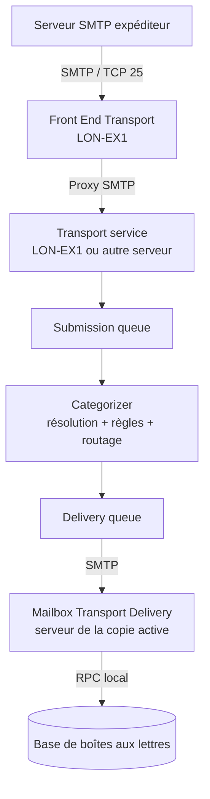

Un message envoyé à une boîte aux lettres Exchange ne passe pas directement du client Outlook au fichier `.edb` du destinataire. Même lorsqu'expéditeur et destinataire appartiennent à la même organisation, Exchange fait intervenir plusieurs services, un moteur de catégorisation, des connecteurs et des files d'attente.

Cette architecture permet de **dissocier la réception SMTP, le traitement du message, le routage et la remise dans la base active**. Elle explique aussi pourquoi un serveur peut accepter un message avec un code SMTP `250` alors que sa remise finale n'est pas encore terminée.

L'objectif est de suivre le parcours d'un message, puis de disposer d'une méthode de diagnostic lorsque le courrier s'accumule ou ne parvient pas à destination. Les exemples reposent sur une organisation fictive `adatum.com`, avec des serveurs `LON-EX1` et `LON-EX2`.

> **Versions :** les mécanismes décrits concernent Exchange Server 2016/2019 et, pour l'essentiel, Exchange Server Subscription Edition (SE). Les interfaces illustrées sont celles d'Exchange 2019. **Le support d'Exchange Server 2016 et 2019 a pris fin le 14 octobre 2025** ; en 2026, la version cible pour une infrastructure on-premises pérenne est Exchange Server SE. Les opérations d'administration doivent être vérifiées sur la version réellement déployée.

> **Captures de laboratoire :** les captures originales utilisées pour rédiger ce tutoriel documentent les connecteurs de réception, une session SMTP interactive, les journaux SMTP, Queue Viewer, les files en PowerShell, le pipeline de transport, la topologie des coûts AD et une politique DLP. Les explications ci-dessous s'appuient sur ces observations. Les images elles-mêmes ne sont pas encore hébergées dans le dépôt du blog et ne sont donc pas insérées sous forme de liens cassés.

## 1. Les trois étages du pipeline de transport Exchange

Sur un serveur Exchange de rôle Mailbox, trois composants doivent être distingués :

| Composant | Fonction | Ce qu'il ne fait pas |
| --- | --- | --- |
| **Front End Transport** | Accepter et *proxifier* les connexions SMTP externes entrantes, et éventuellement les connexions sortantes | Ne catégorise pas les messages et **ne conserve pas de file d'attente locale** |
| **Transport service** | Recevoir et traiter les messages, appliquer les règles, déterminer les destinataires et routes, gérer les files | N'écrit pas directement dans les bases de boîtes aux lettres |
| **Mailbox Transport** | Faire le lien entre le transport SMTP et les bases de boîtes aux lettres | Ne remplace pas le moteur central de catégorisation |

Le service logique **Mailbox Transport** comprend deux services Windows :

- **Mailbox Transport Submission** récupère les messages soumis depuis une base de boîtes aux lettres et les transmet au service Transport via SMTP.
- **Mailbox Transport Delivery** reçoit les messages destinés aux boîtes locales et les remet à la base active.

La communication **entre Mailbox Transport et la base locale** utilise RPC. Cela ne signifie pas que les clients Outlook modernes utilisent RPC pour accéder aux boîtes : la connectivité client relève notamment de MAPI/HTTP. Il s'agit ici du **fonctionnement interne** des services Exchange.

Le Front End Transport ne possède pas de file de messages. Le Transport service assure la catégorisation et les files de soumission et de remise, tandis que Mailbox Transport accède à la base via RPC.


### Exemple : courrier entrant depuis Internet

Un message envoyé à `beth@adatum.com` suit, dans une configuration sans serveur Edge Transport, ce chemin simplifié :



Le service Transport reçoit le message, puis le **categorizer** doit déterminer ce qu'il faut en faire :

1. résoudre et valider les destinataires ;
2. développer si nécessaire les groupes de distribution ;
3. appliquer les politiques de transport pertinentes ;
4. déterminer le prochain saut (*next hop*) ;
5. placer le message dans la file de remise correspondante.

La file `Submission` intervient **avant la catégorisation**. Les files de remise (*delivery queues*) interviennent **après**, lorsque la destination est connue.

### Et pour un message envoyé par une boîte Exchange ?

Le processus débute dans la boîte d'envoi de l'utilisateur. **Mailbox Transport Submission** récupère le message depuis la base où se trouve la boîte, puis le soumet au service Transport. Le categorizer et les files prennent ensuite le relais.

Le message peut rester interne à l'organisation, être transmis à une autre organisation SMTP ou sortir via une passerelle, un équipement de sécurité ou un *smart host*.

La distinction entre Submission Queue, Categorizer, Delivery Queues et les répertoires Pickup/Replay fournit plusieurs points d'observation lors d'un incident.


## 2. Connecteurs SMTP : qui accepte le message et vers où l'envoyer ?

Il faut distinguer **connecteurs de réception** (*Receive connectors*) et **connecteurs d'envoi** (*Send connectors*).

### Receive connectors : sélectionner le traitement d'une connexion entrante

Un connecteur de réception est associé à un serveur et à un service de transport. Il définit notamment :

- les **adresses IP et ports locaux** sur lesquels le service écoute ;
- les **adresses IP distantes** autorisées à utiliser le connecteur ;
- les mécanismes d'authentification et les groupes de permissions ;
- les limites de taille des messages ;
- l'activation éventuelle du **protocol logging**.

Sur un serveur Mailbox, les connecteurs prédéfinis comprennent notamment :

| Connecteur par défaut | Service | Port TCP typique | Usage |
| --- | --- | --- | --- |
| `Default Frontend <serveur>` | Front End Transport | 25 | Réception depuis des serveurs SMTP externes |
| `Client Frontend <serveur>` | Front End Transport | 587 | Soumission par des clients authentifiés |
| `Default <serveur>` | Transport | 2525 | Échanges entre composants et serveurs Exchange |
| `Client Proxy <serveur>` | Transport | 465 | Connexions client proxifiées par le frontal |
| `Outbound Proxy Frontend <serveur>` | Front End Transport | 717 | Proxy SMTP sortant, lorsque utilisé |

Les valeurs sont celles des connecteurs créés par défaut ; une configuration personnalisée peut les modifier.

Dans le laboratoire, un connecteur nommé **`CRM Relay`** apparaît à côté des connecteurs standards de `LON-EX1` :

Un même serveur peut recevoir des flux très différents : Internet, applications métier, copieurs ou serveurs Exchange. Ces flux n'exigent pas nécessairement les mêmes autorisations ni la même journalisation.


Exemple d'inventaire dans l'Exchange Management Shell :

```powershell
Get-ReceiveConnector -Server "LON-EX1" |
    Format-Table Identity,TransportRole,Enabled,Bindings -AutoSize

Get-ReceiveConnector "LON-EX1\CRM Relay" |
    Format-List Identity,Bindings,RemoteIPRanges,
                AuthMechanism,PermissionGroups,
                MaxMessageSize,ProtocolLoggingLevel
```

**Point subtil :** plusieurs connecteurs peuvent écouter sur le même couple IP locale / port, à condition que leurs plages d'IP clientes soient suffisamment distinctes. Si les plages se chevauchent, Exchange sélectionne le connecteur correspondant à la **plage d'adresses distantes la plus spécifique**. Ce mécanisme permet, par exemple, d'affecter un connecteur dédié à un ERP sans mobiliser un nouveau port SMTP.

Il ne s'agit donc pas de la même logique qu'un reverse proxy HTTP fondé sur un nom d'hôte : pour les connecteurs de réception, **les IP clientes et les bindings sont déterminants**.

> **Sécurité :** un connecteur permettant de relayer vers des domaines tiers ne doit jamais être exposé à toutes les IP clientes. Pour un relais applicatif anonyme, il faut créer un connecteur dédié, limiter précisément `RemoteIPRanges` et n'attribuer les droits de relais qu'aux systèmes autorisés. Modifier à l'aveugle le connecteur `Default Frontend` peut transformer une passerelle Exchange en relais ouvert.

#### Mini-tutoriel : créer un connecteur de relais pour une application

**Situation.** Un ERP à l'adresse `192.0.2.20` doit utiliser Exchange comme relais SMTP. L'adresse IP et les noms du laboratoire sont fictifs. Dans ce cas, créer un connecteur de réception **dédié** est préférable à l'extension des permissions du connecteur `Default Frontend`.

**1. Recenser les connecteurs existants et vérifier les IP autorisées.**

```powershell
Get-ReceiveConnector -Server "LON-EX1" |
    Format-Table Identity,TransportRole,Bindings,RemoteIPRanges -AutoSize
```

**2. Créer un connecteur Front End Transport dédié à l'IP de l'application.**

```powershell
New-ReceiveConnector -Server "LON-EX1" `
    -Name "CRM Relay" `
    -TransportRole FrontendTransport `
    -Custom `
    -Bindings 0.0.0.0:25 `
    -RemoteIPRanges 192.0.2.20
```

Le connecteur peut partager le port 25 avec les connecteurs standard : Exchange choisit la **plage d'IP distante la plus spécifique**. Le filtrage par IP ne distingue toutefois pas deux machines derrière une même adresse NAT.

**3. N'autoriser le relais externe que si l'application en a besoin.** Le connecteur nouvellement créé n'accorde pas automatiquement le droit de relayer vers des domaines tiers. Microsoft documente la configuration minimale suivante pour un relais anonyme contrôlé :

```powershell
$Connector = "LON-EX1\CRM Relay"

Set-ReceiveConnector $Connector -PermissionGroups AnonymousUsers

Get-ReceiveConnector $Connector |
    Add-ADPermission `
        -User "NT AUTHORITY\ANONYMOUS LOGON" `
        -ExtendedRights "Ms-Exch-SMTP-Accept-Any-Recipient"
```

**4. Vérifier les autorisations et tester les flux.**

```powershell
Get-ReceiveConnector $Connector |
    Format-List Identity,Bindings,RemoteIPRanges,
                AuthMechanism,PermissionGroups,ProtocolLoggingLevel

Get-ADPermission $Connector -User "NT AUTHORITY\ANONYMOUS LOGON" |
    Where-Object { -not $_.Deny -and -not $_.IsInherited } |
    Format-Table User,ExtendedRights -Wrap
```

Effectuer un envoi SMTP depuis l'ERP vers un destinataire interne, puis externe, et contrôler la trace. Faire également un test depuis une **IP non autorisée** : elle ne doit pas pouvoir utiliser les permissions de relais de ce connecteur. La protection du réseau et du serveur émetteur reste essentielle, même lorsque `RemoteIPRanges` est restrictif.

**Retour arrière.** Un connecteur dédié peut être désactivé pendant le diagnostic avec `Set-ReceiveConnector $Connector -Enabled $false`, puis supprimé avec `Remove-ReceiveConnector $Connector` après validation de l'impact. Cela n'enlève pas d'éventuels autres droits ajoutés ailleurs.

La configuration `ExternalAuthoritative` avec `ExchangeServers` existe, mais elle accorde des permissions très étendues. Elle ne doit pas devenir la solution par défaut pour les applications et copieurs.

*Lecture des captures du TP :* l'écran `CRM Relay` permet de repérer le connecteur dédié, tandis que le journal `SmtpReceive` permet de vérifier quel connecteur a réellement accepté la session.

Source : [Microsoft Learn — Relais SMTP anonyme](https://learn.microsoft.com/fr-fr/exchange/mail-flow/connectors/allow-anonymous-relay).

### Send connectors : choisir la sortie

Le connecteur d'envoi détermine comment Exchange doit remettre le message lorsqu'il sort de son périmètre de transport :

- l'**espace d'adressage** concerné (`*`, `partenaire.example`, etc.) ;
- le routage par DNS/MX ou par **smart host** ;
- les serveurs Exchange sources du connecteur ;
- son coût et son étendue ;
- les paramètres TLS et d'authentification éventuels.

```powershell
Get-SendConnector |
    Format-Table Name,Enabled,AddressSpaces,SourceTransportServers -AutoSize

Get-SendConnector "Vers Internet" |
    Format-List AddressSpaces,DNSRoutingEnabled,SmartHosts,
                SourceTransportServers,IsScopedConnector,
                ProtocolLoggingLevel
```

Dans une architecture utilisant une passerelle SMTP, Exchange peut remettre les messages à un *smart host* plutôt que résoudre lui-même les MX des domaines externes.

**À ne pas confondre :** une adresse IP de *smart host* dans un Send connector n'est pas une destination finale de boîte aux lettres ; c'est le prochain serveur chargé de poursuivre la remise.

#### Mini-tutoriel : créer un connecteur sortant vers un smart host

**Situation.** Tout le courrier sortant doit transiter par une passerelle de sécurité SMTP, par exemple `smtp-relay.adatum.com` (nom fictif).

**1. Examiner les connecteurs déjà présents.** Vérifier les espaces d'adressage et leurs coûts avant d'ajouter une nouvelle route :

```powershell
Get-SendConnector |
    Format-Table Name,Enabled,AddressSpaces,
                 SourceTransportServers,SmartHosts -AutoSize
```

**2. Créer un connecteur de sortie via le relais :**

```powershell
New-SendConnector `
    -Name "Sortie via passerelle" `
    -Usage Custom `
    -AddressSpaces "*" `
    -DNSRoutingEnabled $false `
    -SmartHosts "smtp-relay.adatum.com" `
    -SourceTransportServers "LON-EX1","LON-EX2"
```

Le `*` désigne les destinations SMTP non gérées localement. `DNSRoutingEnabled $false` signifie qu'Exchange envoie vers le smart host au lieu de se connecter directement aux MX des destinataires. Les éventuelles exigences de TLS ou d'authentification de la passerelle sont à définir séparément.

**3. Vérifier la configuration :**

```powershell
Get-SendConnector "Sortie via passerelle" |
    Format-List Name,Enabled,AddressSpaces,DNSRoutingEnabled,
                SmartHosts,SmartHostAuthMechanism,
                SourceTransportServers,RequireTLS,
                ProtocolLoggingLevel
```

**4. Tester depuis une boîte Exchange**, suivre le message dans les tracking logs et vérifier le serveur SMTP qui reçoit effectivement le message. Un événement `SEND` vers la passerelle prouve le transfert au prochain saut, pas forcément la remise dans la boîte distante.

**Retour arrière :** `Set-SendConnector "Sortie via passerelle" -Enabled $false` désactive la route pour vérifier le comportement prévu des autres connecteurs. Ne pas désactiver une route de production sans avoir défini l'alternative.

Source : [Microsoft Learn — Connecteurs d'envoi](https://learn.microsoft.com/en-us/exchange/mail-flow/connectors/send-connectors).

### Un domaine SMTP partagé entre Exchange et un autre système

Le routage est plus délicat lorsque le même domaine SMTP possède des destinataires sur **Exchange et sur une autre plateforme**, par exemple Postfix.

Un **domaine accepté de type `InternalRelay`** permet à Exchange de traiter les destinataires connus localement, puis de remettre les autres à un système externe via un connecteur d'envoi approprié.

```powershell
Get-AcceptedDomain |
    Format-Table Name,DomainName,DomainType -AutoSize
```

Le fonctionnement n'est pas automatique du seul fait d'avoir choisi `InternalRelay` : les objets destinataires et le chemin de routage vers le système tiers doivent être correctement configurés. Sinon, le risque est de créer une **boucle de routage**, ou de rejeter un destinataire pourtant existant sur l'autre système.

### Mini-tutoriel : partager un domaine entre Exchange et une autre messagerie

**Situation.** Les adresses `@adatum.com` existent à la fois sur Exchange et sur une plateforme SMTP tierce, par exemple Postfix. Le domaine peut être défini comme `InternalRelay`, mais ce paramètre ne crée **pas** le chemin de routage.

**1. Vérifier le type actuel du domaine :**

```powershell
Get-AcceptedDomain "adatum.com" |
    Format-List Name,DomainName,DomainType,AddressBookEnabled
```

**2. Le cas échéant, basculer ce domaine en relais interne :**

```powershell
Set-AcceptedDomain -Identity "adatum.com" -DomainType InternalRelay
```

Cette modification est **globale à l'organisation Exchange** : vérifier préalablement les objets destinataires, les flux entrants et la capacité de la plateforme tierce à remettre à Exchange les destinataires Exchange. Pour un domaine `InternalRelay` dont certains destinataires ne sont pas présents dans l'annuaire, `AddressBookEnabled` doit normalement rester à `$false` pour le filtrage de destinataires.

**3. Prévoir la sortie des destinataires non résolus localement.** Exemple avec un smart host tiers fictif `smtp-tiers.adatum.net` :

```powershell
New-SendConnector `
    -Name "Relais vers messagerie tierce" `
    -Usage Custom `
    -AddressSpaces "adatum.com" `
    -DNSRoutingEnabled $false `
    -SmartHosts "smtp-tiers.adatum.net" `
    -SourceTransportServers "LON-EX1","LON-EX2"
```

**4. Tester trois scénarios :** un destinataire Exchange, un destinataire du système tiers et une adresse inexistante. Une boucle SMTP indique souvent que chaque plateforme renvoie à l'autre un destinataire qu'aucune ne connaît.

**Retour arrière :** rétablir le `DomainType` d'origine **seulement si le flux antérieur est encore valide**, et désactiver le connecteur de relais si nécessaire. Il ne faut pas basculer aveuglément vers `Authoritative` tant que le domaine est partagé.

Source : [Microsoft Learn — Domaines acceptés](https://learn.microsoft.com/en-us/exchange/mail-flow/accepted-domains/accepted-domains).

## 3. Le routage interne : bases, DAG, sites Active Directory et coûts

Le categorizer ne choisit pas arbitrairement un serveur. Il détermine d'abord une **routing destination**.

On distingue notamment :

- la **base de boîtes aux lettres** qui héberge le destinataire ;
- un **connecteur** (SMTP ou autre type de remise) ;
- un **serveur d'expansion d'un groupe de distribution** explicitement désigné.

Exchange regroupe ensuite les serveurs de transport chargés de ces destinations dans des **delivery groups**. Parmi eux : les DAG routables, les groupes de remise de boîtes, les serveurs sources d'un connecteur, certaines listes de serveurs d'expansion et certains sites AD.

### Pourquoi le DAG intervient dans le routage

Si `DB1` est active sur `LON-EX2`, la remise destinée à une boîte de `DB1` doit parvenir au **Mailbox Transport Delivery** de `LON-EX2`, même si le SMTP a d'abord été accepté par `LON-EX1`.

Une activation de copie sur un autre membre du DAG change la localisation de la base active, **pas l'adresse SMTP du destinataire**. Les composants de transport prennent en compte cette localisation pour atteindre la bonne base.

### Les sites Active Directory ne servent pas qu'à l'authentification

Exchange réutilise la topologie des **sites et liens de sites Active Directory** pour évaluer les routes et leurs coûts. Il est donc important que les sous-réseaux, sites et liens AD reflètent correctement l'implantation des serveurs.

Les coûts de liens AD ne représentent pas des latences en millisecondes. Une route de coût minimal ne signifie pas que les messages traversent physiquement chaque site intermédiaire : Exchange peut remettre directement au delivery group de destination.


Le routage privilégie le **chemin au coût calculé le plus faible**, puis applique ses règles de départage. En cas d'indisponibilité de la destination, des mécanismes de repli peuvent faire intervenir des sites intermédiaires.

Il existe des réglages avancés pour influer sur les chemins :

```powershell
Get-ADSite |
    Format-Table Name,HubSiteEnabled -AutoSize

Get-ADSiteLink |
    Format-Table Name,ExchangeCost -AutoSize

# Exemples de modification : uniquement après étude de topologie
# Set-ADSite -Identity "SITE-HUB" -HubSiteEnabled $true
# Set-ADSiteLink -Identity "LIEN-A-B" -ExchangeCost 20
```

Un **hub site** peut imposer le transit par un site AD situé sur la route de coût minimal. Ce n'est cependant pas une raison pour reproduire systématiquement une topologie SMTP personnalisée : la centralisation des infrastructures Exchange et les DAG multisites rendent certaines anciennes pratiques moins pertinentes.

#### Mini-tutoriel : configurer un hub site ou un coût de lien Exchange

**Un hub site Exchange n'est pas un point de passage à créer systématiquement.** Il permet d'imposer une étape de transport lorsque le site est situé sur le **chemin de routage de coût minimal**. Un site déclaré hub mais situé en dehors de ce chemin ne devient pas un relais obligatoire.

Avant toute modification, recenser les sites et les coûts :

```powershell
Get-ADSite |
    Format-Table Name,HubSiteEnabled -AutoSize

Get-ADSiteLink |
    Format-Table Name,ExchangeCost -AutoSize
```

Sur `Get-ADSiteLink`, une valeur `ExchangeCost` absente signifie qu'Exchange utilise le coût du lien IP Active Directory, au lieu d'un coût Exchange distinct. La modification des **coûts Exchange** permet d'influer sur le routage des messages sans nécessairement changer la réplication AD.

Exemple de changement **illustratif**, uniquement après validation du plan de routage :

```powershell
Set-ADSite -Identity "SITE-HUB" -HubSiteEnabled $true

Set-ADSiteLink -Identity "LIEN-A-B" -ExchangeCost 20
```

Vérifier :

```powershell
Get-ADSite "SITE-HUB" | Format-List Name,HubSiteEnabled
Get-ADSiteLink "LIEN-A-B" | Format-List Name,ExchangeCost
```

**Retour arrière :** supprimer la qualité de hub avec `-HubSiteEnabled $false`; pour le coût, restaurer la valeur sauvegardée avant intervention (ou `$null` si aucun coût Exchange explicite n'était défini).

Ce réglage est **organisationnel** : il doit être validé avec les équipes qui administrent la topologie AD et le transport. Il n'améliore pas mécaniquement la disponibilité ; au contraire, un hub imposé peut devenir un point de concentration supplémentaire.

*Lecture de la capture du TP :* les chiffres positionnés sur les liens représentent des **coûts logiques**, pas des durées de transmission en millisecondes.

Source : [Microsoft Learn — Routage Exchange par sites AD](https://learn.microsoft.com/en-us/exchange/mail-flow/mail-routing/mail-routing).

### Mini-tutoriel : expansion des groupes de distribution, comportement automatique et configuration

Lorsqu'un message est envoyé à un groupe de distribution, Exchange doit **résoudre les membres du groupe**. Le categorizer effectue cette expansion, puis crée les destinataires et les chemins de remise appropriés. Les groupes imbriqués et les groupes dynamiques impliquent des opérations supplémentaires de résolution.

**Par défaut, Exchange choisit automatiquement un serveur d'expansion disponible et approprié.** La propriété `ExpansionServer` est vide (`$null`). Il n'y a donc généralement **rien à configurer**.

On peut néanmoins imposer un serveur précis pour un besoin particulier. Ce n'est pas une prescription de la *Preferred Architecture* : si ce serveur devient indisponible, les messages envoyés aux groupes concernés ne peuvent plus être remis normalement. Dans une architecture privilégiant la résilience, il faut donc **préférer le choix automatique**.

**1. Repérer les groupes déjà configurés avec un serveur fixe.**

```powershell
Get-DistributionGroup -ResultSize Unlimited |
    Where-Object { $_.ExpansionServer } |
    Format-Table DisplayName,ExpansionServer -AutoSize

Get-DynamicDistributionGroup -ResultSize Unlimited |
    Where-Object { $_.ExpansionServer } |
    Format-Table DisplayName,ExpansionServer -AutoSize
```

**2. Vérifier le groupe ciblé.**

```powershell
Get-DistributionGroup "Liste-Generale" |
    Format-List DisplayName,ExpansionServer,RecipientTypeDetails
```

**3. Exemple de configuration explicite, à réserver à un besoin justifié.**

```powershell
$LegacyDN = (Get-ExchangeServer "LON-EX2").ExchangeLegacyDN

Set-DistributionGroup -Identity "Liste-Generale" `
    -ExpansionServer $LegacyDN
```

Le paramètre `-ExpansionServer` attend le **`ExchangeLegacyDN`** du serveur, pas simplement son FQDN. Le serveur doit disposer du rôle Mailbox avec le service Transport approprié.

**4. Vérifier et revenir au fonctionnement automatique.**

```powershell
Get-DistributionGroup "Liste-Generale" |
    Format-List DisplayName,ExpansionServer

Set-DistributionGroup -Identity "Liste-Generale" `
    -ExpansionServer $null
```

Pour un groupe de distribution dynamique, utiliser `Get-DynamicDistributionGroup` et `Set-DynamicDistributionGroup` avec le même paramètre `-ExpansionServer`. L'appartenance d'un groupe dynamique résulte de son filtre de destinataires ; la définition du serveur d'expansion **ne remplace pas le filtre**.

**5. Vérifier l'expansion d'un message test.** Après l'envoi à une liste, rechercher les événements `EXPAND` dans les journaux de suivi des serveurs concernés :

```powershell
Get-MessageTrackingLog -Server "LON-EX2" `
    -Start (Get-Date).AddHours(-1) `
    -EventId EXPAND |
    Select-Object Timestamp,ServerHostname,RelatedRecipientAddress,
                  MessageId,NetworkMessageId
```

L'absence d'événement sur ce serveur ne prouve pas l'échec de l'expansion : si `ExpansionServer` est vide, elle a pu avoir lieu **sur un autre serveur de transport**. Dans une organisation multisite, élargir la recherche en conséquence.

**Pourquoi conserver le comportement automatique ?** Un DAG réplique les bases, mais **ne rend pas automatiquement hautement disponible un serveur d'expansion imposé par configuration**. La fonctionnalité reste supportée en Exchange Server SE ; son usage est simplement à justifier.

Références : [Set-DistributionGroup](https://learn.microsoft.com/en-us/powershell/module/exchange/set-distributiongroup) et [Set-DynamicDistributionGroup](https://learn.microsoft.com/en-us/powershell/module/exchangepowershell/set-dynamicdistributiongroup).

## 4. Les files d'attente : où s'arrête un message ?

Le transport Exchange utilise une base de files, distincte des bases de boîtes aux lettres. On y rencontre notamment les types suivants :

| File | Ce qu'elle représente | Piste de diagnostic lorsque les messages s'accumulent |
| --- | --- | --- |
| `Submission` | Messages en attente de catégorisation | Traitement du categorizer, résolution AD, santé du Transport service |
| `Delivery` | Messages prêts à être remis à une destination | DNS, connecteur d'envoi, smart host, TLS, serveur distant ou base cible |
| `Unreachable` | Messages dont le prochain saut n'est pas calculable | Routes, connecteurs, configuration des destinataires |
| `Poison` | Messages isolés à la suite de défaillances suspectes du traitement | Analyser précisément le message et les événements système |
| `Shadow` | Copies redondantes de messages en transit | Santé des serveurs de transport et état de la redondance |

Le statut `Retry` signifie qu'Exchange **réessaiera la remise**. Il n'indique pas à lui seul si la cause est un problème DNS, une connexion TCP refusée, un échec TLS ou une réponse SMTP temporaire.

### Observer avec Queue Viewer

L'outil **Queue Viewer**, accessible depuis Exchange Toolbox, permet d'examiner les files d'un serveur, puis de consulter les messages qu'elles contiennent.

Dans le laboratoire, deux messages se trouvent dans `LON-EX1\5`. L'examen de la file permet d'identifier sa destination et son état avant toute tentative de reprise.


En PowerShell :

```powershell
# Inventaire des files non vides
Get-Queue -Server "LON-EX1" -Exclude Empty |
    Format-Table Identity,Status,MessageCount,
                 DeliveryType,NextHopDomain -AutoSize

# Détails de la file en échec
Get-Queue -Identity "LON-EX1\5" |
    Format-List Identity,Status,MessageCount,
                NextHopDomain,LastError

# Messages de cette file
Get-Message -Queue "LON-EX1\5" |
    Format-Table Identity,FromAddress,Status,Subject -AutoSize
```

Un exemple du TP présente une file `SmartHostConnectorDelivery` en `Retry` avec deux messages, et une file `ShadowRedundancy` distincte. Les deux mécanismes ne doivent pas être confondus.


Lorsqu'une cause externe a été corrigée, il est possible de provoquer un nouvel essai :

```powershell
# Après correction de la cause et vérification de la file
Retry-Queue -Identity "LON-EX1\5"
```

Il ne faut pas exécuter des suppressions massives ou des reprises répétées avant de comprendre le **`LastError`** et les conséquences sur la destination.

### Mini-tutoriel : traiter une file de remise en `Retry`

**Situation observée dans le TP.** La file `LON-EX1\5` contient deux messages. Son `DeliveryType` est `SmartHostConnectorDelivery` et son état est `Retry`.

**1. Identifier la destination et la cause.**

```powershell
Get-Queue -Identity "LON-EX1\5" |
    Format-List Identity,Status,DeliveryType,NextHopDomain,
                MessageCount,LastError,LastRetryTime,NextRetryTime

Get-Message -Queue "LON-EX1\5" |
    Format-Table Identity,FromAddress,Recipients,Status -AutoSize
```

`LastError` et les protocol logs sont souvent plus utiles que l'état `Retry` seul. Il faut rechercher un échec DNS, TLS, une indisponibilité du smart host ou un refus SMTP temporaire.

**2. Corriger la cause.** Un connecteur qui vise un smart host hors service ne sera pas réparé par `Retry-Queue`. Il faut d'abord remettre le prochain saut en état de répondre.

**3. Forcer une nouvelle tentative après correction.**

```powershell
Retry-Queue -Identity "LON-EX1\5"

Get-Queue -Identity "LON-EX1\5" |
    Format-List Status,MessageCount,LastError,NextRetryTime
```

**4. Distinguer `Retry` de `Resubmit`.** L'option `-Resubmit $true` renvoie les messages vers la file `Submission` pour qu'ils soient **recatégorisés** ; ce n'est pas une simple nouvelle connexion SMTP. Elle ne s'applique qu'aux files prises en charge, notamment certaines files de remise en `Retry` et `Unreachable` :

```powershell
# Uniquement si une nouvelle catégorisation est nécessaire
# Retry-Queue -Identity "LON-EX1\5" -Resubmit $true
```

Cette commande ne doit pas être utilisée comme première réponse à une panne de smart host. Sur une file très volumineuse, elle peut provoquer un nouveau traitement important.

**5. Comparer avec Queue Viewer.** Dans Exchange Toolbox, ouvrir **Queue Viewer**, sélectionner la file concernée, consulter `Last Error` et la liste des messages, puis utiliser **Retry Queue** si la cause a été corrigée. La capture du TP montre précisément ce rapprochement entre l'interface et `Get-Queue`.

Référence : [Microsoft Learn — Gestion des files](https://learn.microsoft.com/en-us/exchange/mail-flow/queues/queue-procedures).

### Shadow Redundancy et Safety Net ne jouent pas le même rôle

**Shadow Redundancy** conserve une copie supplémentaire du message **pendant son transit**, sur un autre service de transport éligible. Cela permet de reprendre une remise lorsque le serveur qui détenait le message principal disparaît avant de l'avoir traité correctement.

**Safety Net**, en revanche, conserve pendant une durée limitée des messages **déjà traités ou remis**, afin de permettre certaines resoumissions, notamment après un basculement de base de boîtes aux lettres.

Il ne s'agit donc ni de sauvegardes historiques des boîtes, ni de substituts à une stratégie de restauration. Leur efficacité dépend de la topologie, du nombre de serveurs disponibles et de leur configuration.

### Mini-tutoriel : examiner Shadow Redundancy et Safety Net sans changer leurs paramètres

Shadow Redundancy et Safety Net protègent **des étapes différentes**. Leur présence ne doit pas être traitée comme une sauvegarde récupérable à volonté. Les valeurs par défaut sont généralement adaptées à une architecture qui comporte suffisamment de serveurs.

**1. Relever la configuration globale actuelle :**

```powershell
Get-TransportConfig |
    Format-List ShadowRedundancyEnabled,
                RejectMessageOnShadowFailure,
                ShadowMessagePreferenceSetting,
                ShadowResubmitTimeSpan,
                SafetyNetHoldTime
```

**2. Examiner les files du serveur observé :**

```powershell
Get-Queue -Server "LON-EX1" |
    Format-Table Identity,DeliveryType,Status,
                 MessageCount,NextHopDomain -AutoSize
```

Une file `ShadowRedundancy` contenant des messages ne signifie pas en soi une panne. Une copie secondaire est conservée temporairement pour permettre une reprise en cas d'échec du traitement primaire.

**3. Contrôler les capacités de redondance.** Shadow Redundancy nécessite un autre serveur Transport éligible (dans le même DAG lorsqu'il y a un DAG, ou dans le site AD en dehors d'un DAG). En dessous de cette capacité, activer un paramètre ne crée pas magiquement une seconde copie sur une autre machine.

**4. Éviter de désactiver la redondance pour faire disparaître une file.** `ShadowRedundancyEnabled` concerne l'organisation entière. La durée `SafetyNetHoldTime` doit être comparée aux stratégies de copies retardées et aux objectifs de récupération avant toute modification.

Sources : [Shadow Redundancy](https://learn.microsoft.com/en-us/exchange/mail-flow/transport-high-availability/shadow-redundancy) et [Safety Net](https://learn.microsoft.com/en-us/exchange/mail-flow/transport-high-availability/safety-net).

## 5. Les trois niveaux de diagnostic : tracking, protocole SMTP et file

Pour déterminer où un message est bloqué, il faut éviter de mélanger trois sources d'information :

| Outil | Question traitée |
| --- | --- |
| **Message tracking logs** | Quels événements Exchange ont concerné ce message, sur quels serveurs, et à quelle heure ? |
| **Protocol logs SMTP** | Quel dialogue SMTP a réellement eu lieu avec une IP et un connecteur ? |
| **Queue Viewer / Get-Queue** | Quels messages attendent encore et quelle est l'erreur actuelle ? |

### Message tracking : reconstituer les événements

Chaque serveur Exchange écrit ses propres journaux de suivi. Il faut donc examiner plusieurs serveurs lorsque le message a traversé plusieurs services Transport.

```powershell
$Debut = (Get-Date).AddHours(-2)

Get-MessageTrackingLog `
    -Server "LON-EX1" `
    -Start $Debut `
    -Recipients "beth@adatum.com" |
    Sort-Object Timestamp |
    Format-Table Timestamp,EventId,Source,Sender,Recipients -AutoSize
```

Les événements utiles comprennent, entre autres, `RECEIVE`, `SEND`, `DELIVER`, `FAIL`, `DEFER` et `EXPAND`.

Pour suivre le même message, le champ **`MessageId`** est souvent plus adapté que l'`InternalMessageId` : ce dernier dépend du serveur de transport. Le **`NetworkMessageId`** facilite également la corrélation de certaines bifurcations et expansions.

```powershell
Get-MessageTrackingLog -Server "LON-EX2" `
    -Start $Debut `
    -MessageId "<identifiant-du-message@domaine>" |
    Format-Table Timestamp,EventId,Source,MessageId -AutoSize
```

Un `SEND` sur un serveur ne vaut pas forcément `DELIVER` dans la boîte finale : il peut simplement indiquer la remise au saut SMTP suivant.

### Mini-tutoriel : suivre un message sur plusieurs serveurs

**Situation.** Une application indique que le message a été accepté avec `250`, mais la boîte du destinataire reste vide. Un `RECEIVE` ou `SEND` isolé n'explique pas le trajet complet.

**1. Choisir une fenêtre de recherche courte et relever le `MessageId`.**

```powershell
$Debut = (Get-Date).AddHours(-1)
$Fin   = Get-Date

Get-MessageTrackingLog -Server "LON-EX1" `
    -Start $Debut -End $Fin `
    -Recipients "beth@adatum.com" |
    Sort-Object Timestamp |
    Format-Table Timestamp,EventId,Source,MessageId -AutoSize
```

**2. Une fois le Message-Id identifié, interroger les services Transport de tous les serveurs concernés.**

```powershell
$MessageId = "<identifiant@domaine>"  # Exemple à remplacer

$Historique = foreach ($Serveur in (Get-TransportService)) {
    Get-MessageTrackingLog -Server $Serveur.Name `
        -Start $Debut -End $Fin `
        -MessageId $MessageId `
        -ResultSize Unlimited `
        -ErrorAction Continue
}

$Historique |
    Sort-Object Timestamp |
    Select-Object Timestamp,ServerHostname,EventId,Source,
                  Sender,Recipients,MessageId,NetworkMessageId |
    Format-Table -AutoSize
```

Une recherche globale doit rester **bornée dans le temps** : interroger tous les serveurs sur une grande période peut produire beaucoup d'I/O et de résultats. En environnement très volumineux, cibler d'abord les serveurs traversés est plus efficace.

**3. Interpréter les événements sans confondre les étapes.** `RECEIVE` signifie que le service a reçu le message ; `EXPAND` indique l'expansion d'un groupe ; `SEND` correspond à une remise vers un autre composant ou serveur ; `DELIVER` indique la remise dans une boîte par Exchange ; `DEFER` ou `FAIL` signalent une difficulté ou un échec.

**4. Utiliser le bon identifiant.** `InternalMessageId` change d'un serveur Exchange à l'autre. `MessageId` vient de l'en-tête du courrier, tandis que `NetworkMessageId` est conservé lors de certaines bifurcations liées aux règles ou à l'expansion des groupes. Le `NetworkMessageId` est particulièrement utile pour corréler les branches d'un même message.

Source : [Microsoft Learn — Message tracking](https://learn.microsoft.com/en-us/exchange/mail-flow/transport-logs/message-tracking).

### Protocol logging : observer le dialogue SMTP

Le protocole SMTP échange des commandes (`EHLO`, `MAIL FROM`, `RCPT TO`, `DATA`, etc.) et des réponses numériques (`220`, `250`, `354`, `4xx`, `5xx`). Les journaux de protocole donnent une visibilité sur ces échanges.

Pour inspecter et, si nécessaire, activer la journalisation d'un connecteur :

```powershell
Get-ReceiveConnector -Server "LON-EX1" |
    Format-Table Identity,TransportRole,ProtocolLoggingLevel

Set-ReceiveConnector `
    -Identity "LON-EX1\CRM Relay" `
    -ProtocolLoggingLevel Verbose
```

Pour un connecteur d'envoi :

```powershell
Get-SendConnector |
    Format-Table Name,ProtocolLoggingLevel

# Exemple après ciblage du connecteur concerné
# Set-SendConnector -Identity "Vers Internet" -ProtocolLoggingLevel Verbose
```

Les journaux **Front End** et **Hub Transport** sont distincts. Les emplacements standards comprennent :

```text
%ExchangeInstallPath%TransportRoles\Logs\FrontEnd\ProtocolLog\SmtpReceive
%ExchangeInstallPath%TransportRoles\Logs\FrontEnd\ProtocolLog\SmtpSend

%ExchangeInstallPath%TransportRoles\Logs\Hub\ProtocolLog\SmtpReceive
%ExchangeInstallPath%TransportRoles\Logs\Hub\ProtocolLog\SmtpSend
```

Les chemins effectifs peuvent être confirmés par :

```powershell
Get-FrontEndTransportService "LON-EX1" |
    Format-List *ProtocolLogPath

Get-TransportService "LON-EX1" |
    Format-List *ProtocolLogPath
```

Dans un fichier `RECV...LOG`, le nom du connecteur, les adresses et ports locaux/distants, l'identifiant de session et les échanges SMTP permettent notamment de vérifier qu'un relais applicatif utilise le bon connecteur.


**En pratique :** le journal de protocole répond à la question "quelle réponse SMTP a été donnée ?", tandis que le tracking répond à "qu'est devenu ce message dans Exchange ?".

### Mini-tutoriel : activer puis exploiter les protocol logs d'un connecteur

Le suivi de message décrit les événements internes. Le **protocol log**, lui, conserve le dialogue SMTP : commandes, réponses, session, IP et connecteur. Dans le TP, le fichier `RECV...LOG` a été utilisé pour retrouver la session d'un client SMTP.

**1. Vérifier le niveau de journalisation d'un connecteur.**

```powershell
Get-ReceiveConnector "LON-EX1\CRM Relay" |
    Format-List Identity,TransportRole,ProtocolLoggingLevel

Get-SendConnector |
    Format-Table Name,ProtocolLoggingLevel -AutoSize
```

**2. Activer temporairement le journal détaillé sur le seul connecteur concerné.**

```powershell
Set-ReceiveConnector "LON-EX1\CRM Relay" `
    -ProtocolLoggingLevel Verbose
```

**3. Localiser les fichiers sur le serveur.**

```powershell
Get-FrontEndTransportService "LON-EX1" |
    Format-List ReceiveProtocolLogPath,SendProtocolLogPath

Get-TransportService "LON-EX1" |
    Format-List ReceiveProtocolLogPath,SendProtocolLogPath
```

Pour un connecteur `FrontEndTransport`, les journaux de réception sont normalement sous `%ExchangeInstallPath%TransportRoles\Logs\FrontEnd\ProtocolLog\SmtpReceive`. Pour le service Transport, ils sont sous `...\Hub\ProtocolLog\SmtpReceive`.

**4. Reproduire le problème et examiner les champs** `date-time`, `connector-id`, `session-id`, `local-endpoint`, `remote-endpoint`, `event` et `data`. Une même session peut comporter plusieurs lignes : le `session-id` évite de mélanger deux connexions simultanées.

**5. Revenir au niveau de journalisation précédent** si le diagnostic le justifie :

```powershell
Set-ReceiveConnector "LON-EX1\CRM Relay" `
    -ProtocolLoggingLevel None
```

Ce retour à `None` n'est approprié que si c'était la **valeur initiale**. En production, noter cette valeur avant modification ; certains connecteurs sont déjà en `Verbose` pour les besoins d'exploitation.

*Lecture de la capture du TP :* les lignes du fichier `RECV` doivent être lues comme **un dialogue de session SMTP**, pas comme une liste de messages remis dans les boîtes. Un `250` après `DATA` atteste la prise en charge par le serveur qui répond.

Source : [Microsoft Learn — Protocol logging](https://learn.microsoft.com/en-us/exchange/mail-flow/connectors/protocol-logging).

## 6. Tester une connexion SMTP manuellement

Le test de connectivité le plus simple est :

```powershell
Test-NetConnection -ComputerName "LON-EX1.adatum.com" -Port 25
```

Il confirme principalement la capacité à établir une connexion TCP. Il ne prouve ni l'acceptation d'un destinataire, ni le bon routage, ni le fonctionnement de TLS.

Un test SMTP manuel depuis un poste autorisé peut être effectué avec Telnet :

```text
telnet LON-EX1.adatum.com 25
```

Puis dans la session SMTP :

```text
EHLO test.adatum.com
MAIL FROM:<crm@adatum.com>
RCPT TO:<beth@adatum.com>
DATA
Subject: Test SMTP depuis CRM

Ceci est un message de test.
.
QUIT
```

La ligne vide sépare les en-têtes SMTP du corps du message. Le **point seul sur une ligne** termine la commande `DATA`.

Pendant un test SMTP, `HELO` sans domaine peut entraîner `501 5.5.4 Invalid domain name`. Un en-tête `Subject:` envoyé avant `DATA` est interprété comme une commande SMTP et peut renvoyer `500 5.5.3`. Après `DATA`, le serveur peut accepter le message et l'inscrire pour remise.


Trois réponses doivent être interprétées correctement :

- **`250`** : l'étape SMTP a été acceptée. Après le point final de `DATA`, cela signifie que le serveur a pris le message en charge, **pas que la boîte finale l'a déjà reçu** ;
- **`4xx`** : échec temporaire, généralement susceptible d'un nouvel essai ;
- **`5xx`** : refus permanent de l'opération SMTP demandée.

Le comportement exact dépend du connecteur, de l'adresse cliente, des droits de relais et de la destination. Un refus de relais pour un domaine externe peut être normal sur un connecteur non prévu pour cela.

**Attention :** Telnet ne permet pas de tester correctement une session sécurisée nécessitant STARTTLS et une authentification. Un outil SMTP compatible TLS est nécessaire pour ce type de validation.

## 7. Pickup et Replay : réinjecter des messages dans le transport

Les répertoires **Pickup** et **Replay** permettent de soumettre des fichiers au pipeline de transport sans ouvrir une session SMTP ordinaire.

Ils ont des usages différents :

- **Pickup** accepte un message texte conforme, utile pour un test contrôlé ou pour l'injection de messages à partir d'une application adaptée ;
- **Replay** est prévu pour les messages au format d'export Exchange ou issus de passerelles compatibles, et **pas simplement pour n'importe quel fichier `.eml` rédigé à la main**.

Ces fonctions peuvent aussi servir dans une procédure de récupération après incident. Un exemple de terrain concerne des messages restés bloqués dans une file de transport sur un hôte incorrect : certains messages exportés peuvent être réinjectés dans un système de transport sain au moyen du format et du dossier appropriés.

Ce n'est toutefois **pas une méthode universelle pour réparer une base de files corrompue**. La conservation des destinataires, des métadonnées d'enveloppe et l'évitement de doublons doivent être vérifiés avant toute réinjection.

Pour connaître les chemins réellement configurés :

```powershell
Get-TransportService "LON-EX1" |
    Format-List PickupDirectoryPath,ReplayDirectoryPath
```

Dans un incident, il faut d'abord chercher à comprendre **pourquoi** les messages se sont accumulés plutôt qu'à déplacer des fichiers entre dossiers.

### Mini-tutoriel : distinguer les répertoires Pickup et Replay avant toute réinjection

Le support présente les dossiers `Pickup` et `Replay`. Ce sont **deux portes d'entrée différentes** dans le service de transport, à ne pas confondre avec des files de messages ordinaires ni avec une méthode de sauvegarde.

**1. Lire les répertoires configurés :**

```powershell
Get-TransportService "LON-EX1" |
    Format-List PickupDirectoryPath,ReplayDirectoryPath
```

**2. Choisir le dossier correspondant au format du message.** `Pickup` peut traiter un message mis au bon format texte avec en-têtes MIME valides. `Replay` est destiné aux messages soumis dans un format d'export adapté, notamment les messages exportés d'une file Exchange. Déplacer n'importe quel fichier `.eml` dans `Replay` ne constitue pas une procédure générale fiable.

**3. Dans une récupération d'incident, examiner l'enveloppe et la provenance** : destinataires, présence d'un expéditeur valide, risque de doublons et état précédent de la remise. Une réinjection mal maîtrisée peut produire des messages dupliqués ou une nouvelle boucle.

**4. Valider le résultat dans les journaux** (`RECEIVE`, `SEND`, `DELIVER`, etc.), pas uniquement en constatant que le fichier a disparu du répertoire.

Pour une file existante en `Retry`, les commandes `Get-Queue` et `Retry-Queue` sont les premiers outils à envisager **avant** une exportation manuelle vers Replay.

Référence : [Microsoft Learn — Procédures pour les files d'attente](https://learn.microsoft.com/en-us/exchange/mail-flow/queues/queue-procedures).

## 8. Les agents de transport et les règles de conformité

Les agents de transport s'exécutent à des étapes du pipeline pour examiner ou modifier le traitement d'un message : règles de transport, certaines politiques DLP, agents tiers de sécurité ou développements spécifiques.

```powershell
Get-TransportAgent |
    Format-Table Name,Enabled,Priority -AutoSize

Get-TransportPipeline |
    Format-List Event,TransportAgents
```

Les règles de transport et les politiques DLP n'ont pas le même rôle qu'un connecteur SMTP :

- le connecteur détermine **qui entre** ou **où le message sort** ;
- la règle de transport détermine **quelle action appliquer** lorsqu'un message satisfait à des conditions ;
- la politique DLP peut détecter des **informations sensibles** et déclencher une action appropriée.

Une capture du laboratoire illustre une politique **`UK Financial Data`** dotée d'une règle portant sur les messages adressés à l'extérieur de l'organisation, avec une condition liée à la présence d'informations financières :

Dans le laboratoire, une politique `UK Financial Data` apparaît dans l'EAC en mode `Enforcing`. Cela ne prouve pas qu'un message donné a été bloqué : il faut vérifier les conditions et les actions des règles.


Des agents tiers peuvent également être développés ou déployés. Ils disposent d'un accès puissant aux messages et doivent être évalués avec prudence : une erreur ou un ralentissement dans un agent peut affecter l'ensemble du flux.

### Mini-tutoriel : inspecter une politique DLP et tester une règle de transport

Dans la capture du laboratoire, la politique **`UK Financial Data`** est affichée dans l'EAC avec le mode `Enforcing`. Ce seul écran ne permet pas de conclure qu'un message particulier a été bloqué : il faut examiner les conditions, actions et exceptions de ses règles.

**1. Inventorier la politique et les règles Exchange :**

```powershell
Get-DlpPolicy |
    Format-Table Name,State,Mode -AutoSize

Get-DlpPolicy "UK Financial Data" | Format-List *

Get-TransportRule |
    Format-Table Name,State,Mode,Priority -AutoSize
```

En Exchange **on-premises**, `Get-DlpPolicy` concerne les anciennes politiques DLP fondées sur les règles de transport. Il ne doit pas être confondu avec les stratégies Microsoft Purview de Microsoft 365.

**2. Créer un exemple de règle sans bloquer la messagerie.** Le mode `Audit` permet de tester une condition et de consigner le résultat sans appliquer les actions qui affecteraient la remise :

```powershell
New-TransportRule `
    -Name "LAB - Audit mots clés sortants" `
    -SentToScope NotInOrganization `
    -SubjectContainsWords "DEMO-CONFIDENTIEL" `
    -SetAuditSeverity High `
    -Mode Audit
```

**3. Vérifier et tester.** Envoyer un message de test vers une adresse externe autorisée, avec le mot clé dans l'objet, puis examiner le suivi de message et la configuration de la règle :

```powershell
Get-TransportRule "LAB - Audit mots clés sortants" |
    Format-List Name,State,Mode,Priority,Description
```

Un mode `Audit` n'a pas la même portée qu'un blocage actif. La règle d'exemple teste un **mot-clé**, pas un vrai détecteur de données financières : une politique DLP utilise des conditions plus spécialisées.

**4. Nettoyage après le laboratoire :**

```powershell
Remove-TransportRule "LAB - Audit mots clés sortants"
```

Les règles sont partagées par les serveurs Mailbox d'une même organisation Exchange ; même en mode Audit, un test doit être circonscrit et approuvé sur une plateforme de production.

Références : [Get-DlpPolicy](https://learn.microsoft.com/en-us/powershell/module/exchangepowershell/get-dlppolicy) et [New-TransportRule](https://learn.microsoft.com/en-us/powershell/module/exchangepowershell/new-transportrule).

## 9. Méthode de dépannage : un message est accepté, mais il n'arrive pas

Un cas représentatif : une application `CRM` envoie du courrier via `LON-EX1`. La session SMTP renvoie `250`, mais le destinataire ne reçoit rien.

**Première étape : déterminer où commence le problème.** Vérifier le connecteur de réception sélectionné, l'adresse IP cliente, l'heure de la session et le résultat de `DATA` dans les protocol logs.

**Deuxième étape : suivre les événements du message.** Rechercher son `MessageId` dans les tracking logs du ou des serveurs concernés. La dernière opération connue est-elle `RECEIVE`, `SEND`, `DEFER`, `FAIL` ou `DELIVER` ?

**Troisième étape : regarder les files.** Une file `Retry` vers un smart host suggère un problème entre Exchange et le prochain saut. Une accumulation dans `Submission` oriente plutôt vers la catégorisation et les dépendances du Transport service. Un message absent des files peut avoir déjà été remis ou rejeté ; seul le suivi permet de trancher.

**Quatrième étape : corriger la cause et vérifier réellement la reprise.** La correction peut concerner le DNS, une liaison TCP, TLS, les autorisations de relais, le connecteur sortant ou le serveur de destination. Il ne suffit pas de constater que la file se vide : rechercher ensuite un événement de remise cohérent et valider le message côté destinataire.

### Et si aucun connecteur ne semble en cause ?

Exchange dispose d'un mécanisme de **back pressure** : le service Transport surveille notamment les ressources mémoire et disque et peut limiter l'acceptation de messages pour protéger le serveur.

Les symptômes peuvent ressembler à un problème réseau, alors que la cause est un volume saturé ou une file de transport trop importante. Les événements du journal **Application**, avec la source `MSExchangeTransport`, fournissent alors des indications utiles.

La base des files de transport mérite donc une attention particulière au dimensionnement. Son emplacement peut être séparé du volume système lorsque la conception de la plateforme le justifie.

## Conclusion

Pour diagnostiquer correctement le transport SMTP d'Exchange, il faut distinguer quatre questions :

1. **Le message a-t-il été accepté ?** → connecteur de réception et journal de protocole.
2. **Comment a-t-il été traité et où devait-il aller ?** → categorizer, routage, delivery group et message tracking.
3. **Est-il toujours en attente ?** → Queue Viewer et `Get-Queue`, avec le statut et la dernière erreur.
4. **A-t-il été remis à sa destination finale ?** → événements `DELIVER` ou accusé SMTP du prochain saut, suivis d'une vérification adaptée à la destination.

La distinction la plus importante reste celle-ci : **une connexion SMTP réussie ne prouve pas la livraison d'un message, et une réponse `250` ne dit pas à elle seule où il se trouve ensuite**.

Les outils de diagnostic sont complémentaires. Dans une architecture multisite ou multiservers, c'est leur **corrélation**, et non la lecture isolée d'une seule trace, qui permet de retrouver le chemin réel du message.

## Documentation de référence

- [Microsoft Learn — Flux de courrier et pipeline de transport](https://learn.microsoft.com/en-us/exchange/mail-flow/mail-flow)
- [Microsoft Learn — Routage du courrier dans Exchange Server](https://learn.microsoft.com/fr-fr/exchange/mail-flow/mail-routing/mail-routing)
- [Microsoft Learn — Receive connectors](https://learn.microsoft.com/en-us/exchange/mail-flow/connectors/receive-connectors)
- [Microsoft Learn — Send connectors](https://learn.microsoft.com/fr-fr/exchange/mail-flow/connectors/send-connectors)
- [Microsoft Learn — Autoriser un relais anonyme](https://learn.microsoft.com/fr-fr/exchange/mail-flow/connectors/allow-anonymous-relay)
- [Microsoft Learn — Message tracking](https://learn.microsoft.com/en-us/exchange/mail-flow/transport-logs/message-tracking)
- [Microsoft Learn — Protocol logging](https://learn.microsoft.com/en-us/exchange/mail-flow/connectors/protocol-logging)
- [Microsoft Learn — Files d'attente Exchange](https://learn.microsoft.com/en-us/exchange/mail-flow/queues/queue-procedures)
- [Microsoft Learn — Shadow Redundancy](https://learn.microsoft.com/en-us/exchange/mail-flow/transport-high-availability/shadow-redundancy)
- [Microsoft Learn — Agents de transport](https://learn.microsoft.com/fr-fr/exchange/mail-flow/transport-agents/transport-agents)
- [Microsoft Learn — Fin de support Exchange 2016/2019](https://learn.microsoft.com/fr-fr/troubleshoot/exchange/administration/exchange-2019-2016-end-of-support)

À lire également : [Exchange Server : restaurer une boîte aux lettres, une base et un membre de DAG](/articles/exchange-restaurer-rdb-recoverserver-dag/).