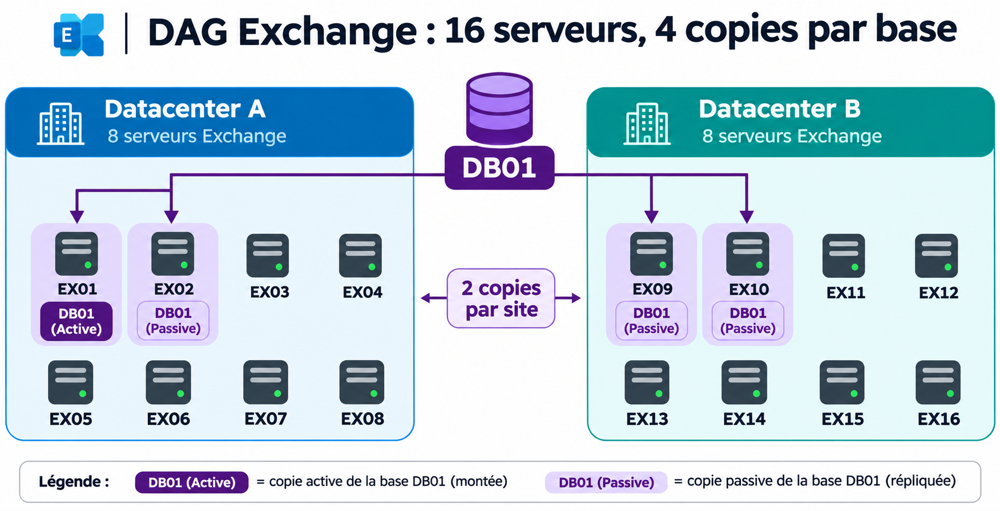
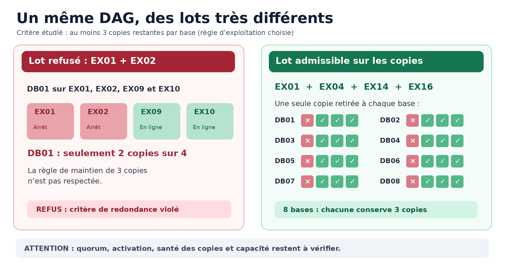

# Exchange DAG : quels serveurs peut-on mettre en maintenance simultanément ?

Dans un environnement Exchange de grande taille, appliquer des correctifs à un serveur est relativement simple. **Décider quels serveurs peuvent être maintenus en parallèle est beaucoup plus délicat.**

Imaginons un Database Availability Group (DAG) de **16 serveurs**, répartis sur deux datacenters, avec **quatre copies de chaque base de données**. Peut-on arrêter deux serveurs simultanément ? Quatre ? Huit ?

La mauvaise réponse serait : « Puisqu'il y a quatre copies par base, je peux arrêter un quart des serveurs. » La répartition des copies, leur état et les règles du cluster changent complètement le résultat.

Nous allons construire un exemple concret pour comprendre comment raisonner, **sans écrire de script**.

## 1. Quatre copies ne signifient pas quatre serveurs interchangeables

Un DAG Exchange peut regrouper jusqu'à 16 serveurs Mailbox. Chaque base possède une **copie active**, celle qui est montée, et éventuellement plusieurs **copies passives**, alimentées par réplication des journaux de transactions.

Pour la base `DB01`, imaginons cette répartition :

- `EX01` : copie active ;
- `EX02` : copie passive ;
- `EX09` : copie passive ;
- `EX10` : copie passive.

Si `EX01` doit être maintenu, il faut d'abord transférer l'activité de `DB01` vers une copie appropriée. L'existence d'une copie passive ne garantit pas qu'elle pourra être montée : son état, son retard de réplication et les règles d'activation comptent également.

*Schéma 1 — Une base, quatre copies, deux par datacenter. Les autres serveurs peuvent héberger d'autres bases : le dessin montre uniquement DB01.*

## 2. Notre DAG de 16 serveurs

Notre infrastructure fictive comprend :

- **Datacenter A** : `EX01` à `EX08` ;
- **Datacenter B** : `EX09` à `EX16` ;
- **Un témoin de quorum** accessible depuis les deux sites, idéalement placé dans un troisième emplacement indépendant ;
- **Huit bases** (`DB01` à `DB08`) possédant chacune quatre copies, deux par site.

La répartition des copies est la suivante :

| Base | Copies sur le site A | Copies sur le site B |
|---|---|---|
| DB01 | EX01, EX02 | EX09, EX10 |
| DB02 | EX01, EX03 | EX09, EX11 |
| DB03 | EX04, EX05 | EX12, EX13 |
| DB04 | EX06, EX07 | EX14, EX15 |
| DB05 | EX02, EX08 | EX10, EX16 |
| DB06 | EX03, EX04 | EX11, EX12 |
| DB07 | EX05, EX06 | EX13, EX14 |
| DB08 | EX07, EX08 | EX15, EX16 |

Chaque serveur héberge ici **deux copies de bases**. Ce choix simplifie les calculs ; en production, un serveur hébergera souvent beaucoup plus de bases et des copies dont la distribution sera moins régulière.

**Hypothèse initiale** : les 32 copies de notre exemple sont saines et correctement répliquées. Sans cette hypothèse, il faudrait exclure les copies défaillantes du calcul dès le départ.

## 3. Première règle : fixer la redondance que l'on veut conserver

Il faut d'abord définir une **politique de maintenance**. Pour l'exemple, choisissons :

> Pendant la maintenance, chaque base doit conserver au moins **trois copies saines** sur des serveurs restant en service.

Ce seuil est **notre choix d'exploitation**, pas une obligation universelle imposée par Microsoft. Une organisation pourrait accepter deux copies restantes, tandis qu'une autre imposerait des exigences plus strictes, notamment de répartition géographique.

Avec quatre copies initiales, notre règle autorise donc **au plus une copie indisponible par base**.

### Essai n° 1 : EX01 et EX02

Les deux serveurs hébergent `DB01`. Si on les arrête ensemble, cette base ne conserve que `EX09` et `EX10`, soit **deux copies sur quatre**.

Le DAG compte toujours 14 serveurs en service, mais **le lot est refusé par notre règle**. Le pourcentage de serveurs restants ne dit rien, à lui seul, de la redondance de chaque base.

### Essai n° 2 : EX01 et EX09

Ces serveurs sont situés sur deux datacenters différents. Pourtant, ils hébergent tous les deux `DB01` **et** `DB02` : chacune de ces bases perdrait deux copies.

**Un serveur par datacenter n'est pas automatiquement une combinaison sûre.** Le critère déterminant est la distribution réelle des copies.

### Essai n° 3 : EX01 et EX04

`EX01` héberge `DB01` et `DB02` ; `EX04` héberge `DB03` et `DB06`. Ils n'hébergent donc aucune copie d'une même base, dans notre exemple.

Les quatre bases affectées conserveraient trois copies chacune, et les autres en conserveraient quatre. **Ce lot passe le premier contrôle**, celui du nombre de copies restantes.

## 4. Peut-on aller jusqu'à quatre serveurs ?

Testons le lot **EX01 + EX04 + EX14 + EX16** :

| Serveur arrêté | Copies indisponibles |
|---|---|
| EX01 | DB01, DB02 |
| EX04 | DB03, DB06 |
| EX14 | DB04, DB07 |
| EX16 | DB05, DB08 |

Chaque base perd **exactement une copie** : il reste donc trois copies par base.

*Schéma 2 — À gauche, deux serveurs suffisent à enfreindre la règle. À droite, quatre serveurs passent le contrôle du nombre de copies, mais cela ne constitue pas encore une autorisation de maintenance.*

Dans ce jeu de données, quatre serveurs constituent même un **maximum théorique** sous notre règle :

- Huit bases peuvent perdre **une copie chacune**, soit huit copies indisponibles au maximum.
- Chaque serveur porte **deux copies**.
- Huit copies divisées par deux copies par serveur donnent **quatre serveurs**.

Ce raisonnement ne vaut **que pour cette topologie**. Avec davantage de bases, des répartitions différentes ou des copies déjà indisponibles, le maximum change. Et même ici, il ne s'agit que d'un **maximum sur le critère des copies**.

## 5. Une copie restante est-elle vraiment activable ?

C'est là que le simple tableau de répartition atteint ses limites.

Exchange utilise **Active Manager**, qui peut sélectionner une copie à activer grâce au mécanisme *Best Copy and Server Selection* (BCSS). Il ne suffit donc pas de constater qu'un fichier de base est répliqué quelque part.

Les contraintes à regarder comprennent notamment :

- **État de la copie** : `Healthy`, `Suspended`, `Failed`, etc. ;
- **CopyQueueLength** et **ReplayQueueLength** : journaux en attente de copie ou de relecture ;
- **ActivationPreference** : ordre de préférence, qui n'est pas à lui seul une garantie de sélection ;
- **DatabaseCopyAutoActivationPolicy** : activation automatique autorisée, limitée au site ou bloquée ;
- **MaximumActiveDatabases** : limite du nombre de bases actives sur un serveur ;
- **Santé des composants** : une copie peut être présente sur un serveur impropre à recevoir le service.

Prenons `DB01`, dont la copie active se trouve sur `EX01`. Notre lot impose son transfert avant l'arrêt. Si `EX02`, `EX09` et `EX10` sont sains, mais que leurs politiques ou capacités empêchent tous l'activation, **la base ne peut pas simplement basculer parce qu'il reste trois copies**.

Les **copies retardées** (*lagged copies*) demandent une attention supplémentaire : une copie conservant volontairement un retard de relecture ne doit pas être assimilée sans vérification à une copie passive immédiatement prête pour le service.

**Une bonne planification examine donc deux choses distinctes : le nombre de copies qui subsistent et l'existence d'au moins une destination réellement admissible pour chaque base active à déplacer.**

## 6. Le quorum : une contrainte indépendante des copies

Le DAG repose sur **Windows Failover Clustering** pour sa coordination. Le quorum permet de déterminer si le cluster possède encore assez de votes pour continuer à fonctionner et évite qu'une infrastructure coupée en plusieurs parties ne se considère simultanément active.

Dans une représentation simplifiée, notre cluster dispose de 16 nœuds votants et d'un témoin qui participe au vote : cela ferait **17 votes**, avec une majorité initiale de **neuf**.

Quatre serveurs à l'arrêt laisseraient 12 nœuds. Le calcul paraît rassurant, mais il ne suffit pas en production : **quorum dynamique** et **témoin dynamique** peuvent modifier les votes effectifs pendant les opérations.

Il faut donc connaître l'état réel du cluster, les votes courants, le témoin et l'ordre des arrêts. Une succession d'arrêts planifiés n'a pas nécessairement les mêmes conséquences qu'une panne simultanée de nombreux membres.

Le témoin **ne stocke pas de copies des bases Exchange** : son rôle concerne la décision de quorum, pas la réplication des données.

## 7. Disponibilité pendant la maintenance et perte d'un datacenter : deux objectifs différents

Revenons au lot de quatre serveurs : deux se trouvent sur le site A (`EX01`, `EX04`) et deux sur le site B (`EX14`, `EX16`).

À l'issue de leur mise en maintenance, chaque base conserve trois copies, mais selon les bases, la répartition devient :

- **Une copie sur A et deux sur B** ; ou
- **Deux copies sur A et une sur B**.

Le fonctionnement normal peut rester assuré. En revanche, si un datacenter complet tombe en panne **pendant** cette maintenance, certaines bases n'auront plus **qu'une seule copie** sur le site survivant.

Cela ne signifie pas systématiquement qu'elles seront indisponibles : tout dépend également du quorum, de l'état de cette copie, des autorisations d'activation et de la capacité restante. Mais leur redondance est alors fortement diminuée.

Il faut donc distinguer trois niveaux de garantie :

1. **Continuité planifiée** : le service fonctionne après les arrêts prévus.
2. **Tolérance à une panne supplémentaire** : la maintenance n'empêche pas de supporter, par exemple, la perte d'un autre serveur.
3. **Résilience à la perte d'un site** : le service peut rester disponible malgré la disparition complète d'un datacenter pendant la maintenance.

Ces objectifs ne produisent **pas forcément les mêmes lots**.

Le mode **Datacenter Activation Coordination (DAC)** peut contribuer à prévenir une situation de *split-brain* au niveau des bases lors des basculements et retours de site. Il ne remplace toutefois ni le quorum ni les copies saines.

## 8. Les serveurs restants peuvent-ils absorber la charge ?

Même lorsque les bases disposent de copies activables, il faut s'assurer que les serveurs restants ont la **capacité nécessaire**.

Supposons qu'un serveur héberge normalement 20 bases actives. Si on le retire de la production, ces bases doivent être réparties ailleurs. Lorsqu'on retire plusieurs serveurs à la fois, le nombre de bases à absorber peut devenir important.

Les contraintes ne se limitent pas au nombre maximal de bases actives. Il faut aussi considérer la charge CPU, la mémoire, les IOPS, les débits de réplication et les ressources nécessaires à la remise en service.

Sans oublier que les serveurs Mailbox hébergent aussi les **services d'accès client et de transport**. Un DAG peut conserver toutes ses bases montées tout en subissant une dégradation des connexions Outlook, de l'accès web ou du traitement SMTP.

**Disponibilité des bases et disponibilité globale de la messagerie ne sont pas synonymes.**

## 9. Comment préparer les lots en pratique ?

La bonne démarche est de partir d'une **photographie de l'état réel**, puis d'appliquer une politique de maintenance explicite.

**Avant de former les lots**, on recense les copies de chaque base, leur état de santé, les copies retardées, les bases actives, les contraintes d'activation, l'état du cluster et du témoin, ainsi que la capacité des serveurs restants. Des outils comme `Get-MailboxDatabaseCopyStatus`, `Get-DatabaseAvailabilityGroup -Status` et `Test-ReplicationHealth` aident à établir ce diagnostic.

**Ensuite**, on écarte les combinaisons qui enfreignent les règles choisies : nombre de copies, capacité d'activation, quorum, répartition géographique et charge. Les lots ainsi obtenus sont des **candidats**, pas encore des autorisations automatiques.

**Avant l'arrêt**, les bases actives doivent être déplacées correctement, les composants Exchange mis en maintenance et le transport drainé. Microsoft fournit notamment les scripts `StartDagServerMaintenance.ps1` et `StopDagServerMaintenance.ps1` pour accompagner ces opérations ; la maintenance des composants client et transport doit aussi être traitée.

**Après chaque lot**, on contrôle la remise en production et la santé de la réplication avant d'entamer le suivant. Un plan établi le matin peut devenir inadapté l'après-midi si une copie passe en erreur, si un serveur redémarre mal ou si les bases actives n'ont pas retrouvé une répartition satisfaisante.

## 10. Ce que démontre réellement notre exemple

Notre DAG fictif contient 16 serveurs et quatre copies par base.

- **EX01 + EX02** : refusé, car DB01 perd deux copies.
- **EX01 + EX09** : refusé, car DB01 et DB02 perdent chacune deux copies.
- **EX01 + EX04** : acceptable **sur le seul critère du nombre de copies**.
- **EX01 + EX04 + EX14 + EX16** : acceptable **sur ce même critère**, chaque base conservant trois copies.

Il serait toutefois incorrect d'annoncer que ce dernier lot est « sans risque ». Pour le décider, il manque encore les informations concernant l'état réel des copies, leur activation possible, la capacité, le quorum et la résilience exigée pendant l'intervention.

## Conclusion

Dans un DAG de 16 serveurs avec quatre copies de chaque base, **le nombre maximal de serveurs pouvant être arrêtés simultanément n'est pas une constante**.

Il dépend de la distribution effective des bases, de leur santé, de la possibilité de basculer les copies actives, du quorum et des exigences de continuité de service.

La question utile n'est donc pas :

> « J'ai quatre copies par base : combien de serveurs puis-je éteindre ? »

Mais :

> **« Quels ensembles de serveurs puis-je rendre indisponibles tout en respectant les garanties de disponibilité et de résilience de mon infrastructure ? »**

C'est une question de planification sous contraintes. Une fois les contraintes clairement formulées, il devient possible de les vérifier systématiquement et, éventuellement, d'automatiser la proposition de lots. Mais **l'algorithme ne pourra jamais remplacer une politique de risque clairement définie**.

---

### Pour aller plus loin — documentation Microsoft

- [Database Availability Groups (DAG)](https://learn.microsoft.com/en-us/exchange/high-availability/database-availability-groups/database-availability-groups)
- [Copies de bases de données de boîtes aux lettres](https://learn.microsoft.com/fr-fr/exchange/high-availability/database-availability-groups/database-copies)
- [Active Manager et sélection des copies](https://learn.microsoft.com/en-us/exchange/high-availability/database-availability-groups/active-manager)
- [Gérer les DAG et leurs maintenances](https://learn.microsoft.com/fr-fr/exchange/high-availability/manage-ha/manage-dags)
- [Quorum et témoin dans Windows Failover Clustering](https://learn.microsoft.com/en-us/windows-server/failover-clustering/what-is-quorum-witness)
- [Datacenter Activation Coordination (DAC)](https://learn.microsoft.com/en-us/exchange/high-availability/database-availability-groups/dac-mode)
