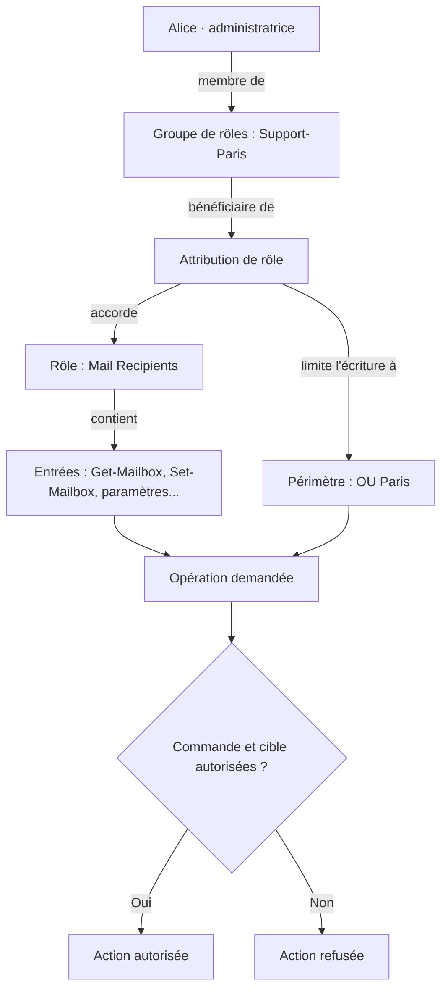

Un technicien du support peut consulter une boîte aux lettres dans l'Exchange Admin Center, mais ne peut pas en modifier certaines propriétés. Son collègue, connecté au même serveur, dispose d'un bouton supplémentaire. Un troisième administrateur peut exécuter `Set-Mailbox`, mais uniquement sur les utilisateurs d'une agence.

On pourrait penser à un problème de permissions NTFS, d'ACL Active Directory ou de droits administrateur sur Windows Server. Pourtant, les trois comportements peuvent s'expliquer par **RBAC**, le modèle d'autorisations d'Exchange.

RBAC (*Role-Based Access Control*) répond à une question plus précise que « Est-il administrateur ? » :

> **Qui a le droit d'exécuter quelle opération, avec quels paramètres, et sur quels objets Exchange ?**

Nous allons construire ce raisonnement progressivement, puis déléguer la gestion des boîtes aux lettres d'une agence à une équipe sans lui donner les droits sur toute l'organisation.

> **Versions et périmètre :** cet article concerne **Exchange Server on-premises**, principalement Exchange Server Subscription Edition (SE). Le modèle décrit existe aussi sur Exchange 2016 et 2019 ; ces deux versions ont atteint leur fin de support le **14 octobre 2025** (hors programme ESU applicable). Les interfaces peuvent différer d'une version à l'autre. Exchange Online utilise également RBAC, mais possède ses propres rôles, mécanismes et évolutions : les exemples ci-dessous ne sont pas à transposer tels quels dans Microsoft 365.

## 1. Pourquoi Exchange a-t-il son propre système d'autorisations ?

Dans une petite entreprise, le même administrateur gère souvent Active Directory, les serveurs, Exchange et les utilisateurs. Il est tentant de lui donner des droits élevés partout.

Dans une organisation plus grande, les responsabilités peuvent être réparties :

| Équipe | Besoin opérationnel | Ce qu'elle ne devrait pas pouvoir faire |
|---|---|---|
| Support N1 | Consulter des informations sur les destinataires | Modifier les bases ou les paramètres de transport |
| Support N2 | Exécuter quelques opérations courantes sur un périmètre limité | Modifier toutes les boîtes de l'organisation |
| Administration Exchange N3 | Gérer les destinataires, services, bases et serveurs suivant sa mission | Obtenir automatiquement des droits d'administration AD sans justification |
| Administration Active Directory | Créer et administrer les identités, comptes et groupes AD | Obtenir automatiquement toutes les capacités d'administration Exchange |

RBAC sert à **déléguer des tâches Exchange**, plutôt qu'à distribuer le statut très large d'administrateur.

Ce mécanisme est utilisé aussi bien par l'**Exchange Management Shell (EMS)** que par l'**Exchange Admin Center (EAC)**. Une fonctionnalité absente ou non modifiable dans l'EAC peut donc être la conséquence des autorisations RBAC, et non d'une limitation de l'interface.

L'important est de comprendre que **RBAC ne crée pas des autorisations Windows générales** : il contrôle les opérations effectuées via les outils d'administration Exchange.

## 2. Le modèle mental : qui, quoi, où ?

Pour comprendre RBAC, il faut distinguer cinq objets.

| Élément | Question | Exemple |
|---|---|---|
| **Role group** (*groupe de rôles*) | À **qui** donne-t-on les droits ? | `Support-Paris` |
| **Management role** (*rôle de gestion*) | **Quelles tâches** sont permises ? | `Mail Recipients` |
| **Role entry** (*entrée de rôle*) | **Quelles commandes et quels paramètres** ? | `Set-Mailbox` et certains de ses paramètres |
| **Role assignment** (*attribution de rôle*) | **Quel rôle est lié à quel bénéficiaire** ? | `Mail Recipients` attribué à `Support-Paris` |
| **Management scope** (*étendue/périmètre*) | **Sur quels objets** le droit s'exerce-t-il ? | Boîtes de l'OU `Paris` |

Le rôle ne devient effectif pour une personne que lorsqu'il lui est attribué, généralement par l'intermédiaire d'un groupe de rôles.



*Schéma 1 — Une autorisation Exchange n'est pas simplement un groupe AD : elle résulte d'une attribution qui associe un rôle à un bénéficiaire et, éventuellement, à un périmètre explicite.*

**Une subtilité essentielle : le périmètre est associé à l'attribution de rôle, pas simplement au compte utilisateur.** La même personne peut recevoir le même rôle à travers plusieurs attributions, chacune avec une portée différente.

## 3. Le rôle de gestion : ce que l'on peut faire

Prenons le rôle intégré `Mail Recipients`.

Il contient différentes opérations de gestion des destinataires Exchange. Un rôle n'est donc pas « le droit d'utiliser PowerShell » : il représente un ensemble de tâches prédéfini.

Pour découvrir les rôles disponibles sur **ton organisation** :

```powershell
Get-ManagementRole | Sort-Object Name | Format-Table Name,Parent,IsEndUserRole
```

Puis pour examiner un rôle :

```powershell
Get-ManagementRole "Mail Recipients" | Format-List *
```

Les rôles peuvent former une **hiérarchie parent-enfant**. On peut créer un rôle personnalisé dérivé d'un rôle existant, puis lui retirer des entrées ou des paramètres. Un enfant ne sert pas à obtenir plus de privilèges que son parent : il sert surtout à **restreindre** un ensemble de droits.

### Une entrée de rôle va jusqu'aux paramètres

L'unité fine d'autorisation est la *management role entry*. Elle identifie une cmdlet **et les paramètres de cette cmdlet** que le rôle expose.

```powershell
# Toutes les entrées du rôle
Get-ManagementRoleEntry "Mail Recipients\*" |
    Sort-Object Name |
    Format-Table Name

# Paramètres de Set-Mailbox inclus dans ce rôle
Get-ManagementRoleEntry "Mail Recipients\Set-Mailbox" |
    Format-List Name,Parameters
```

Deux administrateurs peuvent donc tous les deux avoir accès à `Set-Mailbox`, **sans disposer nécessairement de la même liste de paramètres**.

La différence n'est pas cosmétique. Autoriser la modification d'un attribut documentaire n'a pas la même portée que permettre de configurer une redirection ou certains paramètres de sécurité d'une boîte.

Pour rechercher les rôles qui donnent accès à une commande, voire à un paramètre précis :

```powershell
Get-ManagementRole -Cmdlet Set-Mailbox

Get-ManagementRole -Cmdlet Set-Mailbox `
    -CmdletParameters HiddenFromAddressListsEnabled
```

**Attention à la lecture du résultat :** un rôle qui contient la commande ne signifie pas que le demandeur bénéficie réellement d'une attribution de ce rôle, ni qu'il possède un périmètre autorisant la modification de la boîte cible.

## 4. Les groupes de rôles : à qui attribuer ces capacités ?

Les groupes de rôles Exchange sont des **groupes universels de sécurité Active Directory**, généralement situés dans l'OU `Microsoft Exchange Security Groups` du domaine racine de forêt.

Plusieurs groupes intégrés existent. Quelques exemples :

| Groupe de rôles | Usage général |
|---|---|
| `Organization Management` | Administration très large de l'organisation Exchange ; à réserver à un petit nombre de comptes |
| `Recipient Management` | Administration des destinataires, selon les rôles effectivement affectés |
| `Server Management` | Administration de fonctionnalités de serveurs Exchange |
| `View-Only Organization Management` | Consultation de la configuration et des destinataires |
| `Help Desk` | Opérations de support limitées, notamment certaines options utilisateur |
| `Records Management` | Certaines fonctions de conservation et de conformité |

**Un nom de groupe ne suffit pas à connaître les droits exacts.** Il faut contrôler les rôles attribués à ce groupe, puis les périmètres des attributions.

```powershell
# Groupes de rôles disponibles
Get-RoleGroup | Sort-Object Name | Format-Table Name

# Membres d'un groupe de rôles
Get-RoleGroupMember "Recipient Management"

# Attributions du groupe, avec leurs périmètres
Get-ManagementRoleAssignment -RoleAssignee "Recipient Management" |
    Format-Table Role,RoleAssigneeName,RecipientWriteScope,CustomRecipientWriteScope -AutoSize
```

Dans une organisation qui applique le principe du moindre privilège, **on crée souvent des groupes personnalisés** plutôt que d'ajouter tout le support dans `Organization Management`.

## 5. Un scope limite les objets modifiables, pas forcément les objets visibles

C'est l'une des distinctions les plus importantes de RBAC.

Un **recipient write scope** détermine **sur quels destinataires une opération de modification est autorisée**.

Un rôle possède également des **read scopes**. Les étendues explicites utilisées lors des attributions permettent principalement de restreindre les droits d'écriture ; elles ne remplacent pas automatiquement l'étendue implicite de lecture du rôle.

Par conséquent :

> **Un administrateur peut voir une boîte en dehors de son périmètre de modification, sans avoir le droit de la changer.**

Ne pas confondre ce comportement avec une *Address Book Policy (ABP)*, qui intervient dans la présentation des carnets d'adresses aux utilisateurs. Une ABP n'est pas un mécanisme de séparation des droits administratifs RBAC.

### Scopes de destinataires et scopes de configuration

Les périmètres n'ont pas tous le même objet :

| Catégorie | Exemples d'objets |
|---|---|
| **Recipient scope** | Boîtes aux lettres, contacts, groupes et autres destinataires |
| **Configuration scope** | Serveurs, bases de données et certains paramètres de configuration |

Les scopes de destinataires peuvent être liés à une **OU**, à un **filtre de destinataires** ou à leur combinaison. Des scopes de configuration peuvent viser des serveurs ou bases selon des listes ou filtres adaptés.

L'étendue effective dépend aussi des droits de lecture implicites du rôle : une attribution ne peut pas, à elle seule, donner accès à des objets que le rôle n'est pas autorisé à lire.

## 6. Cas pratique : déléguer les boîtes d'une agence sans déléguer toute l'organisation

Prenons un domaine fictif `adatum.com` avec trois OU :

```text
adatum.com
└── Utilisateurs
    ├── Paris
    ├── Lyon
    └── Nantes
```

Notre objectif : permettre à une petite équipe d'administration de gérer certains attributs Exchange des utilisateurs de `Paris`, **sans possibilité de modification des destinataires de Lyon et Nantes via cette attribution**.

### Première approche : limiter un rôle intégré à une OU

Microsoft permet de créer un groupe de rôles avec une portée d'écriture correspondant à une OU.

```powershell
# Exemple de laboratoire : délégation géographique d'un rôle intégré
New-RoleGroup -Name "EXP-Paris-Destinataires" `
    -Roles "Mail Recipients" `
    -RecipientOrganizationalUnitScope "adatum.com/Utilisateurs/Paris"

# Puis ajouter explicitement un membre
Add-RoleGroupMember -Identity "EXP-Paris-Destinataires" `
    -Member "admin.paris"
```

Le rôle `Mail Recipients` reste relativement large. **Cette configuration peut convenir à une équipe d'administration des destinataires, pas nécessairement à un support N1/N2**. On devra parfois créer un rôle enfant plus restreint.

Le fait qu'un objet soit rangé dans l'OU `Paris` ne lui **attribue pas automatiquement** un groupe de rôles Exchange. Les membres du groupe restent à gérer explicitement.

Pour vérifier le résultat :

```powershell
Get-RoleGroup "EXP-Paris-Destinataires" | Format-List Name,Roles

Get-ManagementRoleAssignment -RoleAssignee "EXP-Paris-Destinataires" |
    Format-List Role,RecipientWriteScope,RecipientOrganizationalUnitScope,*Scope*
```

> **Important :** ce test vérifie l'attribution créée. Il ne démontre pas que `admin.paris` ne dispose d'aucun autre droit sur les objets de Lyon ou Nantes. C'est l'ensemble de ses attributions effectives qu'il faut auditer.

### Deuxième approche : un scope calculé par attribut

L'OU peut être un mauvais critère : une entreprise peut organiser son AD par statut, service technique ou pays, tandis que la responsabilité Exchange dépend d'une région métier.

On peut alors utiliser un attribut de destinataire, par exemple `CustomAttribute1`.

```powershell
# Exemple fictif : seules les boîtes marquées AgenceParis
New-ManagementScope -Name "Scope-AgenceParis" `
    -RecipientRestrictionFilter "(RecipientTypeDetails -eq 'UserMailbox') -and (CustomAttribute1 -eq 'AgenceParis')"

# Associer ce scope à un nouveau groupe de rôles
New-RoleGroup -Name "EXP-AgenceParis" `
    -Roles "Mail Recipients" `
    -CustomRecipientWriteScope "Scope-AgenceParis"
```

Le filtre est évalué sur les propriétés des destinataires. **Il faut gouverner ces attributs** : si le champ utilisé pour déterminer le périmètre peut être changé trop librement, la séparation devient fragile. Il est préférable de tester ces filtres en laboratoire et d'identifier précisément qui peut modifier les attributs de rattachement.

La portée d'une OU et le scope calculé sont **deux variantes illustratives**, pas deux configurations à cumuler sans réflexion.

### Pourquoi ne pas se contenter de l'OU ?

Parce qu'il existe deux questions différentes :

1. **Où se trouvent les comptes AD ?** → organisation de l'annuaire.
2. **Quelles boîtes cette équipe a-t-elle le droit de modifier ?** → modèle de délégation Exchange.

La correspondance peut être simple, mais elle n'est pas obligatoire.

## 7. Le piège des permissions cumulatives : un petit scope ne retire pas un grand droit

Imaginons qu'Alice appartienne à deux groupes de rôles :

- `EXP-Paris-Destinataires` : `Mail Recipients`, limité à `Paris`.
- `Recipient Management` : rôles d'administration des destinataires à une portée plus large.

La restriction du premier groupe ne **soustrait pas** les droits obtenus par le second.


*Schéma 2 — Les autorisations ordinaires se cumulent. L'appartenance à un groupe limité ne protège pas contre un autre groupe disposant de droits plus étendus.*

Cela explique pourquoi une délégation qui paraît correctement limitée peut ne pas l'être pour un administrateur particulier.

Un **scope exclusif** (*exclusive scope*) peut protéger certains destinataires en imposant une attribution associée à un périmètre exclusif. C'est un mécanisme avancé qui mérite une étude et des tests séparés : créer un scope exclusif peut immédiatement empêcher des administrateurs existants de modifier les destinataires concernés. **Ce n'est ni une ACE Deny AD ni un réglage à improviser en production.**

## 8. Réduire les commandes et paramètres : les rôles personnalisés

Un scope répond à « **où** ? », mais il ne répond pas à « **quoi exactement** ? ».

Pour le support N2, même un rôle `Mail Recipients` limité à l'OU peut être trop permissif. On peut donc créer un **rôle enfant** dérivé d'un rôle intégré, puis retirer les entrées ou paramètres inutiles.

```powershell
# Étape préparatoire : créer un rôle enfant
New-ManagementRole -Name "SupportN2-MailRecipients" `
    -Parent "Mail Recipients"

# Examiner tout ce qui a été hérité AVANT de l'attribuer
Get-ManagementRoleEntry "SupportN2-MailRecipients\*" |
    Sort-Object Name |
    Format-Table Name
```

**À ce stade, le rôle enfant hérite encore des droits de son parent.** Ne le confie donc à aucun groupe avant d'avoir terminé sa réduction et ses tests.

Deux commandes permettent d'affiner ce rôle :

- `Remove-ManagementRoleEntry` : supprimer complètement une commande du rôle enfant.
- `Set-ManagementRoleEntry` : retirer certains paramètres d'une entrée conservée.

Exemple de démarche : conserver les commandes de consultation nécessaires, autoriser uniquement quelques modifications déterminées, puis **auditer les paramètres conservés** avant de créer l'attribution finale.

Il n'existe pas de modèle universel de « rôle support sans danger ». Tout dépend de ce que le support doit vraiment faire, et certaines commandes peuvent modifier des paramètres sensibles. Mieux vaut établir une matrice des opérations autorisées avant de composer le rôle.

## 9. RBAC et Active Directory : pourquoi être administrateur du domaine ne suffit pas

Exchange est étroitement intégré à Active Directory. Les objets destinataires y possèdent de nombreux attributs Exchange, et la configuration d'organisation y est également stockée.

Pourtant, **les permissions AD et les permissions RBAC ne sont pas équivalentes**.

Lorsqu'un utilisateur emploie les outils d'administration Exchange, RBAC contrôle l'opération demandée. Une opération autorisée s'exécute dans le contexte privilégié du **Exchange Trusted Subsystem**, et non avec les seules permissions AD directes du demandeur.

D'où deux conclusions :

- Un administrateur Exchange peut recevoir des droits de gestion des destinataires sans être personnellement `Domain Admin`.
- Un administrateur Active Directory n'obtient pas automatiquement tous les rôles RBAC Exchange simplement parce qu'il possède des droits AD élevés.

**Attention à la limite de cette séparation :** un administrateur AD très privilégié peut parfois modifier les objets AD, les groupes de rôles ou les permissions qui soutiennent Exchange par d'autres moyens. RBAC ne constitue pas une barrière absolue contre une compromission de l'AD ou un administrateur du domaine tout-puissant.

Il ne faut pas modifier manuellement les membres du groupe `Exchange Trusted Subsystem`, ni retirer arbitrairement les ACL Exchange sur les objets AD. On risquerait de casser le fonctionnement de la messagerie.

**Cas particulier : les serveurs Edge Transport.** Leur administration locale ne repose pas sur le RBAC de l’organisation Exchange : Microsoft indique qu’il faut être administrateur local de l’Edge pour administrer ses fonctionnalités. Ce point est à distinguer des rôles d’administration du transport sur les serveurs Mailbox. Les permissions locales Windows nécessaires à certaines tâches constituent également un contrôle distinct de RBAC.

### Shared permissions et split permissions

Par défaut, Exchange utilise un modèle de **permissions partagées** : les outils Exchange peuvent, avec des droits adéquats, créer des principaux de sécurité AD lors de certaines opérations (par exemple créer un nouvel utilisateur et sa boîte).

Les organisations qui veulent mieux séparer les équipes disposent de deux variantes :

| Modèle | Principe | Conséquence pratique |
|---|---|---|
| **Shared permissions** | Exchange conserve la possibilité de créer des principaux AD selon les rôles attribués | Certains administrateurs Exchange peuvent créer utilisateurs et groupes via Exchange |
| **RBAC split permissions** | Retire les attributions de rôles qui autorisent la création des principaux à certains administrateurs Exchange | Création réservée à des rôles particuliers ; Exchange et ses services conservent leurs capacités AD nécessaires |
| **Active Directory split permissions** | Retire au sous-système Exchange les autorisations AD de création de principaux | Les comptes et groupes sont créés via les outils AD ; séparation plus forte mais contraintes supplémentaires |

Dans un modèle de séparation, le scénario devient souvent :

1. L'équipe AD crée le compte utilisateur.
2. L'équipe Exchange active ou configure la boîte associée à cet objet existant.
3. Le support intervient ensuite sur un périmètre Exchange limité.

Ce n'est pas une restriction qui apparaît automatiquement lorsque les équipes AD et Exchange sont différentes : **il faut vérifier le modèle réellement configuré**. Microsoft privilégie le modèle *RBAC split permissions* lorsque cette souplesse répond au besoin.

La mise en place d'**Active Directory split permissions** modifie les autorisations AD et le comportement de l'organisation entière. Elle nécessite une étude d'impact, notamment pour les outils de provisioning et les applications tierces. Ce n'est pas une simple case de droits à cocher sur un utilisateur.

## 10. Ne pas confondre les groupes de rôles administratifs avec les droits des utilisateurs

RBAC s'applique aussi aux **utilisateurs finaux**, mais par un autre mécanisme : les **role assignment policies** (*stratégies d'attribution de rôles*).

Ces stratégies rassemblent des rôles dont le nom commence généralement par `My` :

- `MyBaseOptions` : certaines options personnelles de la boîte.
- `MyContactInformation` : certaines informations de contact.
- `MyDistributionGroupMembership` : possibilités encadrées d'adhésion ou de retrait de groupes.
- `MyDistributionGroups` : capacités de gestion des groupes possédés, si accordées.
- `My ReadWriteMailbox Apps` : rôle associé à certaines autorisations d'installation de compléments ayant un niveau d'accès élevé à la boîte.

Le dernier exemple mérite une attention particulière : **autoriser une personne à installer un complément ayant accès à sa boîte ne revient pas à lui confier un rôle d'administration Exchange**, mais cela peut avoir un impact sur la sécurité et la confidentialité des données.

Une boîte aux lettres est associée à **une seule** role assignment policy à la fois. La stratégie par défaut est généralement affectée aux nouvelles boîtes, tandis que les boîtes existantes conservent la leur si l'on change simplement la stratégie par défaut.

Pour consulter la configuration :

```powershell
Get-RoleAssignmentPolicy | Format-Table Name,IsDefault

Get-Mailbox "alice" | Format-List Name,RoleAssignmentPolicy

Get-ManagementRoleAssignment -RoleAssignee "Default Role Assignment Policy" |
    Format-Table Role,RoleAssigneeName
```

Pour modifier l'association d'une boîte, si le changement a été validé :

```powershell
Set-Mailbox "alice" -RoleAssignmentPolicy "Politique-Utilisateurs-Standard"
```

*Ce nom de politique est fictif ; elle doit exister avant l'exécution.*

### Et `Full Access`, `Send As`, `Send on Behalf` ?

Ce sont encore d'autres types de permissions.

- `Full Access` : ouvrir et gérer le contenu d'une boîte.
- `Send As` : envoyer en se présentant comme la boîte.
- `Send on Behalf` : envoyer au nom de la boîte, avec indication de la délégation.

Ces autorisations concernent l'accès ou l'usage d'une **boîte cible**. RBAC, lui, décide **qui est autorisé à administrer les paramètres Exchange ou à attribuer certaines permissions**.

Il faut donc distinguer « avoir le droit d'exécuter `Add-MailboxPermission` » de « posséder personnellement `Full Access` sur une boîte ».

## 11. Diagnostiquer un problème de droits RBAC

Face à un refus ou à une commande introuvable, mieux vaut suivre une méthode systématique.

### Étape 1 — Identifier la commande, le paramètre et la cible

Prenons un appel à `Set-Mailbox` sur `alice@adatum.com` avec un paramètre spécifique. Le problème peut venir de trois endroits distincts :

- la commande n'existe pas ou n'est pas exposée dans la session ;
- le paramètre n'est pas autorisé par les rôles de la session ;
- la commande est permise, mais **la boîte cible est hors périmètre d'écriture**.

Il faut également vérifier que la session pointe vers la bonne organisation et qu'elle a été ouverte avec la bonne identité.

### Étape 2 — Rechercher quels rôles autorisent la commande

```powershell
Get-ManagementRole -Cmdlet Set-Mailbox

Get-ManagementRole -Cmdlet Set-Mailbox `
    -CmdletParameters HiddenFromAddressListsEnabled
```

Puis examiner les attributions des rôles retournés. Cette inspection exige elle-même des droits de consultation des attributions RBAC ; un technicien support limité ne pourra pas forcément l'exécuter.

```powershell
Get-ManagementRoleAssignment -RoleAssignee "admin.paris" -Delegating $false |
    Format-Table Role,RoleAssigneeName,RoleAssigneeType -AutoSize
```

L'option `-Delegating $false` permet d'écarter les attributions servant à déléguer des rôles à d'autres administrateurs, plutôt que celles qui autorisent directement des opérations.

### Étape 3 — Inspecter les scopes

```powershell
Get-ManagementRoleAssignment -RoleAssignee "admin.paris" -Delegating $false |
    Format-List Role,RoleAssigneeName,*Scope*

Get-ManagementScope | Format-Table Name,ScopeRestrictionType,Exclusive -AutoSize
```

Une commande possible sur `alice` ne l'est pas nécessairement sur `bob`, même si les deux possèdent une boîte utilisateur.

### Étape 4 — Contrôler les groupes et les droits cumulés

```powershell
Get-RoleGroupMember "EXP-Paris-Destinataires"
Get-RoleGroupMember "Recipient Management"
Get-RoleGroupMember "Organization Management"
```

L'utilisateur peut appartenir à plusieurs groupes de rôles, directement ou indirectement. Les droits ordinaires obtenus via ces différentes voies sont cumulatifs.

### Étape 5 — Tester avec un compte représentatif

Le meilleur contrôle n'est pas de lire uniquement les propriétés du groupe : il faut **ouvrir une nouvelle session avec un compte de test** possédant exactement les mêmes attributions que la population visée.

Tester séparément :

1. Une consultation autorisée.
2. Une modification autorisée sur un objet **dans** le scope.
3. La même modification sur un objet **hors** scope, qui doit être refusée.
4. Une opération dangereuse ou non prévue, qui ne doit pas être possible.

Une modification de groupe ou de rôle peut nécessiter une nouvelle authentification ou une nouvelle session pour que l'effet soit visible.

## 12. Concevoir une délégation propre plutôt qu'empiler les exceptions

Voici la méthode que je retiendrais pour une infrastructure d'entreprise :

1. **Lister les opérations exactes** nécessaires au métier : consulter, créer, déplacer, modifier une propriété, exporter, etc.
2. **Identifier les rôles existants** qui les contiennent ; ne pas réinventer un rôle si une délégation intégrée suffit.
3. **Définir les objets concernés** : toutes les boîtes, une OU, un ensemble déterminé par filtre, certains serveurs ou bases.
4. **Créer le groupe de rôles** et les éventuels scopes personnalisés, sans ajouter les utilisateurs au départ.
5. **Réduire les commandes/paramètres** quand les rôles intégrés sont trop généreux.
6. **Tester en positif et en négatif** avec un compte de laboratoire.
7. **Auditer les autres groupes de rôles** de chaque futur membre : une attribution trop large peut neutraliser l'intérêt d'un scope limité.
8. **Documenter la délégation et sa durée**, valider son propriétaire et contrôler régulièrement ses membres.

On évitera en particulier d'accorder le rôle `Role Management` ou un groupe administratif très privilégié pour résoudre rapidement un besoin ponctuel : une personne autorisée à **modifier le modèle de délégation** peut potentiellement obtenir ou attribuer beaucoup plus de permissions que celles nécessaires à sa tâche initiale.

## 13. Petit exercice de compréhension

Considérons une organisation avec trois services : `Finance`, `RH` et `Support`.

- Alice est membre de `RG-Finance`, auquel le rôle `Mail Recipients` a été attribué avec un scope d'écriture limité aux boîtes Finance.
- Bob appartient au groupe `View-Only Organization Management`.
- Claire est membre à la fois de `RG-Finance` **et** de `Recipient Management` avec une attribution large.

**Questions :**

1. Alice peut-elle modifier une boîte RH simplement parce qu'elle peut la voir dans l'EAC ?
2. Bob peut-il modifier une boîte Finance ?
3. Le scope Finance suffit-il à empêcher Claire de modifier une boîte RH ?

**Réponses :**

1. **Non**, pas grâce à l'attribution `RG-Finance`. La lecture et l'écriture sont deux autorisations distinctes ; il faut vérifier qu'elle n'a pas d'autre rôle plus large.
2. **Non**, son groupe est orienté consultation, sous réserve de l'absence d'autres attributions.
3. **Non** : Claire cumule les droits de ses groupes. L'attribution large peut lui permettre de modifier la boîte RH.

Cet exercice illustre pourquoi **l'analyse d'un groupe de rôles isolé ne suffit jamais à établir les droits effectifs d'un administrateur**.

## Conclusion

RBAC est l'un des mécanismes les plus importants d'Exchange à comprendre dès qu'on sort de l'administration par un compte unique disposant de tous les droits.

La logique tient finalement en quatre questions :

- **Qui** exécute l'opération ?
- **Quoi** : quelle cmdlet et quels paramètres ?
- **Pourquoi y a-t-il droit** : quelle attribution de rôle ?
- **Où** : sur quels objets s'applique son scope ?

Le modèle devient réellement utile lorsque ces quatre questions sont reliées aux autres permissions de l'environnement : Active Directory, délégations de boîte, outils de provisioning et procédures de contrôle.

Pour un administrateur Exchange, l'objectif n'est pas de mémoriser des dizaines de groupes et de commandes. C'est de savoir **retrouver la chaîne d'autorisation**, l'expliquer et prouver qu'une délégation ne dépasse pas le besoin demandé.

## Sources et pour aller plus loin

Cet article s'appuie sur le manuel de formation Microsoft **20345-1B, *Administering Microsoft Exchange Server 2016/2019***, module 11, leçon 1 (*Securing Exchange Server by using RBAC*, pages numérotées 11-2 à 11-13), en complément de la documentation Microsoft Learn applicable à Exchange Server SE. Les exemples de syntaxe et les mécanismes de *split permissions* ont été recoupés avec cette documentation plus récente.

- [Microsoft Learn — Autorisations Exchange Server](https://learn.microsoft.com/fr-fr/exchange/permissions/permissions)
- [Microsoft Learn — Gérer les groupes de rôles](https://learn.microsoft.com/fr-fr/exchange/permissions/role-groups)
- [Microsoft Learn — Rechercher les droits nécessaires pour une cmdlet](https://learn.microsoft.com/fr-fr/powershell/exchange/find-exchange-cmdlet-permissions?view=exchange-ps)
- [Microsoft Learn — New-ManagementScope](https://learn.microsoft.com/en-us/powershell/module/exchangepowershell/new-managementscope?view=exchange-ps)
- [Microsoft Learn — New-ManagementRole et rôles dérivés](https://learn.microsoft.com/en-us/powershell/module/exchangepowershell/new-managementrole?view=exchange-ps)
- [Microsoft Learn — Stratégies d'attribution de rôles](https://learn.microsoft.com/fr-fr/exchange/permissions/role-assignment-policies)
- [Microsoft Learn — Shared permissions et split permissions](https://learn.microsoft.com/fr-fr/exchange/permissions/split-permissions/split-permissions)
- [Microsoft Learn — Fin de support Exchange Server 2016/2019](https://learn.microsoft.com/fr-fr/troubleshoot/exchange/administration/exchange-2019-2016-end-of-support)

**Sur ce blog :** [Comprendre les destinataires et les politiques d'adressage](/articles/exchange-server-destinataires-groupes-politiques-adressage/) et [Comprendre le fonctionnement d'un DAG](/articles/comprendre-fonctionnement-dag-exchange-server/) complètent le sujet.