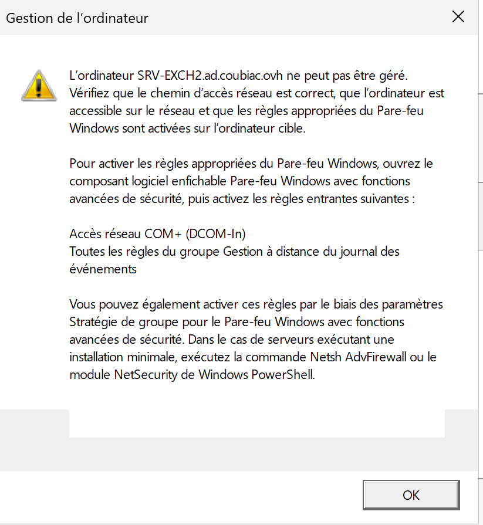
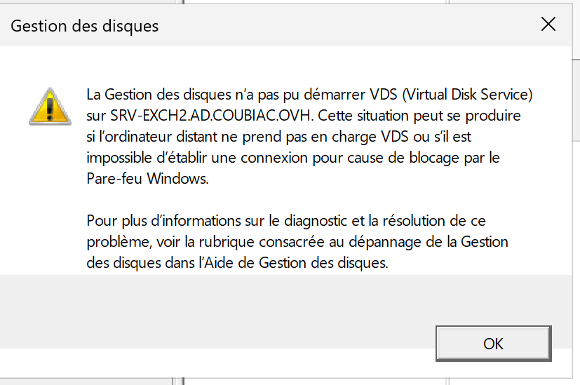
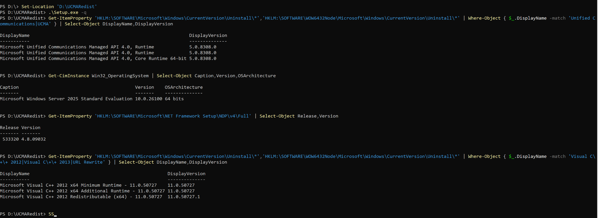
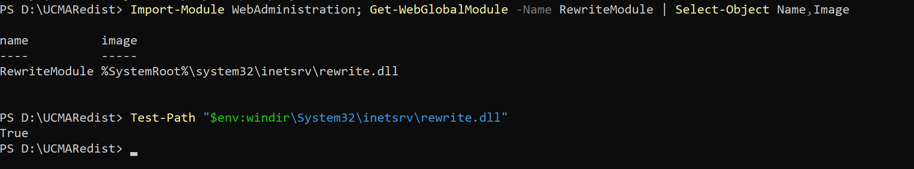
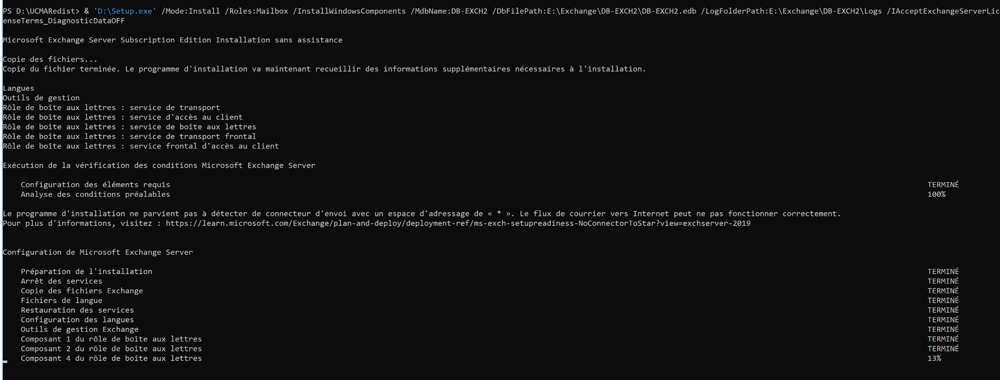
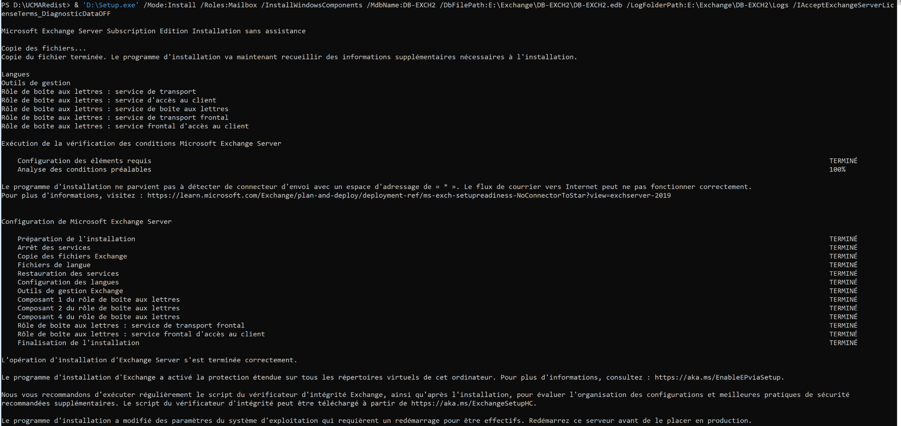
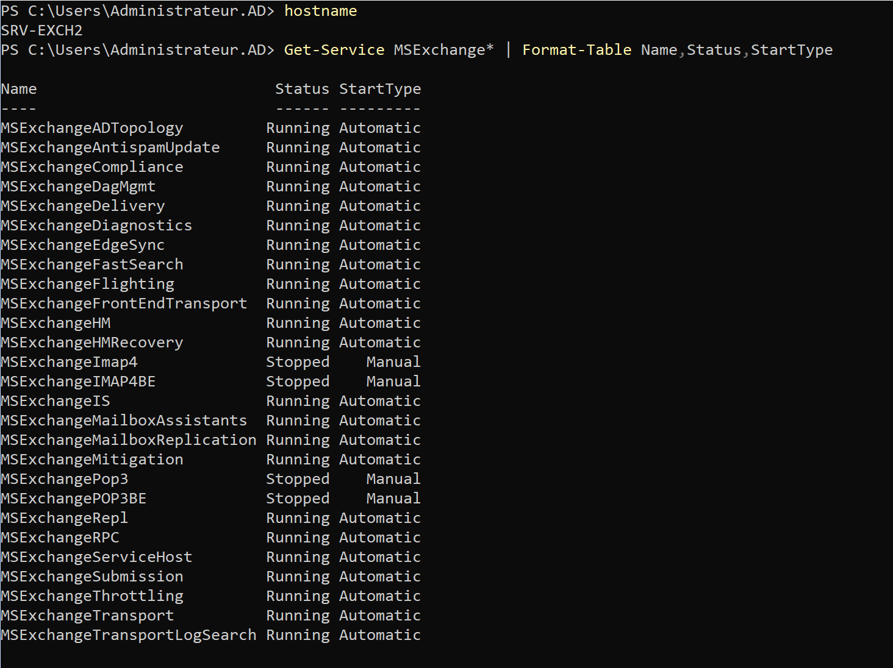
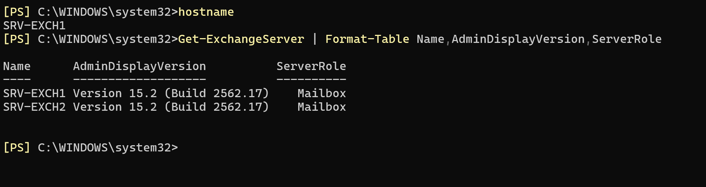
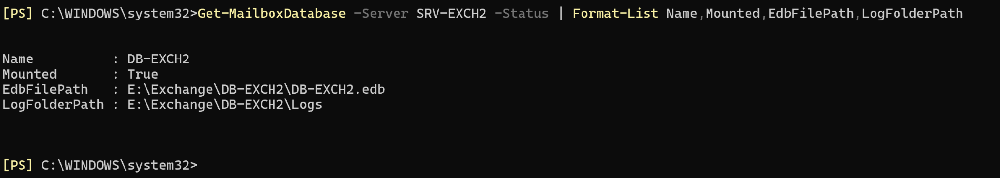
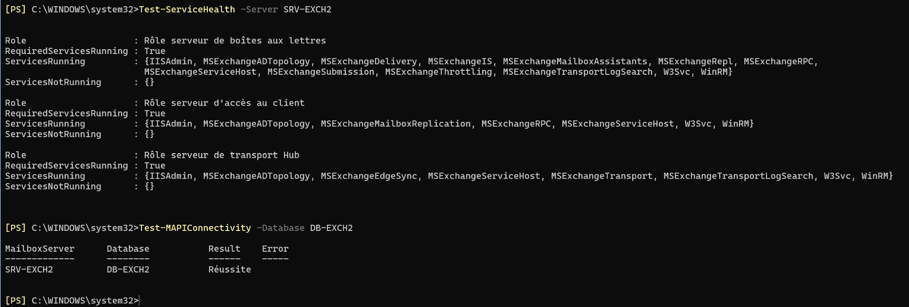

Installer Exchange Server Subscription Edition (SE) sur **Windows Server 2025 Core** n'est pas fondamentalement compliqué : le programme d'installation prend en charge le mode sans assistance. En pratique, ce sont souvent les opérations qui précèdent l'installation — administration distante, stockage, prérequis et dépendances — qui demandent le plus d'attention.

Voici le déroulement d'une installation **réalisée et validée dans mon lab**, avec les commandes utilisées, les problèmes rencontrés et les vérifications finales. L'objectif est d'ajouter un second serveur Mailbox à une organisation Exchange existante. La mise en place d'un **Database Availability Group (DAG)** fera l'objet d'une suite ; aucun DAG n'est configuré dans cet article.

> **Contexte :** c'est un laboratoire, pas un dimensionnement de production. Les chemins, la taille des volumes et les exceptions de pare-feu sont à adapter à ton environnement. Les commandes ci-dessous sont volontairement écrites **sur une seule ligne** pour faciliter le copier-coller sur Server Core.

## 1. Environnement de départ

| Élément | Configuration |
|---|---|
| Domaine Active Directory | `ad.coubiac.ovh` |
| Serveur existant | `SRV-EXCH1`, Exchange SE, build `15.2.2562.17` |
| Nouveau serveur | `SRV-EXCH2`, Windows Server 2025 Standard Evaluation, installation Core |
| Disque système | `C:` (NTFS) |
| ISO Exchange | `D:` (`EXCHANGESERVERSE-X64`) |
| Disque bases et journaux | `E:` (ReFS, environ 100 Go dans le lab) |
| Première base créée | `DB-EXCH2` |

Le nouveau serveur est déjà joint au domaine. L'organisation Exchange et son schéma Active Directory existent déjà : nous **n'effectuons pas ici une première installation d'organisation** et ne relançons pas arbitrairement les opérations `/PrepareSchema` ou `/PrepareAD`.

Microsoft prend en charge Exchange SE sous Windows Server 2025, y compris en **Server Core**, option recommandée dans sa matrice de support.

## 2. Administrer Server Core depuis une machine graphique

On peut installer Exchange entièrement depuis PowerShell sur Server Core. Pour faciliter les opérations initiales, je souhaitais néanmoins utiliser `compmgmt.msc` depuis un serveur disposant d'une interface graphique.

### Activer WinRM

Sur `SRV-EXCH2`, en PowerShell administrateur :

```powershell
Configure-SMRemoting.exe -Enable
```

```powershell
Enable-PSRemoting -Force
```

Cela permet notamment les sessions distantes PowerShell, mais **WinRM ne suffit pas pour toutes les consoles MMC**. Certaines s'appuient sur DCOM/RPC et nécessitent des règles de pare-feu distinctes.

### Autoriser les composants MMC nécessaires

Dans ce lab, l'ouverture de la Gestion de l'ordinateur à distance a d'abord provoqué une erreur demandant les exceptions DCOM et « Gestion à distance du journal des événements ».



Les noms techniques des règles sont plus fiables que les noms affichés en français. Sur `SRV-EXCH2` :

```powershell
Get-NetFirewallRule -Name 'RemoteEventLogSvc-*','WMI-WINMGMT-In-TCP','WMI-RPCSS-In-TCP','RemoteSvcAdmin-*' | Enable-NetFirewallRule
```

Pour vérifier leur état :

```powershell
Get-NetFirewallRule | Where-Object { $_.Name -match 'RemoteEventLog|RemoteSvcAdmin|WMI-' } | Format-Table Name,Enabled,Profile
```

Ces ouvertures étaient destinées au **réseau interne du lab**. En production, il faut limiter leur portée aux adresses des postes d'administration, plutôt que d'élargir l'accès RPC inutilement.

### Cas particulier : Gestion des disques à distance

La console MMC fonctionnait alors partiellement, mais **Gestion des disques** affichait un nouveau message : impossible de démarrer *Virtual Disk Service* (VDS) sur le serveur distant.



Sur `SRV-EXCH2` **et sur le poste qui exécute la console graphique** :

```powershell
Get-NetFirewallRule -Name 'RVM-*' | Enable-NetFirewallRule
```

Puis, sur les deux machines si nécessaire :

```powershell
Start-Service -Name vds
```

L'accès aux disques a ensuite fonctionné. **Un port 135 accessible ne suffit pas à prouver que toutes les communications RPC fonctionnent** : il faut également tenir compte des règles applicables aux services et des ports RPC dynamiques. L'IPv6 n'était pas en cause dans ce diagnostic.

## 3. Préparer le volume Exchange en ReFS

Dans ce lab, `E:` est réservé à la base et à ses journaux, tandis que les binaires Exchange restent sur `C:`.

État initial du volume : **ReFS, unités d'allocation de 4 Ko**. Microsoft recommande **64 Ko** pour les volumes hébergeant les fichiers `.edb` et les journaux Exchange. Les flux d'intégrité ReFS sont également désactivés pour ce type de charge.

Vérification :

```powershell
Get-Volume -DriveLetter E | Select-Object DriveLetter,FileSystem,AllocationUnitSize
```

Dans un volume **vide** et après avoir vérifié qu'aucune donnée n'était à conserver, j'ai reformaté le disque :

> **Attention :** cette commande détruit les données de `E:`. Ne jamais l'exécuter sur un volume existant contenant des informations à conserver.

```powershell
Format-Volume -DriveLetter E -FileSystem ReFS -AllocationUnitSize 65536 -NewFileSystemLabel "DATA" -SetIntegrityStreams $false
```

Contrôle après formatage : `E:`, `ReFS`, `65536`. Puis création de l'arborescence :

```powershell
New-Item -ItemType Directory -Path 'E:\Exchange\DB-EXCH2','E:\Exchange\DB-EXCH2\Logs' -Force
```

Dans mon cas, la base sera stockée dans `E:\Exchange\DB-EXCH2\DB-EXCH2.edb` et ses journaux dans `E:\Exchange\DB-EXCH2\Logs`.

## 4. Installer les prérequis sur Server Core

### Vérifier Windows et .NET Framework

```powershell
Get-CimInstance Win32_OperatingSystem | Select-Object Caption,Version,OSArchitecture
```

```powershell
Get-ItemProperty 'HKLM:\SOFTWARE\Microsoft\NET Framework Setup\NDP\v4\Full' | Select-Object Release,Version
```

Sur `SRV-EXCH2` : Windows Server 2025 Standard Evaluation `10.0.26100` et .NET Framework 4.8.1 (`Release = 533320`). Le redistribuable Visual C++ 2012 x64 était déjà présent.

### Media Foundation

```powershell
Install-WindowsFeature Server-Media-Foundation
```

Résultat : `Success=True`, sans redémarrage requis.

### UCMA 4.0 : attention au lanceur de l'ISO

Le média Exchange SE utilisé contient le répertoire `D:\UCMARedist`, mais **pas** de fichier `D:\UCMARedist\UCMARunTimeSetup.exe`. L'exécutable présent est `D:\UCMARedist\Setup.exe`.

Le lancement du programme depuis un autre répertoire n'avait pas produit d'installation visible. Une tentative d'exécution directe de `Chains\UcmaRuntime.msi` a également échoué : le MSI impose l'utilisation du bootstrapper.

La commande qui a fonctionné sur ce média a consisté à **se placer dans le dossier de l'installateur** :

```powershell
Set-Location 'D:\UCMARedist'; .\Setup.exe -q
```

Vérification dans les logiciels installés :

```powershell
Get-ItemProperty 'HKLM:\SOFTWARE\Microsoft\Windows\CurrentVersion\Uninstall\*','HKLM:\SOFTWARE\WOW6432Node\Microsoft\Windows\CurrentVersion\Uninstall\*' | Where-Object { $_.DisplayName -match 'Unified Communications|UCMA' } | Select-Object DisplayName,DisplayVersion
```

Résultat : **Unified Communications Managed API 4.0 Runtime**, version `5.0.8308.0`, avec son composant *Core Runtime 64-bit*.



### Visual C++ 2013 x64

Sur ce serveur, le redistribuable 2013 n'était pas détecté ; je l'ai installé depuis Microsoft :

```powershell
New-Item -ItemType Directory -Path C:\Install -Force
```

```powershell
Invoke-WebRequest -Uri 'https://aka.ms/highdpimfc2013x64enu' -OutFile 'C:\Install\vcredist2013_x64.exe'
```

```powershell
$p = Start-Process 'C:\Install\vcredist2013_x64.exe' -ArgumentList '/install /quiet /norestart' -Wait -PassThru; "Code retour : $($p.ExitCode)"
```

Code de sortie `0` et version installée `12.0.40664`.

### IIS URL Rewrite 2.1

Pour installer le module URL Rewrite, j'ai d'abord ajouté le rôle IIS de base :

```powershell
Install-WindowsFeature Web-Server
```

Puis téléchargé et installé le module x64 :

```powershell
Invoke-WebRequest -Uri 'https://download.microsoft.com/download/1/2/8/128E2E22-C1B9-44A4-BE2A-5859ED1D4592/rewrite_amd64_fr-FR.msi' -OutFile 'C:\Install\rewrite_x64.msi'
```

```powershell
$p = Start-Process msiexec.exe -ArgumentList '/i "C:\Install\rewrite_x64.msi" /qn /norestart /L*v "C:\Install\rewrite-install.log"' -Wait -PassThru; "Code retour : $($p.ExitCode)"
```

Le MSI a retourné `0`, mais **URL Rewrite n'apparaissait pas dans la recherche des programmes installés**. Pour confirmer réellement sa présence, j'ai interrogé IIS :

```powershell
Import-Module WebAdministration; Get-WebGlobalModule -Name RewriteModule | Select-Object Name,Image
```

```powershell
Test-Path "$env:windir\System32\inetsrv\rewrite.dll"
```

Résultat : `RewriteModule` enregistré et fichier DLL présent (`True`). Le prérequis était donc bien installé.



> Le commutateur Exchange `/InstallWindowsComponents` installe les rôles et fonctionnalités Windows nécessaires ; il ne dispense pas de vérifier les dépendances logicielles externes. Vérifier aussi que le service **Remote Registry** n'est pas désactivé, comme le demande Microsoft.

## 5. Installer Exchange SE en ligne de commande

J'ai utilisé le même média Exchange SE RTM que sur `SRV-EXCH1`. Le second serveur rejoint **l'organisation déjà existante** : il ne faut pas préciser un nouveau nom d'organisation.

Depuis une session PowerShell exécutée avec les droits d'administration nécessaires :

```powershell
& 'D:\Setup.exe' /Mode:Install /Roles:Mailbox /InstallWindowsComponents /MdbName:DB-EXCH2 /DbFilePath:E:\Exchange\DB-EXCH2\DB-EXCH2.edb /LogFolderPath:E:\Exchange\DB-EXCH2\Logs /IAcceptExchangeServerLicenseTerms_DiagnosticDataOFF
```

Les options principales :

| Paramètre | Rôle |
|---|---|
| `/Mode:Install /Roles:Mailbox` | Installer le rôle Mailbox |
| `/InstallWindowsComponents` | Installer les fonctionnalités Windows requises |
| `/MdbName:DB-EXCH2` | Nommer la première base |
| `/DbFilePath:...` | Choisir l'emplacement du fichier EDB |
| `/LogFolderPath:...` | Choisir l'emplacement des journaux |
| `/IAcceptExchangeServerLicenseTerms_DiagnosticDataOFF` | Accepter la licence sans collecte facultative des diagnostics |

Les contrôles de prérequis ont réussi. Un avertissement non bloquant indiquait cependant l'absence de **connecteur d'envoi avec espace d'adressage `*`**. Il faudra configurer le routage sortant si l'organisation doit envoyer des messages vers Internet ; cet avertissement ne signifie pas que le nouveau serveur est inutilisable.



### L'installation paraît bloquée ? Lire le journal

Sur cette VM, l'installation a pris environ **une heure et vingt minutes**. Lors de l'enregistrement des compteurs de performances Exchange, la progression de la console semblait très lente.

J'ai ouvert une **deuxième session PowerShell**, sans interrompre le premier Setup, puis consulté :

```powershell
Get-Content C:\ExchangeSetupLogs\ExchangeSetup.log -Tail 30
```

Pour suivre les nouvelles lignes :

```powershell
Get-Content C:\ExchangeSetupLogs\ExchangeSetup.log -Tail 10 -Wait
```

Le journal continuait à traiter les fichiers `Setup\Perf\*.xml`. Autre piège constaté : les horodatages **dans les lignes du journal** affichaient une heure de moins que l'heure locale française. Comparer directement ces valeurs à l'horloge du serveur faisait croire, à tort, que rien n'avait bougé depuis une heure. La date de dernière modification du **fichier**, elle, évoluait bien.

La fin du Setup a confirmé que **l'installation s'était terminée correctement**. Il a aussi indiqué l'activation de l'**Extended Protection** sur les répertoires virtuels et la nécessité d'un redémarrage.



## 6. Redémarrer et valider le nouveau serveur

Sur `SRV-EXCH2` :

```powershell
Restart-Computer
```

Après redémarrage, consultation des services :

```powershell
Get-Service MSExchange* | Format-Table Name,Status,StartType
```

Les services Exchange nécessaires sont démarrés. Certains services **POP3/IMAP4** restent arrêtés en démarrage manuel : ce n'est pas une anomalie si ces protocoles ne sont pas utilisés.



Depuis l'**Exchange Management Shell** sur `SRV-EXCH1`, les deux serveurs sont visibles dans l'organisation :

```powershell
Get-ExchangeServer | Format-Table Name,AdminDisplayVersion,ServerRole
```

Résultat : `SRV-EXCH1` et `SRV-EXCH2`, tous deux au **build 15.2.2562.17**, rôle `Mailbox`.



Contrôle de la nouvelle base :

```powershell
Get-MailboxDatabase -Server SRV-EXCH2 -Status | Format-List Name,Mounted,EdbFilePath,LogFolderPath
```

Résultat : `DB-EXCH2`, `Mounted=True`, fichier `E:\Exchange\DB-EXCH2\DB-EXCH2.edb` et journaux `E:\Exchange\DB-EXCH2\Logs`.



Enfin, vérification des services attendus et de l'accès MAPI :

```powershell
Test-ServiceHealth -Server SRV-EXCH2
```

```powershell
Test-MAPIConnectivity -Database DB-EXCH2
```

`Test-ServiceHealth` rapporte `RequiredServicesRunning=True` pour les rôles vérifiés et aucun service requis manquant. `Test-MAPIConnectivity` retourne **Réussite** pour `SRV-EXCH2` / `DB-EXCH2`.



Ces tests confirment l'installation des services attendus et l'accès MAPI à la base. Ils ne remplacent pas, pour une mise en production, les tests de flux de messagerie, certificats, URL, DNS, sauvegardes et disponibilité réelle depuis les clients.

## 7. Et ensuite : mises à jour, puis DAG

À ce stade, le **deuxième serveur Exchange SE fonctionne**, mais il n'y a **pas encore de haute disponibilité des bases**. Chaque serveur dispose de sa propre base ; il n'existe pas automatiquement de copie de `DB-EXCH2` sur `SRV-EXCH1`.

Les prochaines étapes seront de :

1. Vérifier et installer les **Security Updates / Hotfix Updates Exchange SE** applicables sur les deux serveurs, avec les procédures de maintenance appropriées ;
2. Contrôler la configuration des URL Exchange, des certificats et des flux nécessaires ;
3. Préparer un **File Share Witness** adapté à un DAG de deux nœuds ;
4. Créer le DAG, y ajouter les deux serveurs et vérifier les réseaux de réplication ;
5. Ajouter des copies de bases avec `Add-MailboxDatabaseCopy`, puis tester le basculement.

Ce sera la **deuxième partie** du tutoriel, après validation des mises à jour et de la configuration de l'environnement.

## Références Microsoft

- [Matrice de prise en charge Exchange Server](https://learn.microsoft.com/fr-fr/exchange/plan-and-deploy/supportability-matrix)
- [Prérequis Exchange Server 2019 / SE](https://learn.microsoft.com/fr-fr/exchange/plan-and-deploy/prerequisites)
- [Installation Exchange en mode sans assistance](https://learn.microsoft.com/fr-fr/exchange/plan-and-deploy/deploy-new-installations/unattended-installs)
- [Options de stockage Exchange : ReFS et tailles d'allocation](https://learn.microsoft.com/fr-fr/exchange/plan-and-deploy/deployment-ref/storage-configuration)

*Article basé sur un lab Windows Server 2025 Core et Exchange SE RTM, testé le 8 novembre 2026. Vérifier les exigences et les mises à jour Microsoft avant de reproduire la procédure sur une autre version.*
