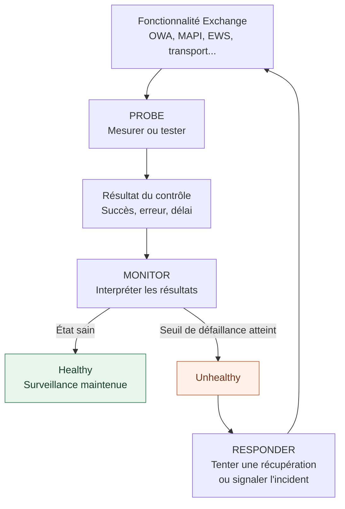
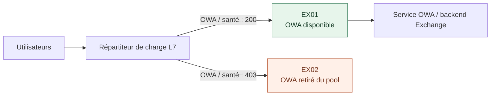
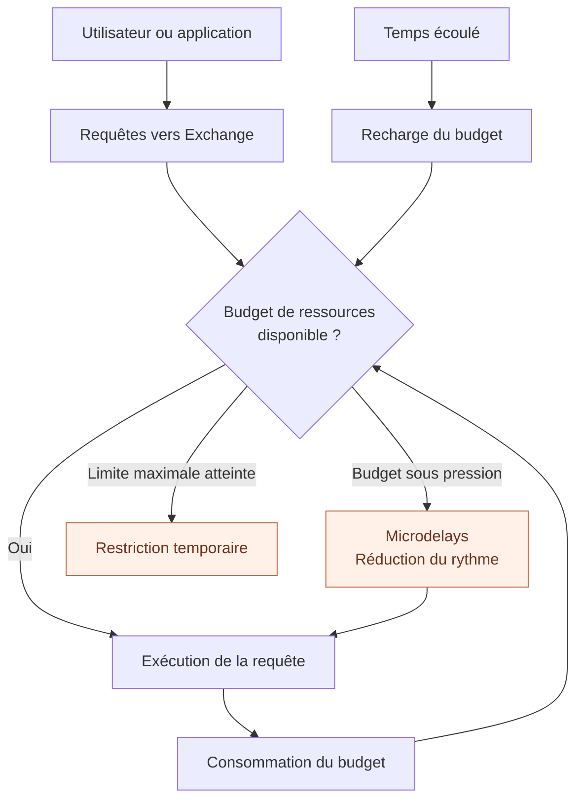

Un utilisateur signale qu'Outlook sur le Web (OWA) ne fonctionne plus. L'administrateur se connecte au serveur Exchange : IIS est démarré, les principaux services Windows sont en cours d'exécution et le port TCP 443 répond.

Pourtant, OWA retourne une erreur. Quelques minutes plus tard, le service refonctionne sans intervention apparente. Les journaux montrent qu'un pool d'applications IIS a été recyclé automatiquement.

Autre situation : une application qui interroge des boîtes aux lettres devient subitement lente. Les serveurs répondent, les bases sont montées, mais certaines requêtes prennent de plus en plus de temps. L'application est-elle en panne, Exchange est-il saturé ou applique-t-il volontairement une limitation de ressources ?

Ces deux incidents peuvent faire intervenir des mécanismes de protection d'Exchange, **mais pas nécessairement les mêmes**.

Pour les comprendre, il faut distinguer :

- **Managed Availability** : surveiller les fonctionnalités Exchange et tenter certaines récupérations automatiques.
- **User Workload Management** : limiter la consommation des ressources par un utilisateur ou une application.
- **System Workload Management** : adapter certaines charges internes à la pression sur les ressources du serveur.
- **Back Pressure** : protéger spécifiquement le transport SMTP lorsque ses ressources deviennent insuffisantes.

L'objectif est de comprendre leurs interactions, puis de disposer d'une méthode d'investigation avant d'envisager un redémarrage ou un changement de configuration.

> **Versions :** les principes présentés concernent Exchange Server 2016, 2019 et Subscription Edition (SE). Ils prolongent les notions abordées dans le support Microsoft **20345-1B, *Administering Microsoft Exchange Server 2016/2019***, notamment les modules 6 (accès clients), 8 (transport), 10 (supervision et dépannage) et 11 (gestion des charges et maintenance). Le support de formation ne détaille pas à lui seul toutes les subtilités des Probes et Responders : les sections correspondantes sont donc complétées par Microsoft Learn. En novembre 2026, Exchange Server SE est la version de référence pour les déploiements on-premises pérennes ; les versions 2016 et 2019 sont sorties du support standard le 14 octobre 2025.

## 1. Un service démarré est-il nécessairement fonctionnel ?

Prenons le service IIS. Son processus peut être présent et écouter sur le port 443. Cela démontre seulement qu'un composant de la chaîne est accessible.

Pour qu'un utilisateur ouvre sa boîte avec OWA, beaucoup d'autres éléments doivent fonctionner :

1. Le nom de service doit être résolu par DNS.
2. Le répartiteur de charge doit sélectionner un serveur capable de traiter la requête.
3. Le serveur doit accepter la connexion HTTPS et négocier TLS.
4. Les composants d'authentification et de proxy doivent fonctionner.
5. Les dépendances nécessaires, dont Active Directory, doivent être disponibles.
6. Le serveur qui héberge la base active doit pouvoir répondre.

Une vérification TCP ne garantit pas que cette chaîne fonctionne de bout en bout. Inversement, une base de données Exchange parfaitement saine ne garantit pas que le service OWA soit disponible.

C'est précisément la différence entre une **surveillance de composants** et une **surveillance orientée expérience utilisateur**.

Managed Availability s'intéresse principalement à trois dimensions :

| Dimension | Question posée |
|---|---|
| **Disponibilité** | Le service est-il utilisable ? |
| **Latence** | Les opérations répondent-elles suffisamment vite ? |
| **Erreurs** | Les opérations attendues aboutissent-elles ? |

Sa priorité est la **récupération du service**, pas la production automatique d'une analyse complète de la cause racine. Une récupération réussie peut masquer temporairement une anomalie récurrente : les événements historiques restent donc essentiels au diagnostic.

## 2. Où s'exécute Managed Availability ?

Managed Availability, également nommé *Active Monitoring* ou *Local Active Monitoring*, est intégré à chaque serveur Exchange.

Son fonctionnement repose notamment sur deux processus :

- **`MSExchangeHMHost.exe`** : le processus hôte du Health Manager, qui pilote le processus de travail et peut contribuer à le relancer si nécessaire.
- **`MSExchangeHMWorker.exe`** : le processus de travail qui exécute les activités de surveillance.

Le système utilise aussi des définitions de contrôles, les journaux d'événements Windows, certains paramètres en registre et des **boîtes aux lettres de surveillance** (*health mailboxes*) pour des transactions synthétiques.

Par exemple, tester une fonctionnalité de messagerie de bout en bout peut nécessiter une véritable boîte de surveillance plutôt qu'une simple requête HTTP.

```powershell
# Inventorier les boîtes de surveillance Exchange (lecture seule)
Get-Mailbox -Monitoring |
    Select-Object Name,Database,ServerName |
    Format-Table -AutoSize
```

Ces objets ne sont pas des boîtes utilisateurs ordinaires. Ils sont employés par les mécanismes de contrôle Exchange. **Il ne faut pas les supprimer pour "faire du ménage"** sans analyser leur état et suivre une procédure documentée.

## 3. Les trois éléments fondamentaux : Probe, Monitor, Responder

On présente souvent Managed Availability comme une chaîne : **Probe → Monitor → Responder**. Cette représentation est volontairement simplifiée, mais elle permet de comprendre le modèle.



*Schéma 1 — Le Probe produit des mesures, le Monitor décide si elles révèlent une anomalie, le Responder déclenche éventuellement une action. Les contrôles continuent ensuite.*

### La Probe : observer, mesurer ou simuler

Une *Probe* (sonde) collecte des informations sur l'état d'un composant ou d'une fonctionnalité.

Microsoft distingue notamment trois familles :

| Famille | Fonctionnement | Exemple conceptuel |
|---|---|---|
| **Recurrent probe** | Exécute périodiquement une transaction de test | Vérifier une opération d'accès à une boîte |
| **Notification** | Un autre composant informe Managed Availability d'un événement | Signaler la perte d'une condition nécessaire à une copie de base |
| **Check** | Observe une mesure et publie un résultat lorsque certains seuils sont franchis | Détecter une valeur anormale de compteur |

Toutes les sondes ne lancent donc pas une requête à intervalles réguliers. Certaines sont alimentées par d'autres services Exchange.

Dans les définitions d'une sonde récurrente, plusieurs propriétés aident à comprendre ce qui se passe :

- `Name` : son identité.
- `ServiceName` : le Health Set auquel elle appartient.
- `TargetResource` : la ressource évaluée.
- `RecurrenceIntervalSeconds` : l'intervalle de répétition.
- `TimeoutSeconds` : le délai au-delà duquel le test expire.

Une Probe peut échouer ponctuellement à cause d'une latence transitoire ou d'une dépendance momentanément indisponible. **Un échec de Probe n'implique pas automatiquement que toute la fonctionnalité est en panne.** C'est le Monitor qui interprète les résultats dans leur contexte.

### Le Monitor : déterminer quand la situation devient anormale

Le *Monitor* applique une logique aux résultats reçus. Selon sa définition, il peut évaluer une succession d'échecs, un seuil, une durée ou des événements de notification.

Un Monitor peut notamment être déclaré `Healthy` ou `Unhealthy`. Les sorties d'administration peuvent aussi montrer des états tels que `Degraded`, `Disabled`, `Unavailable` ou `Repairing`.

Ces états ne sont pas interchangeables :

- **`Healthy`** : le contrôle considère la fonctionnalité saine.
- **`Degraded`** : état transitoire de dégradation signalé par le framework.
- **`Unhealthy`** : le contrôle a détecté une anomalie selon ses critères.
- **`Unavailable`** : l'état du moniteur n'a pas pu être récupéré.
- **`Disabled`** : le moniteur a été explicitement désactivé.
- **`Repairing`** : indique qu'une intervention de réparation est en cours.

Le délai avant déclenchement et les critères exacts dépendent du Monitor : il ne faut pas supposer qu'un même nombre d'erreurs ou qu'une durée universelle s'applique à tous les Health Sets.

### Le Responder : tenter une récupération ou remonter l'alerte

Un *Responder* exécute une réponse à un problème identifié :

- Recycler un pool d'applications IIS.
- Redémarrer un service.
- Déclencher une opération de basculement appropriée.
- Mettre un protocole hors service ou le réactiver.
- Déclencher, dans certains cas prévus par Exchange, une action beaucoup plus intrusive allant jusqu'au redémarrage du serveur.
- Escalader l'incident via les journaux pour une prise en charge humaine.

**Ces actions sont possibles, pas systématiques.** Chaque fonctionnalité possède ses propres définitions et séquences de récupération. Il ne faut pas résumer Managed Availability à "trois échecs puis redémarrage du serveur".

Un point mérite une attention particulière : les Responders sont eux-mêmes soumis à des **mécanismes de limitation**, ou *Responder Throttling*. Ils ne doivent pas provoquer une succession incontrôlée de redémarrages.

## 4. Les Health Sets : passer de centaines de contrôles à une vue exploitable

Une infrastructure Exchange comporte de nombreux tests. Les consulter un par un serait peu pratique.

Les sondes, moniteurs et répondeurs associés à une fonctionnalité sont donc regroupés dans un **Health Set**.

On rencontre, selon les versions et composants installés, des Health Sets liés à OWA, MAPI/HTTP, Exchange ActiveSync, EWS, aux bases de données, à l'Information Store ou au transport.

Un Health Set synthétise l'état de ses Monitors. Son état global reflète le moins bon état observé parmi eux. Un Health Set dégradé n'indique cependant pas automatiquement que *tous* les utilisateurs de la fonctionnalité sont en échec.

Il faut toujours préciser : **quel serveur, quel Health Set, quel Monitor et quelle ressource cible ?**

Pour un DAG important, cette distinction est essentielle : un défaut local sur un membre ne signifie pas nécessairement une indisponibilité de l'organisation entière.

## 5. Que peut voir l'administrateur en PowerShell ?

Les cmdlets suivantes sont prévues pour **l'Exchange Management Shell on-premises**. Les exemples utilisent le serveur fictif `EX01`. Les noms exacts des Health Sets doivent être découverts dans l'environnement avant toute investigation ciblée.

### Première étape : obtenir une vue synthétique

```powershell
# Résumé de santé du serveur
Get-HealthReport -Identity EX01
```

Cette commande fournit une vue agrégée des Health Sets. Elle convient à une première orientation.

```powershell
# Détail des moniteurs et de leur état
Get-ServerHealth -Identity EX01 |
    Format-Table HealthSetName,Name,AlertValue,HealthGroupName -AutoSize
```

Le résultat est plus détaillé : il permet d'identifier les moniteurs qui justifient un état dégradé.

Pour afficher les moniteurs actuellement signalés comme défaillants :

```powershell
Get-ServerHealth -Identity EX01 |
    Where-Object { $_.AlertValue -eq 'Unhealthy' } |
    Format-Table HealthSetName,Name,AlertValue -AutoSize
```

Cette sortie est un **instantané**, pas une chronologie. Un Monitor revenu sain ne permet pas, à lui seul, de savoir pourquoi il est tombé en erreur dix minutes auparavant.

### Deuxième étape : isoler une fonctionnalité

Après avoir identifié le nom exact du Health Set, il est possible de se limiter à ce périmètre.

```powershell
# Exemple : rechercher les noms des Health Sets liés à OWA
Get-ServerHealth -Identity EX01 |
    Where-Object { $_.HealthSetName -like '*OWA*' } |
    Select-Object -ExpandProperty HealthSetName -Unique
```

Puis, en remplaçant la valeur par celle réellement observée :

```powershell
# Le nom OWA.Protocol est un exemple documenté ;
# confirmer sa présence sur le serveur concerné.
Get-ServerHealth -Identity EX01 -HealthSet 'OWA.Protocol' |
    Format-Table Name,AlertValue -AutoSize
```

### Troisième étape : découvrir les contrôles associés

```powershell
Get-MonitoringItemIdentity -Server EX01 -Identity 'OWA.Protocol' |
    Format-Table Identity,ItemType,Name -AutoSize
```

La commande permet de retrouver les éléments de surveillance associés au Health Set. Pour certains contrôles, `Get-MonitoringItemHelp` peut fournir des renseignements supplémentaires.

Il faut distinguer le **nom du Health Set**, le **nom de la Probe** et le **nom du Monitor**. Ils ne désignent pas le même objet.

### Quatrième étape : relancer ponctuellement une sonde appropriée

Microsoft documente `Invoke-MonitoringProbe` pour lancer manuellement certaines sondes :

```powershell
# Exemple officiel de syntaxe, à réserver à un test ciblé
Invoke-MonitoringProbe -Identity 'ActiveSync.Protocol\ActiveSyncSelfTestProbe' -Server EX01 |
    Format-List
```

Attention : **toutes les sondes ne peuvent pas être déclenchées manuellement** avec cette cmdlet. Elle doit être utilisée après identification d'une Probe compatible, et son résultat doit être interprété en tenant compte des dépendances et de l'heure du test.

## 6. Les journaux d'événements : retrouver ce qui s'est réellement passé

Managed Availability écrit de nombreux événements dans des canaux Windows spécialisés, souvent appelés *Crimson channels*.

On distingue notamment :

| Famille de journaux | Informations recherchées |
|---|---|
| **ProbeDefinition / ProbeResult** | Définition et résultats des tests |
| **MonitorDefinition / MonitorResult** | Définition, transitions et résultats des moniteurs |
| **ResponderDefinition / ResponderResult** | Répondeurs configurés et leurs résultats |
| **RecoveryActionResults** | Actions de récupération exécutées et leur issue |
| **ManagedAvailability / Monitoring** | Alertes et informations de surveillance utiles à l'exploitation |

Les noms précis des canaux Windows peuvent varier dans leur présentation. Il est préférable de les **découvrir sur le serveur** plutôt que de recopier un nom supposé valide.

```powershell
# À exécuter sur le serveur Exchange analysé
Get-WinEvent -ListLog '*ActiveMonitoring*' |
    Select-Object LogName,IsEnabled,RecordCount |
    Format-Table -AutoSize

Get-WinEvent -ListLog '*ManagedAvailability*' |
    Select-Object LogName,IsEnabled,RecordCount |
    Format-Table -AutoSize
```

Après avoir relevé le nom exact du journal pertinent, une interrogation bornée dans le temps est préférable :

```powershell
# Exemple : adapter le nom du journal à celui réellement découvert.
$journal = 'NOM_EXACT_DU_JOURNAL'
$debut   = (Get-Date).AddMinutes(-30)

Get-WinEvent -FilterHashtable @{
    LogName   = $journal
    StartTime = $debut
} -MaxEvents 50 |
    Select-Object TimeCreated,Id,ProviderName,Message |
    Format-List
```

**Précaution de production :** les journaux `ProbeResult` peuvent contenir énormément d'événements, particulièrement sur les grands DAG. Éviter les extractions sans borne temporelle ni limite de volume.

Une méthode efficace consiste à reconstruire la chronologie suivante :

1. Première Probe en échec.
2. Passage d'un Monitor en état dégradé ou `Unhealthy`.
3. Éventuelle décision d'un Responder.
4. Action de récupération réalisée, différée ou ignorée.
5. Retour à `Healthy`, ou persistance de l'anomalie.

C'est souvent cette chronologie qui permet de distinguer un incident isolé d'un dysfonctionnement chronique.

## 7. Managed Availability et le répartiteur de charge

Considérons deux serveurs Exchange `EX01` et `EX02`, tous deux publiés derrière un répartiteur de charge HTTP.

`EX01` répond toujours sur le port 443, mais son composant OWA est jugé défaillant. Si le répartiteur effectue uniquement une vérification TCP, il peut continuer à lui envoyer des utilisateurs.

Pour éviter ce comportement, Exchange expose des points de contrôle tels que :

- `/owa/healthcheck.htm`
- `/mapi/healthcheck.htm`
- `/ecp/healthcheck.htm`

L'URL dépend du protocole à évaluer et de la configuration de publication. Le répartiteur doit interroger la cible prévue, conformément à son mode de fonctionnement (L4, L7, terminaison TLS, routage par chemin, etc.).

Dans le fonctionnement documenté par Microsoft, un contrôle de santé peut renvoyer :

| Réponse HTTP | Interprétation dans ce contexte |
|---|---|
| **200** | Le protocole surveillé est déclaré disponible |
| **403** | Le composant a été placé hors service par le mécanisme de contrôle |
| **Autre code / échec réseau** | Vérifier aussi IIS, TLS, publication, authentification, proxy ou réseau ; ce n'est pas nécessairement une décision de Managed Availability |

La nuance est importante : un `403` observé **sur le point de contrôle prévu** n'a pas la même signification qu'un `403` rencontré par un utilisateur sur une page ordinaire.



*Schéma 2 — Avec une vérification applicative adaptée, le répartiteur peut cesser d'envoyer des requêtes OWA à un serveur déclaré indisponible, même si son port 443 répond encore.*

Sur un répartiteur purement L4 associé à un espace de noms unique, la granularité peut être limitée au serveur entier : un échec sur le contrôle OWA peut conduire à retirer également un serveur pour d'autres requêtes HTTP. Un répartiteur L7 peut prendre des décisions **par protocole ou chemin**, sous réserve de sa configuration.

### Et `ServerComponentState` ?

```powershell
Get-ServerComponentState -Identity EX01 |
    Format-Table Component,State -AutoSize
```

Cette commande affiche l'état des composants Exchange, notamment ceux qui interviennent dans l'acceptation du trafic.

Il faut distinguer deux notions :

- **L'état de santé**, issu des Monitors et des Health Sets.
- **L'état administratif ou opérationnel d'un composant**, éventuellement modifié pour une maintenance ou une récupération.

Un composant peut être `Inactive` parce qu'un administrateur l'a placé en maintenance. Il ne faut pas conclure automatiquement qu'un Responder a détecté une panne.

La configuration d'un composant peut dépendre de plusieurs *requesters* (par exemple `Maintenance` ou `HealthAPI`). Pour rechercher pourquoi il est inactif, l'identité du requester et l'historique des opérations comptent autant que l'état apparent.

## 8. Pourquoi les Responders sont-ils eux-mêmes limités ?

Imaginons un serveur confronté à un problème persistant. Un Monitor le détecte et un Responder redémarre le service concerné. Le problème revient immédiatement : sans garde-fou, une séquence de récupération pourrait tourner en boucle.

Le **Responder Throttling** sert à encadrer la fréquence ou l'enchaînement des actions correctives.

Le principe est simple : **une récupération automatique ne doit pas devenir plus perturbatrice que l'incident initial**.

La documentation Microsoft indique que tous les Responders intègrent une forme de throttling. Lorsqu'une limite est atteinte, une action peut être **différée** ou **ignorée** selon son type. Par exemple, une action de type `Bugcheck Responder` peut être ignorée au lieu d'être simplement reportée.

Cela explique une situation déroutante :

> Le Monitor reste `Unhealthy`, un Responder existe dans sa définition, mais aucune nouvelle récupération n'est déclenchée immédiatement.

Ce constat **ne prouve pas que Managed Availability ne fonctionne plus**. Il faut examiner les événements de Responder et les actions précédentes avant d'en tirer une conclusion.

Ce mécanisme est distinct du throttling imposé aux utilisateurs et applications, présenté plus loin.

## 9. Les overrides : modifier les règles de surveillance avec prudence

Managed Availability permet de définir des *monitoring overrides* pour certains paramètres de Probes, Monitors et Responders.

Deux catégories existent :

- **Server override** : appliqué à un serveur donné ; stocké localement.
- **Global override** : applicable à un ensemble de serveurs ; configuration conservée dans Active Directory.

Un override peut être temporaire ou lié à une version précise. Il sert par exemple à ajuster un seuil dans une situation identifiée, mais il peut aussi **masquer une panne réelle**.

Les commandes de consultation sont utiles pour l'inventaire :

```powershell
# Substitutions locales du serveur
Get-ServerMonitoringOverride -Server EX01

# Substitutions globales de l'organisation
Get-GlobalMonitoringOverride
```

La création ou la suppression d'un override est un **changement de configuration**, pas une simple opération de diagnostic. Microsoft précise qu'une modification peut ne pas être prise en compte immédiatement : le Health Manager recherche régulièrement les changements, et les overrides globaux subissent aussi les délais de réplication AD.

Avant toute modification : identifier le Monitor concerné, expliquer pourquoi son seuil actuel est inapproprié, borner la durée de l'exception, documenter le retour arrière et conserver une supervision externe.

**Désactiver une sonde pour faire disparaître une alerte ne résout pas la cause de cette alerte.**

## 10. Le throttling utilisateur : protéger Exchange contre une consommation excessive

Le mot *throttling* signifie ici que le serveur **régule volontairement** l'utilisation de ses ressources. Une lenteur peut donc constituer un mécanisme de protection, et non le symptôme direct d'un service défaillant.

Prenons un exemple fictif : une application d'archivage interroge plusieurs milliers de boîtes avec EWS. Elle ouvre de nombreuses requêtes concurrentes et consomme une quantité significative de ressources.

Si toutes les requêtes étaient acceptées sans limite, elle pourrait dégrader l'expérience des autres utilisateurs.

Exchange dispose donc de mécanismes de *User Workload Management*, historiquement appelés *User Throttling*, qui reposent sur des **budgets** et des règles adaptées aux différents accès.

### Comprendre le principe du budget

Imaginons un budget de ressources qui se recharge dans le temps.

| Concept | Principe | Conséquence observable |
|---|---|---|
| **Burst allowance** | Autorise une consommation temporairement élevée | Une activité courte peut se terminer sans ralentissement notable |
| **Recharge rate** | Détermine à quelle vitesse le budget se reconstitue | Après une période de repos, des ressources redeviennent disponibles |
| **Traffic shaping / microdelays** | Introduit de courtes attentes avant d'atteindre une situation critique | Les opérations deviennent plus lentes |
| **Maximum usage** | Applique une restriction temporaire lorsque la limite est atteinte | Certaines opérations sont temporairement refusées ou bloquées |

L'analogie du budget aide à comprendre la logique, mais elle ne signifie pas que toutes les requêtes utilisent exactement le même compteur ou les mêmes unités. Les paramètres dépendent notamment du protocole et de la stratégie appliquée.



*Schéma 3 — Le throttling utilisateur cherche d'abord à réguler le rythme de consommation. Selon les paramètres et la situation, il peut aller jusqu'à une restriction temporaire.*

### Les Throttling Policies

Les paramètres de throttling sont regroupés dans des stratégies Exchange appelées **Throttling Policies**.

La stratégie `GlobalThrottlingPolicy` fournit un socle global. Des stratégies personnalisées peuvent s'appliquer à l'organisation ou à des objets déterminés.

```powershell
# Inventaire des stratégies (lecture seule)
Get-ThrottlingPolicy |
    Format-Table Name,ThrottlingPolicyScope -AutoSize

# Examiner la stratégie globale
Get-ThrottlingPolicy -Identity GlobalThrottlingPolicy |
    Format-List Name,ThrottlingPolicyScope,*Ews*,*Rca*,*PowerShell*
```

Les catégories et propriétés disponibles dépendent de la version. Ici, les caractères génériques permettent d'inspecter des familles de paramètres sans présumer qu'une liste particulière est identique sur toutes les versions.

Dans la documentation Microsoft, les portées sont organisées en ordre de priorité :

1. **`Regular`** : stratégie associée explicitement à des objets déterminés.
2. **`Organization`** : paramètres personnalisés d'organisation.
3. **`Global`** : politique globale, utilisée lorsque les stratégies plus spécifiques ne redéfinissent pas la valeur concernée.

Les paramètres non redéfinis peuvent être hérités des niveaux plus généraux. Une stratégie ne constitue donc pas toujours une copie complète de tous les paramètres de throttling.

Pour savoir quelle stratégie est associée à un objet :

```powershell
# Exemple fictif de compte applicatif
Get-ThrottlingPolicyAssociation -Identity 'svc-application' |
    Format-List *

# Autre vue si le compte possède une boîte Exchange
Get-Mailbox -Identity 'svc-application' |
    Format-List Name,ThrottlingPolicy
```

La propriété `ThrottlingPolicy` d'une boîte peut être vide lorsque la politique effective résulte des règles par défaut. **Une valeur `$null` ne signifie donc pas que le throttling est désactivé.**

Microsoft déconseille de modifier directement `GlobalThrottlingPolicy`, notamment pour éviter des changements écrasés par des mises à jour. Une exception justifiée devrait être mise en œuvre avec une stratégie dédiée, mesurée et documentée.

### Quand une application devient lente

Pour une application EWS, une baisse de débit peut avoir plusieurs causes :

- La politique de throttling limite sa consommation.
- Le nombre de requêtes concurrentes est trop élevé.
- Le serveur est réellement saturé.
- Un composant ou une dépendance répond lentement.
- Le réseau, un proxy ou l'application cliente introduit de la latence.

Un symptôme seul ne suffit pas à conclure. L'investigation doit comparer **la stratégie effective**, la consommation observée, les réponses applicatives, les journaux du protocole concerné et l'état du serveur.

**Une hausse des limites de throttling peut masquer un problème de conception de l'application et pénaliser les autres utilisateurs.** Avant de modifier Exchange, il est souvent préférable de limiter la concurrence côté application, de réduire la fréquence des appels et d'éviter les requêtes inutiles.

## 11. System Workload Management : privilégier les charges importantes

Exchange exécute simultanément des opérations très différentes : accès des utilisateurs, recherche, maintenance, assistants de boîtes aux lettres, déplacements de boîtes, etc.

Certaines opérations peuvent attendre davantage que d'autres.

Le *System Workload Management* cherche à adapter certaines charges de travail à l'état des ressources du serveur. Le support de formation 20345-1B décrit quatre classes de priorité :

| Classe | Idée générale |
|---|---|
| **Urgent** | Travail prioritaire |
| **Customer Expectation** | Opérations importantes pour l'expérience attendue par l'utilisateur |
| **Internal Maintenance** | Traitements internes qui peuvent être modulés |
| **Discretionary** | Travaux généralement moins urgents |

Le même support distingue des situations de ressources de type **Underloaded**, **Overloaded** et **Critical**.

Prenons une illustration : lors d'une période de forte activité, Exchange peut réduire le rythme de certaines opérations internes de priorité inférieure afin de préserver les opérations plus sensibles pour les utilisateurs.

Il ne faut toutefois pas en déduire un ordre universel de suspension valable pour tous les composants, toutes les versions et toutes les situations. Les décisions exactes dépendent de la logique interne d'Exchange.

**Point important :** Microsoft indique que les paramètres de *System Workload Management* ne doivent être personnalisés que sous sa supervision. Les anciennes familles de cmdlets `*-ResourcePolicy`, `*-WorkloadManagementPolicy` et `*-WorkloadPolicy` sont documentées comme dépréciées. Il ne s'agit donc pas d'un mécanisme que l'on devrait "optimiser" manuellement en production à partir d'un tutoriel générique.

## 12. Back Pressure : lorsque le transport protège ses propres ressources

Le transport SMTP possède son propre dispositif de protection : le **Back Pressure**.

Le service Microsoft Exchange Transport surveille notamment les ressources critiques de son traitement des messages : mémoire, espace disponible pour certaines données de transport et longueur de files spécifiques.

Lorsque la pression augmente, Exchange peut ralentir l'acceptation de nouveaux messages, puis refuser certaines soumissions pour éviter l'effondrement du service.

On peut rencontrer trois niveaux logiques :

- **Low / Normal** : fonctionnement normal.
- **Medium** : limitation partielle selon la ressource concernée.
- **High** : mesures de protection nettement plus restrictives, pouvant interrompre des flux de messages.

Le détail des réactions dépend de la ressource en cause. Il serait erroné d'affirmer qu'un seuil de mémoire identique entraîne toujours le même comportement qu'un disque de file d'attente saturé.

### Comment reconnaître un Back Pressure ?

Les indices peuvent comprendre :

- Des connexions SMTP acceptées, mais des échanges inhabituellement lents.
- Des réponses SMTP temporaires de refus ou des difficultés de soumission.
- Des files de transport qui évoluent anormalement.
- Des événements `MSExchangeTransport` liés au *Resource Manager*.

Microsoft documente notamment les événements `15004` (augmentation de la pression), `15005` (diminution), `15006` (problème critique d'espace disque) et `15007` (pression mémoire sévère), selon le scénario.

Une commande de diagnostic permet de consulter les ressources surveillées :

```powershell
# Lecture seule : état des ressources de transport sur EX01
[xml]$bp = Get-ExchangeDiagnosticInfo -Server EX01 `
    -Process EdgeTransport -Component ResourceThrottling

$bp.Diagnostics.Components.ResourceThrottling.ResourceTracker.ResourceMeter
```

La sortie peut nécessiter une inspection plus détaillée selon la version et les propriétés retournées. Le plus important est d'identifier **quelle ressource** est sous pression, et non de supprimer la limitation.

**À éviter :** modifier arbitrairement les seuils de Back Pressure dans `EdgeTransport.exe.config`. Microsoft déconseille ces modifications, qui peuvent accroître les risques de dégradation du service ou de perte de données.

Pour un diagnostic approfondi du transport, voir aussi [Exchange Server : comprendre le transport SMTP, le routage et les files d'attente](/articles/exchange-transport-smtp-routage-connecteurs-files-attente/).

## 13. Quatre mécanismes de protection, quatre questions différentes

Le terme *throttling* ne doit pas masquer les différences fondamentales.

| Mécanisme | Question traitée | Conséquence possible | Où regarder en priorité ? |
|---|---|---|---|
| **Managed Availability** | Le service rend-il l'expérience attendue ? | Récupération, mise hors ligne, escalade | Health Sets, Monitors, Responders, journaux ActiveMonitoring |
| **Responder Throttling** | Une action corrective peut-elle être répétée sans aggraver la situation ? | Action différée ou ignorée | Historique des Responders et Recovery Actions |
| **User Throttling** | Un compte ou une application consomme-t-il trop ? | Microdélais, restriction temporaire | Throttling Policies, association, traces du protocole concerné |
| **System Workload Management** | Quelles charges internes faut-il ralentir sous pression ? | Ralentissement de travaux moins prioritaires | État des ressources, performances, documentation Microsoft |
| **Back Pressure** | Le transport dispose-t-il des ressources nécessaires ? | Ralentissement ou refus de nouvelles soumissions SMTP | `MSExchangeTransport`, ResourceThrottling, disque et mémoire |

Cette grille évite de confondre une **récupération automatique**, un **arbitrage de ressources** et un **refus SMTP de protection**.

## 14. Cas pratique n° 1 : OWA ne fonctionne plus, mais IIS est démarré

Voici un scénario **fictif** de diagnostic, destiné à montrer une méthode de raisonnement plutôt qu'à reproduire un incident réellement observé.

L'organisation publie OWA derrière un répartiteur L7. Deux serveurs Exchange sont disponibles, `EX01` et `EX02`.

À 10 h 12, plusieurs utilisateurs signalent une erreur lors de l'ouverture d'OWA. Le répartiteur indique qu'`EX02` n'est plus disponible pour ce protocole. Pourtant, le serveur est joignable et IIS fonctionne.

### Étape A — Délimiter le symptôme

Il faut d'abord répondre à quatre questions :

1. Le problème concerne-t-il un seul utilisateur, un site ou tous les utilisateurs ?
2. OWA est-il seul concerné, ou MAPI/HTTP et EWS sont-ils également dégradés ?
3. L'incident apparaît-il sur `EX02` uniquement, ou sur plusieurs serveurs ?
4. La panne persiste-t-elle ou le service s'est-il déjà rétabli ?

Cette étape évite de conclure trop vite à un problème IIS, DNS ou de bases Exchange.

### Étape B — Comparer l'état des Health Sets

```powershell
Get-HealthReport -Identity EX01
Get-HealthReport -Identity EX02
```

Puis rechercher les moniteurs associés à OWA sur le serveur en difficulté :

```powershell
Get-ServerHealth -Identity EX02 |
    Where-Object { $_.HealthSetName -like '*OWA*' } |
    Format-Table HealthSetName,Name,AlertValue -AutoSize
```

Imaginons que l'un des Monitors soit `Unhealthy`. Cela identifie **une fonctionnalité surveillée en anomalie**, mais ne donne pas encore la cause racine.

### Étape C — Vérifier les composants et les contrôles applicatifs

```powershell
Get-ServerComponentState -Identity EX02 |
    Where-Object { $_.Component -match 'Owa|ServerWideOffline' } |
    Format-Table Component,State -AutoSize
```

Il faut ensuite comparer ce résultat avec les états remontés par le répartiteur de charge et les réponses des points de contrôle applicatifs, en respectant la topologie HTTPS et les noms de certificat.

Si `EX02` a été mis hors service pour OWA, il est essentiel de savoir **si c'est une décision de Managed Availability ou une action de maintenance**.

### Étape D — Reconstituer la chronologie

Les journaux peuvent, dans notre scénario fictif, montrer :

| Heure | Observation | Interprétation |
|---|---|---|
| 10:12 | Plusieurs Probes OWA échouent | La fonctionnalité rencontre un problème observé |
| 10:13 | Un Monitor passe `Unhealthy` | Les critères de défaillance sont atteints |
| 10:14 | Un Responder recycle un pool IIS | Exchange tente une récupération automatique |
| 10:15 | De nouvelles Probes réussissent | La fonctionnalité pourrait être rétablie |
| 10:16 | Le répartiteur réintègre le serveur | À confirmer avec les contrôles et les délais configurés |

*Les horaires sont illustratifs, pas une séquence de délais imposée par Exchange.*

Le fait que le pool IIS ait été recyclé explique **comment** le service a été récupéré. Il ne démontre pas **pourquoi** il a cessé de fonctionner. Un problème de mémoire, de dépendance, de données ou une régression logicielle peuvent provoquer de nouveaux incidents.

### Étape E — Contrôler le retour durable à la normale

Avant de clore l'incident, vérifier que :

- Les moniteurs concernés sont revenus à un état satisfaisant.
- Le protocole est de nouveau disponible sur le serveur.
- Les tests fonctionnels réussissent pour des utilisateurs représentatifs.
- Aucune répétition de l'anomalie n'apparaît dans les événements.
- Les autres membres du DAG n'ont pas subi un transfert de charge problématique.

Sur un grand environnement, il est pertinent de centraliser les transitions de Monitors et les actions des Responders pour détecter les récupérations automatiques récurrentes qui pourraient passer inaperçues.

## 15. Cas pratique n° 2 : une application EWS ralentit sans panne apparente

Autre scénario fictif : une application de traitement de courriers, exécutée avec un compte de service, met désormais 20 minutes au lieu de 5 pour terminer son travail.

Les premières vérifications indiquent :

- Les services Exchange sont démarrés.
- Les bases sont accessibles.
- Aucun Health Set majeur n'est actuellement en état `Unhealthy`.
- Les opérations de l'application sont pourtant ralenties.

Il serait tentant de conclure que Managed Availability ne voit pas la panne. Mais il faut envisager une autre explication : **Exchange applique peut-être du throttling à ce compte ou à la charge concernée**.

### Une démarche en quatre questions

**1. Quelle identité est utilisée ?**

Il faut identifier le compte ou le contexte sous lequel le serveur traite les requêtes : compte utilisateur, compte de service, mécanisme de délégation, etc.

**2. Quelle stratégie est effectivement appliquée ?**

```powershell
Get-ThrottlingPolicyAssociation -Identity 'svc-application' |
    Format-List *

Get-ThrottlingPolicy |
    Format-Table Name,ThrottlingPolicyScope -AutoSize
```

Ne pas se limiter à la présence d'une politique explicite : l'héritage et les paramètres de l'organisation comptent également.

**3. Quelle est la nature de la lenteur ?**

Une baisse du nombre de requêtes terminées n'est pas une preuve de throttling. Les journaux EWS, les erreurs applicatives, la concurrence réelle et les ressources serveur doivent permettre de distinguer attente imposée, saturation, timeout et anomalie cliente.

**4. Le problème touche-t-il d'autres utilisateurs ?**

Si une seule application est touchée, sa consommation et sa stratégie deviennent des pistes prioritaires. Si toutes les requêtes EWS ralentissent, une saturation ou un défaut de service plus large doit être exploré.

La démarche correcte ne consiste pas à supprimer les limites, mais à **mesurer la charge et comprendre pourquoi elle dépasse les capacités ou les budgets prévus**.

## 16. Comment surveiller un grand environnement Exchange sans se noyer dans les alertes ?

Sur un DAG de 16 serveurs, les mécanismes locaux de Managed Availability produisent un volume important d'informations. Ils restent indispensables, mais ils ne remplacent pas une supervision centralisée.

Une stratégie d'exploitation peut être organisée autour de trois niveaux.

### Niveau 1 — La disponibilité réelle du service

Vérifier depuis l'extérieur des serveurs que les fonctions essentielles restent utilisables : accès clients, DNS, TLS, réception et émission des messages, dépendances et disponibilité des bases.

C'est une vue **orientée utilisateurs**.

### Niveau 2 — Les états de santé Exchange

Collecter périodiquement les synthèses de Health Sets et les états des composants, puis corréler les anomalies entre serveurs et sites.

C'est une vue **orientée fonctionnement interne**.

```powershell
# Exemple de vue synthétique multi-serveurs
Get-ExchangeServer | Get-HealthReport -RollupGroup
```

L'état global ne remplace pas l'examen détaillé du Monitor à l'origine du problème.

### Niveau 3 — Les événements de récupération et les tendances

Surveiller les répétitions :

- Plusieurs récupérations automatiques de la même fonctionnalité.
- Des Responders de plus en plus souvent différés ou limités.
- Des Health Sets qui oscillent entre `Healthy` et `Unhealthy`.
- Une saturation progressive des ressources.
- Des épisodes répétés de Back Pressure ou de ralentissement applicatif.

C'est une vue **orientée prévention et diagnostic**.

Le plus utile n'est pas nécessairement d'envoyer une alerte à chaque Probe en échec : il faut distinguer une anomalie transitoire, une récupération automatique réussie et un problème durable nécessitant une intervention.

## 17. Mini-TP de découverte, sans modification de configuration

L'objectif est de se familiariser avec les mécanismes sur un laboratoire Exchange. Les commandes proposées sont des commandes de lecture ; il n'est pas nécessaire de provoquer une panne.

### Exercice 1 — Découvrir les Health Sets

Sur un serveur `EX01`, obtenir :

1. Le rapport synthétique de santé.
2. La liste des Health Sets présents.
3. Les Monitors dont l'état n'est pas `Healthy`.

```powershell
Get-HealthReport -Identity EX01

Get-ServerHealth -Identity EX01 |
    Select-Object -ExpandProperty HealthSetName -Unique |
    Sort-Object

Get-ServerHealth -Identity EX01 |
    Where-Object { $_.AlertValue -ne 'Healthy' } |
    Format-Table HealthSetName,Name,AlertValue -AutoSize
```

**Question :** pourquoi cette dernière commande ne suffit-elle pas à affirmer qu'un utilisateur rencontre actuellement une panne ?

### Exercice 2 — Retrouver une Probe et son Monitor

Choisir un Health Set présent dans le résultat précédent, puis lister ses éléments :

```powershell
# Remplacer le nom par un Health Set réellement présent
Get-MonitoringItemIdentity -Server EX01 -Identity 'OWA.Protocol' |
    Format-Table ItemType,Name,Identity -AutoSize
```

**Question :** pourquoi un événement de Probe en échec doit-il être relié à son Monitor avant de déclencher une intervention ?

### Exercice 3 — Inspecter les politiques de ressources

```powershell
Get-ThrottlingPolicy |
    Format-Table Name,ThrottlingPolicyScope -AutoSize

Get-ThrottlingPolicy -Identity GlobalThrottlingPolicy |
    Format-List Name,ThrottlingPolicyScope
```

**Question :** l'absence de stratégie explicitement affectée à une boîte signifie-t-elle qu'elle n'est soumise à aucune limite ?

### Corrigé

1. **Non** : un Monitor peut être désactivé, indisponible ou en réparation ; une anomalie peut être limitée à un composant ou à un serveur, et une panne ancienne peut déjà avoir été récupérée. Le ressenti utilisateur et l'historique sont indispensables.
2. **Parce que le Monitor applique la logique de décision** : il peut attendre plusieurs résultats, intégrer des seuils ou interpréter une notification. Une Probe isolée n'a pas toute la signification de son état consolidé.
3. **Non** : une stratégie globale ou d'organisation peut s'appliquer même sans association explicite à la boîte.

## Conclusion

Managed Availability ne se contente pas de vérifier si les processus Exchange sont démarrés. Il cherche à déterminer si les fonctionnalités fournissent l'expérience attendue, et peut engager des actions de récupération sans attendre l'intervention d'un administrateur.

Pour comprendre un incident, il faut donc relier **Probe → Monitor → Responder**, puis reconstruire la chronologie des résultats et des actions.

Le throttling répond à un problème différent : protéger les ressources disponibles. Les budgets utilisateur, la régulation des charges internes, les limites des Responders et le Back Pressure SMTP ne doivent pas être confondus.

Un serveur peut être **sain, mais volontairement limité**. Il peut aussi être **joignable, mais fonctionnellement indisponible**. Et une récupération automatique peut **restaurer le service sans corriger définitivement la cause racine**.

C'est cette distinction qui permet de passer d'une exploitation centrée sur les redémarrages à une démarche de diagnostic structurée.

## Pour prolonger la lecture sur ce blog

- [Exchange Server : comprendre le fonctionnement d'un DAG](/articles/comprendre-fonctionnement-dag-exchange-server/) : la réplication, Active Manager et les basculements.
- [Exchange DAG : quels serveurs peut-on mettre en maintenance simultanément ?](/articles/exchange-dag-lots-maintenance/) : préserver les copies, le quorum et les possibilités d'activation.
- [Exchange Server : comprendre les accès clients, Autodiscover et MAPI/HTTP](/articles/exchange-server-comprendre-acces-clients-autodiscover-certificats-mapi-owa-activesync/) : la chaîne complète d'accès aux boîtes.
- [Exchange Server : comprendre le transport SMTP et diagnostiquer les files d'attente](/articles/exchange-transport-smtp-routage-connecteurs-files-attente/) : le cheminement des messages et les incidents SMTP.

## Sources et références

**Support de formation Microsoft :**

- Microsoft, *20345-1B — Administering Microsoft Exchange Server 2016/2019*, modules 6, 8, 10 et 11 (support de formation, version historique).

**Documentation Microsoft Learn vérifiée en novembre 2026 :**

- [Managed availability — mécanismes, Probes, Monitors, Responders et Health Sets](https://learn.microsoft.com/en-us/exchange/high-availability/managed-availability/managed-availability)
- [Manage health sets and server health — commandes de consultation](https://learn.microsoft.com/en-us/exchange/high-availability/managed-availability/health-sets)
- [Configure managed availability overrides — limites et substitutions](https://learn.microsoft.com/en-us/exchange/high-availability/managed-availability/configure-overrides)
- [Load balancing in Exchange Server — contrôles applicatifs et Managed Availability](https://learn.microsoft.com/en-us/exchange/architecture/client-access/load-balancing)
- [User workload management in Exchange Server — budgets et throttling utilisateur](https://learn.microsoft.com/en-us/exchange/server-health/workload-management)
- [Server health and performance in Exchange Server — System Workload Management](https://learn.microsoft.com/en-us/exchange/server-health/server-health)
- [Understanding back pressure — ressources, niveaux et actions du transport](https://learn.microsoft.com/en-us/exchange/mail-flow/back-pressure)
- [Invoke-MonitoringProbe — possibilités et limites des sondes manuelles](https://learn.microsoft.com/en-us/powershell/module/exchangepowershell/invoke-monitoringprobe?view=exchange-ps)
- [Get-ServerHealth — syntaxe et état des moniteurs](https://learn.microsoft.com/en-us/powershell/module/exchangepowershell/get-serverhealth?view=exchange-ps)
- [Exchange workload management (documentation historique Exchange 2013) — dépréciation des anciennes cmdlets de gestion des charges système](https://learn.microsoft.com/en-us/exchange/exchange-workload-management-exchange-2013-help)

*Les exemples de serveurs, les applications et les chronologies d'incident sont fictifs. Les noms de Probes et Health Sets doivent être confirmés sur la version d'Exchange réellement installée.*