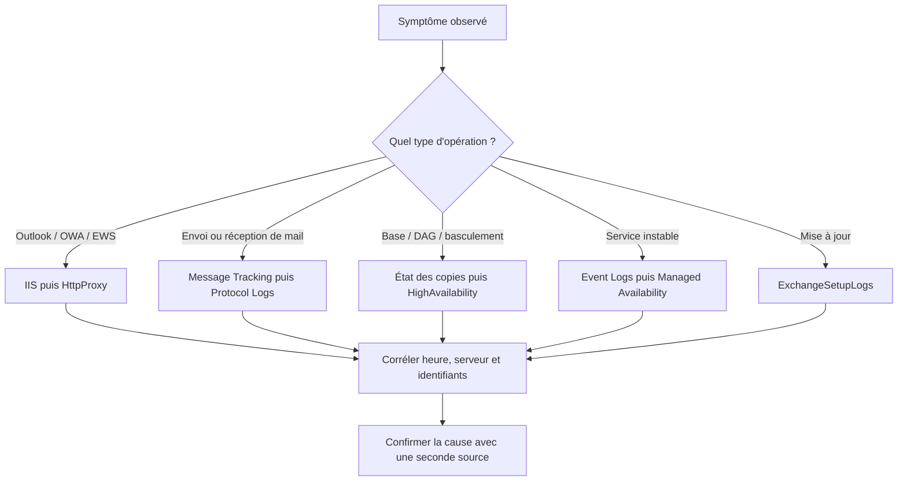
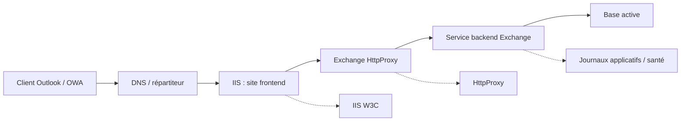
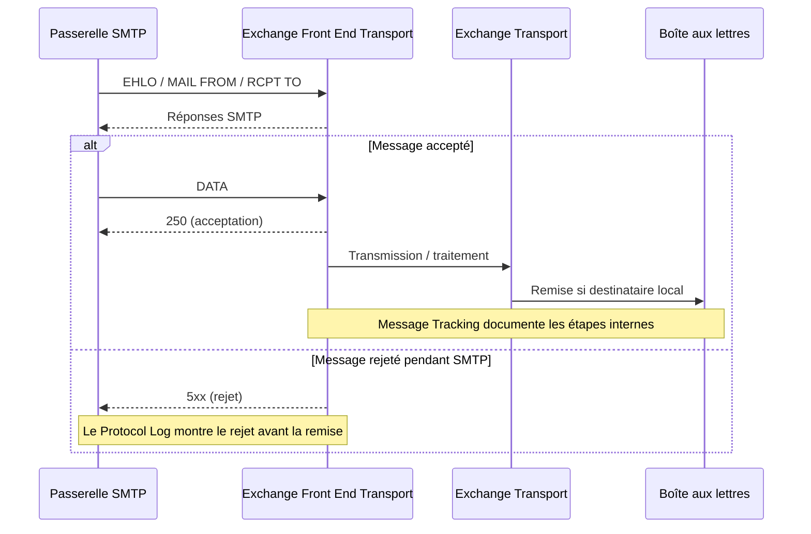

Un utilisateur ne peut plus ouvrir Outlook. Un autre reçoit un rapport de non-remise. Une base Exchange bascule sans raison apparente. Une mise à jour échoue à 95 %.

Ces incidents n'ont pas la même origine et **ne laissent pas leurs traces au même endroit**. Chercher uniquement dans le journal *Application* de Windows, puis redémarrer un service lorsqu'aucune erreur évidente n'apparaît, constitue rarement une méthode de diagnostic efficace.

Exchange dispose de plusieurs familles de journaux. Certains enregistrent des requêtes HTTP, d'autres des conversations SMTP, des mouvements de bases, les décisions de Managed Availability ou les actions d'administration. La difficulté n'est pas de connaître tous les fichiers par cœur, mais de savoir **quel journal interroger pour répondre à quelle question**.

Cet article propose une méthode d'investigation reproductible, applicable à Exchange Server 2016/2019 et, pour les mécanismes documentés ici, à Exchange Server Subscription Edition (SE). Les versions 2016 et 2019 ont atteint leur fin de support standard en octobre 2025 : les exemples sont destinés à l'apprentissage et doivent être adaptés à la version effectivement déployée.

> **Périmètre :** les exemples concernent Exchange **on-premises**. `Get-MessageTrackingLog` ne doit pas être confondu avec `Get-MessageTrace` d'Exchange Online. Les commandes sont principalement des commandes de consultation. Les noms des serveurs, comptes, heures et messages sont fictifs.

## 1. Premier piège : tous les « logs Exchange » ne servent pas à diagnostiquer

Une base de boîtes aux lettres possède des *transaction logs*, généralement des fichiers portant l'extension `.log`. Ils enregistrent les modifications transactionnelles nécessaires au fonctionnement de la base, à la réplication et, selon la configuration, à la récupération.

**Ce ne sont pas les journaux de diagnostic dont il sera question ici.** Un fichier de transactions ESE n'est pas un fichier texte dans lequel rechercher la cause d'un échec OWA ou d'un rejet SMTP.

Les journaux utiles à l'exploitation se répartissent plutôt en catégories :

| Famille | Question principale | Exemples |
| --- | --- | --- |
| **Événements Windows et Exchange** | Quel service ou composant a signalé un problème ? | Application, System, canaux Exchange |
| **Accès HTTP** | La requête cliente est-elle arrivée et quel résultat a-t-elle obtenu ? | IIS W3C, HttpProxy |
| **Transport des messages** | Où en est passé un message et qu'a répondu l'hôte SMTP ? | Message Tracking, Protocol Logs, Connectivity |
| **Disponibilité et DAG** | Pourquoi une copie a-t-elle échoué ou une base a-t-elle basculé ? | HighAvailability, MailboxDatabaseFailureItems, état des copies |
| **Surveillance et récupération** | Exchange a-t-il détecté une anomalie et tenté de la corriger ? | ActiveMonitoring, ManagedAvailability |
| **Installation et administration** | Quelle étape du Setup a échoué ? Qui a changé un paramètre ? | ExchangeSetup.log, audit administratif |

L'environnement comprend souvent d'autres sources : load balancer, reverse proxy, DNS, Active Directory, passerelle antispam (par exemple Cisco Secure Email) et outil de supervision. **Un problème Exchange peut avoir sa cause hors d'Exchange.**

## 2. Avant d'ouvrir un fichier : réduire le problème

Une investigation commence par quatre informations :

1. **Le symptôme exact :** un message d'erreur, une capture, un code SMTP, un code HTTP ou un nom de base.
2. **Le périmètre :** un utilisateur ou tous ? Un serveur ou tous ? Un site ou tous ? Une application ou plusieurs ?
3. **La fenêtre temporelle :** heure de début, durée, récurrence et fuseau horaire.
4. **Le parcours supposé :** quels équipements et quels services la requête a-t-elle traversés ?

Exemple : « Outlook est lent » est insuffisant. « Depuis 10 h 12, les utilisateurs du site B reçoivent des erreurs intermittentes en MAPI/HTTP, uniquement lorsqu'ils passent par le répartiteur LB02 » oriente immédiatement l'analyse.



*Schéma 1 — Le symptôme oriente vers une famille de traces. Il ne détermine pas, à lui seul, la cause de l'incident.*

Une bonne règle est de **ne jamais conclure uniquement à partir d'une ligne isolée**. Un code HTTP, un événement d'erreur ou une file SMTP qui contient quelques messages a besoin de contexte.

### La chronologie et les fuseaux horaires

Sur un poste Windows configuré en France, l'Observateur d'événements présente généralement les heures en heure locale. En revanche, **les journaux IIS W3C, les Protocol Logs SMTP et les fichiers Message Tracking utilisent des horodatages UTC**.

Le 14 novembre à 10 h 00, heure de Paris, correspond à 09 h 00 UTC. L'écart passe à deux heures en été.

Pour éviter les erreurs, noter systématiquement :

- l'heure communiquée par l'utilisateur et son fuseau ;
- l'heure UTC utilisée pour les fichiers concernés ;
- l'horloge des serveurs et une éventuelle dérive NTP ;
- l'intervalle étudié, en conservant une marge de quelques minutes.

En PowerShell :

```powershell
# Sur le système où la commande est exécutée
Get-Date
(Get-Date).ToUniversalTime()
```

Attention : les paramètres temporels de certaines cmdlets Exchange acceptent des valeurs `DateTime` interprétées selon la culture et l'environnement d'exécution. Préférer des objets `Get-Date` à des chaînes ambiguës telles que `11/12/2026`.

## 3. La carte des principaux journaux

Par défaut, Exchange s'installe sous `C:\Program Files\Microsoft\Exchange Server\V15`, mais ce chemin peut varier. La variable d'environnement `ExchangeInstallPath` permet de retrouver le dossier d'installation sur le serveur.

```powershell
# À exécuter sur le serveur Exchange concerné
$env:ExchangeInstallPath
```

| Journal | Emplacement habituel ou méthode de découverte |
| --- | --- |
| IIS | `%SystemDrive%\inetpub\logs\LogFiles\W3SVC*` |
| HttpProxy | `%ExchangeInstallPath%Logging\HttpProxy\<protocole>` |
| Message Tracking | `%ExchangeInstallPath%TransportRoles\Logs\MessageTracking` |
| Front End SMTP Receive | `%ExchangeInstallPath%TransportRoles\Logs\FrontEnd\ProtocolLog\SmtpReceive` |
| Transport SMTP Receive | `%ExchangeInstallPath%TransportRoles\Logs\Hub\ProtocolLog\SmtpReceive` |
| Transport SMTP Send | `%ExchangeInstallPath%TransportRoles\Logs\Hub\ProtocolLog\SmtpSend` |
| Managed Availability / DAG | Observateur d'événements → Journaux des applications et des services → Microsoft → Exchange |
| Setup Exchange | `C:\ExchangeSetupLogs\ExchangeSetup.log` |
| Audit d'administration | Recherche d'audit Exchange ; ne se réduit pas à un fichier texte local |

Ces chemins sont des **valeurs habituelles**, non une garantie. Les journaux de transport peuvent être déplacés et leurs paramètres de rotation modifiés. La configuration réelle prime toujours sur le tableau.

```powershell
# Chemins et limites des journaux de transport sur EX01
Get-TransportService EX01 |
    Format-List MessageTrackingLog*,ReceiveProtocolLog*,SendProtocolLog*

Get-FrontEndTransportService EX01 |
    Format-List ReceiveProtocolLog*,SendProtocolLog*
```

Ne pas explorer toute l'arborescence `Logging` au hasard : certains dossiers sont très volumineux et appartiennent à des composants différents.

## 4. IIS : savoir si la requête HTTP est arrivée

OWA, EWS, MAPI/HTTP, Autodiscover et d'autres services Exchange utilisent HTTP ou HTTPS. Les journaux IIS fournissent un premier constat : **le serveur web a-t-il vu la requête et qu'a-t-il renvoyé ?**

Dans une installation classique, les logs W3C sont sous :

```text
C:\inetpub\logs\LogFiles\W3SVC1\
C:\inetpub\logs\LogFiles\W3SVC2\
```

Le premier répertoire correspond généralement au *Default Web Site* et le second à *Exchange Back End*, mais **les identifiants W3SVC sont ceux des sites IIS : il faut vérifier leur correspondance**, surtout après des modifications de configuration.

```powershell
# Sur le serveur IIS/Exchange
Import-Module WebAdministration
Get-Website | Select-Object Name,Id,State,PhysicalPath
```

### Comment lire un fichier W3C ?

Un fichier W3C n'est pas un CSV ordinaire. Il commence par des métadonnées, notamment la ligne `#Fields`, qui définit l'ordre des colonnes.

Exemple fictif simplifié :

```text
#Fields: date time c-ip cs-method cs-uri-stem sc-status sc-substatus sc-win32-status time-taken
2026-11-14 09:12:04 192.0.2.15 POST /mapi/emsmdb/ 503 0 0 12054
```

La ligne indique qu'une requête POST visant `/mapi/emsmdb/` a reçu un code HTTP `503` et qu'elle a pris environ 12 secondes (`time-taken`, en millisecondes). **Elle ne prouve pas, à elle seule, pourquoi la requête a échoué.**

Quelques colonnes particulièrement utiles :

| Champ | Signification |
| --- | --- |
| `date`, `time` | Horodatage UTC |
| `c-ip` | Adresse du client vu par IIS, éventuellement celle d'un proxy |
| `cs-method` | Méthode HTTP (`GET`, `POST`...) |
| `cs-uri-stem` | Chemin demandé (`/owa/`, `/mapi/`, `/EWS/`...) |
| `sc-status` | Code de réponse HTTP |
| `sc-substatus` | Sous-code IIS, lorsqu'il existe |
| `sc-win32-status` | Code Windows associé à la requête |
| `time-taken` | Durée en millisecondes |

Les champs réellement présents dépendent de la configuration IIS. Il faut **toujours lire la ligne `#Fields`** avant de supposer qu'une colonne est à une position donnée.

Sur un fichier ciblé, voici une première recherche **sans modification de la configuration** :

```powershell
$fichier = 'C:\inetpub\logs\LogFiles\W3SVC1\u_ex261114.log'

# Vérifier d'abord les champs réellement enregistrés
Get-Content $fichier -TotalCount 20 |
    Where-Object { $_ -like '#Fields:*' }

# Repérer les requêtes MAPI dans ce fichier précis
Select-String -Path $fichier -SimpleMatch '/mapi/' |
    Select-Object -First 20 LineNumber,Line
```

Le nom du fichier est fictif et doit être remplacé par le fichier réellement présent. **Ce filtrage est textuel** : il ne remplace pas une véritable analyse des colonnes pour calculer des statistiques par statut HTTP ou par durée.

### Bien interpréter les codes HTTP

- **200 :** la requête HTTP a reçu une réponse réussie ; cela ne garantit pas que toute la session utilisateur fonctionne.
- **302 :** redirection, souvent normale dans un parcours d'authentification.
- **401 :** demande ou échec d'authentification. Une séquence de négociation NTLM/Kerberos peut comporter des `401` attendus ; un `401` isolé n'est pas nécessairement une panne.
- **403 :** accès refusé ; examiner le sous-code, la configuration et le contexte.
- **500 :** erreur de traitement côté serveur ; rechercher la cause dans les journaux applicatifs ou HttpProxy.
- **503 :** service indisponible ; vérifier les pools IIS, la charge, les dépendances et les composants Exchange, sans conclure automatiquement à une saturation.

Pour une première recherche, limiter la lecture aux fichiers correspondant à la fenêtre de l'incident :

```powershell
$iis = Join-Path $env:SystemDrive 'inetpub\logs\LogFiles'

Get-ChildItem $iis -Recurse -Filter '*.log' -File |
    Where-Object LastWriteTime -gt (Get-Date).AddHours(-2) |
    Sort-Object LastWriteTime -Descending |
    Select-Object -First 15 FullName,LastWriteTime,Length
```

Le tri sur `LastWriteTime` permet de sélectionner des **fichiers candidats**, pas les seules lignes correspondant à l'incident. Sur un serveur très sollicité, privilégier un site, une journée et un nombre réduit de fichiers pour éviter une recherche coûteuse.

## 5. HttpProxy : comprendre ce qu'Exchange a fait de la requête

Les logs IIS indiquent que la requête a atteint IIS. Les journaux **HttpProxy** donnent une vision plus spécifique au fonctionnement Exchange : quel protocole était concerné, quel backend a été ciblé, quel routage a eu lieu, et quels résultats ou erreurs ont été enregistrés.

Emplacements fréquents :

```text
%ExchangeInstallPath%Logging\HttpProxy\Owa\
%ExchangeInstallPath%Logging\HttpProxy\Mapi\
%ExchangeInstallPath%Logging\HttpProxy\Ews\
%ExchangeInstallPath%Logging\HttpProxy\Autodiscover\
%ExchangeInstallPath%Logging\HttpProxy\Eas\
```

Le nom des colonnes et la présence de certains champs peuvent varier selon le composant et la version. Chercher notamment, lorsqu'ils existent, les informations de **backend**, de **statut HTTP**, d'**identifiant de requête**, de **latence** et d'**exception**.



*Schéma 2 — IIS et HttpProxy ne racontent pas exactement la même étape du traitement d'une connexion cliente.*

### Exemple : Outlook ne se connecte plus

Supposons que des requêtes `/mapi/` apparaissent dans IIS à 10 h 12, avec plusieurs réponses `500` ou `503`.

La démarche est la suivante :

1. Vérifier que le problème est bien présent sur le frontend concerné et noter son heure exacte.
2. Ouvrir les fichiers correspondants dans `Logging\HttpProxy\Mapi`.
3. Comparer les résultats à la même période : backend ciblé, codes d'erreur, durées et identifiants disponibles.
4. Vérifier l'état du backend et de la base active de l'utilisateur.
5. Rechercher un incident IIS, un événement Managed Availability ou une bascule au même moment.

Si les requêtes n'apparaissent **pas** dans IIS, le diagnostic doit d'abord remonter vers le DNS, le load balancer, le reverse proxy, les règles réseau et la résolution du namespace.

Si elles apparaissent dans IIS mais **pas** dans le journal HttpProxy attendu, vérifier le chemin appelé, le composant ayant traité la demande, la rotation des logs et la phase de traitement où la requête a échoué.

Une absence de ligne n'est donc pas, à elle seule, une preuve de panne d'un composant.

## 6. Event Viewer : les erreurs Windows et les canaux Exchange

Le journal **Application** de Windows reste utile pour les services, les dépendances .NET, les accès aux bases ou les exceptions applicatives. Le journal **System** couvre notamment les problèmes de pilotes, de stockage et de réseau signalés par Windows.

Mais Exchange utilise également de nombreux canaux spécifiques, dits *crimson channels*, dans **Journaux des applications et des services**.

L'exploration peut se faire dans `eventvwr.msc`, ou avec PowerShell :

```powershell
# Découvrir les canaux présents sur le serveur local
Get-WinEvent -ListLog '*Exchange*' |
    Select-Object LogName,RecordCount,IsEnabled

# Erreurs du journal Application sur la dernière heure
Get-WinEvent -FilterHashtable @{
    LogName   = 'Application'
    StartTime = (Get-Date).AddHours(-1)
    Level     = 2
} | Select-Object TimeCreated,ProviderName,Id,Message
```

Il est préférable de filtrer **dès la lecture** avec `-FilterHashtable`, plutôt que de récupérer des dizaines de milliers d'événements puis de les filtrer avec `Where-Object`.

Attention également au coût des requêtes : certains canaux Managed Availability enregistrent énormément d'événements. Une extraction complète de `ProbeResult` sur un grand serveur peut avoir un impact sur les performances.

## 7. Managed Availability : pourquoi Exchange a-t-il agi tout seul ?

Managed Availability surveille Exchange au moyen de **Probes**, **Monitors** et **Responders**. Un service Windows démarré ne suffit pas à affirmer qu'une fonctionnalité est saine.

Les canaux à connaître sont notamment :

- `Microsoft-Exchange-ActiveMonitoring/ProbeResult` : résultats des sondes.
- `Microsoft-Exchange-ManagedAvailability/Monitoring` : événements d'escalade et de supervision utiles à l'administrateur.
- `Microsoft-Exchange-ManagedAvailability/RecoveryActionResults` : actions de récupération lancées et résultats.

La présence et les noms exacts des canaux doivent être vérifiés avec `Get-WinEvent -ListLog` sur le serveur concerné.

Exemple de lecture ciblée :

```powershell
$debut = (Get-Date).AddHours(-2)

Get-WinEvent -FilterHashtable @{
    LogName   = 'Microsoft-Exchange-ManagedAvailability/RecoveryActionResults'
    StartTime = $debut
} | Select-Object TimeCreated,Id,LevelDisplayName,Message
```

Pour une vue synthétique avant de plonger dans les événements :

```powershell
Get-HealthReport -Identity EX01

Get-ServerHealth -Identity EX01 |
    Where-Object AlertValue -ne 'Healthy' |
    Format-Table HealthSetName,Name,AlertValue -AutoSize

Get-ServerComponentState -Identity EX01
```

**Attention à l'interprétation :** une Probe échouée peut être suivie d'autres sondes réussies ; elle ne signifie pas systématiquement que l'utilisateur a subi une interruption. De même, une récupération automatique réussie ne démontre pas que la cause initiale a disparu.

Pour les mécanismes internes, voir aussi l'article du blog : [Comprendre Managed Availability, les Health Sets et le throttling](/articles/exchange-managed-availability-throttling-diagnostic/).

## 8. DAG et HighAvailability : retrouver un basculement ou une défaillance de copie

Lorsqu'une base n'est plus montée à l'endroit attendu, trois questions doivent être séparées :

1. Quel était le serveur actif avant l'incident ?
2. Quel événement a conduit à une tentative de basculement ?
3. Pourquoi la copie candidate a-t-elle été sélectionnée ou refusée ?

Les canaux **HighAvailability** et **MailboxDatabaseFailureItems** sont des sources importantes. Ils comprennent des événements autour de la réplication, d'Active Manager, des opérations de montage, de l'état des copies et des anomalies de bases.

Les commandes suivantes établissent l'état courant :

```powershell
Get-MailboxDatabaseCopyStatus DB01* |
    Format-Table Name,Status,CopyQueueLength,ReplayQueueLength -AutoSize

Test-ReplicationHealth -Identity EX01

Get-DatabaseAvailabilityGroup -Identity DAG01 -Status |
    Format-List Name,Servers,OperationalServers,WitnessServer,PrimaryActiveManager
```

La dernière commande décrit **l'état au moment du contrôle**, pas nécessairement l'état au moment de l'incident. Pour reconstruire le passé, les événements et la supervision historique sont nécessaires.

Exchange fournit aussi des scripts de collecte de métriques et de mouvements, notamment `CollectOverMetrics.ps1`, documenté par Microsoft. Ce type de rapport est utile pour reconstruire une succession de montages et de basculements, sous réserve de disposer encore des événements nécessaires.

Une base peut être montée et une autre copie en échec. À l'inverse, toutes les copies peuvent être saines alors que le service client est indisponible. Le diagnostic doit préserver cette distinction.

## 9. Message Tracking : retrouver ce qui est arrivé à un mail

**Message Tracking** enregistre les événements du parcours d'un message dans le pipeline Exchange. Il répond à une question différente du journal SMTP : *le serveur a-t-il accepté, transféré, différé, remis ou échoué à traiter ce message ?*

Le répertoire par défaut est :

```text
%ExchangeInstallPath%TransportRoles\Logs\MessageTracking
```

On y trouve notamment les familles de fichiers :

- `MSGTRK` : service de transport.
- `MSGTRKMS` : soumission depuis une boîte aux lettres.
- `MSGTRKMD` : remise dans une boîte aux lettres.
- `MSGTRKMA` : modération de messages.

Il est généralement plus pratique d'interroger ces journaux avec **Exchange Management Shell** qu'en ouvrant directement les CSV :

```powershell
$debut = (Get-Date).AddHours(-3)
$fin   = Get-Date

Get-MessageTrackingLog -Server EX01 `
    -Start $debut -End $fin `
    -Recipients 'alice@exemple.fr' -ResultSize 2000 |
    Sort-Object Timestamp |
    Format-Table Timestamp,EventId,Source,Sender,Recipients,MessageId -AutoSize
```

Quelques événements courants :

| Événement | Interprétation générale |
| --- | --- |
| `RECEIVE` | Message reçu par un composant du transport |
| `SEND` | Message transmis au prochain saut ; **pas une preuve de remise finale** |
| `DELIVER` | Remise à une boîte aux lettres Exchange |
| `DEFER` | Livraison temporairement différée |
| `FAIL` | Échec de traitement ou de livraison à l'étape enregistrée |
| `EXPAND` | Expansion d'un groupe de distribution |
| `TRANSFER` | Bifurcation ou transfert du message dans certains traitements |

Une recherche doit souvent être exécutée **sur plusieurs serveurs** : un même message traverse différents composants Exchange, et les journaux de tracking sont locaux à chaque serveur.

Pour interroger quelques serveurs identifiés à partir de la topologie :

```powershell
$serveurs = 'EX01','EX02','EX03'
$debut = (Get-Date).AddHours(-2)
$fin = Get-Date

foreach ($serveur in $serveurs) {
    Get-MessageTrackingLog -Server $serveur -Start $debut -End $fin `
        -Recipients 'alice@exemple.fr' -ResultSize 2000 |
        Select-Object @{Name='ServeurInterroge';Expression={$serveur}}, `
                      Timestamp,EventId,MessageId,Recipients
}
```

`ResultSize 2000` limite ici le nombre d'événements renvoyés **par serveur**. Si cette limite est atteinte, réduire d'abord la fenêtre ou affiner les critères avant de demander un volume supérieur.

### Quel identifiant suivre ?

- `MessageId` : correspond à l'identifiant du message au sens de l'en-tête Internet ; utile pour suivre le message entre serveurs, avec prudence lorsque des messages ont des identifiants identiques ou malformés.
- `InternalMessageId` : identifiant interne au serveur Exchange qui traite le message ; il peut changer d'un serveur à l'autre.
- `NetworkMessageId` : identifiant Exchange utile à la corrélation d'un message au fil de certaines transformations, notamment des copies créées par bifurcation.

```powershell
# Exemple : recherche plus précise après récupération du Message-ID complet
Get-MessageTrackingLog -Server EX02 `
    -Start $debut -End $fin `
    -MessageId '<exemple.20261114.0912@exemple.fr>' `
    -ResultSize 2000 |
    Sort-Object Timestamp |
    Select-Object Timestamp,EventId,Source,ServerHostname,Recipients,RecipientStatus
```

**Point crucial :** le suivi de message ne démontre pas ce que le destinataire a lu dans Outlook. Il décrit des événements de transport et de livraison, pas la consultation humaine du message.

Pour l'analyse détaillée du pipeline, des files et des connecteurs, voir [Comprendre le transport SMTP et diagnostiquer les files d'attente](/articles/exchange-transport-smtp-routage-connecteurs-files-attente/).

## 10. Protocol Logs : lire la véritable conversation SMTP

Les *Protocol Logs* conservent les échanges SMTP entre deux interlocuteurs. C'est ici qu'il faut chercher **la commande et la réponse exacte du serveur distant ou local**, notamment lorsqu'un message n'a même pas été accepté par Exchange.

Les chemins par défaut dépendent du service :

| Composant | Réception | Envoi |
| --- | --- | --- |
| Front End Transport | `FrontEnd\ProtocolLog\SmtpReceive` | `FrontEnd\ProtocolLog\SmtpSend` |
| Transport | `Hub\ProtocolLog\SmtpReceive` | `Hub\ProtocolLog\SmtpSend` |
| Mailbox Transport | `Mailbox\ProtocolLog\SmtpReceive\Delivery` | `Mailbox\ProtocolLog\SmtpSend\Submission` |

Tous ces chemins sont relatifs à `%ExchangeInstallPath%TransportRoles\Logs\`.

Le niveau de journalisation dépend du connecteur. Il n'est **pas forcément activé partout** :

```powershell
Get-ReceiveConnector |
    Format-Table Identity,TransportRole,ProtocolLoggingLevel -AutoSize

Get-SendConnector |
    Format-Table Identity,ProtocolLoggingLevel -AutoSize
```

Si un journal manque, vérifier d'abord le niveau de journalisation et le chemin effectif. Activer `Verbose` constitue une modification de configuration à réaliser de façon ciblée, après évaluation de son impact et avec une politique de conservation adaptée.

### Session-ID et numéro de séquence

Une session SMTP peut générer de nombreuses lignes, entrelacées avec celles d'autres connexions.

Le journal fournit notamment :

- `session-id` : identifiant commun aux événements d'une connexion SMTP ;
- `sequence-number` : ordre des événements de cette session ;
- `local-endpoint` et `remote-endpoint` : adresses IP et ports ;
- `event` : `+` connexion, `-` déconnexion, `<` réception, `>` émission, `*` information ;
- `data` : commande SMTP ou réponse échangée.

Un scénario fictif :

```text
09:12:01   Passerelle SMTP  -> Exchange : connexion TCP
09:12:01   Exchange        -> Passerelle : 220 Service ready
09:12:02   Passerelle      -> Exchange : EHLO gw.exemple.fr
09:12:03   Passerelle      -> Exchange : MAIL FROM:<expediteur@exemple.fr>
09:12:03   Passerelle      -> Exchange : RCPT TO:<destinataire@exemple.fr>
09:12:03   Exchange        -> Passerelle : 550 5.1.1 Recipient not found
```

*Exemple pédagogique de dialogue SMTP reconstitué, pas une extraction brute de Protocol Log.*

Dans ce scénario, il n'est pas surprenant de ne pas trouver d'événement `DELIVER` pour ce destinataire : la session a déjà échoué pendant la phase SMTP.



*Schéma 3 — La réponse SMTP d'acceptation et la remise finale dans une boîte sont deux événements distincts.*

### Où chercher quand Exchange est derrière une passerelle ?

Dans une infrastructure avec une passerelle antispam, le diagnostic s'effectue par sauts :

1. La passerelle a-t-elle accepté le message depuis Internet ?
2. A-t-elle décidé de le remettre à Exchange et à quel serveur ?
3. Exchange a-t-il accepté la transaction SMTP ?
4. Le message apparaît-il ensuite dans le Message Tracking ?
5. Existe-t-il une remise `DELIVER`, une transmission `SEND`, un différé ou un échec ?

Le Message-ID, les heures UTC, les adresses d'expéditeur/destinataire et les identifiants propres à chaque système permettent de raccorder les traces, sans supposer qu'un identifiant interne est universel.

## 11. Les autres traces du transport : files, connectivité et Back Pressure

Quand un message est accepté mais tarde à être remis, consulter également **l'état courant des files** :

```powershell
Get-Queue -Server EX01 |
    Sort-Object MessageCount -Descending |
    Format-Table Identity,Status,MessageCount,NextHopDomain -AutoSize
```

Une file ne contenant aucun message au moment du contrôle ne prouve pas qu'elle était vide une heure auparavant.

Les *Connectivity Logs* tracent des informations relatives aux connexions sortantes des composants de transport. Les journaux d'agents peuvent apporter des informations sur les décisions prises par certains agents antispam ou de transport. Le *Routing Table Logging* documente des instantanés des tables de routage.

Le **Back Pressure** est un mécanisme de protection du transport en cas de pression sur certaines ressources, par exemple le stockage ou la mémoire. Pour en rechercher la manifestation, rapprocher les événements de transport, l'état des ressources et les journaux du serveur. Un rejet SMTP `4xx` ou `5xx` ne suffit pas à établir à lui seul qu'il s'agit de Back Pressure.

## 12. ExchangeSetupLogs : comprendre une CU ou une SU en échec

Une installation Exchange ou une mise à jour défaillante laisse généralement des informations dans :

```text
C:\ExchangeSetupLogs\ExchangeSetup.log
C:\ExchangeSetupLogs\ServiceControl.log
```

Le premier journal permet de repérer l'étape qui échoue, les prérequis et les exceptions du programme d'installation. Le second peut aider à retrouver l'état des services pendant une intervention.

```powershell
# Rechercher quelques éléments significatifs sans afficher tout le fichier
Select-String -Path 'C:\ExchangeSetupLogs\ExchangeSetup.log' `
    -Pattern 'ERROR','Exception','Failed' |
    Select-Object -Last 40
```

Attention : les mots « ERROR » ou « Failed » peuvent figurer dans des lignes secondaires. **L'erreur décisive est souvent située quelques lignes avant le dernier échec**. Examiner la séquence complète, la phase d'installation, les redémarrages et les éventuelles actions déjà réalisées.

Microsoft fournit également un outil de revue des journaux, `SetupLogReviewer.ps1`, adapté à certaines situations de dépannage des mises à jour Exchange.

Ne pas relancer plusieurs fois Setup ou modifier les permissions AD sans avoir identifié l'étape qui échoue.

## 13. Audit administratif : qui a modifié la configuration ?

Une panne peut être liée à un changement effectué quelques minutes ou quelques jours auparavant : ajout d'un connecteur, modification d'un certificat, nouvelle politique, restriction d'activation ou changement d'adresse.

Exchange Server possède un **journal d'audit d'administration** permettant de rechercher certaines opérations exécutées en Exchange Management Shell ou via l'EAC.

```powershell
Get-AdminAuditLogConfig |
    Format-List AdminAuditLogEnabled,AdminAuditLogAgeLimit,AdminAuditLogCmdlets,AdminAuditLogParameters

# Exemple : rechercher des changements récents de connecteurs
Search-AdminAuditLog -StartDate (Get-Date).AddDays(-2) `
    -EndDate (Get-Date) -Cmdlets 'Set-ReceiveConnector'
```

Il faut distinguer cet audit des journaux d'accès aux boîtes aux lettres et des événements de sécurité Windows. L'audit administratif porte principalement sur **les actions de configuration**, non sur le fait qu'un administrateur a ouvert une fenêtre dans l'EAC.

Son contenu dépend des paramètres d'audit et de rétention, et certaines opérations peuvent ne pas être enregistrées si elles échouent avant l'étape de journalisation.

Pour approfondir les autorisations administratives, voir [Comprendre RBAC, les rôles et les délégations d'administration](/articles/exchange-server-rbac-roles-scopes-delegation/).

## 14. Rechercher efficacement sans saturer le serveur

Sur un serveur Exchange de production, analyser les journaux doit rester une opération maîtrisée. Certaines requêtes sont beaucoup plus coûteuses qu'il n'y paraît.

### Découvrir, cibler, puis affiner

La bonne séquence est :

1. Identifier le serveur ou le composant supposé concerné.
2. Restreindre la fenêtre temporelle.
3. Identifier le bon répertoire et les fichiers utiles.
4. Lire l'en-tête des colonnes.
5. Rechercher un identifiant stable (session, requête, message, boîte) plutôt qu'un mot trop générique.
6. Vérifier la cause avec une deuxième source.

```powershell
# Exemple : chercher un identifiant de session SMTP dans quelques fichiers ciblés
$rep = Join-Path $env:ExchangeInstallPath 'TransportRoles\Logs\Hub\ProtocolLog\SmtpReceive'

$fichiers = Get-ChildItem $rep -Filter '*.log' -File |
    Where-Object LastWriteTime -gt (Get-Date).AddHours(-3)

$fichiers | Select-String -SimpleMatch -Pattern 'SESSION-ID-A-REMPLACER' |
    Select-Object Path,LineNumber,Line
```

Cette approche évite de scanner des mois de journaux sur plusieurs serveurs d'un seul coup. Pour une analyse massive, copier de manière contrôlée les fichiers nécessaires vers un poste d'investigation, selon les procédures de sécurité internes.

### Attention au format CSV

Les **Protocol Logs** et **Message Tracking** sont des fichiers structurés séparés par des virgules, avec des lignes de métadonnées. Les **logs IIS W3C** utilisent des champs séparés par des espaces et une ligne `#Fields` qui peut varier. Les **journaux HttpProxy** possèdent leurs propres champs, variables selon le composant.

Il ne faut donc **pas appliquer aveuglément le même `Import-Csv` à tous ces fichiers**, ni supposer que les colonnes ont toujours le même ordre. Une analyse fiable commence par l'identification du format réel.

### Ne pas transformer une investigation en nouvelle panne

- Éviter les recherches globales non filtrées sur des canaux très bavards.
- Ne pas activer partout les traces détaillées sans nécessité.
- Vérifier les politiques de rotation et l'espace disque disponible.
- Ne pas redémarrer un composant avant d'avoir préservé les traces utiles, sauf nécessité opérationnelle.
- Protéger les copies des journaux : elles peuvent contenir des adresses IP, identifiants, adresses e-mail, objets de messages, commandes SMTP et informations sensibles.
- Ne pas publier de logs bruts sur un blog ou un forum.

## 15. Trois scénarios : raisonner à partir du symptôme

### Scénario A — Outlook affiche « Déconnecté » sur un seul site

**Hypothèses initiales :** problème réseau ou de répartiteur, erreur d'authentification, HttpProxy, backend indisponible, base non accessible.

**Ordre de recherche :**

1. Vérifier les noms DNS et le point d'entrée utilisé depuis le site impacté.
2. Rechercher les requêtes `/mapi/` dans IIS, en heure UTC.
3. Comparer les journaux HttpProxy des frontends sollicités.
4. Identifier le backend ciblé, lorsqu'il figure dans les traces.
5. Examiner `Get-ServerHealth`, l'état des composants Exchange et l'emplacement de la base active.
6. Corréler avec les événements ActiveMonitoring/ManagedAvailability et les changements récents.

**Ce qu'il ne faut pas conclure :** « le port 443 répond, donc Exchange fonctionne » ; « les `401` prouvent une erreur d'authentification » ; « aucun événement Application, donc le problème vient du client ».

### Scénario B — Un message externe n'arrive jamais au destinataire

**Hypothèses initiales :** refus de la passerelle, rejet SMTP par Exchange, routage, règle de transport, retard de livraison ou problème de boîte.

**Ordre de recherche :**

1. Relever l'heure d'envoi, les adresses, le Message-ID si disponible et tout NDR.
2. Examiner la trace sur la passerelle SMTP.
3. Chercher la session correspondante dans les Protocol Logs d'Exchange.
4. Si Exchange a accepté le message, rechercher les événements Message Tracking sur les serveurs concernés.
5. Contrôler les files et, si nécessaire, le transport interne et le backend.

**Exemple de diagnostic :** si la passerelle montre un `550` pendant `RCPT TO`, rechercher exclusivement un `DELIVER` dans Exchange est une fausse piste. Le rejet est survenu avant la remise.

### Scénario C — DB01 bascule sans intervention d'un administrateur

**Hypothèses initiales :** indisponibilité du serveur actif, état de la copie, problème de réplication, réponse de Managed Availability, réseau ou cluster.

**Ordre de recherche :**

1. Déterminer l'heure exacte de la transition et le serveur anciennement actif.
2. Examiner HighAvailability et les événements de la base.
3. Contrôler l'historique des actions de récupération de Managed Availability.
4. Vérifier le cluster, les services de réplication et les éventuelles pertes de connectivité.
5. Vérifier que les copies restantes ont retrouvé leur état normal après la transition.

**Ce qu'il ne faut pas conclure :** « Active Manager a changé le serveur de la base, donc Active Manager est à l'origine de la panne ». Il peut n'être que le mécanisme ayant réagi à un incident antérieur.

## 16. Mini-TP : choisir la bonne source

Pour chaque situation, déterminer le **premier journal** ou la **première commande** à examiner.

**Situation 1.** Une application SMTP reçoit `550 5.7.1` dès la tentative de remise au serveur Exchange. Aucun événement `DELIVER` n'est retrouvé.

**Situation 2.** Le service IIS est démarré, mais Managed Availability a relancé un pool d'applications OWA pendant la nuit.

**Situation 3.** Une mise à jour Exchange ne se termine pas et le programme Setup affiche une erreur générique.

**Situation 4.** Une boîte ne reçoit plus de messages après une modification récente d'un connecteur de réception.

<details markdown="1">
<summary>Afficher le corrigé</summary>

**1.** Commencer par les **Protocol Logs SMTP** du service ayant reçu la connexion. Ils permettent d'examiner le dialogue, le connecteur et l'étape exacte du rejet. Le Message Tracking peut être absent si le message n'a jamais été accepté.

**2.** Consulter **ManagedAvailability/RecoveryActionResults**, puis les résultats des Probes et les journaux HttpProxy/IIS à la même période. Le but est d'identifier la raison de la récupération et son efficacité.

**3.** Examiner **ExchangeSetup.log**, idéalement avec le contexte des lignes précédant l'échec. Le journal `ServiceControl.log` peut être utile pour comprendre les états des services.

**4.** Confronter les **Protocol Logs** et le **Message Tracking** à l'**audit d'administration**, puis confirmer la configuration actuelle du connecteur. La corrélation temporelle ne suffit pas : il faut vérifier que le changement explique effectivement le symptôme.

</details>

## 17. Une méthode à garder pour chaque incident

Le raisonnement peut se résumer en six étapes :

1. **Décrire** le symptôme sans présumer de sa cause.
2. **Délimiter** les utilisateurs, serveurs, services et sites affectés.
3. **Dater** précisément les premiers signes et convertir les horaires si nécessaire.
4. **Sélectionner** les journaux associés au chemin technique de l'opération.
5. **Corréler** les événements à l'aide de l'heure, des serveurs et des identifiants disponibles.
6. **Valider** l'hypothèse avec une source indépendante avant de modifier la configuration.

Le plus important n'est pas la quantité de logs collectés, mais la capacité à reconstruire la chronologie des faits.

Un événement ne raconte qu'une partie de l'histoire. **Le diagnostic commence lorsqu'on relie les événements entre eux.**

## Pour prolonger la lecture sur ce blog

- [Comprendre les accès clients, Autodiscover, MAPI/HTTP, OWA et ActiveSync](/articles/exchange-server-comprendre-acces-clients-autodiscover-certificats-mapi-owa-activesync/) : architecture des accès clients.
- [Comprendre Managed Availability, les Health Sets et le throttling](/articles/exchange-managed-availability-throttling-diagnostic/) : surveillance et actions de récupération automatiques.
- [Comprendre le fonctionnement d'un DAG](/articles/comprendre-fonctionnement-dag-exchange-server/) : réplication, Active Manager et basculements.
- [Comprendre le transport SMTP, le routage et diagnostiquer les files d'attente](/articles/exchange-transport-smtp-routage-connecteurs-files-attente/) : diagnostic approfondi du pipeline SMTP.
- [Suivre un message entre IronPort et Exchange Server](/articles/suivre-message-ironport-exchange-server/) : parcours d'un message à travers la passerelle et Exchange.

## Sources et documentation

Les scénarios de diagnostic reprennent l'approche du **module 10, « Monitoring and troubleshooting Microsoft Exchange Server »**, du support de formation Microsoft **20345-1B**, en la complétant par les documents Microsoft Learn actuellement disponibles pour Exchange Server et Exchange SE.

- [Microsoft Learn — Transport logs in Exchange Server](https://learn.microsoft.com/en-us/exchange/mail-flow/transport-logs/transport-logs)
- [Microsoft Learn — Message tracking](https://learn.microsoft.com/en-us/exchange/mail-flow/transport-logs/message-tracking)
- [Microsoft Learn — Search message tracking logs](https://learn.microsoft.com/en-us/exchange/mail-flow/transport-logs/search-message-tracking-logs)
- [Microsoft Learn — Configure protocol logging](https://learn.microsoft.com/en-us/exchange/mail-flow/connectors/configure-protocol-logging)
- [Microsoft Learn — Protocol logging](https://learn.microsoft.com/en-us/exchange/mail-flow/connectors/protocol-logging)
- [Microsoft Learn — Managed availability](https://learn.microsoft.com/en-us/exchange/high-availability/managed-availability/managed-availability)
- [Microsoft Learn — Monitor database availability groups](https://learn.microsoft.com/en-us/exchange/high-availability/manage-ha/monitor-dags)
- [Microsoft Learn — Configure MAPI over HTTP](https://learn.microsoft.com/en-us/exchange/clients/mapi-over-http/configure-mapi-over-http)
- [Microsoft Learn — Fix failed Exchange Server updates](https://learn.microsoft.com/en-us/exchange/troubleshoot/client-connectivity/exchange-security-update-issues)
- [Microsoft Learn — Administrator audit logging in Exchange Server](https://learn.microsoft.com/en-us/exchange/policy-and-compliance/admin-audit-logging/admin-audit-logging)
- [Microsoft Learn — W3C Logging](https://learn.microsoft.com/en-us/windows/win32/http/w3c-logging)